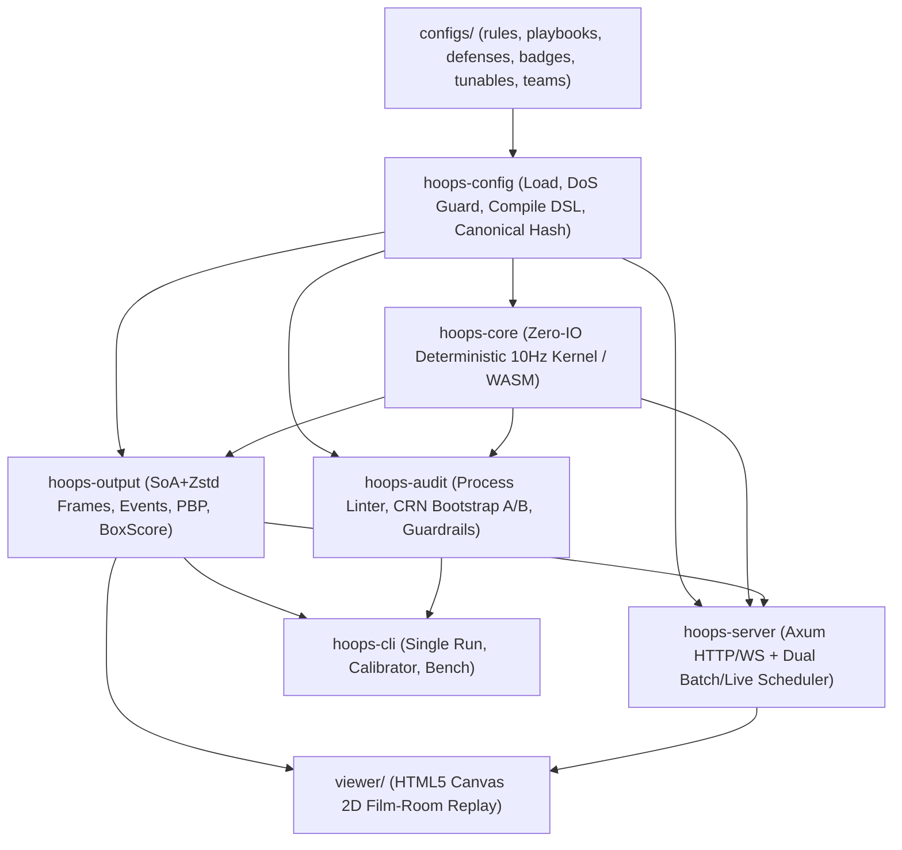
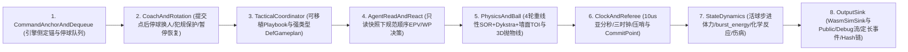

# Hoops 篮球比赛模拟引擎 — 架构与详细工程规格设计文档 (v30)

> **文档状态**：Architecture & Engineering Specification v30（完整工程基线规格：冻结 `113` 字段 / `153` 标量 `EngineTunables`、`28` 项 `CommandRejectReason`、`11` 项 `CommandAbortReason`、`TimeoutRules` 全量停顿时长字段与 `MandatoryFirstChargePolicy` 二值枚举、FIBA 2024 Art. 17.2.4/18.2.3/18.2.4/19.2.2/19.2.3/19.2.4 & OBRI 18/19-4(b) 暂停换人分轨与基于精确走表量 $\Delta u > 0$ 的同停球再换资格限制、`HTR1` `80 B` 头绑定 `init_spec_sha256` 与 `applied_commands_sha256`、共有检查点交叉校验及区间逐拍哈希链重算校验、`SharedDurableWalStore` 权威提交边界 `authoritative_committed_wal_seq` + 串行仲裁槽位 `WalSimSlotV1` 同槽持久化检查点依据〔`durable_checkpoint_gen` / `first_uncheckpointed_wal_seq`〕与扫描保留租约 + 检查点文件读取保护租约与登记排队上界 + 覆写前持久化回收边界屏障 + 分后端组提交计数口径 + 共享不可变 `LiveSessionConfigV1`〔持久化 `pace_multiplier` 与参赛方绑定〕+ 驻留/段水位检查点主动推进 + `unsealed_tail_frames` 跨分块微批与 `PausedInPostWhistle` 拍中检查点水线接管闭环 + `PendingForfeitFinalize`/`GameFinished` 全终局光标接管〔含路径 A 前置排空在途完整块与 `ArchiveComplete` 双工件 URI 权威发布〕+ `watch::Receiver<SealingFlushProgress>` 无丢失唤醒重连、收官 `WP(Shoot)` 与 `WP(Hold)` 共享 `10 µs` 精确风险时长及各分支发生时刻模型，以及 Metric 3 双端统一 `<= 2.4384 m (8.0 ft)` 距离判定）  
> **实现与验证**：Rust 工作区、配置、服务端和录像室均位于本仓库。下列规则和性能指标定义验收要求；相关实现与测试入口见 [`IMPLEMENTATION_PLAN.md`](IMPLEMENTATION_PLAN.md)。  
> **适用范围**：`hoops` Rust 多 Crate 工作区、配置编译与校验、双模并发服务、三层输出协议、2D 回放器与真实感验收体系  
> **设计基线**：作为 M0–M6 工程实现、确定性重放与验收测试的单一事实来源（Single Source of Truth）。

---

## 1. 项目定位、运行模式与全局架构

Hoops 是一个面向 **Web 多人在线篮球经理/竞技游戏** 的高性能、确定性篮球比赛模拟引擎。它以 **0.1 秒（10 Hz）连续时空步进** 为核心，输入两支球队的球员属性、倾向、徽章、化学反应、轮换与攻防战术配置，在参数化联赛规则书约束下完整推演比赛每个时刻的球员跑位、对抗、传投轨迹、体力轮换与裁判判罚，并输出可用于 **实时在线对局、离线高速批量推演、2D 录像室回放与详细中文战报** 的三层解耦数据。

- **规则覆盖边界声明**：M0–M6 一等工程交付与强制验收规则集为 **`nba.toml`（严格遵照 *2023–24 NBA Official Rules* 裁判规则版本，与 §12.2 2023–24 留出真实比赛统计基准同季）** 与 **`fiba.toml`（严格遵照 *FIBA Official Basketball Rules 2024* 及 2024 官方规则解释）**；CBA、欧冠（EuroLeague）等联赛仅作为基于同一可插拔 `RuleSet` Schema 的可扩展配置能力保留，不在 M3/M5 交付独立真实比赛标定套件或规则回归单测。
- **二进制内存与传输容量单位统一**：本文档全部内存池、缓冲区、分块配额与进程 `VmHWM` 阈值统一采用 **IEC 二进制单位（`1 KiB = 1,024 B`，`1 MiB = 1,048,576 B`）**，禁用十进制 `MB`/`KB`。

### 1.1 三种运行模式（Execution Modes）

引擎服务端与内核支持三种明确区分的运行模式，各自采用匹配的调度器、推流粒度、人类决策窗口与产物生命周期：

| 运行模式 | 适用场景 | 调度器与算力归属 | 帧输出与推流粒度 | 人类决策窗口 | 产物生命周期 |
| :--- | :--- | :--- | :--- | :--- | :--- |
| **`Batch { mode }`** | `FastBatch`（离线蒙特卡洛、参数标定、净效率统计）vs `FullTrace`（完整录像/战报结算） | 有界 Rayon CPU 线程池（并发内核实例严格受 **`MAX_ACTIVE_BATCH_ENGINES = 8`** 信号量约束） | **`FastBatch`**：禁用帧、事件流与归档存储（零磁盘 IO，`StateHashMode::Disabled`；访问 `/frames`、`/events`、`/replay` 返回 **`HTTP 409 Conflict (ArtifactsDisabledInFastBatch)`**）；**`FullTrace`**：按 ≤600-tick SoA+Delta Zstd 分块写入独立不可变对象路径并附 `SeekIndexFooterV1` | 无（确定性 `AiPostWhistleController` 全权托管，决策以系统 `AnchoredCommand` 留痕） | 受全局 `192.0 MiB` `Batch` 池与 `15 min` TTL + LRU 管控 |
| **`Live { tick_rate_hz, pace_multiplier }`** | 在线实时多人对局（`1×` 标准倍速含 `48 min` 活球走表、罚球/发球短停及 `0x17 DeadTime` 暂停/节间/中场墙钟驻留合计约 `2` 小时；`2×/4×/5×` 按 `1/pace_multiplier` 等比缩放） | 每场绑定唯一 **Tokio Timer-Wheel Actor**（持有单调 **`lease_epoch`**、跨节点共享持久 **`SharedDurableWalStore`** 上的 **`SharedWalGroupCommitter`** 通道、共享不可变 `MatchInitSpecV1` 与 `LiveSessionConfigV1` 对象及 **`LiveServiceCheckpointV1`**；不占用 Rayon） | `pace_multiplier ∈ {1, 2, 4, 5}`（随不可变 `LiveSessionConfigV1` 首次受理前共享持久化，接管后严格按原倍速恢复），活球/常规期每 `100 ms` 推进 `batch_ticks = pace_multiplier` 帧维持 `10.0 batches/s` 并按微批原子提交单一整帧 **`WalRecord::StepCommit (step_count ∈ 1..=5)`** 经 `SharedWalGroupCommitter` 写入带 `lease_epoch` 栅栏与权威提交水线 `authoritative_committed_wal_seq` 的 `SharedDurableWalStore`（`<= 2 ms` 窗口 / `<= 128` 条合并提交 `<= 500 批/秒`：Raft 多数派确认 `<= 500 次/秒`、共享块卷 `fdatasync` `<= 1,002 次/秒`）确认后推流；**遇 `0x17 DeadTime` 立即执行 `Flush-on-DeadTime` 切批冲刷并挂起 `ServiceTimerKind::DeadTimeDwell` 墙钟驻留定时器（`dwell_wall_ms = ceil(duration_ds * 100 / pace_multiplier)`，随 `WalRecord::StepCommit.post_service_timer` 持久化，驻留期挂起 `100 ms` 步进并开放 `t_pause + 1` `PreTick` 停球教练指令窗）**；**WAL 循环段由统一串行仲裁槽位 `WalSimSlotV1`（先完成检查点文件 `fdatasync` 再登记 `durable_checkpoint_gen` 与 `first_uncheckpointed_wal_seq`，结合 `scan_pin_from_wal_seq` 扫描保留租约）判定回收并在覆写前同槽持久化依据与 `oldest_retained_wal_seq`，配合驻留/段水位主动刷写内联 `unsealed_tail_frames` 及与 `emitted_tick_event_cursor` 一一对应的整记录边界检查点，接管经 `begin_takeover_and_pin_scan` 重建未封口帧/事件流（零重复发布 `PausedInPostWhistle` 拍中事件），且对 `PendingForfeitFinalize` 补跑唯一 Stage 8 持久化终局 `StepCommit`、对 `GameFinished` 先排空在途完整块再按持久化 `archive_status` 接续发布双工件 URI**；以 `TransitionPhaseAToB`（含带版本 `watch::Receiver<SealingFlushProgress>` 的 `AwaitSealingFlush` 连续性保护）原子交接并在缺帧降级重连时经 `SessionSync.boxscore_snapshot` 无缝重置 `LiveBoxScoreState`。**PvP 未完赛前严禁暴露 `.hreplay`、私有战术字典与 `DebugOverlayFrameV1`；参赛者不可调用 `DELETE` 撤单（仅可经 `/forfeit` 定锚 `ForfeitMatch` 认输）** | 人工交互先经纯只读 `prepare_command`（`AlreadyAccepted` 直返 / `NewCommand` 交付完整候选 `AnchoredCommand`；`COMMIT_EVENT_RESERVE` 严禁阻塞关窗 `SystemCommand`；系统指令耗尽 `8,192` 时 Stage 6a 直通提交零阻滞）→ `SharedWalGroupCommitter` 写入 `SharedDurableWalStore` 持久化确认 → `commit_prepared_command`；归档停写（`44 KiB` 玩家区满仅拒玩家不阻系统）与 WAL 停写严格分域 | 活跃期入驻 `Live` `64.0 MiB` 保留池 + `12.0 MiB` `PhaseBSnapshotRetainPool`（理论加法上限 `478.0 MiB` / 唯一刚性门禁 **`VmHWM < 512.0 MiB`**）；健康排空直发、回填、重试 **`ArchiveFinalizingRetry -> ArchiveComplete { published_artifact_uri, published_replay_uri }`** CAS 或 `60s` 超时转 `ArchiveFailed` |
| **`Replay`** | 历史对局回放与跨版本/同版本验证 | 客户端/回填 WASM 或原生内核按需展开 | 跨版本自包含归档以 `.hframes.zst`（`0..=T_final`，含帧、**28 类 `GameRecordEventV1` (`0x01..=0x1C`)** 与 `SeekIndexFooterV1`）为准；同版本或历史 WASM C-ABI 重演用 `.hreplay`（启动仅喂 `<= 256.0 KiB` **`MatchInitSpecV1`** 含完整 Phase A–C `EngineTunables`、冻结编解码表与 `rotation_script`，最大单包极值 `<= 1,423,761 B << 2.0 MiB`，再流式喂入 `AnchoredCommand`） | 按 `.hreplay` 经 `hoops_engine_replay_anchored_command` 于原 `(enqueued_at_tick, enqueued_phase)` 精确重演（`ForfeitMatch` 批量静默清退未来拍预约队列并复用唯一 Stage 8） | 不可变分代对象存储 + 原子指针发布 |

### 1.2 核心设计决策矩阵

| 设计维度 | 最终工程共识 (v30) | 核心约束与工程依据 |
| :--- | :--- | :--- |
| **工作区与线协议边界** | `WasmSimSink` + **`113` 字段 `EngineTunables`** + `CourtSideLine` + `FibaSubReentryLock` + 完整 `ShotContext` | `ShotContext` 含 `shot_id`（由持久化 `GameState.next_shot_id: u32` 自 `1` 分配）、`shooter/assist/blocker_roster_idx`、`shot_value`、`ground_truth_is_three_pointer`、`release_zone`、`release_x/y_mm` 支持飞行期检查点恢复；`§2.4` 定义 `CourtSideLine`、`FibaSubReentryLock`、`RosterRules.fiba_sub_clock_run_reentry_rule`、`MandatoryFirstChargePolicy` 与 `TimeoutRules` 全量停顿时长字段；`EngineTunables` 闭合 **`113` 字段 / `153` 标量**（含 `shot_release_duration_ds`），`CommandRejectReason` 冻结 `28` 项（`0x0001..=0x001C`），`CommandAbortReason` 冻结 `11` 项（`0x01..=0x0B`）；`HeaderDictsV1.def_rule_dict <= 256` 严格匹配 `hoops-config` |
| **确定性与单一真源** | `GameState.next_shot_id` + `ReviewableEventEntry` + `HTR1` `80 B` 逐拍哈希轨迹 + `FootworkRecord` 12 字段 + `8,192` | `GameState.next_shot_id: u32` 随 `CanonicalLeBytes`/`StateHash`/检查点持久化分配 `ShotContext.shot_id` 与 `0x07`/`0x08.shot_id`（`0x09.ft_seq_id := event_seq as u32`）；`hoops-cli bisect` 明确区分仅 `.hreplay`（稀疏百拍区间 `[t_lo, t_hi]`）、模式 A（`HTR1` `80 B` 头绑定 `init_spec_sha256` 与 `applied_commands_sha256`、交叉核对全部共有稀疏检查点并自已验证前置检查点逐拍重算区间哈希链〔损毁报 `HashTraceChainCorrupted`〕，定位精确 `t*` 与四类失配）及模式 B（双侧快照逐字段 diff）；终局批量静默清空未来拍队列（`0` 事件），`system_commands_accepted_count == 8,192` 时 Stage 6a 直通 Stage 6c 零阻滞 |
| **时钟、规则与状态机** | **1-Tick `DeadTime` + `Live` `DeadTimeDwell`** + **FIBA 2024 Art. 17.2.4 / 18.2.3 / 19.2.2 / 19.2.4** | `DeadTime` 内核占 `1` `sim_tick`（`0..=T_final` 共 `T_final + 1` 帧），全部 `0x17` `duration_ds` 由 `TimeoutRules` 显式字段驱动，`Live` 触发 `Flush-on-DeadTime` + `DeadTimeDwell`；第 1 档官方强制暂停归属遵循 `MandatoryFirstChargePolicy::{HomeFirst, CanonicalAlphaFirst}`；FIBA L2M 推进仅于 `post_made_fg || post_made_last_ft`（Art. 17.2.4）任选边线，其余停球（OBRI 17-16）钳制原侧；`InboundContext` 分离 `post_made_last_ft` 与 `post_made_fg`；**FIBA 2024 Art. 19.2.4 通过 `PlayerRuntimeState.fiba_sub_reentry_lock` 约束刚下场/刚上场球员在经历比赛时钟实际运行（精确走表量 $\Delta u > 0$，独立于显示十分秒跳变）并再次停球前不可再次换上或换下（含场上不足 5 人、`P1` 强制离场与可纠正错误罚球例外）** |
| **物理、EPV 与收官 WP** | 径向网格兜底 + `WP(Shoot)`/`WP(Hold)` 共享 `10 µs` 精确时钟与分支时刻建模 + `BankMiss` | `WP(Shoot)` 先以与 §3.1 同一 `10 µs` 精确时钟检验预计离手早于双表终响（`gc_rem_10us > Δu_rel && sc_rem_10us > Δu_rel`），同刻及信号后离手严禁计分且与 `Hold` 共享基于 `10 µs` 剩余计时的精确风险时长 $\Delta t_{\text{ds}}$ 及半程时刻 $t'_{\text{ev}}$；合法离手再按 5 分支实际发生时刻结算（`blk_tov`/`and1`/`foul_miss` 取离手时刻、`clean_make`/`clean_miss` 取抵达篮筐时刻）；M2 覆盖信号前/同刻/信号后三态边界（含非整十分秒 `0.20001 s`）、$t_{\text{rem}} > \Delta t_{\text{flight}}$ 护球禁令、末段显式概率矩阵与零抢断耗表必胜夹具；`4×128` 重线性 Dykstra + `4 × 3` 兜底 |
| **输出、无损归档与并发** | **`SharedDurableWalStore`（串行仲裁槽位 `WalSimSlotV1` + 覆写前同槽依据屏障 + 拍中/终局接管闭环 + 同槽持久化检查点文件读取保护租约）** + **`LiveSessionConfigV1`** + **`watch` 版 `AwaitSealingFlush`** + **双工件幂等 `CAS`** | `Live` 首次发布前先在 `SharedDurableWalStore` 共享持久化不可变 `MatchInitSpecV1` 与 `LiveSessionConfigV1`（锚定 `pace_multiplier` 与参赛方绑定）；组提交按 `<= 500 批/秒` 分后端计数（Raft `<= 500 次/秒`、块卷 `fdatasync` `<= 1,002 次/秒`）；`64.0 MiB` 循环段在同一串行仲裁器内按 `WalSimSlotV1`（检查点先完成共享存储 `fdatasync` 再登记 `durable_checkpoint_gen` 与 `first_uncheckpointed_wal_seq`，结合 `scan_pin_from_wal_seq`）判定回收并在覆写前于 `64.0 KiB` 双槽 `WalCommitManifest` 同槽持久化检查点依据与 `oldest_retained_wal_seq`；检查点将 `durable_published_event_seq` 精确绑定 `engine.state.next_event_seq - 1`（对应 `emitted_tick_event_cursor`），接管经 `begin_takeover_and_pin_scan` 零重复发布 `PausedInPostWhistle` 拍中事件，覆盖 `PendingForfeitFinalize` 补做终局 `StepCommit` 与 `GameFinished` 排空在途完整块后发布双工件 URI；`watch::Receiver<SealingFlushProgress>` 消除丢失唤醒；路径 C 目录 `CAS` 幂等与双工件禁止删除护栏 |
| **验收与里程碑解耦** | 纯 PBP 可观测口径 + M1/M3/M5 零跨阶段前置依赖 + **`v30`** 黄金基准 | M1 仅测 `RawStream` 帧/事件连续性（独立于 M5 `LiveBoxScoreState`）；M3 重演直接消费 M0 内存 `ReplayManifest` 经 `replay_anchored_command` 驱动；M5 交付 `.hreplay` 文件级删配置回归与 `LiveBoxScoreState`；Metric 2 `<= 280 ds`；Metric 3 模拟端与真实端共享唯一几何距离阈值 `dist_to_rim_m <= 2.4384 m (8.0 ft)`，无法换算精确距离的记录统一计入 `DistanceUnknown` 与 `>= 90.0%` 覆盖率门控 |

### 1.3 系统全局拓扑与数据流



---

## 2. Rust 多 Crate 工作区与确定性规范

### 2.1 工作区目录结构与 `hoops-config` 职责划分

```text
hoops/
├── Cargo.toml                  # Cargo workspace manifest & shared dependency versions
├── rust-toolchain.toml         # Pinned Rust 1.82.0 toolchain + wasm32-unknown-unknown target
├── docs/
│   └── ARCHITECTURE.md         # 本架构与详细工程规格设计文档 (v30)
├── configs/
│   ├── rules/
│   │   ├── nba.toml            # 完整 NBA 规则书配置（遵照 2023–24 NBA Official Rules）
│   │   └── fiba.toml           # FIBA 规则配置（遵照 FIBA 2024 Official Rules）
│   ├── playbooks/              # 进攻声明式战术剧本 DSL（相对锚点坐标）
│   ├── defenses/               # 强类型防守比赛计划 DSL（反点名 Pre-Switch、掩护树、滞后自适应）
│   ├── badges/                 # 数据驱动徽章 Modifier 定义
│   ├── tunables/               # 版本化 EngineTunables 参数标定集
│   ├── benchmarks/             # 2023–24 留出 PBP / 微追踪集、HoldoutDatasetManifestV1 及条件桶快照库
│   └── teams/                  # 4 支典型 NBA 样板队配置
├── crates/
│   ├── hoops-config/           # 配置加载、DoS 体积/复杂度防御、DSL 编译与校验、复用 hoops-core::CanonicalLeBytes 计算 config_hashes
│   ├── hoops-core/             # 零 IO、无 TOML 解析、纯确定性 10Hz 推演内核（含 CanonicalLeBytes 与 wire_schema_v1，支持 wasm32）
│   │   └── src/
│   │       ├── wire_schema_v1/ # §2.4 完整 Schema、CanonicalLeBytes、RuleCode/CommandRejectReason(u16)、CheckpointV1
│   │       ├── model/          # Player, FunctionalRole, Team, CourtGeometry, Ball, GameState, Command
│   │       ├── rules/          # Loadable RuleSet, Violation/Foul Detectors, PendingRuling, CommitPoint
│   │       ├── tactics/        # MacroPhilosophy, CompiledPlaybook, CompiledDefGameplan, EPV Behavior AI
│   │       ├── physics/        # 2D Kinematics, Swept CCD, PlayableBounds, ReLinDykstra, 3D BallTrajectory
│   │       ├── resolve/        # Shot Sampling Model, Badge Pipeline, libm math & custom samplers
│   │       ├── rotation/       # DualFatigue, FunctionalRotation, DynamicCoachAI, SuspendedState, Injury
│   │       └── engine/         # DeterministicEngine::step(), PrepareCommit, SubDsClock, StateHash, PossessionFSM
│   ├── hoops-output/           # 显式小端编解码、Public/Debug 双流、SoA+Delta Zstd (528 KiB)、28 类事件、中文 PBP
│   ├── hoops-audit/            # Process Linter、CRN 配对 Bootstrap A/B、对称性校验、宏观护栏
│   ├── hoops-server/           # Axum HTTP/WS、JWT 鉴权、SharedWalGroupCommitter、Rayon Batch + Tokio Live Actor、CAS 归档
│   └── hoops-cli/              # 单场推演、JSONL 调试、hoops-cli calibrate 参数标定、bisect、压测工具
└── viewer/                     # 零构建静态 Web 2D 录像室回放器（HTML5 Canvas + ES Module）
```

### 2.2 依赖方向、8 条 `CanonicalLeBytes` 规则、双段配置/重演结构与 WASM C-ABI

1. **`hoops-core::wire_schema_v1`、`hoops-config` 职责划分与 8 条 `CanonicalLeBytes` 规则**：
   - **`CanonicalLeBytes` Trait 与全部冻结二进制线协议结构下沉于 `hoops-core`**（`hoops_core::canonical_le_bytes` 与 `hoops_core::wire_schema_v1`，完整字段与判别式定义见 §2.4），定义全工作区唯一的线协议结构体、枚举、固定判别式 **`RuleCode: u16`（`0x0000..=0x0025`，见 §8.4）**、**`CommandRejectReason: u16`（`0x0001..=0x001C`，28 项）**、**`ChallengeWindowSnapshotV1`（`32 B`）**、**`MatchInitSpecV1`**、**`ReplayVerificationV1`** 与 **`EngineCheckpointSnapshotV1`**。`hoops-config` 单向依赖 `hoops-core`，负责读取解析 TOML/JSON、校验 DoS 上限、编译 DSL 为 `hoops_core::model::Compiled*` 与 `RuleSet` IR，并直接调用 `hoops-core` 的 `CanonicalLeBytes` 计算规范化配置哈希 `config_hashes`（严禁依赖原始文本空格/注释或平台指针字长）。
   - `CanonicalLeBytes` 严格遵循以下 **8 条全类型闭合规则**：
     1. **基础整数与布尔**：`bool` 编码为 `1 B`（`false = 0x00`, `true = 0x01`）；`u8..u64`、`i8..i64` 按二进制补码小端字节序编码（严禁任何字段直接编码 `usize` / `isize`）；
     2. **IEEE-754 浮点规范化**：`f32` / `f64` 先执行 `-0.0 -> +0.0` 归零与任意 NaN 折叠为唯一静默 NaN 位模式（`f32` 取 `0x7fc0_0000_u32`、`f64` 取 `0x7ff8_0000_0000_0000_u64`），再调用 `.to_bits().to_le_bytes()` 输出；
     3. **`Option<T>`**：`None` 编码为 `1 B` `0x00`；`Some(v)` 编码为 `0x01` 紧跟 `CanonicalLeBytes(v)`；
     4. **枚举类型（`enum`）**：所有参与规范哈希的枚举必须显式标注 **`#[repr(u8)]`**（或 `RuleCode`/`CommandRejectReason` 显式 **`#[repr(u16)]`** 小端）并赋予固定判别式标签；编码时先写固定标签，再按变体字段声明顺序编码其全部关联字段；
     5. **定长数组 `[T; N]`**：按元素下标 `0..N` 顺序直接串联 `CanonicalLeBytes(elem)`（不附带长度前缀）；
     6. **变长序列、有序映射与字符串**：`Vec<T>` 与 `String`（合法 UTF-8 无 `\0`，全部 ID 字符串长度严格限定 `1..=64 B`）统一前置 **`4 B` `u32` 小端元素个数/字节数前缀**，随后依次编码元素或原始 UTF-8 字节；`BTreeMap<K, V>`（禁止 `HashMap`）前置 `u32` 键数量，按键的 `CanonicalLeBytes` 字典序升序逐对输出 `(key, value)`；
     7. **结构体（`struct`）**：严格按 §2.4 给定的 Rust 源码字段声明顺序逐字段无内存缝隙填充（no padding bytes）串联编码；
     8. **元组类型（`()` 与 `(T0, T1, ..., Tk)`）**：单元类型 `()` 编码为 `0 B`；$k$ 元组严格按下标 `0..k` 顺序逐元素无填充串联编码 `CanonicalLeBytes(elem_0) || ... || CanonicalLeBytes(elem_{k-1})`。
   - **`_pad == 0` 显式编解码校验不变量**：全部定长线协议结构与事件载荷中的保留/填充字节（`_pad` / `reserved`）编码端强制置 `0x00`；解码端**必须逐字节校验 `_pad == 0x00`**，发现任意非零填充字节立即返回 **`DecodeError::NonZeroPadding { offset, value }`**（M0 单测显式验证非零 `_pad` 拒收）。
   - **全协议冻结公共辅助编码表（供独立解码器与跨版本 WASM/宿主零猜想互通）**：
     - **三态时钟值（`new_shot_clock_ds: u16` / `shot_clock_ds: u16`）**：`0..=240` 表示精确分秒（`0.0..=24.0 s`）；**`0xFFFF` 严格表示 `None`（进攻时钟关闭/停用）**；**`0xFFFE` 严格表示 `Unchanged`（保持现行剩余值，专用于事件差分与改判日志）**；其余 `> 240 && < 0xFFFE` 解码拒收；
     - **冻结 `ChallengeWindowSnapshotV1`（固定 `32 B` 小端布局）**：`0..8` (`ruling_id: u64`)、`8..12` (`whistle_tick: u32`)、`12..16` (`window_open_tick: u32`)、`16..20` (`window_epoch: u32`)、`20..24` (`request_seq: u32`)、`24..26` (`initial_rule_code: u16`)、`26` (`window_state: u8`: `0=Open, 1=PendingRefereeGrant, 2=UnderReview, 3=ClosedCommitted`)、`27` (`window_kind_tag: u8`，与 `0x0E ChallengeWindowOpenedRecord` 共享唯一枚举映射：`0=LiveDeadball, 1=TimeoutPending_TeamCalled_Home, 2=TimeoutPending_TeamCalled_Away, 3=TimeoutPending_Mandatory_Home, 4=TimeoutPending_Mandatory_Away`)、`28` (`eligible_sides_mask: u8`: `bit0=Home, bit1=Away`)、`29` (`grant_requester_side: u8`: `0=Home, 1=Away, 0xFF=None`)、`30..32` (`_pad: [u8; 2]` 恒 `0`)；
     - **冻结 `CommandRejectReason`（`#[repr(u16)]` 小端固定数值，`0x0000` 保留给成功 `Ok`，共计 `28` 项 `0x0001..=0x001C`）**：
       `0x0001 = InvalidCodecOrPadding`、`0x0002 = PayloadTooLarge`、`0x0003 = RateLimited`、`0x0004 = QueueFull`、`0x0005 = GameCommandLimitExceeded`、`0x0006 = CommandLogStorageStalled`、`0x0007 = ClientRequestIdTooOld`、`0x0008 = IdempotencyPayloadMismatch`、`0x0009 = ForbiddenSystemCommand`、`0x000A = InvalidPhase`、`0x000B = Expired`、`0x000C = StaleWindowEpoch`、`0x000D = StaleRequestSeq`、`0x000E = ChallengeDisabled`、`0x000F = UnchallengeableRuling`、`0x0010 = NoChallengesRemaining`、`0x0011 = ChallengeAlreadyGranted`、`0x0012 = RulingIdMismatch`、`0x0013 = JumpBallAlreadyTossed`、`0x0014 = NotInPlayerControl`、`0x0015 = TickCommandSlotFull`、`0x0016 = ChallengeTargetPastFirstStoppage`、`0x0017 = WindowChallengeCycleLimitReached`、`0x0018 = TickEventCapacityReserved`、`0x0019 = MatchAlreadyEnded`、`0x001A = ReviewableEventEvicted`、`0x001B = ReplayManifestCapacityExceeded`、**`0x001C = SubIneligibleUntilClockRun`**（FIBA 2024 Art. 19.2.4 同停球未走表禁止刚下场球员返场或刚上场球员离场；WASM 输出缓冲区不足专用返回码 `0xFFFF_FFFE`）。
2. **`hoops-core`（零 IO 纯计算内核）与 WASM 三维内存指标模型**：
   - **允许依赖**：仅 `serde`、`libm`、`sha2`（显式 `default-features = false`，纯 Rust 实现且兼容 `wasm32`）、`thiserror`（RNG 采用内核内建零依赖纯 Rust `Philox4x32_10` 实现）；无任何工作区内部下游依赖。
   - **禁止依赖**：无文件/网络/时钟 IO、无 `toml`/`tokio`/`rayon`/`getrandom`、无 `HashMap`/`HashSet`。
   - **可复现构建参数与工件指纹**：仓库固定 `rust-toolchain.toml`（`channel = "1.82.0"`、`targets = ["wasm32-unknown-unknown"]`）及确定性构建参数：`CARGO_INCREMENTAL=0` 与 `RUSTFLAGS="-C target-cpu=mvp -C target-feature=-simd128,-relaxed-simd -C codegen-units=1 -C opt-level=3 -C debuginfo=0 -C strip=symbols --remap-path-prefix=$PWD=/hoops_ws"`。产出工件计入不可变构件库 `hoops_core_<engine_wasm_sha256>.wasm`，并在 `MatchInitSpecV1` 中同时登记 `engine_wasm_sha256`、`rustc_version_sha256` 与 `cargo_lock_sha256`。
   - **区分启动结构 `MatchInitSpecV1` 与赛后完整归档 `ReplayManifest`**：
     - 完整 `.hreplay`（`ReplayManifest`，允许含至多 `4,096` 条 `<= 182 B` 玩家 + `8,192` 条 `<= 42 B` 系统 `AnchoredCommand` 与终局 `ReplayVerificationV1`，最坏合法全量闭包严格证明上界 `1,423,761 B` `<= 2,097,152 B` = **`2.0 MiB`**，严格闭合证明见 §3.3）仅存内联 **`init_spec: MatchInitSpecV1`**、**`applied_commands`** 与赛后可选项 **`verification: Option<ReplayVerificationV1>`**；
     - **严格区分三项 WASM 与宿主内存观测指标**：
       1. **WASM 客体活跃堆字节（`live_heap_bytes`）**：`MatchInitSpecV1` 刚性门禁 `CanonicalLeBytes <= 262,144 B (256.0 KiB)`；初始化瞬时活跃对象含静态只读段 `<= 600.0 KiB` + 调用帧区与解包暂存 `<= 128.0 KiB` + 原始输入 `MatchInitSpecV1 <= 256.0 KiB` + 解码后 `SimulationEngine`（**可变 `GameState` 与固定队列 `<= 120.0 KiB` + 只读不可变编译配置包 `<= 384.0 KiB`，合计 `<= 504.0 KiB <= 512.0 KiB`**）+ `WasmSimSink <= 64.0 KiB` + `dlmalloc` 开销，**`live_heap_bytes` 瞬时峰值约 `~2.2 MiB`；宿主在 `hoops_engine_from_manifest` 后调用 `hoops_wasm_dealloc` 释出 `256.0 KiB` 输入缓冲，仅使分配器内活跃占用 `live_heap_bytes` 降至 `~1.9 MiB`**，释放页块留在 `dlmalloc` 空闲链表供运行期复用；
       2. **WASM 线性内存页数（`memory.size()`，单调不减）**：WASM `memory.size()` 永不因 `dealloc` 而退缩；**M0 必须以极限最大合法配置（`256.0 KiB` `MatchInitSpecV1` + `32` 剧本/`24` 防守规则/`2×15` 满编）在 `wasmtime` 实际测验并强制断言 `memory.size() <= 64 pages (4.0 MiB)` 且初始化完成后整场 `step()` 运行期间新增 `memory.grow` 页数 `== 0`**；
       3. **宿主进程物理常驻内存（`VmHWM`）**：用于 `hoops-server` 全并发实例实际测量，刚性门禁 `VmHWM < 512.0 MiB`（§11.2 总加法配额 **`478.0 MiB`**）。
   - **冻结 WASM 线性内存 C-ABI（1 个 `"memory"` 导出 + 14 个冻结函数导出）、原子容量前置检查与 `WasmSimSink` 读写解耦**：必须显式导出 `(memory (export "memory"))`：
     - **`WasmEngineHandle` 严格分离“内核发布状态”与“最近一次 ABI 调用暂存（`WasmSimSink`）”**：
       - WASM 句柄持有 `{ engine: SimulationEngine, wasm_sink: WasmSimSink }`；`wasm_sink` 独立保存于 **`GameState` 之外**（严禁纳入 `StateHash`），包含 `last_call_has_public_frame: bool`、`last_call_public_frame: [u8; 124]`、`last_call_has_debug_frame: bool`、`last_call_debug_frame: [u8; 118]`、`last_call_events_wire: Vec<u8>`、`last_call_event_count: u16`、`last_hashes: [u8; 96]` 与 **`last_checkpoint_bytes: Vec<u8>`**（专供诊断检查点导出）。
       - **变更型 ABI 调用入口重置规则**：在通过容量/合法性前置校验确定提交状态后，`hoops_engine_from_manifest` / `hoops_engine_replay_anchored_command` / `hoops_engine_step` 及 `hoops_engine_enqueue_command` 提交点**先重置 `wasm_sink` 的当次帧标志并清空 `last_call_events_wire`**，再写入本次调用新提交帧、增量事件后缀（`current_tick_events[emitted_tick_event_cursor..]`）与哈希。即便 `step()` 返回前在 Stage 8 清空 `current_tick_events`，宿主仍可通过 `last_events_ptr` 无损读取本拍末段事件！
       - **只读视图与检查点捕获零内核副作用不变量**：`hoops_engine_last_public_frame_ptr`、`hoops_engine_last_debug_frame_ptr`、`hoops_engine_last_events_ptr`、`hoops_engine_active_window_ptr`、`hoops_engine_last_hashes_ptr` 与 `hoops_engine_capture_checkpoint_ptr` **绝不修改 `GameState`、绝不改变 `emitted_tick_event_cursor`**；前 5 项纯只读可重复调用任意次，`capture_checkpoint_ptr` 仅刷新 `wasm_sink.last_checkpoint_bytes`。
     - `hoops_wasm_abi_version() -> u32`（当前固定返回 `1`）；
     - `hoops_wasm_alloc(size: u32) -> *mut u8`、`hoops_wasm_dealloc(ptr: *mut u8, size: u32)`（线性内存收发缓冲区管理）；
     - `hoops_engine_from_manifest(init_spec_ptr: *const u8, init_spec_len: u32) -> u32`（接收 `<= 256.0 KiB` `CanonicalLeBytes(MatchInitSpecV1)`，初始化 `tick = 0` 并同步写入 **`tick = 0` 初始 `PublicFrameV1`/`DebugOverlayFrameV1`（置 `*out_has_new_frame = 1`）、开场 `PeriodStarted` 事件（进入 `last_events_ptr`）与 `rolling_hash[0]` 三元组（进入 `last_hashes_ptr`）**，成功返回非零 `handle`，`0` 表示解析/超限失败）；
     - `hoops_engine_destroy(handle: u32)`（销毁实例并释放句柄与内部缓冲区）；
     - **`hoops_engine_enqueue_command(handle: u32, ingress_ptr: *const u8, ingress_len: u32, out_anchored_ptr: *mut u8, out_anchored_cap: u32) -> u32`（严格两阶段先检查容量再提交原子性，兼容幂等重投 `PreparedOutcome`）**：
       - **严格执行顺序**：(1) 解码 `IngressCommand`；(2) 调用只读 `&self` 接口 **`engine.prepare_command(cmd)`**，返回 `Err(reason)`（直接无副作用返回 `reason as u32`）或 `Ok(PreparedOutcome::AlreadyAccepted(existing_anchored) | PreparedOutcome::NewCommand(prepared))`；(3) 将拟返回的已定锚/候选 `AnchoredCommand` 预编码为定长小端字节（共 `L` 字节，玩家 `<= 182 B`、系统 `<= 42 B`）；(4) **在修改任何引擎状态或 `wasm_sink` 之前**校验 `out_anchored_cap < 4 + L`：**若容量不足，仅当 `out_anchored_cap >= 4` 时向 `out_anchored_ptr[0..4]` 写入所需最小字节数 `(4 + L) as u32 LE` 并立即返回 `0xFFFF_FFFE`，此时对 `GameState`、`wasm_sink`、`next_ingress_seq`、`client_dedup_ring` 与事件缓冲严禁产生任何副作用！**(5) 仅当 `out_anchored_cap >= 4 + L` 时，先重置 `wasm_sink`（`has_new_frame = false`、清空增量事件切片）：若为 `PreparedOutcome::AlreadyAccepted(existing)` 则零变更 `GameState` 并刷新 `last_hashes`，若为 `PreparedOutcome::NewCommand(prepared)` 则调用 `engine.commit_prepared_command(prepared, &mut wasm_sink)` 完成定锚并立即执行/发射；随后向 `out_anchored_ptr` 写入 `[L: u32 LE][bytes]` 并返回 `0`。**M0 WASM 单测强制覆盖**：先传过小 `out_anchored_cap = 16` 获 `0xFFFF_FFFE` 与所需长度回告、验证状态与 `last_events_ptr` 零变化，再用充足缓冲重试与同 `client_request_id` 二次幂等重投，断言两次返回相同 `AnchoredCommand` 且后续 `rolling_hash` 同直通调用逐位一致；
     - `hoops_engine_replay_anchored_command(handle: u32, anchored_ptr: *const u8, anchored_len: u32) -> u32`（读取已定锚 `AnchoredCommand` `<= 1,024 B`，按原 `(enqueued_at_tick, enqueued_phase)` 重演，成功返回 `0`）；
     - `hoops_engine_step(handle: u32) -> u32`（返回值编码 `StepStatus`：`1 = TickCompleted`, `2 = AwaitingPostWhistle`, `3 = Finished`, **`4 = Aborted(DeterminismInvariantViolation)`**, `0 / >=0x8000_0000 = Error`）；
     - `hoops_engine_last_public_frame_ptr(handle: u32, out_has_new_frame: *mut u8) -> *const u8`（只读视图，指向 `124 B` `PublicFrameV1`；当且仅当上一次已提交变更调用执行了 `tick = 0` 初始化或 Stage 8 帧提交时置 `*out_has_new_frame = 1`，若停留在 `AwaitingPostWhistle` 或仅 `enqueue/replay` 调用后置 `0`）；
     - `hoops_engine_last_debug_frame_ptr(handle: u32, out_has_new_frame: *mut u8) -> *const u8`（只读视图，指向 `118 B` `DebugOverlayFrameV1`；同一 `out_has_new_frame` 语义）；
     - `hoops_engine_last_events_ptr(handle: u32, out_len: *mut u32) -> *const u8`（只读视图，返回 `wasm_sink.last_call_events_wire`：即上一次已提交变更调用新追加的事件增量切片 `[delta_count: u16 LE][delta_payload_bytes: u32 LE] || GameRecordEventV1...`；无新增事件时固定返回 `6 B` `[0u16, 0u32]`；重复读取返回完全相同字节与 `*out_len`）；
     - `hoops_engine_active_window_ptr(handle: u32, out_len: *mut u32) -> *const u8`（只读视图，无挂起窗写 `*out_len = 0`；有挂起窗返回精确 `32 B` `ChallengeWindowSnapshotV1`）；
     - `hoops_engine_last_hashes_ptr(handle: u32) -> *const u8`（只读视图，固定 `96 B`：`state_hash[32] || event_hash[32] || rolling_hash[32]`）；
     - **`hoops_engine_capture_checkpoint_ptr(handle: u32, out_len: *mut u32) -> *const u8`**（无副作用捕获当前完整 `EngineCheckpointSnapshotV1` 为 `CanonicalLeBytes` 写入 `wasm_sink.last_checkpoint_bytes`，向 `out_len` 写入精确字节长度并返指针；供 `hoops-audit bisect --reference-wasm` 进行逐帧/逐字段 `GameState` 对拍）。
   - **防作弊与 CI 门禁**：**所有在线 PvP `Live` 对局严格采用服务器权威模拟**；CI 须通过 `wasmtime` 运行完整测试赛并逐帧核对 `rolling_hash[t]` 与 Native 一致。
3. **无环 Crate 显式单向依赖拓扑（消除拓扑与文本冲突）**：
   - `hoops-core` ← `hoops-config`（唯一双向只看 IR 产出：`hoops-config` 依赖 `hoops-core`）；
   - `hoops-output`、`hoops-audit` ← 单向依赖 `hoops-core` 与 `hoops-config`；
   - **`hoops-server`** ← 单向依赖 `hoops-core`、`hoops-config` 与 **`hoops-output`**；
   - **`hoops-cli`** ← 单向依赖 `hoops-core`、`hoops-config`、**`hoops-output`** 与 **`hoops-audit`**。

### 2.3 跨平台位级确定性、`Philox-4x32-10` 精确规格、唯一全量 `GameState` 与冻结哈希链

1. **单场单线程步进 + 冻结 `Philox-4x32-10` 映射、`u53` 组成与逐路径计数预算**：
   - **唯一锁定 RNG 算法**：全工作区统一采用 **`hoops_core::rng::Philox4x32_10`**（标准常数 `M0 = 0xD2511F53`, `M1 = 0xCD9E8D57`, `W0 = 0x9E3779B9`, `W1 = 0xBB67AE85`，`key = [seed as u32, (seed >> 32) as u32]`）：
     - **与球队能力微调及主客场绝对脱敏的 `canonical_team_id`**：`CompiledTeamSnapshot` 挂载不可变 **`team_id: String`**；两支参赛队的 **`canonical_team_id: u8 ∈ {0 (TeamAlpha), 1 (TeamBeta)}`** 依据 **`MatchInitSpecV1.canonical_team_id_override`**（CRN 实验显式锁定 `[0, 1]`/`[1, 0]`）或不可变 **`team_id` ASCII 字典序**分配；
     - 队内球员按不可变 `player_id` ASCII 升序拥有固定 **`team_roster_rank ∈ 0..15`**（`ruleset.roster.max_team_players` 严格校核 NBA `<= 15`、FIBA Art. 4.2.1 `<= 12`），构成：
       $$\text{canonical\_actor\_id}: \texttt{u8} = (\text{canonical\_team\_id} \ll 4) \mid (\text{team\_roster\_rank} \mathbin{\&} \texttt{0x0F})$$
       全局事件取 **`0xFF`**；计数器槽映射 `actor_slot_idx = if id == 0xFF { 32 } else { ((id >> 4) as usize) * 16 + ((id & 0x0F) as usize) }`（`0..=32`）。
     - **冻结 `RngPurpose` 全量 9 项枚举（`#[repr(u8)]`）及单拍单槽严格调用上界**：

| `RngPurpose` 判别值与名称 | 单拍单槽 (`actor_slot_idx`) 严格调用上界与触发来源证明 |
| :--- | :--- |
| `0 = ShotOutcome` | **`<= 2`**：仅于单次 `AtRelease`（至多 1 次剥断/犯规骰 + 1 次 `IntendedOutcomeClass` / 空心散射预采样）；同拍同一行动者最多出手 1 次 |
| `1 = ShotScatterAndReboundVec` | **`<= 4`**：单次触筐/打板命中散射或着点散射向量抽取（仅含 2 次正态/角度采样及重抽兜底） |
| `2 = ReboundBounce` | **`<= 2`**：单次 `ReboundScramble` 点拨（概率 `tunables.rebound_tip_continue_prob`，默认 `0.20`）骰 + 同帧多选手加权择优采样 |
| `3 = StealRoll` | **`<= 4`**：至多 1 次 `Hold`/突破抢断判定 + 1 次传球走廊截断 + 1 次接球脱手 `Bobble` + 1 次余量 |
| `4 = DecisionSoftmax` | **`<= 1`**：**解析 2-Ply EPV 与 Endgame WP 前瞻树严格零 RNG 调用（纯粹确定性累加）**；仅持球决策最终从 Softmax 概率向量中抽取动作 1 次 |
| `5 = ContactAndFoulRoll` | **`<= MAX_CONTACT_ROLLS_PER_ACTOR_TICK (64)`**：覆盖 Stage 5 `MAX_CCD_TOI_PASSES (32)` 轮同时簇碰撞（受单行动者接触事件上界 **`16` 轮有效接触配对 × 每轮至多 `2` 次对抗骰 = `32`** + 掩护/LGP/无球卡位/争抢犯规余量，**刚性预算严格封顶 `64` 次**） |
| `6 = RefereeNoise` | **`<= 4`**：Stage 6a 单次犯规/违例初判 `ground_truth → perceived_call` 临界噪声抽取（即便同拍双哨仍 `<= 4`） |
| `7 = InjuryAndMomentumRoll` | **`<= 2`**：Stage 7 每人至多 1 次高强度碰撞伤病触发判定 + 1 次手感/动量微事件 |
| `8 = SymmetricPerturbation` | **`<= 1`**：实验 S2 开启零均值对称微扰时每行动者每拍至多抽取 1 个高斯微扰值 |

     - **单槽溢界统一语义（Debug 与 Release 行为绝对一致）**：全 9 项单拍单槽预算上界恒满足 **`<= 64 << u16::MAX (65,535)`**。**无论 Debug 或 Release 构建，每次采样前均强制检查 `old_cnt >= budget`（按上表 9 项各自刚性上限，区别于延至 `u16::MAX`）**：一旦触发即先发射 `AuditWarning::RngCounterSaturated { actor_slot, purpose, budget }`，随即调用 `abort_match_determinism(DeterminismViolationKind::RngCounterSaturated)`：置 `state.game_phase = GamePhase::GameOver`、`state.end_reason = Some(GameEndReason::DeterminismInvariantViolation)`（`5`）、追加 `GameEnded { winner_side: 0xFF, end_reason: 5, .. }` 并经 Stage 8 计算终局哈希与置 `cursor = GameFinished`，最终 `step()` 有序返回 **`StepStatus::Aborted { tick, reason: DeterminismViolationKind::RngCounterSaturated }`**（WASM `hoops_engine_step` 返回 **`4`**，服务端映射 **`MatchAborted(DeterminismInvariantViolation)`** / WS **`4012 MatchDeterminismAborted`**；既不产生半拍残缺状态、也不因 `debug_assert!` 仅在 Debug 崩溃或与 Release 表现分叉）。**M0 强制单测**：人工注入 `ContactAndFoulRoll` 第 `65` 次采样请求（含 Release 模式构建），断言 `step()` 返回 **`StepStatus::Aborted { .., reason: RngCounterSaturated }`**、`state.end_reason == Some(GameEndReason::DeterminismInvariantViolation)`、发射 `AuditWarning::RngCounterSaturated` 与终局 `GameEnded(end_reason = 5)`，且既不 panic 进程树、也不越过 `64` 预算采样。
     - **冻结 `u53` 与 Box-Muller 正态采样比特规则**：对单次 `Philox4x32_10(key, counter)` 输出 `out: [u32; 4]`：
       - 取低两字组成 53-bit 均等均匀实数 **`u ∈ [0.0, 1.0)`**：`bits53 = (((out[1] & 0x001F_FFFF) as u64) << 32) | (out[0] as u64)`，`u = (bits53 as f64) * (1.0 / 9007199254740992.0)`（`9007199254740992.0 = 2^53`）；
       - 标准正态 Box-Muller 采样同用 `out[0..2]` 生成 `u1`（钳位 `u1.max(1.0 / 9007199254740992.0)` 防 `ln(0)`）与 `out[2..4]`（`bits53_2 = (((out[3] & 0x001F_FFFF) as u64) << 32) | (out[2] as u64)`）生成 `u2`，由 `libm::sqrt(-2.0 * libm::log(u1)) * libm::cos(2.0 * PI * u2)` 计算标准正态变量。
     - **全帧统一推进的 `possession_tick: u16`、`possession_id: u32` 边界与 `60_000` 纪元翻滚证明**：
       - **停表帧严格递增不复用**：在**每一个推进完结的 `sim_tick`（无论 `game_clock_running == true` 还是 `JumpBall`/`FreeThrows`/`InboundSetup`/`Timeout` 停表态！）的 Stage 8 末尾**，均执行 `state.possession_tick = state.possession_tick.checked_add(1).expect("possession_tick overflow")`（彻底杜绝停表罚球或漫长发球序列复用同一 Philox `counter`！）；
       - **重置触发条件（置 `possession_id = possession_id.checked_add(1).expect(...)` 并清零 `possession_tick = 0`）**：`SimulationEngine::new` 于 Q1 赛前初值置 `possession_id = 0`；此后：(a) **第 2 节及以后（`quarter >= 2`）每节开启 `PeriodStarted`**；(b) 球权转换或首次确立控球 `PossessionEstablished`；(c) 停球停表退出（`Timeout` 退出、`FreeThrows` 末罚完结、`JumpBall` 重启）；(d) **安全纪元翻滚兜底**：任何极长无换权停球段一旦触及 `state.possession_tick == 60_000`，在 Stage 8 自动执行 `possession_id += 1; possession_tick = 0`（注：Q1 开场大表尚未启动前的暂停/换人禁令严格依据独立布尔字段 **`q1_game_clock_ever_started == false`** 判定，绝不依赖 `possession_id == 0`）。由此 `possession_tick <= 60_000 < 65,535` 恒成立，`possession_id <= max_sim_ticks (200,000) << u32::MAX`（且事件协议 `PossessionEstablished` 已同步升级为 `u32`）。
     - **规范遍历顺序**：Stage 4 决策与 Stage 5 碰撞后动作更新严格按 `(OffensiveTeam, DefensiveTeam)`（无球权中立按 `(TeamAlpha, TeamBeta)`）及 `team_roster_rank` 升序遍历；
     - 计数器映射：`counter: [u32; 4] = [possession_id, ((possession_tick as u32) << 16) | ((canonical_actor_id as u32) << 8) | (purpose as u32), sample_idx as u32, 0u32]`。
2. **锁定内建确定性采样器与 M0 黄金向量**：
   - `u53` 转换与 Box-Muller / 离散前缀和采样均在 `hoops-core::rng` 内部实现，M0 固化 `tests/fixtures/rng_philox_v1_golden.json` 与 `config_hashes_v1_golden.json`。
3. **跨平台浮点确定性策略**：Clippy `disallowed_methods` 禁用 `std` 超越函数（统一走 `libm`），`disallowed_types` 禁用 `HashMap`/`HashSet`，所有浮点进 `StateHash` 前经 `CanonicalLeBytes` 规约 `-0.0` 与 NaN。
4. **唯一全量 `GameState`（无省略全字段展开）+ `EngineCheckpointSnapshotV1` + 增量事件发射与冻结哈希链**：
   - **单一真实来源与不可变运行态分离原则**：`SimulationEngine` **仅持有一个核心可变状态结构 `state: GameState`** 与初始化一次性构筑之**不可变运行配置包**（`seed`、`philox_key: [u32; 2]`、`canonical_team_ids: [u8; 2]`、`intentional_foul_policy`、`state_hash_mode`、`config_hashes`、`ruleset`、`tunables`、`playbooks`、`defenses`、`badges`、`teams: [CompiledTeamSnapshot; 2]`，总计 `<= 384.0 KiB`，使得 WASM 调用方释出 `256.0 KiB` `MatchInitSpecV1` 输入缓冲后全部后续 `step()` 均自给自足）；所有可变状态（`cursor`、`command_queue`、`next_ingress_seq`、`pending_deadball_subs`、`emitted_tick_event_cursor` 等）全部唯一收拢入 `GameState`。
   - `GameState` 按声明顺序完整定义以下 **7 大类全量字段**（**彻底消除一切缩写占位符，全部字段及嵌套类型/枚举判别式见 §2.4**），按序进入 `CanonicalLeBytes(state)`：
     1. **时钟与全局计数**：`sim_tick: u32`、`quarter: u8`、`game_clock_rem_10us: u32`（亚分秒 `10 µs` 整数剩余计数，`0..=72_000_000`，`1 ds = 10,000`，显示值 `game_clock_ds = ((game_clock_rem_10us + 9_999) / 10_000) as u16`）、`game_clock_ds: u16`、`game_clock_running: bool`、`game_clock_ticked_this_step: bool`、**`q1_game_clock_ever_started: bool`**（初始化为 `false`，仅在 Q1 首次将 `game_clock_running` 置 `true` 时翻为 `true` 并永久保持，供 FIBA OBRI 18/19-2 与 NBA Rule 6 §II 开场未走表前持续禁停禁换——含开场跳球违例转入 `InboundSetup` 后仍生效）、`shot_clock_rem_10us: Option<u32>`（`0..=2_400_000`，显示值 `shot_clock_ds = shot_clock_rem_10us.map(|u| ((u + 9_999) / 10_000) as u16)`）、`shot_clock_ds: Option<u16>`、`shot_clock_running: bool`、`ball_in_frontcourt: bool`、`backcourt_8s_timer_ds: u8`、`closely_guarded_timer_ds: u8`、`back_to_basket_timer_ds: u8`、`comments_iil_origin_clocks: Option<CommentsIILOrigin>`（记录 NBA Comments II-L 开表瞬间的 `{ kind, start_gc_rem_10us, start_sc_rem_10us }`，支持跨拍检定与检查点无损恢复）、`possession_id: u32`、`possession_tick: u16`、`possession_side: Option<CommandSide>`、`possession_arrow: CommandSide`、`opening_tip_winner: Option<CommandSide>`、`mandatory_timeout_state: MandatoryTimeoutState`、`rng_sample_counters: [[u16; 9]; 33]`、`next_ingress_seq: u64`、`player_commands_accepted_count: u16`、`system_commands_accepted_count: u16`、`replay_manifest_projected_bytes: u32`、`next_ruling_id: u64`、`next_event_seq: u64`、**`next_shot_id: u32`**（自 `1` 起单调递增，`0` 保留为无投篮哨兵；每次创建 `ShotContext` 并发射 `0x07 ShotReleased` 时取当前 `next_shot_id` 赋给 `ShotContext.shot_id` 与 `0x07.shot_id` 并执行 `next_shot_id += 1`，`0x08 ShotResolved.shot_id` 读自 `ShotContext.shot_id`，随 `StateHash` 与 `EngineCheckpointSnapshotV1` 持久化防检查点分叉与重复 ID）、`next_foul_out_seq: u8`、`last_stoppage_resume_event_seq: u64`、`reviewable_ring_overflow_watermark_event_seq: u64`、`emitted_tick_event_cursor: u16`；
     2. **状态机与挂起现场**：`cursor: EngineCursor`、`game_phase: GamePhase`、`active_pending_ruling: Option<PendingRuling>`、`pending_post_commit_timeout: Option<(CommandSide, AdvanceOption)>`、`pending_fiba_timeout_request: [bool; 2]`、`scramble_origin: Option<ScrambleOrigin>`、`deferred_def_3s_violation: Option<(u8, bool)>`、`deferred_flopping_tech: Option<(CommandSide, u8)>`、`ft_series_queue: BoundedFtQueue`、`inbound_context: Option<InboundContext>`、`jump_ball_context: Option<JumpBallContext>`、`suspended_states: BoundedSuspendedStack<4>`、`pending_fiba_hcc_requests: [Option<PendingFibaHccRequest>; 2]`、`fiba_hcc_generation: [u32; 2]`、**`recent_reviewable_events: BoundedReviewableEventRing<256>`**（常规极长无停表区间之外亦明确支持高密得分/事件极端流写入第 `257` 项之**确定性两级移除策略**：① **第 1 级**优先逐出满足 `stoppage_occurred_since == true && !pinned_by_window_or_hcc` 之最老已过期条目；② **第 2 级（全 `256` 槽仍处于未停表可挑战期时）**无条件逐出**最老（最小 `event_seq`）且未被 `active_pending_ruling` / `pending_fiba_hcc_requests` 锚定之未受锁条目**（最多 `2` 槽被锁，必余 `>= 254` 槽可移除）；两级逐出均推进 `reviewable_ring_overflow_watermark_event_seq = max(watermark, evicted.event_seq)`；查找可复核事件时**始终先按 `event_seq` 扫描 `recent_reviewable_events`**，未命中且 `target_event_seq <= reviewable_ring_overflow_watermark_event_seq` 时方才拒收 `0x001A = ReviewableEventEvicted`**）、`dead_time_pending: Option<DeadTimeRecord>` 与 `end_reason: Option<GameEndReason>`；
     3. **待执行指令、预约与去重水线**：`command_queue: BoundedCommandQueue`（`68` 槽按键序全量序列化）、`pending_deadball_subs: BoundedSubQueue<10>`、`pending_deadball_timeouts: [Option<AdvanceOption>; 2]`、`client_dedup_ring: [BoundedDedupWindow32; 2]` 及 `highest_client_request_id: [u64; 2]`；
     4. **战术与自适应运行态**：`active_play_id: [PlayId; 2]`、`pending_next_play_id: [Option<PlayId>; 2]`、`play_phase_idx: [u8; 2]`、`play_phase_elapsed_ds: [u16; 2]`、`play_mirrored: [bool; 2]`、`slot_bindings: [[u8; 5]; 2]`、`defense_plans: [TeamDefensePlan; 2]`（球队防守计划运行态，内部按 `gameplan_id: GameplanId`、`protect_targets: InlinePlayerList<5>`、`pnr_rule_override: Option<PnrRuleId>`、`manual_matchup_lock: [u8; 2]`（`[defender_roster_idx, attacker_roster_idx]`，教练经 `SetDefensiveGameplan.matchup_override = Set` 写入，`Clear` 或防守人/被防守人下场时置 `[0xFF, 0xFF]`；非 `0xFF` 时在每次对位重算后最后施加并压过球队静态 `matchup_overrides`，PnR 换防、Scram、Peel 与 X-Out 均不改动该对位）、`matchups: [u8; 5]`（防守位置到进攻位置的对位）与 `adaptive_coverage: AdaptiveCoverageState` 顺序序列化；字段仅在 `hoops_core::engine::defense` 模块可见，其余模块只能经 `matchups()`、`inspect()` 与教练指令入口访问，进攻侧代码在类型层面无法读取对方私有防守计划）、`active_pace: [u8; 2]`、`full_court_press: [bool; 2]`（上述 `PlayId`/`GameplanId`/`PnrRuleId` 统一为内联可 `Copy` 之 `InlineId64`，零堆分配且序列化字节等价 `[len: u32 LE][utf8]`）；
     5. **全大名单球员状态（`players: [PlayerRuntimeState; 30]`，定长数组 30 槽，全展开无缩写）**：每项 `PlayerRuntimeState` 严格按下列声明顺序编码：`is_present: bool`、`on_court_slot: Option<u8>`、`x_m: f64`、`y_m: f64`、`vx_m_s: f64`、`vy_m_s: f64`、`facing_rad: f64`、`action_state: PlayerActionState`、`action_timer_ds: u16`、`footwork: FootworkRecord`、`burst_energy: f64`、`cumulative_stamina: f64`、`rhythm_score: f64`、`personal_fouls: u8`、`foul_out_seq: Option<u8>`、`tech_unsportsmanlike_count: u8`、`tech_non_unsportsmanlike_count: u8`、`unsportsmanlike_fouls: u8`、`flagrant1_count: u8`、`flagrant2_count: u8`、`disqualifying_count: u8`、`ejected: bool`、`fouled_out_staying_on_court: bool`、`locked_out_for_game: bool`、`stint_lock_remaining_live_ticks: u16`、**`fiba_sub_reentry_lock: FibaSubReentryLock`**（FIBA 2024 Art. 19.2.4 同停球再换资格锁：`0=None, 1=SubbedOutCannotReenter, 2=SubbedInCannotLeave`，在任意一拍比赛大表经合法活球运行产生精确走表量 $\Delta u > 0$ 时全体清零为 `None`）、`injury_state: PlayerInjuryState`、`court_time_live_ds: u32`、`paint_timer_ds: u16`、**`exiting_paint_grace_ticks: u8`**（FIBA Art. 26.1.2 离开限制区连续向外移动宽限计数，无主动退出时为 `0`）、`feet_set_ticks: u16`、`lgp_established_tick: Option<u32>`、`caught_ball_inside_ldb: bool`；
     6. **球运行态（`ball: BallRuntimeState`，全量序列化，严禁省略）**：`position_m: [f64; 3]`、`velocity_m_s: [f64; 3]`、`ball_state: BallState`、`owner_slot: Option<u8>`、`last_touched_by_slot: Option<u8>`、`last_team_control_side: Option<CommandSide>`、`shot_ctx: Option<ShotContext>`、`pass_ctx: Option<PassFlightContext>`、`live_ball_03s_restricted: bool`、`rim_touched_this_shot: bool`、`backboard_contact_this_shot: BackboardContact`、`passes_over_backboard_top_plane: bool`；
     7. **球队运行态（`team_states: [TeamRuntimeState; 2]`，`Home=0, Away=1`，全量序列化）**：`score_on_court: u16`、`score_official_override: Option<u16>`、`period_team_fouls: u8`、`l2m_period_fouls: u8`、`timeouts_remaining: u8`、`challenges_remaining: u8`、`first_challenge_used_and_won: bool`、`consecutive_timeouts_used_in_deadball: u8`、`team_momentum: f64`、`on_court_chemistry: f64`、`intentional_foul_mode: bool`、`consecutive_scoreless_possessions: u8`、`active_lineup_slots: [u8; 5]`。
   - **完整检查点快照 `EngineCheckpointSnapshotV1` 与增量事件统一规范**：
     ```rust
     #[derive(Debug, Clone, Serialize, Deserialize, PartialEq, Eq)]
     pub struct EngineCheckpointSnapshotV1 {
         pub state: GameState,
         pub prev_rolling_hash: [u8; 32],
         pub current_tick_events: Vec<GameRecordEventV1>,
     }
     ```
     - **`SimSink::on_game_event` 唯一定向发布原则**：每当引擎在 `new`（`tick = 0`）、`commit_prepared_command`/`replay_anchored_command`（`PreTick`/`PostWhistle` 立即执行）、或 `step`（`Stage 1..6a` 开窗暂停前，以及 `Stage 6c..8` 提交后）向 `current_tick_events` 追加事件后，立即将**尚未发布的新增后缀 `current_tick_events[state.emitted_tick_event_cursor as usize ..]`** 逐条通过 `sink.on_game_event(...)` 发出，随即更新 **`state.emitted_tick_event_cursor = current_tick_events.len() as u16`**。由此 `PausedInPostWhistle` 期间开窗/复核事件当场唯一发射一次；到达 Stage 8 时严禁对早期事件重复调用 `on_game_event`，仅对全体 `current_tick_events[0..]` 计算 **`event_hash[t]`**！
     - 从 `EngineCheckpointSnapshotV1` 恢复时（`from_checkpoint_snapshot(&init_spec, snapshot, &mut sink)`）：严格保留 `snapshot.state.emitted_tick_event_cursor`，恢复后的后续推进绝不重发 `[..cursor]` 历史事件，同时保证 `event_hash[t]` 与未中断运行逐位一致。
   - **逐拍哈希链冻结字节拼接定义（独立实现零歧义）与两阶段 `bisect` 模式区分**：
     - **`prev_rolling_hash` 初值**：`SimulationEngine::new` 于处理 `tick = 0` 之前固定置 `prev_rolling_hash = [0u8; 32]`（32 字节全零）；
     - **`state_hash[t]`**（域名标签前缀 **`b"HOOPS_STATE_V1\0"`**）：$\text{SHA-256}\big(\text{domain\_tag} \parallel \text{CanonicalLeBytes}(\text{state})\big)$；
     - **`event_hash[t]`**（域名标签前缀 **`b"HOOPS_EVENT_V1\0"`**）：$\text{SHA-256}\big(\text{domain\_tag} \parallel [\text{event\_count}: \texttt{u16 LE}] \parallel [\text{payload\_bytes}: \texttt{u32 LE}] \parallel \text{events\_wire\_bytes}\big)$（当 `event_count == 0` 时固定拼 `6 B` 全零 `[0u8; 6]`，严禁附带尾随分隔符）；
     - **`tick_digest[t]`**（域名标签前缀 **`b"HOOPS_TICK_V1\0"`**）：$\text{SHA-256}\big(\text{domain\_tag} \parallel [t: \texttt{u32 LE}] \parallel \text{state\_hash}[t] \parallel \text{event\_hash}[t]\big)$；
     - **`rolling_hash[t]`**（域名标签前缀 **`b"HOOPS_ROLL_V1\0"`**）：$\text{SHA-256}\big(\text{domain\_tag} \parallel \text{prev\_rolling\_hash} \parallel \text{tick\_digest}[t]\big)$。
     - **全终局（含 `ForfeitMatch`、`DeterminismInvariantViolation`）唯一统一 Stage 8 固定 4 步**：(1) 确认 `state.sim_tick == t` 并保证 `current_tick_events[emitted_tick_event_cursor..]` 已全数发布；若非 `PendingForfeitFinalize` 且非 `DeterminismInvariantViolation` 中止则推进 `possession_tick`（含停表帧）并按需在 `== 60_000` 执行纪元翻滚；**先**依 `game_phase` 确定性写入最终状态字段：**`state.cursor = if state.game_phase == GamePhase::GameOver { EngineCursor::GameFinished } else { EngineCursor::ReadyForPreTick }`、清零 `state.rng_sample_counters = [[0; 9]; 33]` 与 `state.emitted_tick_event_cursor = 0`**；(2) **随后**按上述冻结公式计算 `state_hash[t]`、`event_hash[t]`、`tick_digest[t]` 与 `rolling_hash[t]`，覆盖 `prev_rolling_hash = rolling_hash[t]`；(3) 发射 `PublicFrameV1 { tick: t }`、`DebugOverlayFrameV1 { tick: t }` 与 hash 三元组，并清空 `current_tick_events`；(4) 若 `end_reason == Some(GameEndReason::DeterminismInvariantViolation)` 返回 `StepStatus::Aborted { tick: t, reason: DeterminismViolationKind::RngCounterSaturated }`，若其余 `GameOver` 返回 `StepStatus::Finished { tick: t }`，否则 `state.sim_tick = t + 1` 返回 `StepStatus::TickCompleted { tick: t }`。**M0 强制固定认输黄金向量**：固化 `tests/fixtures/m0_forfeit_stage8_golden.json`，针对一个具体的 `PausedInPostWhistle` `ForfeitMatch` 终局现场指定精确的 `CanonicalLeBytes(state)` 字节（强制断言已被序列化进哈希的 `cursor == EngineCursor::GameFinished (3)` 且 `emitted_tick_event_cursor == 0`）、期望 `state_hash[t]`、`event_hash[t]` 与 `rolling_hash[t]`。
     - **`hoops-cli bisect` 三级输入能力边界与冻结逐拍参考哈希格式 `HTR1`（`HashTraceV1`）**：
       - **仅提供 `.hreplay`（无 `--reference-hashes`、无参考执行器/快照）**：仅利用 `.hreplay` 内嵌的 `ReplayVerificationV1` 稀疏检查点 `[(0, H_0), (100, H_{100}), ..., (100k, H_{100k}), ..., (T_final, H_{final})]`，输出**首个分叉检查点区间 `[t_lo, t_hi]`**（若 `H_0` 失配则报 `[0, 0]`；否则报 `[prev_matching_checkpoint_tick + 1, first_mismatch_checkpoint_tick]`）以及本地与参考侧在 `t_hi` 的 `rolling_hash` 对比值。因归档仅存每 `100` 拍的 `rolling_hash` 与终局值，该模式仅输出分叉区间，不输出区间内精确分叉拍 `t*`，也不区分状态哈希与事件哈希失配；
       - **模式 A（`.hreplay` + 逐拍参考哈希轨迹 `--reference-hashes <path>`）**：
         - **前置绑定、共有检查点一致性与逐拍哈希链重算校验（执行分叉比对前强制执行）**：(1) 校验 `HTR1` 头部的 `init_spec_sha256 == SHA-256(CanonicalLeBytes(replay.init_spec))` 且 **`applied_commands_sha256 == SHA-256(CanonicalLeBytes(replay.applied_commands))`**（任一错配立即报错 **`HashTraceManifestMismatch`** 并中止，拒绝同配置但不同指令历史的轨迹），并逐条核验 `htr1.record[i].tick == start_tick + i`；(2) 遍历 `.hreplay` 中 `ReplayVerificationV1` 的全部稀疏检查点 `(cp_tick, cp_rolling_hash)`（含 `0`、`100k` 与 `final_tick`），对每一个位于 `HTR1` 覆盖区间 `[start_tick, start_tick + tick_count - 1]` 内的共有检查点，强制核对 **`htr1.record[cp_tick].rolling_hash == cp_rolling_hash`**（若任一共有检查点不一致，说明轨迹与归档验证链来源于不同参考执行，立即报错 **`HashTraceCheckpointConflict { tick: cp_tick }`** 并中止）；(3) **切片与分叉区间逐拍哈希链完整性重算**：先对切片内全部可确定前置哈希的拍 `t ∈ [start_tick, start_tick + tick_count - 1]`（`t == 0` 取初值 `[0u8; 32]`；`t > 0` 且 `t - 1` 命中 `.hreplay` 稀疏检查点时取该检查点权威哈希 `H_{t - 1}`；其余 `t > start_tick` 取 `htr1.record[t - 1].rolling_hash`）按冻结公式重算 `tick_digest'[t] = SHA-256(b"HOOPS_TICK_V1\0" || [t: u32 LE] || htr1.record[t].state_hash || htr1.record[t].event_hash)` 与 `rolling_hash'[t] = SHA-256(b"HOOPS_ROLL_V1\0" || prev_rolling_hash || tick_digest'[t])`，强制断言 **`rolling_hash'[t] == htr1.record[t].rolling_hash`**（任一拍重算不相等说明轨迹记录损坏或遭篡改，立即报错 **`HashTraceChainCorrupted { tick: t }`** 并中止）；
         - **区间定位、前置检查点锚定重算与逐拍分类**：利用 `.hreplay` 稀疏检查点锁定首个分叉区间 `[t_lo, t_hi]`（若稀疏检查点全匹配则按轨迹范围全量扫描并要求 `start_tick == 0`），校验 `[t_lo, t_hi]` 完整包含于 `[start_tick, start_tick + tick_count - 1]`（覆盖不足立即报错 `HashTraceRangeInsufficient`）；取已与本地重演核对一致的权威前置锚点 `prev_anchor`（`t_lo == 0` 取 `[0u8; 32]`；`t_lo > 0` 取 `.hreplay` 前置稀疏检查点 `H_{t_lo - 1}`，若 `start_tick <= t_lo - 1` 亦已满足 `htr1.record[t_lo - 1].rolling_hash == H_{t_lo - 1}`），自 `prev_anchor` 起对 `t = t_lo ..= t_hi` 逐拍完整重算验证 `rolling_hash'[t] == htr1.record[t].rolling_hash` 直至在 `t_hi` 闭合于 `.hreplay` 后置检查点 `H_{t_hi}`（不匹配立即报错 **`HashTraceChainCorrupted { tick: t }`** 并中止，杜绝损坏的 `state_hash`/`event_hash` 绕过共有检查点误报分叉拍）。区间链重算通过后，在该区间内逐拍比对参考侧与本地的 `(state_hash[t], event_hash[t], rolling_hash[t])`，精确报出**首个分叉拍 `t*`**、输出确定性失配分类（`StateOnly`：`state_hash` 失配且 `event_hash` 一致；`EventOnly`：`event_hash` 失配且 `state_hash` 一致；`StateAndEvent`：两者均失配；`RollingChainOnly`：参考轨迹链已重算自洽而本地被测引擎两哈希一致但 `rolling_hash` 计算失配），并导出本地引擎在 `t*` 的 `GameState` 与事件流（纯哈希轨迹不含参考侧状态字段，明确不输出跨侧 `GameState` 字段级 diff）；
         - **冻结 `--reference-hashes` 小端二进制格式 `HTR1`（`HashTraceV1`，由 `hoops-cli trace-hashes <replay.hreplay> --out <path.htrace> [--start-tick S --end-tick E]` 导出，支持全量或单区间切片）**：
           - 固定 **`80 B` 文件头**：`0..4` 魔数 `b"HTR1"`、`4..6` `format_version: u16 = 1`、`6..8` `reserved: u16 = 0`（非零报 `DecodeError::NonZeroPadding`）、`8..12` `start_tick: u32`、`12..16` `tick_count: u32`（连续覆盖 `[start_tick, start_tick + tick_count - 1]`）、`16..48` `init_spec_sha256: [u8; 32]`（`= SHA-256(CanonicalLeBytes(init_spec))`）、**`48..80` `applied_commands_sha256: [u8; 32]`（`= SHA-256(CanonicalLeBytes(applied_commands))`，完整绑定整场定锚指令序列）**；
           - 紧随 `tick_count` 条定长 **`100 B`** 小端记录，第 `i` 条严格按顺序编码：`0..4` `tick: u32`（必须等于 `start_tick + i`）、`4..36` `state_hash: [u8; 32]`、`36..68` `event_hash: [u8; 32]`、`68..100` `rolling_hash: [u8; 32]`；
       - **模式 B（`.hreplay` + 参考预言机或参考快照 `--reference-wasm <path>` / `--reference-bin <path>` / `--reference-state-snapshot <path>`）**：当参考侧为 WASM 时通过冻结导出 **`hoops_engine_capture_checkpoint_ptr`** 采集，定位 `t*` 后同步获取双方在 `t*` 的 `EngineCheckpointSnapshotV1`（或逐事件解码），输出**完整 `GameState` 逐字段精确差异路径及首个分叉 `GameRecordEventV1` 字节差异**。

### 2.4 冻结二进制编码完整类型与判别式 Schema（`hoops_core::wire_schema_v1`）

为保障任何独立编解码器、跨版本 WASM 与参考检查器无需猜想即可实现与 `CanonicalLeBytes` 逐字节完全一致的序列化及哈希输入，本节冻结 **`GameState`** 与 **`MatchInitSpecV1`** 涉及的全部嵌套结构体字段声明顺序、枚举 `#[repr(u8)]` / `#[repr(u16)]` 判别值及字符串/序列上限（**运行期核心状态与指令中的 `PlayId` / `GameplanId` / `PnrRuleId` 采用零堆分配且可 `Copy` 的定长内联结构 `InlineId64 { len: u8 (1..=64), bytes: [u8; 64] }`，其 `CanonicalLeBytes` 与自定义 Serde 严格按 `[len as u32 LE][bytes[0..len]]` 线编码**，与 `MatchInitSpecV1` 静态加载字段 `team_id` / `player_id` / `badge_id` 所用 UTF-8 `String` (`1..=64 B`，无 `\0`) 产生完全一致的二进制字节；**定长球员列表 `InlinePlayerList<const N: usize>`（具体参数 `<5>`）冻结为 `6 B` 内联结构 `{ len: u8 (0..=5), items: [u8; 5] }`，先编码 `len` 再编码 `items[0..5]`，未用尾槽 `items[len..5]` 严格强制填 `0xFF`，严禁对泛型数组 `[RosterIdx; N]` 使用 `#[derive(Serialize, Deserialize)]`，一律提供显式手写 `impl<const N: usize> Serialize / Deserialize / CanonicalLeBytes`**；**凡长度 `N > 32` 之定长数组（如 `rng_sample_counters: [[u16; 9]; 33]`、`BoundedReviewableEventRing<256>`、`BoundedCommandQueue` `68` 槽与 `EncodedAnchoredBytes(pub [u8; 182])`）同样通过新类型包装与手写 `CanonicalLeBytes` / `Serialize` / `Deserialize` 实现**）：

1. **`GameState` 嵌套状态与上下文类型（全部字段按声明顺序无填充串联）**：
   - `EngineCursor`（`#[repr(u8)]`）：`ReadyForPreTick = 0`, `PausedInPostWhistle { window_open_tick: u32, ruling_id: u64 } = 1`, **`PendingForfeitFinalize { forfeiting_side: CommandSide, cleared_ruling_id: Option<u64> } = 2`**, `GameFinished = 3`。
   - `GamePhase`（`#[repr(u8)]`）：`0=JumpBall`, `1=LiveBall`, `2=ShotInFlight`, `3=ReboundScramble`, `4=WhistlePendingCommit`, `5=CoachChallengeReview`, `6=FreeThrows`, `7=InboundSetup`, `8=Timeout`, `9=PeriodBreak`, `10=GameOver`（与 `PublicFrameV1.game_phase` 严格一致）。
   - `GameEndReason`（`#[repr(u8)]`）：`0=Normal`, `1=FibaLossByDefault`, `2=ForfeitHome`, `3=ForfeitAway`, `4=MaxSimTicksExceeded`, **`5=DeterminismInvariantViolation`**（对应第 `65` 次 `RngPurpose` 预算溢界等确定性违例有序中止）。
   - `PlayerActionState`（`#[repr(u8)]`）：`0=Idle`, `1=Jog`, `2=Sprint`, `3=Dribble`, `4=Drive`, `5=PostBackdown`, `6=SetScreen`, `7=NavScreen`, `8=Pass`, `9=Catch`, `10=ShootJumper`, `11=Layup`, `12=Dunk`, `13=DefSlide`, `14=Closeout`, `15=ContestJump`, `16=BoxOut`, `17=ReboundJump`, `18=HustleDive`, `19=Fallen`（与 `PublicFrameV1.visible_action` 严格一致）。
   - `PlayerInjuryState`（`#[repr(u8)]`）：`0=Healthy`, `1=ConcussionEvaluation`, `2=MinorOut { recovery_remaining_live_ticks: u16 }`, `3=OutForGame`。
   - `FibaSubReentryLock`（`#[repr(u8)]`）：`0=None`, `1=SubbedOutCannotReenter`, `2=SubbedInCannotLeave`（FIBA 2024 Art. 19.2.4 同停球再换资格锁，解码遇 `> 2` 返 `DecodeError::InvalidEnumValue`）。
   - `BallState`（`#[repr(u8)]`）：`0=Held`, `1=Dribble`, `2=PassFlight`, `3=ShotFlight`, `4=Loose`, `5=Dead`（与 `PublicFrameV1.ball_state` 严格一致）。
   - `DribbleStatus`（`#[repr(u8)]`, §6.1.1）：`0=None`, `1=LiveTripleThreat`, `2=Dribbling`, `3=Gathered`, `4=AirborneWithBall`；`PivotFoot`（`#[repr(u8)]`, §6.1.1）：`0=Unset`, `1=Left`, `2=Right`, `3=LockedBothFeetAfterStep1JumpStop`；`FootworkRecord` 按 `§6.1.1` **`12` 字段**精确声明顺序编码（含 `gather_game_clock_ds: Option<u16>` 与 `gather_on_air_catch: bool`）。
   - `BackboardContact`（`#[repr(u8)]`）：`0=None`, `1=BelowRimLevel`, `2=AtOrAboveRim`；`ScrambleOrigin`（`#[repr(u8)]`, §3.3）：`0..=2`。
   - `InboundSpot`（`#[repr(u8)]`）：`0=BackcourtEndline`, `1=CenterLineExtendedOppositeTable`, `2=FrontcourtSideline28ft`, `3=FreeThrowLineExtended`, `4=NearestToInterruption`（统一覆盖全部违规/中断最近点含 FIBA Art. 34.1.2 违例最近处，无单独 `NearestToInfraction` 枚举）, `5=FibaFrontcourtThrowInLine`, `6=OriginalInboundSpot`；**`CourtSideLine`（`#[repr(u8)]`）**：`0=TableSide`（记录台侧边线，`y <= 0`）, `1=OppositeTableSide`（记录台对侧边线，`y > 0`）；`JumpBallSpot`（`#[repr(u8)]`）：`0=CenterCircle`, `1=HomeFreeThrowCircle`, `2=AwayFreeThrowCircle`, `3=NearestCircle`。
   - `CommentsIILOrigin`：`{ kind: u8 (0=InboundLiveTouch, 1=LastFtMissFirstTouch), start_gc_rem_10us: u32, start_sc_rem_10us: Option<u32> }`（NBA Comments II-L 开表瞬间的 `10 µs` 基线快照）。
   - `InboundContext`：`{ side: CommandSide, spot: InboundSpot, sideline_side: CourtSideLine, allow_endline_run: bool, stop_clock_until_touch: bool, inbound_ball_at_disposal: bool, inbound_touched_court_player: bool, inbound_5s_timer_ds: u8, original_spot: InboundSpot, pending_shot_clock_ds: Option<u16>, is_period_start_arrow_inbound: bool, allow_both_sides_advance: bool, post_made_fg: bool, post_made_last_ft: bool }`（`sideline_side` 标识发球边线侧别 `0=TableSide | 1=OppositeTableSide`；**`post_made_fg` 与 `post_made_last_ft` 分离标识两类得分后发球源**：(a) **`post_made_fg = true, post_made_last_ft = false`** 仅于**运动战投篮命中**〔`ShotInFlight → InboundSetup`〕时设置〔`sideline_side` 初置 `TableSide`〕；(b) **`post_made_last_ft = true, post_made_fg = false`** 仅于**常规最后一罚/唯一罚命中后转对手底线发球**〔`FreeThrows [on_complete == LiveReboundOnLastMiss && made == true] → InboundSetup`〕时设置〔`sideline_side` 初置 `TableSide`〕；(c) 其余因犯规、违例、出界、争球箭头或技术/违体/保留球权罚球转入 `InboundSetup` 时一律置 `post_made_fg = false, post_made_last_ft = false`〔`sideline_side` 按停球点 `y` 符号继承 `stoppage_sideline_side`〕。FIBA 2024 Art. 17.2.4 与 OBRI 17-16 前场推进选边使用 `post_made_fg || post_made_last_ft` 区分任选与同侧钳制；而 FIBA 2024 Art. 18.2.3、18.2.4、19.2.2、19.2.3 与 OBRI 18/19-4(b) 交球前暂停/换人窗口严格区分 `post_made_last_ft == true`〔向**双方**同时开放暂停与换人〕与 `post_made_fg == true`〔先向**非得分方**开放暂停及 L2M 换人，获准后方解锁得分方〕）。
   - `JumpBallContext`：`{ spot: JumpBallSpot, jumpers: [u8; 2], toss_timer_ds: u8, ball_tossed: bool, ball_tapped: bool, is_opening_tip: bool }`。
   - `RuleCallSnapshot`：`{ rule_code: RuleCode, offending_side: CommandSide, offender_roster_idx: u8, victim_roster_idx: Option<u8>, points_if_made: u8, ft_count: u8, is_shooting_foul: bool, in_shooting_motion_before_whistle: bool, foul_occurred_after_shooting_motion_started: bool, whistle_after_shooting_motion_started: bool, oob_simultaneous_with_made_fg: bool, official_not_reasonably_certain: bool, basket_made_on_play: bool, ball_in_frontcourt_at_call: bool, interruption_spot: InboundSpot, stoppage_sideline_side: CourtSideLine, restart_shot_clock_ds: Option<u16>, foul_category: u8 }`（`0..=6` 与 `0x1B.foul_category` 相同，`stoppage_sideline_side` 供挑战回退与 FIBA OBRI 17-16 停球同侧钳制使用）。
   - `EligibleSidesMask`：`pub struct EligibleSidesMask(pub u8)`（`bit0=Home, bit1=Away`）；`PendingRuling`（`ruling_id` 由 `next_ruling_id` 自 **`1`** 起单调递增分配，`0` 严格保留为“无 `PendingRuling` 哨兵”） / `PendingFibaHccRequest`（`request_seq` 由 `state.fiba_hcc_generation[side]` 自 `0` 起每次新受理 `+= 1` 分配） / `BoundedFtQueue` / `FtSeriesSpec` / `PostFtOutcome` / `ShotContext` 按 `§3.3` exact struct 声明顺序（其中 **`ShotContext` 完整持久化 `shot_id`（由 `state.next_shot_id: u32` 自 `1` 起单调递增分配）、`shooter/assist/blocker_roster_idx`、`shot_value`、`ground_truth_is_three_pointer`、`release_zone`、`release_x_mm`、`release_y_mm` 等 20 个字段**，支持投篮飞行期跨检查点恢复后唯一判定两分/三分并精准发射 `0x08` 与写入 `ReviewableEventEntry`；`IntendedOutcomeClass: u8` = `0=Swish..9=InterceptedLive` 与 `0x08.outcome_class` 唯一一致，`DeferredShotFoul` = `{ call: RuleCallSnapshot, whistle_tick: u32, whistle_game_clock_ds: u16 }`）。
   - `MandatoryTimeoutState`：`{ slot_under_7m_taken: bool, slot_under_3m_taken: bool, slot_under_3m_completed: bool, first_mandatory_charged_to: Option<CommandSide> }`；`DeadTimeRecord`：`{ duration_ds: u16, reason_tag: u8 }`（`0..=4` 与 `0x17` 一致）。
   - `SuspendedGameState`（`#[repr(u8)]`）：`0=Inbound(InboundContext)`, `1=FreeThrows`, `2=JumpBall(JumpBallContext)`（按顺序封存进 `BoundedSuspendedStack<4> { items: [Option<SuspendedGameState>; 4], len: u8 }`）。
   - **`ReviewableEventEntry`（自包含历史得分/改判身份证据，支持跨新出手与 `from_checkpoint_snapshot` 后完整精确发射 `0x19 ScoringEventAmended`）**：`{ event_seq: u64, tick: u32, quarter: u8, game_clock_ds: u16, points_awarded: u8, original_rule_code: u16, scorer_side: Option<CommandSide>, shooter_roster_idx: Option<u8>, assist_roster_idx: Option<u8>, blocker_roster_idx: Option<u8>, original_is_three_pointer: bool, original_fga_counted: bool, stoppage_occurred_since: bool, shot_clock_expired_before_release: bool, ground_truth_is_three_pointer: bool, ground_truth_oob_by_side: Option<CommandSide>, ground_truth_goaltend_violation: bool, ground_truth_def_foul_after_motion_start: bool, official_not_reasonably_certain: bool }`；`BoundedReviewableEventRing<N>`：`{ head: u16, len: u16, entries: [ReviewableEventEntry; N] }`（手写 `CanonicalLeBytes` / `Serialize` / `Deserialize` 先编码 `head: u16, len: u16` 再逐槽编码 `entries[0..N]`，未用槽零初始化；满容时依第 1 级已过停表→第 2 级全满移除最老未锚定条目，推进 `reviewable_ring_overflow_watermark_event_seq`）。
   - `AdaptiveCoverageState`：`{ active_coverage: PnrCoverageKind, n_possessions: u16, observed_points: u32, escalated: bool, cooldown_remaining: u8 }`（`PnrCoverageKind: u8` = `0=Drop, 1=HighShowAndRecover, 2=Blitz, 3=Switch, 4=Ice`）。
   - `PassFlightContext`：`{ passer_slot: u8, target_slot: u8, pass_kind: u8, is_extra_pass: bool, ticks_elapsed: u16, total_flight_ticks: u16, start_pos_m: [f64; 3], target_pos_m: [f64; 3], intercepted_by: Option<u8>, will_bobble: bool }`。
   - `InlinePlayerList<5>`：`{ len: u8, items: [u8; 5] }`（严格 `1 + 5 = 6 B`，显式手写 `Serialize`/`Deserialize`/`CanonicalLeBytes` 先编 `len: u8 (0..=5)` 再编 `items[0..5]`，`items[0..len]` 为合法 `RosterIdx`，**未用尾部槽 `items[len..5]` 编码端强制置 `0xFF`，解码端必须校验 `len <= 5` 且 `items[len..5]` 全为 `0xFF`，否则返回 `DecodeError::InvalidEnumValue`**）；`BoundedDedupWindow32` / `DedupEntry`：`{ client_request_id: u64, request_fingerprint: [u8; 32], anchored: AnchoredCommand }`，环结构体 `{ head: u8, len: u8, entries: [Option<DedupEntry>; 32] }`；`BoundedCommandQueue`：`{ entries: [Option<AnchoredCommand>; 68], order: [u8; 68], len: u8, player_len: u8, system_reserved_len: u8 }`；`BoundedSubQueue<10>`：`{ len: u8, entries: [(CommandSide, u8, u8); 10] }`（`side, out_roster, in_roster`）。

2. **`MatchInitSpecV1` 完整内联配置 IR Schema（所有字符串 `<= 64 B` UTF-8，无 `\0`）**：
   - `StateHashMode`（`#[repr(u8)]`）：`0=Disabled`, `1=PerTickRolling`；`IntentionalFoulPolicy`（`#[repr(u8)]`）：`0=Auto`, `1=Disabled`, `2=ForceEnabled`；`FoulUpThreePolicy`（`#[repr(u8)]`）：`0=Never`, `1=Under6sIfBonus`。
   - **`RuleSet`**：`{ rule_id: String, court: CourtRules, roster: RosterRules, clocks: ClockRules, fouls: FoulRules, timeouts: TimeoutRules, challenges: ChallengeRules }`，按序展开：
     - `CourtRules`：`{ length_m: f64 (∈ [28.0, 50.0]), width_m: f64 (∈ [15.0, 30.0]), rim_offset_m: f64, rim_height_m: f64, three_arc_radius_m: f64, corner_three_dist_m: f64, paint_width_m: f64, paint_length_m: f64, restricted_area_radius_m: f64, oob_runoff_m: f64 (∈ [2.0, 6.0]) }`；
     - `RosterRules`：`{ max_team_players: u8, fiba_sub_clock_run_reentry_rule: bool }`（`fiba_sub_clock_run_reentry_rule`：NBA = `false`，FIBA = `true`，启用 FIBA 2024 Art. 19.2.4 同停球再换资格限制）；
     - `ClockRules`：`{ quarter_sec: u16, ot_sec: u16, stop_on_made_reg_last_sec: u16, stop_on_made_final_ot_sec: u16, min_catch_and_shoot_ds: u16, live_rebound_03s_enabled: bool, free_throw_timer_ds: u16, shot_clock_airball_defense_control_continues: bool, shot_clock_policy: ShotClockResetPolicy (0=NbaRule7, 1=FibaArt29), full_shot_clock_ds: u16, reset_shot_clock_ds: u16, defensive_3sec_enabled: bool, back_to_basket_zone: u8 (0=None, 1=BelowFreeThrowExtended), closely_guarded_5sec_enabled: bool }`；
     - `FoulRules`：`{ foul_out_limit: u8, offensive_foul_counts_toward_team_fouls: bool, regulation_bonus_threshold: u8, regulation_l2m_bonus_threshold: Option<u8>, ot_team_foul_reset_each: bool, ot_bonus_threshold: u8, ot_l2m_bonus_threshold: Option<u8>, goaltend_mode: u8 (0=NbaRule11, 1=FibaArt31), possession_start_mode: u8 (0=JumpBall, 1=AlternatingArrow), short_handed_rule: u8 (0=NbaLastFiveTechFoul, 1=FibaDefaultUnder2Players) }`；
     - `TimeoutRules`：`{ team_to_ds: u16, mandatory_to_ds: u16, quarter_break_ds: u16, ot_break_ds: u16, halftime_ds: u16, review_dead_time_ds: u16, q_total_to: u8, q4_enter_cap: u8, q4_l3m_cap: u8, h1_to: u8, h2_to: u8, h2_l2m_cap: u8, ot_to: u8, mandatory_first_charge_policy: MandatoryFirstChargePolicy (0=HomeFirst, 1=CanonicalAlphaFirst), live_ball_player_to_allowed: bool, to_between_fts_allowed: bool }`（冻结 `MandatoryFirstChargePolicy` 为 `#[repr(u8)]` 二值枚举：`0=HomeFirst` 遵循 NBA Rule 5 §VI-c(1) 默认归属主队，`1=CanonicalAlphaFirst` 按 `canonical_team_id == 0` 归属 `TeamAlpha` 供实验 S1 镜像零分叉使用；全部 `0x17 DeadTime.reason_tag (0..=4)` 的 `duration_ds` 均严格一一对应读取本结构体字段：`0→team_to_ds`、`1→mandatory_to_ds`、`2→review_dead_time_ds`、`3→quarter_break_ds`〔Q1→Q2 / Q3→Q4〕或 `ot_break_ds`〔Q4→OT / OT→OT〕、`4→halftime_ds`）；
     - `ChallengeRules`：`{ mode: u8 (0=Disabled, 1=NbaRule14, 2=FibaIrsEnabled), max_base: u8, bonus_on_first_success: bool, requires_and_charges_timeout: bool }`。
   - **`EngineTunables`（全量收录 §4.2 / §6 / §7 / §8.3 / §9 全部经验与 Phase A–C 可标定系数，共 `113` 字段 / `153` 个标量，完整纳入 `tunables_sha256` 与 `.hreplay`）**：`{ tunables_schema_version: u16 (= 1), max_offball_speed_min_max_m_s: [f64; 2] (默认 [6.8, 8.4]), burst_drain_speed_trigger_u: f64 (0.72), burst_drain_speed_offset_u: f64 (0.55), burst_drain_speed_coeff: f64 (1.6), burst_drain_contact_coeff: f64 (0.9), burst_recovery_rate: f64 (1.25), stamina_factor_base: f64 (1.25), stamina_factor_slope: f64 (0.45), cum_stamina_base_drain_per_live_tick: f64 (0.0052), cum_stamina_burst_load_coeff: f64 (0.0070), bench_stamina_recovery_per_live_tick: f64 (0.0140), timeout_stamina_recovery: f64 (3.5), period_break_stamina_recovery: f64 (8.0), halftime_stamina_recovery: f64 (22.0), fatigue_penalty_threshold: f64 (75.0), fatigue_penalty_exponent: f64 (1.45), rhythm_logit_cap: f64 (0.18), timeout_momentum_decay_ratio: f64 (0.60), help_reaction_delay_min_max_ds: [u16; 2] (默认 [1, 3]), injury_base_prob: f64 (0.0005), pace_tempo_scale: f64, transition_push_scale: f64, shot_zone_bias_3: [f64; 3], shot_alpha_zone: f64, shot_alpha_style: f64, shot_alpha_range: f64, shot_alpha_contest: f64, shot_contest_attr_relief: f64 (0.35), shot_alpha_fatigue: f64, shot_alpha_rhythm: f64, bank_make_max_prob: f64 (0.45), swish_base: f64 (0.72), swish_contest_slope: f64 (0.38), swish_zone_attr_coeff: f64 (0.12), swish_prob_min_max: [f64; 2] (默认 [0.18, 0.85]), airball_base: f64 (0.002), airball_contest_coeff: f64 (0.095), airball_range_coeff: f64 (0.025), airball_attr_relief_coeff: f64 (0.002), airball_prob_min_max: [f64; 2] (默认 [0.001, 0.22]), backboard_only_miss_max_prob: f64 (0.06), bank_miss_max_prob: f64 (0.35), rebound_sigma_m: f64, boxout_disadvantage_factor: f64 (0.35), rebound_attr_weights: [f64; 4] (默认 [0.05, 0.45, 0.30, 0.25]), rebound_fatigue_penalty_coeff: f64 (0.35), rebound_tip_continue_prob: f64 (0.20), shooting_foul_contact_base: f64, reach_foul_contact_base: f64, charge_block_contact_scale: f64, pass_speed_min_max: [f64; 2] (默认 [11.0, 18.5]), pass_intercept_cone_rad: f64, steal_hazard_base: f64, gathered_steal_hazard_mult: f64 (1.8), hustle_loose_ball_scale: f64, decision_softmax_temp_base: f64, shot_release_duration_ds: u16 (3), wp_avg_poss_ds: f64 (140.0), wp_first_poss_ev: f64 (1.08), wp_first_poss_var: f64 (1.18), wp_pair_variance: f64 (2.76), wp_floor_var: f64 (0.20), wp_alpha_first_03s_scale: f64 (0.25), wp_alpha_first_03s_max_abs_diff: u8 (4), wp_alpha_first_ramp_ds_and_floor: [f64; 2] (默认 [20.0, 0.35]), wp_kill_var_ramp_ds_and_floor: [f64; 2] (默认 [180.0, 0.25]), wp_prune_delta: f64 (0.05), wp_mode_max_game_clock_ds: u16 (1200), wp_mode_max_abs_score_diff: u8 (8), wp_argmax_clock_threshold_ds: u16 (240), hold_min_shot_clock_ds: u16 (15), hold_eval_horizon_ds: u16 (20), hold_reeval_interval_ds: u16 (5), epv_halfcourt_base: f64 (0.96), epv_hold_clock_params: [f64; 3] (默认 [20.0, 160.0, 0.25]), epv_gamma_extra: f64 (0.92), epv_extra_pass_min_rem_shot_ds: u16 (12), epv_pivot_delay_cost: f64 (0.04), epv_play_base_scale: f64 (1.00), epv_play_decay_min: f64 (0.30), epv_role_fit_beta: f64 (0.08), epv_tendency_bias_cap: f64 (0.12), epv_putback: f64 (1.08), epv_opp_transition: f64 (1.22), epv_opp_halfcourt: f64 (0.96), drive_eval_horizon_ds: u16 (8), pivot_action_duration_ds: u16 (3), follow_play_min_shot_clock_ds: u16 (50), epv_hold_horizon_ds: u16 (5), epv_bad_shot_iq_penalty_scale: f64 (0.15), epv_urgent_shot_clock_ds: u16 (40), epv_urgent_shot_bonus_max: f64 (0.18), spacing_field_params: [f64; 5] (默认 [0.35, 3.2, 1.00, 0.45, 0.40]), backdoor_cut_overplay_dist_m: f64 (1.8), help_alpha_strong: f64 (0.35), d_pen_norm_speed_m_s: f64 (5.5), b_beat_params: [f64; 4] (默认 [0.20, 0.60, 0.45, 0.75]), d_pen_weights: [f64; 7] (默认 [0.55, 0.25, 0.30, 0.70, 0.20, 0.50, 0.50]), lambda_help_params: [f64; 8] (默认 [0.20, 0.75, 0.35, 0.65, 1.25, 0.65, 0.15, 0.85]), referee_base_error_rate: f64 (0.08), home_whistle_bias: f64 (0.0), sym_perturbation_sigma: f64 (0.002), rotation_p0_stint_lock_live_ticks: u16 (1200), rotation_foul_trouble_nba_q1_h1_q3: [u8; 3] (默认 [2, 3, 4]), rotation_foul_trouble_fiba_q1_h1_q3: [u8; 3] (默认 [255, 3, 4]), rotation_foul_unlock_q4_clock_ds: u16 (3600), rotation_sub_out_stamina: f64 (62.0), rotation_sub_in_stamina: f64 (84.0), garbage_time_abs_diff_and_clock_ds: [u16; 2] (默认 [22, 3600]), intentional_foul_deficit_min_max: [u8; 2] (默认 [1, 8]), intentional_foul_clock_margin_ds: u16 (40), foul_up_three_max_clock_ds: u16 (60) }`。
   - **`CompiledPlaybook`**（`playbooks.len() <= 32`）：`{ play_id: PlayId, min_shot_clock_ds: u16, allow_mirror: bool, role_priority: [u8; 5], slot_weights: [Vec<(u16, f64)>; 5], initial_positions: [(u8, u8, f64, f64); 5] (anchor_kind, side_tag, dx_m, dy_m), phases: Vec<CompiledPlayPhase> (<= 12) }`；其中 `CompiledPlayPhase` = `{ base_epv: f64 (默认 1.02), max_duration_ds: u16, exit_trigger_kind: u8, exit_target_role: u8, exit_fallback_ds: u16, actions: [(u8, u8, u8, u8, f64, f64, f64); 5] (action_kind, anchor, side_tag, target_role, dx_m, dy_m, angle_deg) }`。**逐项冻结编码表（保障任意两独立编译器产出逐字节一致之 `playbooks_sha256`）**：
     - **`anchor_kind: u8` (`0..=7`)**：`0=Rim`, `1=Corner3`, `2=Wing3`, `3=Slot`, `4=TopKey`, `5=Elbow`, `6=LowPost`, `7=DunkerSpot`；
     - **`side_tag: u8` (`0..=2`)**：`0=Neutral`, `1=Strong`, `2=Weak`；
     - **`action_kind: u8` (`0..=5`)**：`0=SpaceAnchor`, `1=DribbleHold`, `2=SetScreen`（含无球 `BackScreen` 语法糖）, `3=RollToRim`, `4=HoverPaint`, `5=DHO`；
     - **`exit_trigger_kind: u8` (`0..=3`)**：`0=TimerFallbackOnly`, `1=OnScreenContact`, `2=OnPassCompleted`, `3=OnPlayerReachedAnchor`；
     - **`SlotMetricKey: u16`（`slot_weights` 键，按升序排序编码）**：复用 `PredicateExpr.metric_key` 域并追加倾向域——`7..=44` 为 §4.1 声明序之 `38` 项 `PlayerAttributes`，`45..=53` 为 `9` 项 `PlayerFunctionalProfile` 职能分（`45=primary_creator`, `46=secondary_handler`, `47=spacer`, `48=movement_shooter`, `49=roll_finisher`, `50=post_hub`, `51=point_of_attack`, `52=rim_protection`, `53=switchability`），**`60..=69` 为 `10` 项 `PlayerTendencies` 标量**（`60=zone_weight_rim`, `61=zone_weight_short_mid`, `62=zone_weight_long_mid`, `63=zone_weight_corner3`, `64=zone_weight_above_break3`, `65=drive_vs_pullup`, `66=pass_vs_shoot`, `67=pnr_roll_vs_pop`, `68=crash_orb`, `69=gamble_steal`）。
   - **`CompiledDefenseGameplan`**（`defenses.len() <= 24`，**且 `hoops-config` 编译期严格门禁全场所有 `defenses` 合并去重后的互异 `PnrRuleId` 总数 `<= 256`，超限返回 `ConfigError::TooManyDistinctDefRules`，确保与 §10.1 `HeaderDictsV1.def_rule_dict` 上限 `256` `100%` 严密一致**）：`{ gameplan_id: GameplanId, base_scheme: u8 (0=ManToMan, 1=Zone23, 2=SwitchAll), switch_max_height_diff_cm: f64, help_shrink_level: u8, role_defs: Vec<(String, RoleDefExpr)>, protect_roles: Vec<String>, hide_on_weakest_shooter: bool, pre_switch_enabled: bool, pre_switch_trigger_radius_m: f64, scram_switch_enabled: bool, peel_switch_enabled: bool, pnr_rules: Vec<CompiledPnrRule> (<= 24), adaptation_triggers: Vec<CompiledAdaptationTrigger> (<= 8) }`；完整嵌套类型展开：
     - `PredicateExpr`（`#[repr(u8)]`，递归深度严格上限 `<= 4`）：`0=All(Vec<PredicateExpr>)`, `1=Any(Vec<PredicateExpr>)`, `2=Not(Box<PredicateExpr>)`, `3=Cmp { subject: u8 (0=TargetOrSelf, 1=Handler, 2=Screener, 3=ScreenerDefender, 4=Context), metric_key: u16 (0..=6 物理画像, 7..=44 38项属性, 45..=53 9项职能分, 54=matchup_height_diff_cm, 55=shot_clock_ds, 56=game_clock_ds, 57=score_diff, 58=shooter_range_m, 59=defender_fouls), op: u8 (0=Lt, 1=Lte, 2=Gt, 3=Gte), val: f64 }`；**`pub type RoleDefExpr = PredicateExpr`**（`role_definitions` 内部 `subject` 固定为 `0 = TargetOrSelf`）；
     - **`CompiledPnrRule`**：`{ rule_id: PnrRuleId, predicates: Vec<PredicateExpr> (<= 8), coverage: PnrCoverageKind (0..=4), on_ball_action: u8 (0=GoUnder, 1=FightOver, 2=StayAttached, 3=TopLock), help_rule: u8 (0=None, 1=LowManTagRoller_WeakCornerXOut, 2=StrongCornerHelp, 3=NoHelpStayHome) }`；
     - **`CompiledAdaptationTrigger`**（`12` 字段）：`{ watch_coverage: PnrCoverageKind (0..=4), min_possessions: u16, prior_weight: f64, prior_ppp: f64, escalate_ppp_threshold: f64, deescalate_ppp_threshold: f64, revert_if_escalated_ppp_exceeds: f64, revert_min_possessions: u16, deescalate_min_possessions: u16, threat_absent_three_point_lt: u8, cooldown_possessions: u8, escalate_to_coverage: PnrCoverageKind (0..=4) }`。
   - **`BadgeDef`**：`{ badge_id: String, hook: u8 (0..=7 对应 §4.1 8 个 Hook), op: u8 (0=Add, 1=Mul), value: f64 }`（加载期已按 `badge_id` UTF-8 升序排列）。
   - **`CompiledTeamSnapshot`**：`{ team_id: String, tactics: TeamTacticsConfig, players: Vec<CompiledPlayerSnapshot> (10..=15) }`；其中：
     - `TeamTacticsConfig`：`{ pace: u8, transition_push: u8, default_spacing: u8, primary_handlers: InlinePlayerList<5>, play_weights: Vec<(String, f64)> (<= 32), orb_crash_count: u8, defensive_gameplan_id: GameplanId, sag_off_3pt_threshold: u8, foul_up_three_policy: FoulUpThreePolicy, matchup_overrides: Vec<(u8, u8)> (<= 15), full_court_press_clutch: bool, rotation_script: CompiledRotationScript }`；
     - **`CompiledRotationScript`**：`{ stints: Vec<CompiledRotationStint> (<= 32) }`；其中 **`CompiledRotationStint`** = `{ quarter_mask: u8 (bit0..3=Q1..Q4, bit4=OT+), start_game_clock_ds: u16, end_game_clock_ds: u16, target_lineup_ranks: [u8; 5] }`；
     - `CompiledPlayerSnapshot`：`{ player_id: String, display_name: String, jersey_number_code: u8 (0..=100), physical: PhysicalProfile { height_cm: f64, wingspan_cm: f64, standing_reach_cm: f64, weight_kg: f64, age: u8, dominant_hand: u8 (0=Right, 1=Left), display_position: u8 (0..=4) }, attributes: [u8; 38] (严格依 §4.1 表内 6+8+5+10+9 = 38 项声明顺序), tendencies: PlayerTendencies { zone_weights: [f64; 5], drive_vs_pullup: f64, pass_vs_shoot: f64, pnr_roll_vs_pop: f64, crash_orb: f64, gamble_steal: f64 }, functional: PlayerFunctionalProfile { scores: [f64; 9], guard_tiers: [bool; 5] }, badge_indices: Vec<u16> (<= 16) }`。

---

## 3. 时钟规则、指令定锚与比赛状态机

### 3.1 准确三时钟规则、帧内时序 $\tau$、强制暂停与 1-Tick 离散停球停顿（`DeadTime`）

内核严格区分**物理仿真帧序（`sim_tick`）**、**比赛/进攻数字时钟（`game_clock` / `shot_clock`）**与**逻辑墙钟停顿事件（`0x17 DeadTime`）**三个正交维度，同时满足**“零空帧膨胀”**与**“全场帧号 `+1` 严格连续”**：

1. **`sim_tick: u32`（1-Tick 离散 `DeadTime` 推进模型：`0` 赛前帧，全场逐拍 `+1` 连续覆盖 `0..=T_final` 共 `T_final + 1` 帧）**：
   - `SimulationEngine::new` 在 `tick = 0` 输出初始站位帧及开场 `PeriodStarted` 事件后将 `sim_tick` 置为 `1`；此后每次 `step()` 调用一律将 `state.sim_tick` **严格递增 `+1`**（**绝不按暂停或中场时长跳增 `sim_tick`，亦绝不空转生成 `600..9,000` 个无意义空帧**）。
   - 对于**长时段无空间动作的停球停顿（常规暂停 `Timeout`、官方强制暂停、节间/中场休息 `PeriodBreak`、无挂起挑战之独立裁判复核）**，采用 **1-Tick 离散推进模型**：每次停顿在仿真内核中**固定驻留 `1` 个离散步 `sim_tick = t_pause`**。在该唯一停顿拍 `t_pause` 的 Stage 8 中，内核确定性产出 **`1` 帧 `PublicFrameV1 { tick: t_pause, ball_flags.bit5 = 0, .. }`**，并在同拍事件流发出 **`1` 条 `0x17 DeadTime { duration_ds, reason_tag }`** 编码逻辑墙钟停顿时长——其 `duration_ds` 严格一一读取 `ruleset.timeouts` 冻结字段（**NBA 2023–24 Official Rules Rule 5 §II-c/d、§IV & §VI-c(3)**：球队常规暂停 `team_to_ds = 750 ds`〔`1:15`〕、官方强制暂停 `mandatory_to_ds = 1,650 ds`〔地方转播 `2:45`；全国转播配置为 `1,950 ds` 即 `3:15`〕、Q1–Q2 与 Q3–Q4 节间 `quarter_break_ds = 1,500 ds`〔地方转播 `2:30`；全国转播配置为 `2,100 ds` 即 `3:30`〕、加时前休息 `ot_break_ds = 1,500 ds`〔地方与全国转播统一 `2:30`〕、复核 `review_dead_time_ds = 300 ds`、中场 `halftime_ds = 9,000 ds`〔`15:00`〕；**FIBA 2024 Official Rules Art. 8.3、8.4 & 18.2.1**：队停 `team_to_ds = 600 ds`〔`1:00`〕、节间与加时前休息 `quarter_break_ds = ot_break_ds = 1,200 ds`〔`2:00`〕、复核 `review_dead_time_ds = 300 ds`、中场 `halftime_ds = 9,000 ds`〔`15:00`〕），同时一次性结算 §4.2 离散体力恢复；随后 `state.sim_tick = t_pause + 1`、`state.cursor = EngineCursor::ReadyForPreTick`。**双模对 `t_pause` 后的推进语义严格分离**：(a) **`Batch` 模式**：零墙钟驻留，下一次 `step()` 立即推进 `t_pause + 1`（`1` 步越过整段停顿）；(b) **`Live` 模式（`Flush-on-DeadTime` + `ServiceTimerKind::DeadTimeDwell`）**：Actor 执行完 `t_pause` 的 `step()` 后，**立即终止当前 `pace_multiplier` 微批循环、经 `SharedWalGroupCommitter` 向 `SharedDurableWalStore` 原子提交本微批单帧 `WalRecord::StepCommit`（写明 `post_service_timer = ServiceTimerState { kind: DeadTimeDwell, deadline_wall_ms: now_wall_ms + dwell_wall_ms, .. }`，其中 **`dwell_wall_ms = ceil(duration_ds * 100 / pace_multiplier)`**，并同帧锚定 `durable_completed_frame_tick = t_pause` 等发布水线字段）并待持久化确认后立刻向 WS 冲刷 `<= t_pause` 帧与 `0x17 DeadTime` 事件，随即挂起（Disarm）`100 ms` 模拟步进定时器直至 `deadline_wall_ms` 墙钟耗尽**；在此真实墙钟窗口期间 `viewer/` 与客户端按 `duration_ds` 展示倒计时，双方教练可从容提交定锚于 `(sim_tick = t_pause + 1, CommandPhase::PreTick)` 的停球指令（`Substitute`、`SetOffensivePlay`、`SetDefensiveGameplan`、`SetPaceAndPressure`、`SetTimeoutAdvance { advance, expected_window_epoch: None }` 以及 NBA Rule 5 §VI-g 连续第 2 次 `CallTimeout` 前场推进；若提交立即 `ForfeitMatch` 则当场取消 `DeadTimeDwell` 并进入 Stage 8 终局）。全赛 `1×` 墙钟约 `2` 小时（`48 min` 活球 + 短停 + 暂停/节间/中场驻留），而离线 `.hreplay`、WAL 与 `LiveBoxScoreState::on_frame` 仍严格保持 **`0..=T_final` 共 `T_final + 1` 帧、恒满足 `frame.tick == last_min_tick + 1` 零跳号**！
2. **亚分秒整数时钟（`game_clock_rem_10us: u32`、`game_clock_ds: u16`、`game_clock_running` 与 `game_clock_ticked_this_step`）**：
   - **固定 `10 µs` 亚分秒整数累积与向上取十分秒显示规范（彻底消除短促停表余量丢失）**：
     - 内核同时持久化 **`SUB_DS_UNITS = 10_000`**（`1 ds = 0.1 s = 10,000 × 10 µs`）为基数的精确剩余整型计时 **`game_clock_rem_10us: u32`**（`0..=72_000_000`）与 **`shot_clock_rem_10us: Option<u32>`**（`0..=2_400_000`），并规定计分板显示分秒统一按**向上进位取整十分秒**计算：
       $$\text{game\_clock\_ds} = \left\lfloor \frac{\text{game\_clock\_rem\_10us} + 9\_999}{10\_000} \right\rfloor, \quad \text{shot\_clock\_ds} = \text{shot\_clock\_rem\_10us}.\text{map}\!\left(|u|\; \left\lfloor \frac{u + 9\_999}{10\_000} \right\rfloor\right)$$
       **严明终钟触发不变量**：单节与 24s 终响信号严格仅当 `rem_10us == 0` 时触发（如仅余 `4,000` 单位即 `0.04 s` 时仍显示 `1 ds`、`0.1 s`，绝不提前误判归零）！
     - **精确扣减、`bit5` 单步显示变化与精确走表量 $\Delta u$ 语义分离**：每当某 `0.1 s` 拍内比赛时钟实际走表物理跨度比例 $\Delta\tau_{\text{live}} \in [0.0, 1.0]$（若拍初已在走表取开始时刻至 `min(τ_whistle, τ_gc_horn, 1.0)`；若由拍内 $\tau_{\text{touch}} < 1.0$ 触球启动取 `τ_touch` 至 `min(τ_whistle, τ_gc_horn, 1.0)`），令本拍精确活球走表量 $\Delta u = \text{round}(\Delta\tau_{\text{live}} \cdot 10\_000) \in 0..=10\_000$：更新 `game_clock_rem_10us = prev_rem_10us.saturating_sub(Δu)` 并重算 `new_ds`；由 $0 \le \Delta u \le 10\_000$ 数学必保 $0 \le \text{prev\_ds} - \text{new\_ds} \le 1$，置 **`game_clock_ticked_this_step = (prev_ds > new_ds)`**（唯一绑定 `PublicFrameV1.ball_flags.bit5`，全量纳入 `StateHash`，专供 `LiveBoxScoreState` 统计 `MIN` 与计分板十分秒显示零误差一致）。**凡需判定“是否经历了比赛时钟实际运行”之规则状态转移（如 FIBA 2024 Art. 19.2.4 再次换人资格解锁）严格依据精确活球走表量 $\Delta u > 0$（即 `prev_rem_10us > new_rem_10us`），独立于计分板显示值 `game_clock_ds` 是否跳减**（例如同拍发球触球走表 `0.04 s` 即 $\Delta u = 4\_000$ 后再次出界停表时，尽管 `prev_ds == new_ds` 且 `bit5 = false`，精确走表量 $\Delta u = 4\_000 > 0$ 立即触发解锁）。由此连续多次 `0.04 s`（`4,000 × 10 µs` 单位）短促开表即停既完整保留规则层真实走表语义，累计越过 `10,000` 境界亦准确步进 `1 ds` 并设 `bit5 = true`，彻底消除系统性时钟漂移或重复累增。
     - **NBA Comments II-L 最小 `0.3 s`（`30,000 × 10 µs`）强制扣表分支、`comments_iil_origin_clocks` 跨拍持久化与整数分秒回拨/重设 `rem_10us` 换算规范**：在 NBA 规则下，于发球入场场内首次合法触球（`kind = 0`）或末/唯一罚不中首次触球（`kind = 1`）开启计表瞬间，立即将 `{ kind, start_gc_rem_10us: game_clock_rem_10us, start_sc_rem_10us: shot_clock_rem_10us }` 持久化写入 **`state.comments_iil_origin_clocks = Some(...)`**（严格纳入 `GameState` 与 `EngineCheckpointSnapshotV1` 哈希与检查点；一旦球队形成后续正常运/传控球或已耗时 `>= 30_000` 即清零 `None`）。只要 `state.comments_iil_origin_clocks == Some(orig)` 且自开表瞬间累计 **`orig.start_gc_rem_10us - game_clock_rem_10us < 30_000`**（无论发生在同拍还是隔拍 `t + 1` 后！），若发生：(a) **发球入场后被场上球员瞬间拍拨/击打出界**（`orig.kind == 0`）→ 在停表当拍将 `game_clock_rem_10us` 置为 `orig.start_gc_rem_10us.saturating_sub(30_000)` 并对活跃 `shot_clock_rem_10us` 自 `orig.start_sc_rem_10us` 同步补扣至至少少 `30,000`；(b) **末罚不中触圈抢到篮板后立即请求常规暂停**（`orig.kind == 1`）→ 授停前将 `game_clock_rem_10us` 置为 **`orig.start_gc_rem_10us.saturating_sub(30_000)`**（归 `0` 则直接进 `PeriodBreak`/`GameOver` 并退还该停），随即置 `comments_iil_origin_clocks = None`。**时钟回拨与重设之亚分秒零余量规范**：凡由挑战改判（`ReviewClockRollback`）、节末留 `0.1 s`（`BuzzerMin01sRestore`）、官方校表（`OfficialClockCorrection`）、新节开表或进攻时钟重设（`240`/`140`）按十分秒整数目标值 `restored_game_clock_ds` / `new_shot_clock_ds` 恢复或重置时钟时，一律确定性置 **`game_clock_rem_10us = (restored_game_clock_ds as u32) * 10_000`** 及 **`shot_clock_rem_10us = new_shot_clock_ds.map(|ds| (ds as u32) * 10_000)`**（亚分秒余量归整），保障跨实现 `StateHash` 位级完全一致。凡因 Comments II-L、`RulingFinalized` 复核回拨或节末保留 `0.1 s` 产生不同于常规 `bit5` 之整数 `ds` 跳变，内核同拍必发 **`ClockAdjusted (0x1C)`** 记录净补/扣差值与在场球员名单，保证 `LiveBoxScoreState` 在线 `MIN` 全程无误。
   - **停止态恢复活球时的 `game_clock_running` 规则**：
     - **`JumpBall`**：抛球（`ball_tossed`）后于最高点及上升期均置 `false`；**FIBA Art. 12.2.4 与 NBA Rule 6 §VI 严格一致要求球过最高点并开始向下运动（`ball_vz_m_s < 0.0`）后**方准合法拍击，于合法拍击（`ball_tapped = true`）瞬间转 `LiveBall { possession_side: None }` 置 `true`（上升期提前触球直接判跳球违例交换球权）；
     - **`InboundSetup`**：停表发球（含 `stop_on_made_basket` 区间命中及 FIBA 任意节非得分方命中后请求暂停）置 `false`，直至场内首次合法触球（`inbound_touched_court_player = true`）置 `true`（FIBA 交替发球触球或违例完结后翻箭头）；非停表命中 `InboundSetup` 保持 **`true`** 照常递减；
     - **`FreeThrows` 末罚触圈不中（`FromFreeThrowMiss`）**：进 `ReboundScramble` 时保持 **`false`**，直到被场上任一球员**首次合法触球（first legal touch on court）**当帧置 `true`（注意此时 `shot_clock` 仍等 `PossessionEstablished`）；
     - **`WhistlePendingCommit` / `CoachChallengeReview` / `Timeout` / `PeriodBreak` / `GameOver`**：强制 `false`。
   - **帧内精确时序顺序 $\tau \in [0.0, 1.0]$（动态 $\tau_{\text{horn}}$ 先比连续值 $\tau$，同刻并列才按类别决胜）**：本拍 $[0.0, 0.1\text{ s})$ 内的连续物理时刻映射为标量 $\tau \in [0.0, 1.0]$，**24s 终响时刻 $\tau_{\text{sc\_horn}}$ 与单节终响时刻 $\tau_{\text{gc\_horn}}$ 由走表起点与拍初剩余 `rem_10us <= 10_000` 精确算出**（如拍初运行且 `rem_10us = 3,000` 则 $\tau_{\text{horn}} = 0.30$；若 $\tau_{\text{touch}} = 0.20$ 始动且余 `4,000` 则 $\tau_{\text{horn}} = 0.60$）。**全部拍内事件排序键为二元组 `(tau_quantized_bits, event_rank)` —— 一律先按真实物理先后 $\tau_a < \tau_b$ 判定因果（若 $\tau_{\text{whistle}} = 0.30 < \tau_{\text{release}} = 0.70$，或 $\tau_{\text{sc\_horn}} = 0.40 < \tau_{\text{release}} = 0.70$，前者均严格阻断后者）**；**严格仅当两事件发生于完全同一瞬时 $\tau_a == \tau_b$** 时，方依次按 **`Rank 0` (`touch`) < `Rank 1` (`release`) < `Rank 2` (`rim/basket`) < `Rank 3` (`whistle`) < `Rank 4` (`shot_clock_horn` @ $\tau_{\text{sc\_horn}}$) < `Rank 5` (`game_clock_horn` @ $\tau_{\text{gc\_horn}}$)** 裁决（合法压哨出手须严格满足出手瞬间大表与进攻表尚余亚分秒时间 **`rem_10us_at_release > 0 && sc_rem_10us_at_release > 0`**，即 $\tau_{\text{release}} < \tau_{\text{horn}}$）。
   - **0.3 秒规则分联赛适用边界、终节信号后投篮犯规与节间开节权严格分流**：
     - **`0.3 s` 规则**：**NBA** 不仅覆盖停球发球与末罚不中，**亦覆盖任意活球常规篮板抢下获控（`ReboundSecured` 瞬间，Comments II-L）**；**FIBA（Art. 16.2.5）** 仅适用于**发球与末罚不中后获控**瞬间。凡处于各自适用恢复/获控瞬间残余 `game_clock_ds ∈ {1, 2}` 或活跃 `shot_clock_ds ∈ {Some(1), Some(2)}` 时，常规接球跳投一律判超时无效，**仅 `AerialTap` 或 `DirectAerialDunk` 合法得分**。
     - **节末确认犯规至少留 `0.1 s` 与终节信号后投篮随挥犯规（NBA Rule 5 §III-a(5) & Rule 13 §II-b）**：若犯规鸣哨发生在单节结束信号之前（`rem_10us > 0`），按上述整分秒回拨规范至少恢复至 **`game_clock_rem_10us = 10_000`（`0.1 s` / `1 ds`，并发 `ClockAdjusted(BuzzerMin01sRestore)`）**；仅当犯规恰好发生于信号同步瞬间（`rem_10us == 0`）置 `period_expired_after_ruling = true` 先罚毕再终节。**终节结束信号响起之后发生之犯规分两支处理**：(a) **若投篮已在信号前离手且被防守人在尚处于连续投篮/随挥触地动作中（`in_shooting_motion_followthrough == true`）犯规（NBA Rule 5 §III-a(5)）**，**绝不忽略**，必须单独裁定并（若投中）加罚 1 次或（若未中）判给 `2/3` 次罚球，`period_expired_after_ruling = true`；(b) 终节信号后的纯技术/违体/恶意/打架犯规统一进入 `PeriodBreak` 后于**下一节开节前**先入 `FreeThrows`。
     - **节间犯规开节权严格分联赛（NBA Rule 9 §III Exception vs FIBA Art. 12.6.3 / 37 / 38）**：**NBA Rule 9 §III** 节间技犯、恶意（`F1`/`F2`）及打架犯规罚毕后严格保留新节原定开节权；FIBA 节间普通技犯亦保留原定中线交替箭头，**仅 FIBA 节间违体（`U`）或夺权（`D`）**由罚球方前场 `8.325 m` 开节（不翻箭头）。
   - **投篮飞行期鸣哨停表锁定规则（NBA Rule 5 §V）**：鸣哨瞬间立即记录 `whistle_tick` / `whistle_game_clock_ds` 并置 `game_clock_running = false`，锁定时钟等待投篮结果确认 And-1。
3. **`shot_clock_ds: Option<u16>`（进攻 24/14 秒时钟——分联赛双表启动 6 情景全表与 12 类重设矩阵）**：
   - **按“联赛 × 恢复来源 × 触圈状态 × 控球状态”严密列出 6 情景比赛时钟与进攻时钟启动规则（NBA Rule 5/7 & FIBA 2024 Art. 29、43、49.2、50.1）**：

| 情景 | 联赛范围 | 恢复来源与触圈状态 | `game_clock_running` 启动时刻 | `shot_clock_running` 与预置启动时刻（含仅触碰 vs 控球区分） |
| :---: | :--- | :--- | :--- | :--- |
| **A** | NBA 全部 & FIBA 非节初 | 常规边线/端线发球 | 场内首次合法触球瞬间 | 预置 `240/140/rem`，**场内首次合法触球瞬间与大表同步启动** |
| **B** | **FIBA Q2–Q4 & OT 节初** | **中线交替箭头发球（Art. 29.2.1 / 50.1）** | 场内首次合法触球（含拍拨）瞬间 | 预置 `240` 暂停熄灭；**拍触瞬间不启动，严格直至 `PossessionEstablished` 瞬间启动** |
| **C** | NBA Q1/OT/争球 & FIBA Q1 | `JumpBall` 跳球 | 球过最高点开始向下运动（`ball_vz_m_s < 0.0`，FIBA Art. 12.2.4）后合法拍击瞬间 | 空窗挂起；**仅当 `PossessionEstablished` 确立球队控制时置 `240` 并启动** |
| **D** | NBA & FIBA | 投篮触圈未进（`FromRimContact`） | 全程持续运行（不停表） | 触圈清零挂起；**争抢拍拨点触（Art. 50.1.1 mere touch）均严禁启动**；**仅 `PossessionEstablished` 置 `140`（ORB）/ `240`（DRB）并启动** |
| **E** | **NBA & FIBA** | **末罚（或唯一罚）不中（`FromFreeThrowMiss`）** | • 若**未触圈**：违例停球，不启动并交对方发球；<br>• 若**触圈弹起**：场内任一球员**首次合法触球（含拍拨点触，NBA Rule 5 §V / FIBA Art. 49.2）**当帧即置 **`true`** | • 触圈不中先清空熄灭；<br>• **即便首发球场内拍拨点触已开启 `game_clock`，24s/14s 时钟在争抢拍触期间必须继续保持 `shot_clock_running = false`（FIBA Art. 50.1.1）**；<br>• **严格直至任一球员实际确立控制权（`PossessionEstablished`）瞬间，方置 `140`（原攻方前场板）/ `240`（防守方后场板）并置 `shot_clock_running = true`** |
| **F** | NBA & FIBA | 未触圈投篮未进（`FromNoRimMissOrBlock`：Airball/擦板/短封盖） | 全程持续运行 | 两表**不断续运行**；原攻方抢回严禁重设；防守方在归零瞬间球仍在空飞获控按 `shot_clock_airball_defense_control_continues` 裁决（NBA `false` 吹 `VIO_24S` / FIBA `true` 限空飞离手重设 `240`；持/运至归零均吹违例） |

   - **NBA 2023–24 vs FIBA 2024 十二类完整进攻时钟重设与关闭对照矩阵（`full_ds = 240`, `reset_ds = 140`；统一关闭条件：若下达目标时长 `target_ds` 且 `game_clock_ds <= target_ds`，一律设为 `None`）：**

     | 场景编号 | 触发事件 / 恢复条件 | NBA (`NbaRule7`) 目标 `shot_clock_ds` 与发球点 | FIBA 2024 (`FibaArt29`) 目标 `shot_clock_ds` 与发球点 |
     | :---: | :--- | :--- | :--- |
     | **1** | Q1 开场跳球 / NBA 加时跳球首次确立控制 | `240`（`<=240` 关 `None`） | `240`（`<=240` 关 `None`） |
     | **2** | 节初交替拥有发球（Q2–Q4 / FIBA OT）开表时序 | `240`（端线，Rule 6 §I-b / Rule 7：首次触球即开两表） | **`240`（Art. 29.2.1：中线发球首次拍触只开 `game_clock`，待场上确立球队控制方启动 `shot_clock = 240`）** |
     | **3** | 活球抢断或防守篮板确立新控球方 | `240`（`<=240` 关 `None`） | `240`（`<=240` 关 `None`） |
     | **4** | 停球换权（对手违例/出界/进攻犯规）于**本方后场发球** | `240`（`<=240` 关 `None`） | `240`（`<=240` 关 `None`） |
     | **5** | 停球换权（对手在己方后场出界/违例/犯规）于**本方前场发球** | **`240`（Rule 7 §II-i：`game_clock_ds <= 240` 一律关 `None`）** | **`140`（Art. 29.2.3：`18.0 s` 重设 `Some(140)`，仅 `<=140` 关）** |
     | **6** | 触铁圈（`rim_touched`）未进或末罚不中后**原攻方前场篮板** | **`140`（Rule 7 §IV-d：球即便弹回后场由原攻方拾获仍重设 `140`）** | **`140`（Art. 29.2.7：`<=140` 关 `None`）** |
     | **7** | 未触圈投篮（`NoScoreNoRim`：`Airball`/打板/短封盖）原攻方抢回 | **保留原剩余 `rem`（严禁重设）** | **保留原剩余 `rem`（严禁重设）** |
     | **8** | 上述触圈/罚失序列中防守方争抢犯规或球出界攻方前场保球 | `140`（`<=140` 关 `None`） | `140`（`<=140` 关 `None`） |
     | **9** | 攻方控球于**前场**遭普通非投篮防守犯规/踢球同队发球 | **Rule 7 §IV-e**：运行态取 `Some(rem.max(140))`（`<=140` 关）；原 `None` 保持 `None` | **Art. 29.2.3**：运行态取 `Some(rem.max(140))`（`<=140` 关）；原已关闭保持 `None` |
     | **10** | 攻方于**后场**保球恢复（非犯规界外 vs 对手踢球/犯规） | **Rule 7 §IV-c**：后场非投篮防守犯规/脚踢均重设 **`240`**（`<=240` 关）；其余停表保留 | **Art. 29.2.2 & 29.2.4**：**后场防守故意踢球/拳击球或对手防守犯规重设 `240`**；仅常规出界/伤停等非犯规留权维持原剩余 `rem` |
     | **11** | NBA 恶意 `F1/F2` vs FIBA 违体 `U`/夺权 `D` 罚毕发球 | **Rule 12B §IV & 7 §IV-c**：**罚球线延长线两侧任选（`FreeThrowLineExtended`）**发球 + **`240`** | **Art. 37.2.2 / 38.3.2 & 29.2.5**：**前场记录台对面 `8.325 m` 发球线（`FibaFrontcourtThrowInLine`）**发球 + **`140`** |
     | **12** | 第四节/加时 L2M（`<= 1200 ds`）请求暂停并将球由后场推进至前场 | **Rule 5 §VI-g & Rule 7**：延续原剩余 `rem`（不缩减、不重设 `140`；原 `None` 维持 `None`） | **Art. 17.2.4、OBRI 17-16 & Art. 29.2.3**：推进至 `FibaFrontcourtThrowInLine`；**`(post_made_fg || post_made_last_ft)`（运动战投中或常规最后一罚罚中后暂停，Art. 17.2.4）由教练按 `AdvanceTableSide | AdvanceOppositeSide` 任选 `inbound_ctx.sideline_side ∈ {TableSide, OppositeTableSide}` 并取 `min(rem, 140)`；`!(post_made_fg || post_made_last_ft)`（犯规/违例/出界停球，Art. 17.2.4 & OBRI 17-16）强制钳制 `inbound_ctx.sideline_side` 保持原停球侧 `stoppage_sideline_side` 不变**（保球推进取 `min(rem, 140)`；若因对手犯规/违例原获 `240` 后推进一律设为 `140`） |

   - **区分“入网得分”、“触铁圈”与“未得分未触圈”**：`BasketMade`（含 `Swish`）正常得分关表；`RimContact` 停止挂起；`NoScoreNoRim` 不停表，飞行中归零依 `shot_clock_airball_defense_control_continues` 裁决。
4. **NBA 官方强制暂停触发与主动叫停占档状态机（`MandatoryTimeoutState`，仅 NBA 常规节 `quarter ∈ 1..=4` 启用，Rule 5 §VI-c）**：
   - 每节清零 `{ slot_under_7m_taken: false, slot_under_3m_taken: false, slot_under_3m_completed: false, first_mandatory_charged_to: None }`。
   - **任意时刻提前主动叫停直接占档（Rule 5 §VI-c）**：
     - 在常规节中，只要尚有未满足之强制暂停档位（**即便比赛时钟尚在 `>= 7:00` 即 `game_clock_ds >= 4200`，例如 `08:00` 首次主动叫停，或在 `>= 3:00` 前的第 2 次主动叫停**）：
       1. 该节第 `1` 次合法球队主动叫停（`!slot_under_7m_taken`）立即占用第 1 个强制档位，置 `slot_under_7m_taken = true, first_mandatory_charged_to = Some(caller)` 并使用 `ruleset.timeouts.mandatory_to_ds`（NBA 地方转播 `1,650 ds` / 全国转播 `1,950 ds`）；此后跨入 `< 4200`（如 `6:59`）时因 `slot_under_7m_taken == true` **绝无二次自动扣除第 1 档**！
       2. 该节第 `2` 次合法球队主动叫停（`slot_under_7m_taken && !slot_under_3m_taken`）立即占用第 2 个强制档位，置 `slot_under_3m_taken = true` 并使用 `ruleset.timeouts.mandatory_to_ds`（NBA 地方转播 `1,650 ds` / 全国转播 `1,950 ds`）；若此前第 2 次主动叫停已在 `>= 3:00` 占满该档，则在 `game_clock_ds <= 1800` 到达瞬间（非未完结 `Timeout` 中）立即置 `slot_under_3m_completed = true`。
       3. **只有当该节两档强制档位均已占满（`slot_under_7m_taken && slot_under_3m_taken`）后的额外球队主动叫停**，方使用 `ruleset.timeouts.team_to_ds`（NBA `750 ds` / FIBA `600 ds`）。
   - **Stage 6a 自动补齐触发与 `TimeoutPending` 协同（不含两罚间未完结、挑战已撤销直接回放及 `game_clock_ds == 0` 终节）**：
     1. 若 `!slot_under_7m_taken && game_clock_ds < 4200`：在 Stage 6a 自动触发 `TimeoutReason::Mandatory { team_side }`（归属严格按 `ruleset.timeouts.mandatory_first_charge_policy`：`MandatoryFirstChargePolicy::HomeFirst (0)` 归属 `CommandSide::Home`，`MandatoryFirstChargePolicy::CanonicalAlphaFirst (1)` 归属 `canonical_team_id == 0` 对应球队供实验 S1 镜像对称使用），置 `slot_under_7m_taken = true, first_mandatory_charged_to = Some(team_side)`；
     2. 若 `slot_under_7m_taken && !slot_under_3m_taken && game_clock_ds < 1800`：若档位 1 非本拍刚结束（避免单次停球连扣），则于本拍 Stage 6a 自动触发第 2 档 `TimeoutReason::Mandatory { team_side }`（归属 `!first_mandatory_charged_to`，无暂停回退另一队；**若第 1 档曾因 NBA Rule 14 §V(d)(1) 划转改写 `first_mandatory_charged_to = Some(challenger)`，则本条必然确定性扣还给原受扣方 `opponent`**），置 `slot_under_3m_taken = true`（`slot_under_3m_completed` 严格保持 `false` 直至本次 `Mandatory` 退出）。
   - **挑战与强制暂停扣除协同**：具体涉及教练挑战时强制暂停的扣停/划转（含 NBA Rule 14 §V(d)(1) 挑战划转同步改写 `first_mandatory_charged_to`）及对手主动暂停处理规则，统一在 **M3 §8.3 真值表**（NBA Rule 14 §V-d/e）完整裁决，不在 M1 前置耦合。
   - **Q4 末段额度削减精确门控（NBA Rule 5 §VI）**：进入 Q4 时双方剩余暂停先削减至 `<= 4`；随后严格仅当 **`game_clock_ds <= 1800 && slot_under_3m_completed == true`** 时，立即将双方剩余暂停削减至 **`<= 2`**。

#### 单步 8 阶段零分配流水线



**M1 状态机必测 19 项临界场景（全量自包含、严禁依赖 M3 Rule 14 挑战执行）**：(1) 节末压哨离手并在 0.0s 保持在途飞行后空心命中（记分进节间）；(2) 节末压哨离手在途飞行后打铁（跳过 `ReboundScramble` 直接进节间）；**(3) 24 秒归零前离手 → 飞行途中进攻时钟归零后分联赛验证**：(3a) 空心 `Swish` 入网或碰铁圈均合法；(3b) `NoScoreNoRim` 随后由防守方控制 → **NBA（`false`，Rule 7 §II–III）必须立即吹 `VIO_24S` 停表界外发球**，**FIBA（`true`，Art. 29.1.2）严格仅限信号响起时球已离手在空中的防守立即明确控制延续活球快攻（持球/运球至归零与攻方抢回均吹 `VIO_24S`）**；**(4) 两罚一中后（无新增犯规/违例）请求常规暂停按联赛成对验证**：**NBA（`timeout_between_free_throws_allowed = true`）立即转 `Timeout` 驻留 1 帧并精确恢复执行第 2 罚** vs **FIBA（`false`，Art. 18.2.4 / 18.3.6）严禁中断第 2 罚**；(5) 注入式哨声下 `WhistlePendingCommit` 窗口经 `CloseChallengeWindow` 常规闭窗及受哨方常规 `CallTimeout` 延后恢复；(6) `0.0 s` 压哨投篮犯规、**NBA Rule 5 §III-a(5) 终节信号后在投篮随挥中犯规单罚** vs `0.1 s` 节末前鸣哨保留；(7) `ReboundScramble` 争抢期间 `game_clock_ds` 归零（无犯规 vs 争抢犯规）；(8) Q2 `06:00` vs `00:00` 犯规对照；(9) **`FOUL_FLAGRANT_1/2`（`FreeThrowLineExtended` + `24s`）** / **`FOUL_UNSPORTSMANLIKE`（`8.325 m` 线 + `14s`）** 末罚投失；(10) 注入式哨声窗口中触发常规/强制 `TimeoutPending` 30s 挂起并经 `CloseChallengeWindow` 恢复；(11) 投篮飞行期鸣哨停表 `0.2 s` 锁定对照；(12) 普通技犯（含 **NBA Rule 9 §III 节间技犯/恶意保原开节权** vs **FIBA 节间违体自带发球权**）vs **非挑战常规 `0` 暂停叫停**超额暂停技犯 **`NearestToInterruption`**；(13) Rule 7 §IV-d/e 与 FIBA 前/后场踢球重设 `240`；(14) `HELD_BALL`、`FOUL_DOUBLE`（有控球原方发球+后场 `24s`）、`WHISTLE_INADVERTENT`（NBA 无控球于中圈 `CenterCircle` 跳球）；(15) `JumpBall` 开场未走表（`!q1_game_clock_ever_started`）禁停禁换——**含开场跳球提前触球违例转为 `InboundSetup` 后、大表尚未启动前依然禁停禁换（FIBA OBRI 18/19-2）**——与 `ball_vz_m_s < 0.0` 下降期拍击（`vz == 0` 最高点提前触球判 `VIO_JUMP_BALL`）、**`LiveBall → ReboundScramble`**（出手瞬封）、**`ShotInFlight → LiveBall`**（无机会直抓）及 `ReboundScramble → LiveBall` 攻守板 `140`/`240`；(16) `BoundedFtQueue` 嵌套技犯与重算时钟；**(17) NBA `MandatoryTimeoutState` 完备单测**：`8:00` 提前主动叫停占第 1 档（`1,650 ds`，过 `6:59` 不复扣）、`>= 3:00` 提前二次占满、`<= 3:00` 自动补第 2 档、`slot_under_3m_completed` 与 Q4 `<= 4 -> <= 2` 额度削减；**(18) Q4 L2M 推进（含 NBA Rule 5 §VI-g 后场运/传后连续第 2 次暂停推进前场、`<= 2` 分归零不授停）及 FIBA `8.325 m` 选边与犯规推进满 `14s` vs 得分（运动战命中及常规最后一罚罚中 `post_made_fg || post_made_last_ft`）推进 `min(rem, 140)`**；**(19) `0.3 s`、亚分秒累积、FIBA 命中后暂停与双表逐帧启动全对验证**：NBA 活球板/发球 vs FIBA 发球/末罚板；**NBA Comments II-L（发球立拨出界/末罚不中先首次触球、拍后从 `from_checkpoint_snapshot` 恢复并于下一拍取得篮板后立即请求暂停，校验大表、`ClockAdjusted 0x1C` 与球员 `MIN` 与连续运行完全一致）**；**亚分秒 `10 µs` 连续 3 次 `0.04 s` 开表即停准确跨越 `0.1 s` 零余量丢失**；**FIBA Art. 29.2.1 节初中线发球及 Art. 50.1 末罚触圈后「第 1 拍点拨只启 `game_clock`、经多拍点拨保持 24s 熄灭、待 `PossessionEstablished` 当帧才启 `140`/`240`」逐帧计时**；**FIBA Art. 18.2.3 & 19.2.2 区分常规末罚命中（`post_made_last_ft == true` 交球前双方同时可叫停/换人）与运动战命中（`post_made_fg == true` 先限非得分方停表并解锁双方，Q4/OT L2M 非得分方换人解锁双方，发球交手后依 Art. 18.2.4/19.2.3 关闭）**；**NBA `10s` vs FIBA `5s` 罚球计时**、**NBA `9 §I-h`（仅 `shots_remaining == 1 && LiveReboundOnLastMiss` `+1` 加罚 vs 恶意/技犯末罚不追加）vs FIBA `31.3.3` / `31-2` 分界**。

### 3.2 权威状态转移表与示意状态图

下表为状态机**权威规格（Authoritative Spec）**，严格定义冲突裁决优先级（保证未提交判罚、挑战权、`JumpBall` 抛球分界、`BoundedFtQueue` 嵌套与发球开表全链路无漏洞）：

| 当前状态 | 合法转移目标状态 | 触发条件与冲突优先级约束 |
| :--- | :--- | :--- |
| `JumpBall` | `LiveBall`, `Timeout`, `WhistlePendingCommit` | • **开场禁停禁换与抛球分界（NBA Rule 6 §II & FIBA 官方解释 18/19-1、18/19-2）**：**第一节比赛时钟从未启动之前（`quarter == 1 && !q1_game_clock_ever_started`，绝不依赖 `possession_id == 0`），双方均严禁请求暂停或换人（拒收 `InvalidPhase`）；即使开场跳球发生提前触球违例并离开 `JumpBall` 转入 `InboundSetup`，在大表首次合法启动（`q1_game_clock_ever_started` 翻 `true`）之前该禁令依然持续有效**；后续加时或争球跳球阶段（`toss_delay_ds = 10`）球仍在裁判手中（`!ball_tossed`）时允许 `JumpBall → Timeout`，一旦 `ball_tossed == true && !ball_tapped` 严禁授予暂停；<br>• **下降期合法拍击与确立控球解耦（与 §3.1 严格一致）**：必须待**球过最高点并开始向下运动（`ball_vz_m_s < 0.0`）**后方准合法拍击（最高点瞬间 `ball_vz_m_s == 0.0` 或上升期 `> 0.0` 提前触球一律判跳球违例进 `WhistlePendingCommit`）；合法拍击（`ball_tapped = true`）瞬间即转 `LiveBall { possession_side: None }`（置 **`game_clock_running = true` 与 `q1_game_clock_ever_started = true`**, `shot_clock` 冻结至确立控制并记录 Q1 `opening_tip_winner`）。 |
| `LiveBall` | `ShotInFlight`, **`ReboundScramble`**, `WhistlePendingCommit`, `Timeout`, `PeriodBreak` | • **出手判定（`ReleaseEvaluation`）**：若遭立即指尖剥断/瞬间封盖（`ReleaseImmediateBlock`，球留场内未出界/未得分）直接转移 **`LiveBall → ReboundScramble`**；合法离手转 **`ShotInFlight`**（按 `rem_10us` 检验压哨及 NBA/FIBA `0.3s` 规则）；若 `possession_side == None` 首次确立控球则记 Q1 `opening_tip_winner` 并按 6 表/12 表启设 `shot_clock_ds`（含 FIBA Art. 29.2.1 节初发球拍拨后首次获控启表）；<br>• 鸣哨进 `WhistlePendingCommit`；**NBA 活球暂停**（`ball_state ∈ {Held, Dribble}` 且归属 `requester`）停表进 `Timeout`（校验 L2M 推进）；**FIBA 预请求非得分方暂停**在 `BasketMade` 后按 `InboundSetup` T1 立即执行；<br>• 走表 `game_clock_rem_10us == 0` 进 `PeriodBreak`。 |
| `ShotInFlight` | `ShotInFlight`, **`LiveBall`**, `InboundSetup`, `ReboundScramble`, `WhistlePendingCommit`, `PeriodBreak` | **按四步顺序裁决（鸣哨立即置 `game_clock_running = false`）**：<br>0. **飞行未终结（`flight_resolved == false`）**：投篮犯规/干扰球鸣哨立即记 `whistle_tick`、`whistle_game_clock_ds` 与 `deferred_foul_call` 并停两表；**若防守人合法空中直接双手抓帽控制或截获明显无得分机会下降球（`InterceptedLive`，非乱战弹飞），立即确立防守控球沿 `ShotInFlight → LiveBall` 重置 `240` 延续快攻**；否则保持 `ShotInFlight → ShotInFlight`；<br>1. **优先级 1**：投篮终结后存在 `deferred_foul_call`（含终节信号前已离手且处于投篮随挥动作中遭犯规，Rule 5 §III-a(5)）、干扰球或终结未中且**投篮起始前已满 `30 ds`** 之 `deferred_def_3s_violation` → 在 Stage 6a 进 `WhistlePendingCommit`（`period_expired_after_ruling = (whistle_game_clock_ds == Some(0) || game_clock_rem_10us == 0)`）；<br>2. **优先级 2**：无有效犯规且 `game_clock_rem_10us == 0` → 压哨命中记分（取消 `deferred_def_3s_violation`）或压哨未中直转 `PeriodBreak`；<br>3. **优先级 3（`game_clock_rem_10us > 0`）**：命中清除 `deferred_def_3s_violation` 并转 `InboundSetup`（先置 `post_made_fg = true, post_made_last_ft = false`、`inbound_ball_at_disposal = false`，依 `stop_on_made_basket` 决定是否停表，FIBA 若非得分方已挂起 `pending_fiba_timeout_request[!scorer]` 按下表 T1 立即停表进 `Timeout`）；未中进 `ReboundScramble`（`RimContact` 置 `FromRimContact` 并清零挂起 `shot_clock`；`FromNoRimMissOrBlock` 继续运行）；24s 违例进 `WhistlePendingCommit`。 |
| `ReboundScramble` | `ReboundScramble`, `LiveBall`, `WhistlePendingCommit`, `PeriodBreak` | **按三层优先级与 FIBA Art. 50.1 双表分离启动裁决**：<br>1. **优先级 1**：发生争抢犯规（含 `rem_10us` 压哨）优先进 `WhistlePendingCommit`；<br>2. **优先级 2**：无犯规且 `game_clock_rem_10us == 0` → 转 `PeriodBreak`；<br>3. **优先级 3（`game_clock_rem_10us > 0`）**：<br>   - **未确立控球前之首次拍拨/触碰（`FromFreeThrowMiss` 专有）**：保持 `ReboundScramble` 并立即置 **`game_clock_running = true` 启动大表**，同时**严禁启动或重置 `shot_clock`（`shot_clock_running = false` 挂起熄灭）**；<br>   - **`PossessionEstablished` 确立控制转 `LiveBall`**：`FromRimContact`/`FromFreeThrowMiss` 下原攻方抢获（前场板）按 12 表第 6 行置 `140` 启动、原守方抢获（后场板）按第 3 行置 `240` 启动（NBA 同置 Comments II-L `0.3s` 检定）；`FromNoRimMissOrBlock` 原攻方抢回严禁重置、防守方抢回置 `240`；出界/`HELD_BALL`/24s 违例进 `WhistlePendingCommit`。 |
| `WhistlePendingCommit` | `CoachChallengeReview`, `Timeout`, `FreeThrows`, `InboundSetup`, `JumpBall`, `PeriodBreak`, `GameOver` | • **Stage 6a 官方强制暂停协同**：符合 NBA 档位条件且非两罚/终节时，将窗口包装为 `TimeoutPending { reason: Mandatory { team_side } }` 沿 `WhistlePendingCommit → Timeout` 挂起 30s 挑战窗；<br>• **NBA / FIBA 挑战触发**：NBA 合法挑战转 **`CoachChallengeReview`**；Rule 14 §V(g) 不可挑战扣停保挑战交原判罚；Rule 14 §V(f) 0 暂停请求挑战按超额暂停技犯交非违规方 `NearestToInterruption` 发球；FIBA `ConfirmChallengeGrant` 按双槽有序调度队列 §3.3 转 **`CoachChallengeReview`**；<br>• **`ForfeitMatch` 认输终局**：`PausedInPostWhistle` 收到合法 `ForfeitMatch` 时清退挂起判罚与 `ft_series_queue`，置 `cursor = PendingForfeitFinalize` 并由 Stage 8 转 `GameOver`；<br>• **Commit Point 提交复杂判罚**：按 `period_expired_after_ruling`、同拍双哨与 **FIBA Art. 42.2.3–42.2.7（相等罚则按时间序抵消，剩余普通技犯最先执行且含主教练替补席行政技犯按时间序不插队例外，后序明确球权覆盖早先普通发球）**、意外哨、`FOUL_DOUBLE`、`HELD_BALL` 及 FIBA `< 2` 人直接转 **`GameOver { end_reason: FibaLossByDefault }`**。 |
| `CoachChallengeReview` | `FreeThrows`, `InboundSetup`, `JumpBall`, `PeriodBreak`, `GameOver` | Stage 6b 已完成核查并置 `ClosedCommitted`；Commit Point 按 §8.3 真值表扣停（含 Rule 14 §V-e 对手常规暂停单方扣停与 §V-d 强制暂停划转）/回拨时钟与重算 `period_expired_after_ruling`（**含 Rule 14 §VI 精确 2 项推翻保留得分情景：守方挑防犯规或攻方挑同期出界推翻**），依次转入 `FreeThrows`、`InboundSetup`、`JumpBall`、`PeriodBreak` 或 `GameOver`；若存在下一条未作废 FIBA `pending_fiba_hcc_requests` 请求，按 §3.3 继续开启次窗或提交完毕。 |
| `FreeThrows` | `FreeThrows`, `ReboundScramble`, `InboundSetup`, `JumpBall`, `Timeout`, `WhistlePendingCommit`, `PeriodBreak`, `GameOver` | • **罚球计时（`ruleset.clocks.free_throw_timer_ds`）**：**NBA Rule 9 §I-a `100 ds`（`10.0 s`）** vs **FIBA Art. 43.2.3 `50 ds`（`5.0 s`）**；NBA 允许 `FreeThrows → Timeout` 保存 `ft_series_queue` 并恢复；FIBA 严禁中断第 2 罚；<br>• **罚球违例与篮圈干扰精确分联赛裁决（NBA Rule 9 §I / Rule 11 vs FIBA Art. 43.3.2 & 31.3.3 & 解释 `31-2`）**：(a) **罚球人本人违例**取消得分；(b) **非罚球人进线**：NBA 活末罚时攻/双违命中亦取消；FIBA 只要 `made == true` 一律忽略进线违例，仅 `made == false` 按攻/防/双交发球/重罚/箭头；**凡原罚有效或唯一补罚计入官方 `FTA` 者一律置 `ft_flags.bit0 (counts_as_official_fta) = 1`**（因防守违例失效被取消重罚之原罚置 `0`）；(c) **罚球飞行与触圈后防守干扰**：NBA `9 §I(h)` 严格仅当 `shots_remaining == 1 && on_complete == LiveReboundOnLastMiss` 时 `+1` 加罚（非进入活球末罚如 `RetainedInbound` 仅 `1` 分不加罚） vs FIBA Art. 31.3.3 触前末/唯一罚 `1` 分+技犯 / 非末罚仅 `1` 分 / Interp. `31-2` 末罚触圈后有得分机会干框仅 `1` 分无技犯；<br>• **顶端系列罚毕检查序**：弹出顶端系列后，(1) 若 `on_complete == ResumeInterruptedFtSeries || !ft_series_queue.is_empty()` 保持 `FreeThrows → FreeThrows`；(2) 若已清空，先检 `period_expired_after_ruling` 进 `PeriodBreak`/`GameOver`，否则按 `on_complete` 转 `InboundSetup`（**当 `on_complete == PostFtOutcome::LiveReboundOnLastMiss` 且末罚或唯一罚命中〔含防守干扰球判进 `1` 分〕转对手底线 `InboundSetup` 时，必置 `inbound_ctx.post_made_fg = false`、`inbound_ctx.post_made_last_ft = true`、`sideline_side = CourtSideLine::TableSide`、`inbound_ball_at_disposal = false`，依 FIBA 2024 Art. 18.2.3 & Art. 19.2.2 于交球前向双方同时开放暂停与换人，并依 Art. 17.2.4 开放教练 L2M 选边；因罚球违例或 `RetainedInbound` 转入 `InboundSetup` 时一律置 `inbound_ctx.post_made_fg = false, inbound_ctx.post_made_last_ft = false`**） / **`ReboundScramble { FromFreeThrowMiss }`**（大表待首触、24s 待 `PossessionEstablished`）/ `JumpBall`；FIBA `< 2` 人直转 `GameOver`。 |
| `InboundSetup` | `LiveBall`, `Timeout`, `WhistlePendingCommit`, `PeriodBreak` | • **Q1 未走表前持续禁停禁换（FIBA OBRI 18/19-2）**：若因开场跳球违例进入 `InboundSetup` 且 `quarter == 1 && !q1_game_clock_ever_started`，双方均仍严禁请求暂停或换人（`InvalidPhase`），直至场内首次合法触球启动大表并置 `q1_game_clock_ever_started = true`；<br>• **FIBA 常规末罚命中（`post_made_last_ft == true`）与运动战投中（`post_made_fg == true`）之暂停/换人机会严格分轨（FIBA 2024 Art. 18.2.3、Art. 18.2.4、Art. 19.2.2、Art. 19.2.3 & OBRI 18/19-4(b)）**：<br>  - **`post_made_last_ft == true`（常规最后一罚或唯一罚命中转对手底线发球）**：已属停球状态且未将球交付发球员（`!inbound_ball_at_disposal`）期间，**依 Art. 18.2.3 与 Art. 19.2.2 同时向双方（得分方与非得分方）开放暂停与换人机会**；发球员就位且球交付发球员控制（`inbound_ball_at_disposal = true`）后依 Art. 18.2.4 与 Art. 19.2.3 关闭；<br>  - **`post_made_fg == true`（运动战投篮命中转对手底线发球，四时刻 `T1 → T4`）**：<br>    - **`T1`（非得分方命中立即停表，覆盖 Q1–Q4 & OT，Art. 18.2.3）**：在 `post_made_fg == true && !inbound_ball_at_disposal` 下仅向**非得分方**开放 `CallTimeout`；非得分方先前已挂起 `pending_fiba_timeout_request[!scorer]` 或当帧提交 `CallTimeout`（含常规 `> 2:00` 时段）时，**立即将 `game_clock_running` 置 `false`、消耗该请求并转 `Timeout` 停表**（保留 `inbound_ctx.post_made_fg = true` 供 L2M 选边）；<br>    - **`T2`（非得分方获停解锁双方，Art. 18.2.3 & 19.2.2）**：非得分方获准此停表后，**同时解锁得分方与非得分方的暂停和停球换人权限**；<br>    - **`T3`（未叫停时得分方受限 & Q4/OT L2M 换人窗同步解锁双方，Art. 19.2.2 & OBRI 18/19-4(b)）**：若非得分方未申请暂停，得分方在运动战投篮命中后严禁叫停或换人；仅当处于 **Q4/OT 最后 2 分钟（`game_clock_ds <= 1200`）且 `!inbound_ball_at_disposal`** 时向**非得分方**开放 `Art. 19.2.2` 换人窗——**依据 OBRI 18/19-4(b)，一旦非得分方获准换人，随即同步向双方（含得分方与非得分方）开放跟进换人与请求暂停（`CallTimeout`）权限**；<br>    - **`T4`（交球后关窗，Art. 18.2.4 & 19.2.3）**：发球员完成站位且球交付发球员控制（`inbound_ball_at_disposal = true`）后，命中后暂停与换人机会立即关闭，静待场内触球（**NBA 仍严禁单凭投篮命中开放任何换人**）；<br>• **发球双表与 FIBA `RecentScoringOrClockEvent`**：常规发球首次场内触球同时开两表并检 NBA Comments II-L（同时置 `q1_game_clock_ever_started = true`）；FIBA 节初中线发球首触只开大表待控开 `240`；若 `!inbound_touched_court_player` 期间存在待核 `RecentScoringOrClockEvent`，立即进 `WhistlePendingCommit`。 |
| `Timeout` | `CoachChallengeReview`, `FreeThrows`, `InboundSetup`, `JumpBall`, `PeriodBreak`, `GameOver` | • **携带 `pending_challenge_window: Some(ruling)` 时**：`Open` 中收到 L2M `SetTimeoutAdvance { advance, expected_window_epoch }` 刷新挂起发球位置；30s 窗内合法挑战转 **`CoachChallengeReview`**；关闭提交后进恢复状态；<br>• **1-Tick 离散停顿与分联赛 L2M 推进校验**：无挂起窗常规暂停固定驻留 **`1` 个离散步 `t_timeout`**（`sim_tick` 严格 `+1`、`ball_flags.bit5 = 0`，产出 `1` 帧与 `1` 条 `0x17 DeadTime`，时长取 `ruleset.timeouts.team_to_ds` 或 `mandatory_to_ds`，并按 `EngineTunables.timeout_stamina_recovery` 默认 **`+3.5`** 结算体力）；若批准 L2M 前场推进（含 NBA Rule 5 §VI-g 连续双停推进），**NBA 移至 `FrontcourtSideline28ft`（续用原 `shot_clock_ds`）；FIBA 将 `spot` 置 `FibaFrontcourtThrowInLine`，且仅当 `(post_made_fg || post_made_last_ft)`（运动战投中或常规最后一罚罚中后暂停，FIBA 2024 Art. 17.2.4）按指令设 `inbound_ctx.sideline_side ∈ {TableSide, OppositeTableSide}`，若 `!(post_made_fg || post_made_last_ft)`（犯规/违例/出界停球，Art. 17.2.4 & OBRI 17-16）则强制钳制 `inbound_ctx.sideline_side` 保持原停球侧 `stoppage_sideline_side` 不变，时钟按 12 表第 12 行重设**；第 2 档官方暂停退出置 `slot_under_3m_completed = true`，弹出 `SuspendedGameState` 恢复执行（内核置 `sim_tick = t_timeout + 1`、`consecutive_timeouts_used_in_deadball >= 1`、`!inbound_ball_at_disposal`；**`Live` 模式下 Actor 依 `Flush-on-DeadTime` 终止本微批并通过 `SharedWalGroupCommitter` 向 `SharedDurableWalStore` 完成本微批单帧 `WalRecord::StepCommit` 持久化提交后，挂起于 `ServiceTimerKind::DeadTimeDwell` 墙钟窗直至 `deadline_wall_ms` 耗尽，驻留期内教练可提交定锚于 `sim_tick = t_timeout + 1, PreTick` 之 `Substitute`、`SetTimeoutAdvance { advance, expected_window_epoch: None }`〔同样受 `(post_made_fg || post_made_last_ft)` / Art. 17.2.4 & OBRI 17-16 钳制〕或 NBA 连续第 2 次 `CallTimeout` 推进**）。 |
| `PeriodBreak` | `JumpBall`, `InboundSetup`, `FreeThrows`, `GameOver` | • 终场分胜负或 FIBA `< 2` 人进 `GameOver`；<br>• **1-Tick 离散停顿与节间体力恢复**：`PeriodBreak` 固定驻留 **`1` 个离散步 `t_break`**（`sim_tick` 严格 `+1`、`bit5 = 0`，产出 `1` 帧与 `1` 条 `0x17 DeadTime`，时长按节次分别取 `ruleset.timeouts.quarter_break_ds` / `ot_break_ds` / `halftime_ds`，在 `Live` 模式下同样触发 `Flush-on-DeadTime` 切批经 `SharedWalGroupCommitter` 持久化并进入 `DeadTimeDwell`，并按 `EngineTunables.period_break_stamina_recovery` 默认 **`+8.0`** 或 `halftime_stamina_recovery` 默认 **`+22.0`** 结算体力）；<br>• **节间犯规罚球与开节权严格分联赛（NBA Rule 9 §III vs FIBA Art. 12.6.3 / 37 / 38）**：**NBA 节间发生普通技术犯规、恶意犯规（`F1/F2`）及打架犯规，先执行 `FreeThrows` 罚毕后一律严格维持下一节原定开节方式与球权（跳球或预定端线发球）**；FIBA 节间普通技术犯规亦不吞箭头（触球后正常翻箭头），**仅 FIBA 节间违体/夺权犯规方由罚球方自带前场 `8.325 m` 发球开节（FIBA 此时不翻箭头）**。无节间违体则按联赛/节次发球（NBA `BackcourtEndline` / FIBA `CenterLineExtendedOppositeTable`）并刷新暂停配额与清理 `MandatoryTimeoutState`。 |

以下状态图仅作为上述转移表的**直观概览示意**：

```mermaid
stateDiagram-v2
    [*] --> JumpBall: 开场或NBA加时跳球
    [*] --> InboundSetup: FIBA节初或加时交替箭头发球
    JumpBall --> LiveBall: 下降期合法拍击开game_clock并待确立控球权
    JumpBall --> Timeout: 非开场跳球未抛前暂停压入现场
    JumpBall --> WhistlePendingCommit: 跳球违例或犯规
    LiveBall --> ShotInFlight: 球员合法出手投篮
    LiveBall --> ReboundScramble: 出手瞬间近身剥断封盖直接转入乱战
    LiveBall --> WhistlePendingCommit: 初判违例犯规双哨或FIBA下个停表核查
    LiveBall --> Timeout: 活球持球暂停含L2M推进与二次暂停检定
    LiveBall --> PeriodBreak: 单节时间归零且无在途投篮
    ShotInFlight --> ShotInFlight: 飞行未终结等待结果且鸣哨即停表
    ShotInFlight --> LiveBall: 防守空中合法抓帽直接控球或截获无机会下降球
    ShotInFlight --> InboundSetup: 投篮命中并依stop_on_made_basket决定停表否
    ShotInFlight --> PeriodBreak: 飞行终结无有效犯规且时钟归零
    ShotInFlight --> ReboundScramble: 投失或封盖留场内并按是否触圈分流24s
    ShotInFlight --> WhistlePendingCommit: 投篮犯规或干扰球或24s或非命中防3秒
    ReboundScramble --> ReboundScramble: 球仍在弹跳争抢未归属
    ReboundScramble --> LiveBall: 抢下篮板确立控制攻板14s守板24s或未触圈续表
    ReboundScramble --> WhistlePendingCommit: 争抢出界或抢板犯规优先含0秒或24s违例
    ReboundScramble --> PeriodBreak: 争抢期间时钟归零且无犯规
    WhistlePendingCommit --> CoachChallengeReview: NBA合法挑战或FIBA有序确认进入复核
    WhistlePendingCommit --> Timeout: 对手受哨或强制暂停含30s挑战窗与后置恢复
    WhistlePendingCommit --> FreeThrows: 窗口关闭提交判罚或Art42按时间序抵消后余罚
    WhistlePendingCommit --> InboundSetup: 窗口关闭换发或有控球权双方犯规或意外哨
    WhistlePendingCommit --> JumpBall: NBA普通争球或无球权双哨或失控意外哨跳球
    WhistlePendingCommit --> PeriodBreak: 0秒无罚球判罚提交终节
    WhistlePendingCommit --> GameOver: 终局0秒或FIBA缺员少于2人判负
    CoachChallengeReview --> FreeThrows: 提交最终判罚并进入罚球
    CoachChallengeReview --> InboundSetup: 提交最终判罚并换发球权
    CoachChallengeReview --> JumpBall: 改判双方争球
    CoachChallengeReview --> PeriodBreak: 末节0秒复核完结
    CoachChallengeReview --> GameOver: 终局复核完结或FIBA缺员判负
    FreeThrows --> FreeThrows: 弹出顶端嵌套技犯后继续下层剩余罚球
    FreeThrows --> ReboundScramble: LiveReboundOnLastMiss末罚不中转篮板争抢
    FreeThrows --> InboundSetup: 末罚命中或罚球违例或RetainedInbound交发球
    FreeThrows --> JumpBall: 无明确球权技犯或双方罚球违例恢复争球
    FreeThrows --> Timeout: NBA罚球间暂停并保存ft_series_queue
    FreeThrows --> WhistlePendingCommit: 罚球违例或停球技犯压入
    FreeThrows --> PeriodBreak: 压哨全部罚球完结
    FreeThrows --> GameOver: 终场分胜负或FIBA缺员判负
    InboundSetup --> LiveBall: 场内触球同步开两表与检0.3秒
    InboundSetup --> Timeout: 合法发球暂停并支持L2M前场推进选边
    InboundSetup --> WhistlePendingCommit: 5秒发球违例或停球犯规或FIBA触球前挑战
    InboundSetup --> PeriodBreak: 非停表时段发球期间时钟归零
    Timeout --> CoachChallengeReview: 30s挑战窗内发起或确认挑战
    Timeout --> FreeThrows: 提交或驻留1帧后恢复已提交剩余罚球
    Timeout --> InboundSetup: 提交或驻留1帧后恢复发球含L2M推进与选边
    Timeout --> JumpBall: 提交或驻留1帧后恢复跳球现场
    Timeout --> PeriodBreak: 挂起0秒无罚球判罚提交终节
    Timeout --> GameOver: 终局判罚或FIBA缺员判负
    PeriodBreak --> JumpBall: NBA进入加时中圈跳球
    PeriodBreak --> InboundSetup: NBA端线或FIBA中线延长线发球
    PeriodBreak --> FreeThrows: 节间技犯或违体犯规先罚再按原开节或自带权开节
    PeriodBreak --> GameOver: 终场分出胜负
    GameOver --> [*]
```



### 3.3 零分配引擎接口、两类拒绝隔离、挑战复核闭环与消歧规则

```rust
#[repr(u8)]
#[derive(Debug, Clone, Copy, Serialize, Deserialize, PartialEq, Eq)]
pub enum EngineCursor {
    ReadyForPreTick = 0,                                                   // 停留在 sim_tick 的 Stage 1 起点
    PausedInPostWhistle { window_open_tick: u32, ruling_id: u64 } = 1,     // 停留在 Stage 6b 等待挑战交互与关窗
    PendingForfeitFinalize { forfeiting_side: CommandSide, cleared_ruling_id: Option<u64> } = 2, // 仅置 ForfeitMatch 挂起终局状态，待 step() 在 Stage 8 完结当拍事件与哈希
    GameFinished = 3,
}

#[repr(u8)]
#[derive(Debug, Clone, Copy, Serialize, Deserialize, PartialEq, Eq)]
pub enum DeterminismViolationKind {
    RngCounterSaturated = 0, // 单拍单槽 RngPurpose 触发 old_cnt >= budget
}

#[repr(u8)]
#[derive(Debug, Clone, Copy, Serialize, Deserialize, PartialEq, Eq)]
pub enum StepStatus {
    TickCompleted { tick: u32 } = 1,
    AwaitingPostWhistle { window_open_tick: u32, ruling_id: u64, window_state: ChallengeWindowState } = 2,
    Finished { tick: u32 } = 3,
    Aborted { tick: u32, reason: DeterminismViolationKind } = 4, // 有序中止（同设 GameEndReason::DeterminismInvariantViolation = 5 与 GameEnded）
}

/// 全引擎唯一内核实例（释放 MatchInitSpecV1 输入缓冲后，全部后续 step() 所需不可变种子、球队静态属性、倾向、徽章索引与轮换表均持久化持于下列只读成员）
pub struct SimulationEngine {
    state: GameState, // 唯一可变确定性真源（cursor / command_queue / next_ingress_seq / comments_iil_origin_clocks / emitted_tick_event_cursor 全部收拢于此）
    // 以下 12 项为一次性初始化构筑之不可变只读配置包（合计 <= 384.0 KiB，运行期严禁变更、不进入 StateHash）：
    seed: u64,
    philox_key: [u32; 2],                              // [seed as u32, (seed >> 32) as u32]
    canonical_team_ids: [u8; 2],                       // [Home canonical_id, Away canonical_id] ∈ {0, 1}
    intentional_foul_policy: IntentionalFoulPolicy,
    state_hash_mode: StateHashMode,
    config_hashes: ConfigHashes,
    ruleset: RuleSet,
    tunables: EngineTunables,
    playbooks: Vec<CompiledPlaybook>,
    defenses: Vec<CompiledDefenseGameplan>,
    badges: Vec<BadgeDef>,
    teams: [CompiledTeamSnapshot; 2],                  // [Home=0, Away=1] 静态阵容、38 项属性、倾向、职能分、徽章与 rotation_script
    prev_rolling_hash: [u8; 32],
    current_tick_events: BoundedTickEventBuf<48>, // 初始化预分配 48 槽拍内事件缓冲，零运行期堆分配（配合提交预留闭环防溢出）
}

/// 零堆分配推演接口：复用内部与 Sink 缓冲区（仅接收确定性比赛事件流与指令日志）
pub trait SimSink {
    fn on_public_frame(&mut self, frame: &PublicFrameV1);
    fn on_debug_frame(&mut self, frame: &DebugOverlayFrameV1);
    fn on_game_event(&mut self, event: &GameRecordEventV1);
    fn on_audit(&mut self, record: &AuditGroundTruthRecord);
    fn on_anchored_command(&mut self, cmd: &AnchoredCommand);
    fn on_tick_hashes(&mut self, tick: u32, state_hash: [u8; 32], event_hash: [u8; 32], rolling_hash: [u8; 32]);
}

#[repr(u8)]
#[derive(Debug, Clone, Copy, Serialize, Deserialize, PartialEq, Eq)]
pub enum PatchField<T> {
    Keep = 0,
    Clear = 1,
    Set(T) = 2,
}

/// 帧内指令执行时相：区分“帧开始（Stage 1）”与“开启挑战窗后等待输入（Stage 6b）”
#[repr(u8)]
#[derive(Debug, Clone, Copy, Serialize, Deserialize, PartialEq, Eq, PartialOrd, Ord, Hash)]
pub enum CommandPhase {
    PreTick = 0,     // 在 resolved_tick 的 Stage 1 执行（战术调整/换人/活球暂停/FIBA活球得分或时钟挑战请求/认输）
    PostWhistle = 1, // 在 window_open_tick 的 Stage 6b（Stage 6a 创建 PendingRuling 后）或挂起挑战窗的 Timeout 内执行
}

#[repr(u8)]
#[derive(Debug, Clone, Copy, Serialize, Deserialize, PartialEq, Eq)]
pub enum TimeoutReason {
    TeamCalled { side: CommandSide } = 0,     // 球队主动请求常规暂停
    Mandatory { team_side: CommandSide } = 1, // 官方强制暂停（归属触发方暂停额度）
}

#[repr(u8)]
#[derive(Debug, Clone, Copy, Serialize, Deserialize, PartialEq, Eq)]
pub enum ScrambleOrigin {
    FromRimContact { prior_offense: CommandSide } = 0,     // 触铁圈弹框进入争抢：冻结 24s，获控后重设 14s/24s
    FromFreeThrowMiss { prior_offense: CommandSide } = 1,  // 末罚触圈不中进入争抢：首次触球开表，获控后重设 14s/24s
    FromNoRimMissOrBlock { prior_offense: CommandSide } = 2, // 未碰圈弹框/Airball/短封盖进入争抢：持续走 24s，原攻方抢回严禁重置
}

#[repr(u8)]
#[derive(Debug, Clone, Copy, Serialize, Deserialize, PartialEq, Eq)]
pub enum BackboardContact {
    None = 0,          // 尚未触及篮板
    BelowRimLevel = 1, // 已触及篮圈高度以下篮板（NBA Rule 11 §I-d 上升段触球亦判干扰球）
    AtOrAboveRim = 2,  // 已触及篮圈高度及以上篮板（NBA Rule 11 §I-c 无论升降均判干扰球）
}

#[repr(u8)]
#[derive(Debug, Clone, Copy, Serialize, Deserialize, PartialEq, Eq)]
pub enum ChallengeWindowState {
    Open = 0,
    PendingRefereeGrant { requester: CommandSide } = 1, // 仅 FIBA FibaIrsEnabled：裁判正式手势确认前允许撤回
    UnderReview = 2,                                  // Stage 6b 内部瞬态：立即完成确定性复核后直接转为 ClosedCommitted
    ClosedCommitted = 3,
}

#[repr(u8)]
#[derive(Debug, Clone, Copy, Serialize, Deserialize, PartialEq, Eq)]
pub enum ChallengeWindowKind {
    LiveDeadball = 0,
    TimeoutPending { reason: TimeoutReason } = 1,
}

/// 合法挑战方压缩位掩码（bit0=Home, bit1=Away），零堆分配
#[repr(transparent)]
#[derive(Debug, Clone, Copy, Serialize, Deserialize, PartialEq, Eq)]
pub struct EligibleSidesMask(pub u8);

/// 预分配定容有界指令队列（容量 = 64 玩家槽 + 4 系统保留槽 = 68），零运行期堆分配
pub struct BoundedCommandQueue {
    entries: Box<[Option<AnchoredCommand>; 68]>, // 仅在 SimulationEngine::new() 一次性堆分配
    order: [u8; 68],                           // 按 (resolved_tick, resolved_phase, ingress_seq) 维护下标有序索引
    len: u8,
    player_len: u8,
    system_reserved_len: u8,
}

/// 纯确定性挂起判罚与挑战窗口状态（零墙钟字段，离线 .hreplay 重演不依赖任何系统时钟）
#[derive(Debug, Clone, Serialize, Deserialize, PartialEq, Eq)]
pub struct PendingRuling {
    pub ruling_id: u64,
    pub whistle_tick: u32,     // 最初吹哨停表 tick（投篮飞行期犯规时可能早于 window_open_tick）
    pub window_open_tick: u32, // Stage 6a 实际创建本结构并开放挑战窗口的 tick (t_window >= whistle_tick)
    pub request_seq: u32,      // 每次收到有效 ChallengeCall 递增 1（消歧撤回后重请的旧确认/旧撤回指令）
    pub window_epoch: u32,     // 每次窗口状态切换（升级 30s 暂停 / 提交 Grant / Withdraw 回 Open / 闭窗）递增 1
    pub challenge_attempts_in_window: u8, // 本窗口累计有效发起挑战次数（上限 MAX_WINDOW_CHALLENGE_CYCLES_PER_RULING = 2）
    pub window_state: ChallengeWindowState,
    pub window_kind: ChallengeWindowKind,
    pub perceived_call: RuleCallSnapshot,
    pub ground_truth: RuleCallSnapshot,
    pub eligible_sides: EligibleSidesMask,
    pub period_expired_after_ruling: bool,
}

/// FIBA 活球/刚进球待核查请求记录（携带申请方、请求序号与入锚序号以支持双槽有序调度与撤回校验；
/// `request_seq` 由 `state.fiba_hcc_generation[side]` 自增 1 分配，停表建窗前发射之 `0x0F`/`0x11` 固定填 `ruling_id = 0` 哨兵）
#[derive(Debug, Clone, Copy, Serialize, Deserialize, PartialEq, Eq)]
pub struct PendingFibaHccRequest {
    pub requester: CommandSide,
    pub target_event_seq: u64,
    pub request_seq: u32,
    pub enqueued_ingress_seq: u64,
}

#[repr(u8)]
#[derive(Debug, Clone, Copy, Serialize, Deserialize, PartialEq, Eq)]
pub enum PostFtOutcome {
    LiveReboundOnLastMiss = 0,                                    // 常规末罚：命中转 InboundSetup，不中统一转 ReboundScramble
    RetainedInbound { side: CommandSide, spot: InboundSpot } = 1, // 命中或不中均由指定 side 发球（恶意/转换 side=罚球方；普通技犯 side=原球权方；0停超额技犯 side=对方 NearestToInterruption）
    ResumeJumpBall { spot: JumpBallSpot } = 2,                    // 无明确球权中断的技术犯规罚毕恢复争球或 FIBA 交替箭头
    ResumeInterruptedFtSeries = 3,                                // 顶端嵌套停球技犯罚毕弹出，无缝续罚下层未完成之普通罚球序列
}

pub const MAX_FT_QUEUE_DEPTH: usize = 8;

/// 有界嵌套罚球序列容器（具名固定 8 层定容零泛型数组，完备兼容标准 Serde 与零运行期堆分配）
#[derive(Debug, Clone, Copy, Serialize, Deserialize, PartialEq, Eq)]
pub struct FtSeriesSpec {
    pub shooter_roster_idx: RosterIdx,
    pub total_shots: u8,
    pub shots_remaining: u8,
    pub is_technical_or_flagrant: bool,
    pub on_complete: PostFtOutcome,
}

#[derive(Debug, Clone, Copy, Serialize, Deserialize, PartialEq, Eq)]
pub struct BoundedFtQueue {
    pub items: [Option<FtSeriesSpec>; MAX_FT_QUEUE_DEPTH], // 固定长度 8，完全兼容标准 Serde derive
    pub len: u8,
}

/// 内部投篮飞行期与鸣哨记录（严禁整包序列化至公开 WS / GameRecordEventV1，对外仅投射 §10.3 ShotTelemetryPublic；自包含出手身份、分值与坐标以支持跨检查点无损恢复）
#[derive(Debug, Clone, Serialize, Deserialize, PartialEq, Eq)]
pub struct ShotContext {
    pub shot_id: u32,                          // 由持久化 state.next_shot_id 自 1 起单调递增分配，对应 0x07 ShotReleased / 0x08 ShotResolved 之唯一投篮序号
    pub shooter_roster_idx: RosterIdx,         // 出手球员大名单索引 (0..=29)
    pub assist_roster_idx: Option<RosterIdx>,  // 候选助攻传球人大名单索引 (None 对应 0x08 之 0xFF)
    pub blocker_roster_idx: Option<RosterIdx>, // 封盖/干扰球员大名单索引 (None 对应 0x08 之 0xFF)
    pub shot_value: u8,                        // 裁判初判出手分值 (2 或 3，与 0x07.shot_value 一致)
    pub ground_truth_is_three_pointer: bool,   // 物理真值是否三分出手（供投篮终结入网后写入 ReviewableEventEntry）
    pub release_zone: u8,                      // 出手区域编码 (0..=4，与 0x07.release_zone 一致)
    pub release_x_mm: i16,                     // 出手瞬间球场中心坐标 x (mm，与 0x07.release_x_mm 一致)
    pub release_y_mm: i16,                     // 出手瞬间球场中心坐标 y (mm，与 0x07.release_y_mm 一致)
    pub intended_outcome: IntendedOutcomeClass, // 内核私有：预采样结局严禁在飞行期间向 WS/公开日志透露
    pub release_tick: u32,
    pub release_game_clock_ds: u16,
    pub whistle_tick: Option<u32>,
    pub whistle_game_clock_ds: Option<u16>,
    pub deferred_foul_call: Option<DeferredShotFoul>, // 内核私有：延迟吹罚真值
    pub flight_resolved_tick: Option<u32>,
    pub basket_scored_tick: Option<u32>,
    pub rim_touched: bool,
    pub backboard_contact: BackboardContact,
    pub released_before_shot_clock_zero: bool,
}

/// 教练挑战目标：常规停球裁决 ID 或 FIBA 2024 Appendix F.3 刚进得分/时钟事件
#[repr(u8)]
#[derive(Debug, Clone, Copy, Serialize, Deserialize, PartialEq, Eq)]
pub enum ChallengeTarget {
    Ruling(u64) = 0,
    RecentScoringOrClockEvent { event_seq: u64 } = 1,
}

/// L2M 暂停前场推进选项（区分 NBA 28ft 线与 FIBA 前场 8.325m 发球线可选边）
#[repr(u8)]
#[derive(Debug, Clone, Copy, Serialize, Deserialize, PartialEq, Eq)]
pub enum AdvanceOption {
    StayBackcourt = 0,
    AdvanceTableSide = 1,
    AdvanceOppositeSide = 2,
}

/// 定长内联零堆可 Copy 标识符（1..=64 B 合法非空 UTF-8 且无 '\0'；因含 [u8; 64] 超过 Serde 32 元素定长数组上限，手写 Serialize/Deserialize 与 CanonicalLeBytes，线格式恒为 [len as u32 LE][bytes[0..len]]，尾部零填充）
#[derive(Debug, Clone, Copy, PartialEq, Eq, PartialOrd, Ord, Hash)]
pub struct InlineId64 {
    pub len: u8,         // 1..=64
    pub bytes: [u8; 64], // [len..] 严格零填充
}
pub type PlayId = InlineId64;
pub type GameplanId = InlineId64;
pub type PnrRuleId = InlineId64;

/// 定长内联零堆可 Copy 球员索引表（严禁对泛型数组 `[RosterIdx; N]` 直接 `#[derive(Serialize, Deserialize)]`；显式手写 `impl<const N: usize> Serialize / Deserialize / CanonicalLeBytes`，先编 `len` 再编 `items[0..N]`，未用尾槽 `items[len..N]` 强制置 `0xFF` 并于解码端校验）
#[derive(Debug, Clone, Copy, PartialEq, Eq)]
pub struct InlinePlayerList<const N: usize> {
    pub len: u8,              // 0..=N
    pub items: [RosterIdx; N], // items[len..N] 强制填 0xFF
}

/// 外部网络（WS/REST）唯一可反序列化的玩家/教练指令（物理隔离系统定时器指令；因 PlayId/GameplanId/PnrRuleId 已采用 InlineId64，全枚举合法支持 Copy 与零堆分配）
#[repr(u8)]
#[derive(Debug, Clone, Copy, Serialize, Deserialize, PartialEq, Eq)]
pub enum PlayerCoachCommand {
    CallTimeout { queue_if_live_disallowed: bool, advance: AdvanceOption } = 0,
    /// Ruling(id) 必须携带 expected_window_epoch = Some(epoch)；RecentScoringOrClockEvent 固定 None
    ChallengeCall { target: ChallengeTarget, expected_window_epoch: Option<u32> } = 1,
    /// FIBA 2024 Appendix F.4.2：携带挑战目标、期望请求序号及可选期望窗口版本，防止旧撤回/跨版本重传误撤
    WithdrawChallenge { target: ChallengeTarget, expected_request_seq: u32, expected_window_epoch: Option<u32> } = 2,
    Substitute { out_player: RosterIdx, in_player: RosterIdx } = 3,
    SetOffensivePlay { play_id: PlayId, force_immediate: bool } = 4,
    SetDefensiveGameplan {
        gameplan_id: PatchField<GameplanId>,
        protect_targets: PatchField<InlinePlayerList<5>>, // { len: u8, items: [RosterIdx; 5] }，1 + 5 = 6 B，未用槽强制 0xFF，零堆分配
        pnr_rule_override: PatchField<PnrRuleId>,
        matchup_override: PatchField<(RosterIdx, RosterIdx)>,
    } = 5,
    SetPaceAndPressure { pace: PatchField<u8>, full_court_press: PatchField<bool> } = 6,
    /// 暂停窗口或挂起现场内明确选择第四节/加时末 2 分钟前场推进及选边；TimeoutPending 挑战窗口 (`PostWhistle`) 必传 `expected_window_epoch = Some(epoch)`，常规暂停后 `DeadTimeDwell` 停球恢复准备期 (`sim_tick = t_timeout + 1`, `PreTick`, `!inbound_ball_at_disposal`) 必传 `expected_window_epoch = None`
    SetTimeoutAdvance { advance: AdvanceOption, expected_window_epoch: Option<u32> } = 7,
    /// 在线 PvP /forfeit 与确定性认输协议（可于 PreTick 或 PausedInPostWhistle 立即定锚执行，PendingForfeitFinalize 待 Stage 8 收尾）
    ForfeitMatch = 8,
}

/// 仅限引擎/服务端 Actor 内部定时器或 Batch AiPostWhistleController 生成的系统指令（固定 42 B AnchoredCommand，无外部网络入口）
#[repr(u8)]
#[derive(Debug, Clone, Copy, Serialize, Deserialize, PartialEq, Eq)]
pub enum SystemCommand {
    ConfirmChallengeGrant { ruling_id: u64, request_seq: u32 } = 0,
    CloseChallengeWindow { ruling_id: u64, window_epoch: u32 } = 1,
}

#[repr(u8)]
#[derive(Debug, Clone, Copy, Serialize, Deserialize, PartialEq, Eq)]
pub enum CommandPayload {
    Player(PlayerCoachCommand) = 0,
    System(SystemCommand) = 1,
}

/// 182 B 预编码指令字节新类型包装（显式手写定长 Serde Serializer/Visitor，避开标准 Serde 对 [T; N] 仅支持 N <= 32 的限制）
#[derive(Debug, Clone, Copy, PartialEq, Eq)]
pub struct EncodedAnchoredBytes(pub [u8; 182]);

/// 两阶段准入预检冻结枚举（只读校验与 Serialize 预编码，供 C-ABI 出界零突变拒绝后原容量重试及幂等重投零变更回复）
#[derive(Debug, Clone, Serialize, Deserialize, PartialEq, Eq)]
pub enum PreparedOutcome {
    /// 命中 client_dedup_ring 同号同载幂等重投：无需更改 GameState，可直接向调用方回写既有已定锚记录与精确字节
    AlreadyAccepted {
        existing_anchored: AnchoredCommand,
        encoded_bytes: EncodedAnchoredBytes,
        encoded_len: u16,
    },
    /// 合法新指令：已构造确定性候选 AnchoredCommand 及其全量 CanonicalLeBytes，供 WASM 检容及 commit 原子提交
    NewCommand(PreparedCommand),
}

/// 合法新指令之两阶段提交句柄（携带候选定锚快照及准确字节计数）
#[derive(Debug, Clone, Serialize, Deserialize, PartialEq, Eq)]
pub struct PreparedCommand {
    pub ingress: IngressCommand,
    pub expected_enqueued_at_tick: u32,
    pub expected_enqueued_phase: CommandPhase,
    pub expected_ingress_seq: u64,
    pub candidate_anchored: AnchoredCommand,
    pub request_fingerprint: [u8; 32],
    pub projected_manifest_delta_bytes: u32,
    pub encoded_bytes: EncodedAnchoredBytes,
    pub encoded_len: u16,
}

/// 入站待定锚指令（所有外部请求必须携带 client_request_id，供 32 槽去重环与滑动水线精确幂等去重）
#[derive(Debug, Clone, Copy, Serialize, Deserialize, PartialEq, Eq)]
pub struct IngressCommand {
    pub client_request_id: u64,       // 客户端单调请求号（系统指令按 (ruling_id, window_epoch/request_seq) 幂等）
    pub apply_at_tick: Option<u32>,   // None 表示立即于当前阶段生效；Some(t) 预约至未来 tick t PreTick（System 指令强制为 None）
    pub phase: CommandPhase,
    pub side: CommandSide,            // Home | Away | System
    pub payload: CommandPayload,
}

#[derive(Debug, Clone, Copy, Serialize, Deserialize, PartialEq, Eq)]
pub struct AnchoredCommand {
    pub client_request_id: u64,
    pub enqueued_at_tick: u32,
    pub enqueued_phase: CommandPhase,
    pub requested_apply_at_tick: Option<u32>, // 完整保留入站 Option<u32>（System 强制 None），保障在线与 .hreplay 指纹比对完全等价及定长 42 B
    pub resolved_tick: u32,
    pub resolved_phase: CommandPhase,
    pub ingress_seq: u64,
    pub side: CommandSide,
    pub payload: CommandPayload,
}

pub const MAX_PRETICK_COMMANDS_PER_TICK: usize = 8;           // 每拍至多 8 条 PreTick（每方 4 条）
pub const MAX_WINDOW_CHALLENGE_CYCLES_PER_RULING: u8 = 2;     // 同判罚窗口至多申请/撤回 2 轮，第 3 次拒收 0x0017
pub const MAX_SYSTEM_COMMANDS_PER_GAME: u16 = 8_192;          // 单场系统命令总配额（闭合 .hreplay 上界）
pub const COMMIT_EVENT_RESERVE: usize = 10;                   // 为 Stage 6c CommitPoint..Stage 8 保留 10 个事件槽位
pub const MAX_EVENTS_PER_TICK: usize = 48;                    // 单拍事件容留总上限：8 + 16 + 10 + 10 = 44 <= 48

impl SimulationEngine {
    /// 构建引擎实例并当场于 tick = 0 发射初始站位帧、开场 PeriodStarted 事件及 rolling_hash[0]，随后将 sim_tick 置为 1
    pub fn new(init_spec: &MatchInitSpecV1, sink: &mut impl SimSink) -> Result<Self, EngineInitError>;

    /// 导出拍间或 PausedInPostWhistle / PendingForfeitFinalize 拍中完整确定性快照（含 rng_sample_counters、current_tick_events 与 emitted_tick_event_cursor）
    pub fn capture_checkpoint_snapshot(&self) -> EngineCheckpointSnapshotV1;

    /// 从 EngineCheckpointSnapshotV1 无损恢复继续推演：
    /// 保留 snapshot.state.emitted_tick_event_cursor，绝不向 sink 重发 [..cursor] 早期已发射事件，同时保留完整 current_tick_events 供 Stage 8 哈希，确保终场 rolling_hash 位级一致
    pub fn from_checkpoint_snapshot(
        init_spec: &MatchInitSpecV1,
        snapshot: EngineCheckpointSnapshotV1,
        sink: &mut impl SimSink,
    ) -> Result<Self, EngineInitError>;

    /// 两阶段第 1 相（纯只读预检）：绝不修改 self.state 且绝不调用 sink；
    /// 1. 终局与去重环优先校验：Home/Away 先比对 client_dedup_ring[s] 与 highest_client_request_id[s] —— 若同号同载命中历史条目（即使 game_phase == GameOver，比如 ForfeitMatch 确认包重投）直接返回 Ok(PreparedOutcome::AlreadyAccepted { .. })；同号异载拒收 Err(IdempotencyPayloadMismatch = 0x0008)；其余处于 GameOver 之新请求一律拒收 Err(MatchAlreadyEnded = 0x0019)；
    /// 2. 载荷字节与双区配额（递增前严格比较 `< 配额`）：玩家校验 `player_commands_accepted_count < 4,096` 且 `CanonicalLeBytes(candidate_anchored) <= 182 B`；System 指令旁路玩家数组，强制 `cmd.apply_at_tick == None`（否则 InvalidPhase = 0x000A）并在递增前校验 `system_commands_accepted_count < MAX_SYSTEM_COMMANDS_PER_GAME (8,192)`（第 `8,192` 条 count=8191 允许通过、第 `8,193` 条拒收）且固定 `42 B`；
    /// 3. 窗口、可审查环与防御容量/事件容留检验：PostWhistle 校验 expected_window_epoch（Err(StaleWindowEpoch)）、挑战循环 <= 2（Err(WindowChallengeCycleLimitReached)）；RecentScoringOrClockEvent **必须先按 event_seq 扫描 recent_reviewable_events（覆盖第 1/2 级移除后仍留存条目）**，仅当环内未命中且 event_seq <= reviewable_ring_overflow_watermark_event_seq 时拒收 ReviewableEventEvicted (0x001A)，已历停表则返回 ChallengeTargetPastFirstStoppage (0x0016)；执行防御性长度上限检查 replay_manifest_projected_bytes + encoded_len <= 2,097,152 B（否则 ReplayManifestCapacityExceeded = 0x001B，正常合法对局 `<= 1,423,761 B` 永不触达，仅供注入防御测试）；**事件容留校验严格区分指令类别以杜绝关窗阻滞**：普通玩家指令（`CommandPayload::Player(p)` 且 `!matches!(p, PlayerCoachCommand::ForfeitMatch)`）强制校验 **`current_tick_events.len() + cmd.max_immediate_events() + COMMIT_EVENT_RESERVE(10) <= MAX_EVENTS_PER_TICK(48)`**（否则 `Err(TickEventCapacityReserved = 0x0018)`，确保玩家动作最多占用 `38` 槽）；而**消费预留槽的关窗/确认系统指令 `CommandPayload::System(_)`（`ConfirmChallengeGrant` / `CloseChallengeWindow`，至多产出 `<= 2` 条立即事件并归入 `COMMIT_EVENT_RESERVE(10)` 预算内）以及短路跳过 Stage 6c–7 的终局指令 `PlayerCoachCommand::ForfeitMatch`（仅产至多 `<= 3` 条事件：至多 `2` 条活跃 `pending_fiba_hcc_requests` `0x18(0x0A)` + `1` 条 `0x1A GameEnded`，队列中最多 `64` 条未出队未来预约指令批量静默清退零发射）仅校验 `current_tick_events.len() + cmd.max_immediate_events() <= MAX_EVENTS_PER_TICK(48)`**，保证挑战窗与满队列认输即便在 `current_tick_events.len() == 38` 时亦永不被 `0x0018` 阻塞或越界；另检 PreTick 配额（Err(TickCommandSlotFull)），产出供 WASM 先测容后决断的 PreparedOutcome。
    pub fn prepare_command(
        &self,
        cmd: IngressCommand,
    ) -> Result<PreparedOutcome, CommandRejectReason>;

    /// 两阶段第 2 相（原子提交执行）：消费 PreparedCommand（保证免再触发准入拒绝），
    /// 校验 expected_ingress_seq == self.state.next_ingress_seq；写入去重环/水线与相应配额（玩家递增 player_commands_accepted_count，System 递增 system_commands_accepted_count）并按 prepared.encoded_len 推进 replay_manifest_projected_bytes；消耗 state.next_ingress_seq 定锚外吐 on_anchored_command；当前阶段可执行则立即执行（含两路径 ForfeitMatch 置 GameOver + PendingForfeitFinalize，且统一收口至 §2.3 唯一 Stage 8 次序）并增量发射。
    pub fn commit_prepared_command(
        &mut self,
        prepared: PreparedCommand,
        sink: &mut impl SimSink,
    ) -> AnchoredCommand;

    /// 原生与在线便捷合并入口：调用 prepare_command(cmd)；遇 PreparedOutcome::AlreadyAccepted 则零修改返回既有 AnchoredCommand，遇 NewCommand(p) 则调用 commit_prepared_command(p, sink)，保证任何 Err(CommandRejectReason) 对 state 与 sink 均严格零副作用。
    pub fn enqueue_command(
        &mut self,
        cmd: IngressCommand,
        sink: &mut impl SimSink,
    ) -> Result<AnchoredCommand, CommandRejectReason>;

    /// 专供 .hreplay 与 WASM 离线等价重演（与在线严格同界）：
    /// 严格校验 state.next_ingress_seq == anchored.ingress_seq 并递增之；若为 Home/Away，以 anchored.requested_apply_at_tick 复现完全等价的 request_fingerprint，**先校验 `state.player_commands_accepted_count < 4,096` 后再执行 `+= 1`** 并更新 client_dedup_ring[s]/highest_client_request_id[s]；若为 System 则**先严格校验 `state.system_commands_accepted_count < MAX_SYSTEM_COMMANDS_PER_GAME (8,192)` 后再执行 `+= 1`（保证第 `8,192` 条成功、第 `8,193` 条拒收且离线 StateHash 与在线逐位一致）**，同步按实际 CanonicalLeBytes(anchored) 长度累计 replay_manifest_projected_bytes，随后按原 (enqueued_at_tick, enqueued_phase) 入列或当场执行。
    pub fn replay_anchored_command(
        &mut self,
        anchored: AnchoredCommand,
        sink: &mut impl SimSink,
    ) -> Result<(), ReplayCommandError>;

    /// 分段四光标确定性单步推演（不阻塞网络/墙钟）：
    /// - cursor == ReadyForPreTick：执行 Stage 1 → Stage 6a；若中途触发 RNG 预算越界转 DeterminismInvariantViolation 并经统一 Stage 8 收尾返回 Aborted { tick, reason: RngCounterSaturated }；**若在 Stage 1 出队触发预约 `ForfeitMatch (apply_at_tick: Some(t))`，对同拍已出队余项（<= 7）与活跃 HCC（<= 2）发 `0x18(0x0A)`、批量静默清空未来拍队列，置 `game_phase = GameOver` 与 `cursor = PendingForfeitFinalize` 后，于同一次 `step()` 调用内直接短路跳过 Stage 2–7 并立即转入 §2.3 唯一 Stage 8 收尾，返回 `StepStatus::Finished { tick: t }`**；**Stage 6a 拟开启挑战窗前必须先检 `state.system_commands_accepted_count < MAX_SYSTEM_COMMANDS_PER_GAME (8,192)`：仅余 `>= 1` 次系统关窗额度时方停在 PausedInPostWhistle 并增量发射 [prev_cursor..] 返回 AwaitingPostWhistle（单窗闭窗至多消耗 1 条 `CloseChallengeWindow` 或 `ConfirmChallengeGrant`，数学保证每扇已开窗口必有关窗出口）；若额度已耗尽（`== 8,192`），跳过暂停开窗、发射 `AuditWarning::SystemCommandQuotaExhaustedWindowBypassed` 并于同拍直通 Stage 6c → Stage 7 → Stage 8 确保比赛顺畅完赛零阻滞**；否则直接执行 Stage 6c → Stage 7 → Stage 8，置 sim_tick += 1 并返回 TickCompleted / Finished；
    /// - cursor == PausedInPostWhistle：当窗口已置 ClosedCommitted 时执行 Stage 6c → Stage 7 → Stage 8（对全量 current_tick_events[0..] 哈希，但绝不重发 [..emitted_tick_event_cursor]），计算 rolling_hash[t_window]，清零光标、恢复 ReadyForPreTick 并递增 sim_tick；窗口仍 Open/PendingRefereeGrant 时幂等返回 AwaitingPostWhistle；
    /// - cursor == PendingForfeitFinalize { forfeiting_side, .. }（由立即认输 `apply_at_tick: None` 在 `commit_prepared_command`/`replay_anchored_command` 期间设置）：跳过剩余物理推进与 Stage 6c/7，唯一复用 §2.3 Stage 8 固定 4 步收尾：确认全量增量事件（含 GameEnded）已发布 → **先清零 rng_sample_counters 与 `emitted_tick_event_cursor = 0` 并置 `cursor = EngineCursor::GameFinished`** → 再按序计算 `state_hash[t]`、`event_hash[t]`、`tick_digest[t]` 与 `rolling_hash[t]` → 发射末帧与哈希三元组并清空 current_tick_events → 返回 `Finished { tick: sim_tick }`；
    /// - cursor == GameFinished：若 end_reason == Some(DeterminismInvariantViolation) 幂等返回 Aborted，否则幂等返回 Finished { tick: final_tick }。
    pub fn step(&mut self, sink: &mut impl SimSink) -> StepStatus;
}
```

#### 指令定锚、三路径状态一致矩阵、单拍容留证明与 FIBA 双槽有序调度
- **三路径严格状态一致性矩阵与冻结幂等指纹（`prepare_command` / `commit_prepared_command` / `enqueue_command` / `replay_anchored_command` / `from_checkpoint_snapshot`）**：
  1. **系统指令数组旁路隔离与配额/时序约束**：任何 `CommandSide::System` 指令严禁下标访问 `client_dedup_ring[2]` / `highest_client_request_id[2]` / `player_commands_accepted_count`，强制要求 **`apply_at_tick == None`**（否则入口拒收 `InvalidPhase = 0x000A`）并在递增前受 **`system_commands_accepted_count < MAX_SYSTEM_COMMANDS_PER_GAME (8,192)`** 约束（第 `8,192` 条成功、第 `8,193` 条在在线与重演两端同等拒收；且 Stage 6a 拟开挑战窗前必检 `< 8,192`，耗尽后直通 Stage 6c 杜绝无出口挂起），仅以 `(ruling_id, window_epoch/request_seq)` 校验并消耗 `state.next_ingress_seq`。
  2. **离线重演冻结 `request_fingerprint` 同步**：定义全局唯一规范输入指纹 `request_fingerprint = SHA-256(b"HOOPS_REQ_FP_V1\x00" || CanonicalLeBytes((side, enqueued_phase, requested_apply_at_tick, payload)))`；由于 `AnchoredCommand` 显式保留 **`requested_apply_at_tick`**，`apply_at_tick: None` 与 `apply_at_tick: Some(t)` 在在线去重与 `.hreplay` 重演中产生完全不同的确定性指纹，彻底杜绝“同号异载”重建歧义，保证任意时刻 `StateHash` 在线与 `.hreplay` 逐位相同。
  3. **增量事件发布与 WASM 缓冲先检容两阶段零突变**：`SimulationEngine` 向 `current_tick_events` 追加事件后仅通过 `SimSink::on_game_event` 发布 `[emitted_tick_event_cursor..]` 并递增 `emitted_tick_event_cursor`；WASM `hoops_engine_enqueue_command` 先调用 `prepare_command` 返回 **`PreparedOutcome`**（`AlreadyAccepted` 或 `NewCommand(prepared)`）并预编码 `L` 字节（玩家 `<= 182 B`、系统 `<= 42 B`），检查 `out_anchored_cap < 4 + L` 若缓冲不足直接返回 `0xFFFF_FFFE`（对 `GameState` 与 `wasm_sink` 绝对零突变，供宿主扩容后原 `client_request_id` 无损重试）；容留充足时 `AlreadyAccepted` 零变更回写既有字节，`NewCommand` 调用 `commit_prepared_command`；`WasmSimSink` 缓存单次 ABI 调用输出使只读视图指针完全零副作用且不受 Stage 8 清空影响；`from_checkpoint_snapshot` 保留该光标防恢复重发。
- **L2M 前场推进权（`AdvanceOption`）分联赛准入规则（含 NBA Rule 5 §VI-g 连续双停推进）**：
  - **NBA（Rule 5 §VI-g）**：仅限 Q4/OT `game_clock_ds <= 1200`；发球前获控或抢板后**未运球且未传球**时允许单次暂停推进至 `FrontcourtSideline28ft`（仅映射 `AdvanceTableSide | AdvanceOppositeSide` 为前场边线，续用原 `shot_clock_ds`）；**无论因先发球至后场，还是后场抢板后已发生运球或传球，只要在比赛恢复前连续请求第 2 次暂停（`consecutive_timeouts_used_in_deadball >= 2`），依法同样允许将球推进至前场 `FrontcourtSideline28ft`**（若该节点尚属第 `1` 次暂停且已运球/传球，则按原后场恢复点保留）。**在 `Live` 模式下，`t_timeout` 触发的 `Flush-on-DeadTime` + `DeadTimeDwell` 墙钟驻留（`dwell_wall_ms = ceil(duration_ds * 100 / pace_multiplier)`）为双方教练提供完整墙钟交互期以提交定锚于 `(enqueued_at_tick = t_timeout + 1, PreTick)` 之连续第 2 次 `CallTimeout`、`SetTimeoutAdvance { advance, expected_window_epoch: None }` 或 `Substitute`；离线 `.hreplay` 按定锚序号等价重演，严禁依赖任何墙钟**。
  - **FIBA（Art. 17.2.4、OBRI 17-16 & Art. 29.2.3）**：请求 `AdvanceTableSide (1)` 或 `AdvanceOppositeSide (2)` 时将 `inbound_ctx.spot` 推进至前场 **`8.325 m` 发球线（`FibaFrontcourtThrowInLine`）**：若 **`(inbound_ctx.post_made_fg || inbound_ctx.post_made_last_ft)`**（对方运动战投篮命中或常规最后一罚罚中后端线发球暂停，Art. 17.2.4），允许教练自由选边并据此将 **`inbound_ctx.sideline_side`** 置为 `CourtSideLine::TableSide (0)` 或 `CourtSideLine::OppositeTableSide (1)`；若 **`!(inbound_ctx.post_made_fg || inbound_ctx.post_made_last_ft)`**（犯规、违例、争球或出界停球停表，Art. 17.2.4 & OBRI 17-16），无论请求 `AdvanceTableSide` 还是 `AdvanceOppositeSide`，均**强制钳制 `inbound_ctx.sideline_side` 保持停球点原侧（即 `RuleCallSnapshot.stoppage_sideline_side`）不变**；请求 `StayBackcourt (0)` 则维持原后场 `spot` 与 `sideline_side`（重设 `240 ds`）。
- **`ForfeitMatch` 两路径确定性认输规范、未来预约队列批量清退与统一唯一 Stage 8 收尾闭环**：
  - `Home` / `Away` 均可在 **`PreTick`（路径 1：`apply_at_tick: None` 立即执行，或 `Some(t)` 预约于 `step()` Stage 1 出队执行）** 及 **`PausedInPostWhistle`（路径 2：`PausedInPostWhistle { window_open_tick, ruling_id }` 立即执行）** 提交 `PlayerCoachCommand::ForfeitMatch`；执行期立即清退挂起 `PendingRuling` / `ft_series_queue` / `pending_fiba_hcc_requests`（其中最多 `2` 条活跃 `pending_fiba_hcc_requests` 及路径 1 预约同拍 Stage 1 批次中尚未执行的至多 `7` 条余项确定性发射 `0x18 (0x0A = SupercededByLaterForfeit)`；**队列 `command_queue` 中全部尚未出队的未来拍预约指令〔至多 `64` 条〕执行 `command_queue.clear()` 批量静默清退、严禁逐条发射 `0x18`，由唯一终局事件 `0x1A GameEnded` 作为全量未来预约失效之规范归档边界**，确保满队列认输当拍事件绝对 `<= 48`；路径 2 下保留当拍已被增量 emit 之早期开窗记录不回滚删改，亦跳过 Stage 6c 免误记原犯规统计），以对手 `!forfeiting_side` 为胜方，置官方比分 NBA **`2:0`** / FIBA **`20:0`**（按胜方写入 `score_home_official` / `score_away_official` 并保留实际 `on_court_score_*`），追加增量 **`GameEnded { end_reason: ForfeitHome | ForfeitAway }`** 并置 **`state.game_phase = GamePhase::GameOver`** 与 **`state.cursor = EngineCursor::PendingForfeitFinalize { forfeiting_side, cleared_ruling_id }`**。**终局哈希收束路径严格唯一**：(a) 若在 `commit_prepared_command`/`replay_anchored_command` 中立即触发（`apply_at_tick: None`），严禁提前算哈希，交由下一次 `step(sink)` 进入 §2.3 唯一 Stage 8 固定 4 步；(b) **若在 `step(sink)` 内部 Stage 1 出队触发预约认输（`apply_at_tick: Some(t)`），则于同一次 `step(sink)` 调用内直接短路跳过 Stage 2–7 并转入同一 §2.3 Stage 8 固定 4 步**（确认增量事件含 `GameEnded` 已全部发布 → 先将 `emitted_tick_event_cursor = 0`、清零 `rng_sample_counters` 并置 `state.cursor = EngineCursor::GameFinished` → 再对变更后之 `GameState` 与 `current_tick_events[0..]` 计算 `state_hash[t]` / `event_hash[t]` / `rolling_hash[t]` → 发射末帧并清空 `current_tick_events` → 返回 `StepStatus::Finished { tick: t }`）。在 `PendingForfeitFinalize` 或 `GameFinished` 下，原同 `client_request_id` 重试命中去重环返回 `AlreadyAccepted` 既有定锚字节，任何新请求均于入口拒收 **`MatchAlreadyEnded (0x0019)`**。
- **严格隔离“入口准入拒绝”与“已定锚指令执行期中止/场内罚则”**：
  1. **入口准入拒绝（Ingress Rejection，`prepare_command` / `enqueue_command` 返回 `Err(CommandRejectReason)`）**：凡未满足当下入队/窗口前置条件的请求（包括 `0x0001..=0x001C` 全量 `28` 项拒收码：如 `StaleWindowEpoch`、`StaleRequestSeq`、`WindowChallengeCycleLimitReached (0x0017)`、`TickEventCapacityReserved (0x0018)`、`ChallengeTargetPastFirstStoppage (0x0016)`、`ReviewableEventEvicted (0x001A)`、`ReplayManifestCapacityExceeded (0x001B)`、`SubIneligibleUntilClockRun (0x001C)`、`MatchAlreadyEnded (0x0019)`、`TickCommandSlotFull`、`ClientRequestIdTooOld`、`IdempotencyPayloadMismatch`、`RateLimited`、`PayloadTooLarge`、`QueueFull`、`CommandLogStorageStalled`、`InvalidPhase (0x000A)` 等），**在内核入口当场拒收**：不更改 `GameState`、不消耗 `next_ingress_seq` 与 `next_event_seq`、不写入 `applied_commands`、**严禁发出任何 `GameRecordEventV1`**；在线 `Live` 模式仅由 Actor 单播瞬态 **`SessionTransportEvent::IngressCommandRejected { client_request_id, reason }`**。
  2. **已定锚指令的执行期中止与场上合规罚则（Anchored Execution Abort / On-Court Penalty）**：凡通过入口准入写入 `applied_commands` 的指令，因后续执行期状态变化而失效，确定性发出 **`GameRecordEventV1::AnchoredCommandAbortedRecord (0x18)`**（占用确定性 `event_seq` 并计入 `event_hash[t']`，使用独立冻结 **`CommandAbortReason: u8 (0x01..=0x0B)`**：`0x01=MootedByPriorOverturn`、`0x02=ActorInjuredOrEjected`、`0x03=ActorFouledOut`、`0x04=StaleWindowEpochAtExecute`、`0x05=StaleRequestSeqAtExecute`、`0x06=PrerequisiteTimeoutUnavailable`、`0x07=ChallengeAlreadyExhausted`、`0x08=TargetOutOfStoppageScope`、`0x09=MatchEndedBeforeExecution`、`0x0A=SupercededByLaterForfeit`、`0x0B=SubIneligibleUntilClockRunAtExecute`）；**终局批量清退规则（防止 `64` 条未来预约越过 `48` 上限）**：`0x09` 与 `0x0A` **严格仅针对当拍已出队之 Stage 1 同拍余项（`<= 7`）及已挂起活跃 `pending_fiba_hcc_requests`（`<= 2`）逐条发射**；当比赛因常规终局、认输、`FibaLossByDefault`、`MaxSimTicksExceeded` 或 `DeterminismInvariantViolation` 进入 `GameOver` 时，**`command_queue` 中全部未出队之未来拍预约指令一律静默批量清零（`0` 条 `0x18`），由终局 `0x1A GameEnded` 统一代表其全部失效**。场内发起 **NBA Rule 14 §V(g) 不可复核事项请求（扣暂停保挑战）** 或 **NBA Rule 14 §V(f) 0 暂停请求挑战（吹超额暂停技犯并由对方于 `NearestToInterruption` 发球）** 均正式定锚记录并等价重放。
- **客户端幂等去重水线与双区计数隔离**：在 `GameState` 维护 **`client_dedup_ring: [BoundedDedupWindow32; 2]`**（存储 `{ client_request_id, request_fingerprint, anchored }`）与 **`highest_client_request_id: [u64; 2]`**；递增前校验 `player_commands_accepted_count < 4096` 与 `system_commands_accepted_count < 8192` 隔离统计。
- **`Batch` 模式确定性挑战窗驱动器（`AiPostWhistleController`）**：`Batch` 下遇 `AwaitingPostWhistle` 同步驱动并写入 `applied_commands`，确保零墙钟可重演。
- **两相执行规则与 NBA/FIBA 挑战复核瞬间闭环**：在 `Stage 6b` 同一次调用内完成复核裁决（经由 `UnderReview` 直转 `ClosedCommitted`，`window_epoch += 1`），`step(sink)` 完结 `Stage 6c -> 7 -> 8`。
- **FIBA `5 s` vs `2 s` 定时器、获批即耗 HCC、双槽有序调度与 `BoundedReviewableEventRing<256>` 首次停表边界**：
  - **5s 关窗与 2s 批准定时器优先级**：有效 `ChallengeCall`（必携 `expected_window_epoch = Some(window_epoch)`）将 `challenge_attempts_in_window += 1`（`> 2` 入口拒收 `WindowChallengeCycleLimitReached`）、`window_epoch += 1`、作废旧 `5s` 关窗，进入 `PendingRefereeGrant { requester }`（服务层将 `2 s` 批准截止与暂存之原关窗剩余 ms 同步写入 `WalRecord::AnchoredCommand.post_service_timer`，见 §11.1）；撤回递增 `window_epoch += 1` 回 `Open`，Actor 按 `max(paused_open_remaining_ms, 500 ms)` 重挂新关窗并写盘同步 `post_service_timer`。
  - **获批即消耗 HCC 与双槽有序队列（FIBA Appendix F.4.2）**：按 **`(target_event_seq ASC, enqueued_ingress_seq ASC)`** 对双槽排序：
    - **获准即占用不退还**：依据 FIBA Appendix F.4.2，凡经裁判执行 **`ConfirmChallengeGrant`** 正式受理进入复核的申请，**无论最终维持原判抑或推翻改判，获准发起方一律永久消耗其全场唯一的 `1` 次 HCC 挑战机会（置 `challenges_remaining = 0`）**；
    - 若两队同时挑战**同一 `target_event_seq`**：合并开启同一评审窗 `PendingRuling`，仅以 **`enqueued_ingress_seq` 最小者**记录为 `grant_requester` 获准进入 `ConfirmChallengeGrant` 并消耗 `1` 次 HCC（不管成败均消耗）；另一队冗余请求以 `AnchoredCommandAbortedRecord(0x01 = MootedByPriorOverturn)` 自动作废且保留其挑战机会；
    - 若两队挑战**不同 `target_event_seq`**：在 Stage 6a/6b **按序逐一串行复核**：仅当前一项置 `ClosedCommitted` 且未改变比赛时间/得分/犯规前提时，下一项才生成新 `PendingRuling` 暂停等待批准（开次窗前同样核查 `system_commands_accepted_count < 8,192`）；若后一项前提已被前一项改判否决，直接发出 `AnchoredCommandAbortedRecord(0x01)`（免扣挑战），待**全队列排空后比赛方恢复进行**。
  - **首次停表恢复边界（`BoundedReviewableEventRing<256>` 两级驱逐 + 先扫环后查水位）**：`RecentScoringOrClockEvent { event_seq }` 在 `state.recent_reviewable_events: BoundedReviewableEventRing<256>` 中核验（不依赖时间间隔下限假设；条目完整持有 `shooter_roster_idx`/`assist_roster_idx`/`blocker_roster_idx`/`original_is_three_pointer`/`original_fga_counted` 身份与统计字段）；每次停球停表恢复至活球时推进 `last_stoppage_resume_event_seq` 并置此前全部条目 `stoppage_occurred_since = true`；一旦满 `256` 槽写入第 `257` 项，严格按**两级移除策略**执行：(a) **第 1 级**优先移除满足 `stoppage_occurred_since == true && !pinned_by_window_or_hcc` 之最老已过期项；(b) **第 2 级（全部 `256` 槽均尚未停表且有效时）**无条件移除**最老（最小 `event_seq`）且未被 `active_pending_ruling` / `pending_fiba_hcc_requests` 锚定之条目**，并始终置 `reviewable_ring_overflow_watermark_event_seq = max(watermark, evicted.event_seq)`。**入口核验严格按先后两步执行**：(1) **先按 `event_seq` 扫描 `recent_reviewable_events` 环**：若命中，检查 `event_seq <= last_stoppage_resume_event_seq || entry.stoppage_occurred_since` 成立则拒收 **`ChallengeTargetPastFirstStoppage (0x0016)`**，否则准入并通过随环携带的 `ReviewableEventEntry` 完整身份与真值证据字段直接复核并精确发射 `0x19 ScoringEventAmended`；(2) **仅当环中未命中时**再检查 `event_seq <= reviewable_ring_overflow_watermark_event_seq` 拒收 **`ReviewableEventEvicted (0x001A)`**，若亦未超过溢流水位且已过停表则拒收 `0x0016`。投篮命中后发球尚未被场上球员触及时允许于同拍 Stage 6a 立即停表开启审核窗。
- **在线交互与离线重演的严格等价性与 M3 全 10 组重演用例（解耦 M5 容器）**：
  - M3 必须包含以下 **10 组完整端到端内存 `ReplayManifest` 确定性重演用例**（直接基于 M0 已交付的 `CanonicalLeBytes(MatchInitSpecV1)` 与 `applied_commands: Vec<AnchoredCommand>`，逐条按原 `(enqueued_at_tick, enqueued_phase)` 经 `replay_anchored_command` 驱动并与 Native / WASM C-ABI 逐拍 `rolling_hash` 全程等价，**不前置依赖 M5 才交付的 `.hreplay` `b"HRPL"` Zstd 文件容器**；待 M5 交付容器格式后再统一封装为 `.hreplay` 并执行删配置自包含回归）：
    - `(a)` NBA 同 `t_window` 瞬间复核 + **Rule 14 §V-e 对手常规主动暂停中挑战失败仅挑战方扣 1 停（绝不双扣）** 与首次成功奖第 2 次；
    - `(b)` `CloseChallengeWindow` 超时关闭 + **`expected_window_epoch` 错配入口拒收 `StaleWindowEpoch`**（含 `SetTimeoutAdvance`）；
    - `(c)` 延迟终结投篮犯规（`whistle_tick = t, window_open_tick = t + 4`）+ **Rule 14 §VI `(1)/(2)` 严格双情形保留得分与非适用边界**：(1) 防守犯规推翻时仅当 `foul_occurred_after_shooting_motion_started == true && basket_made_on_play == true`（不论鸣哨在离手前或离手后）保留得分；(2) 出界与命中同步推翻（`oob_simultaneous_with_made_fg == true && whistle_after_shooting_motion_started == true`）保留得分并交端线发球；撤销进攻犯规等不适用；
    - `(d)` FIBA `WithdrawChallenge` 撤回重请与 **同窗第 3 次尝试拒收 `WindowChallengeCycleLimitReached (0x0017)`**；
    - `(e)` FIBA **`ConfirmChallengeGrant` 获批（含推翻原判与维持原判两种结局）均必消耗获准方 `1` 次 HCC** + 确认后迟到撤回拒收；
    - `(f)` **`tests/fixtures/m3_ingress_probes/` 伴生入口探针与 `ReplayManifest` 双轨校验**：对旧 `request_seq` 撤回/确认、`requested_apply_at_tick: None` vs `Some(t)` 同号异载 **`IdempotencyPayloadMismatch (0x0008)`**、系统指令越权 `InvalidPhase (0x000A)`、**第 `8,192` 条成功 vs 第 `8,193` 条在在线与重演两端同拒，以及达到 `8,192` 上限后再次出现可挑战判罚时 Stage 6a 自动跳过开窗直通 Stage 6c（发 `SystemCommandQuotaExhaustedWindowBypassed`）并顺畅完赛零阻滞**，于伴生入口探针文件断言零状态污染并原样拒收后，再继续驱动 `ReplayManifest` 离线重演验证完全同哈希；
    - `(g)` `window_epoch` 30s 对手暂停升级、NBA Rule 14 §V-d 官方强制暂停失败划转，与 FIBA `4.9 s` 压哨请求作废 `5 s` 关窗；
    - `(h)` 入口拒收（迟到挑战 / **`TickEventCapacityReserved (0x0018)`（含 `len == 38` 拒玩家动作但允许 `SystemCommand` 关窗零阻滞） / `ReviewableEventEvicted (0x001A)` / 注入态 `ReplayManifestCapacityExceeded (0x001B)`**）零污染先序事件哈希 + **`ForfeitMatch` 双路径（Path 1 立即/预约 `PreTick` 与 Path 2 `PausedInPostWhistle` 同归 `PendingForfeitFinalize` 再经 §2.3 先置 `GameFinished` 后哈希之唯一 Stage 8 收束，附 `m0_forfeit_stage8_golden.json` 黄金字节核对 + 满 `64` 条未来拍预约队列立即认输专项用例断言 `command_queue.len == 0`、单拍事件 `<= 48`、`0` 条未来拍 `0x18` 发射，含 NBA `2:0` / FIBA `20:0`、确认重试幂等 `AlreadyAccepted` 及赛后新请求拒收 `MatchAlreadyEnded = 0x0019`）**；
    - `(i)` FIBA 活球 `RecentScoringOrClockEvent` 下次停表闭环改判 2 分↔3 分（包含两大专项现场：**① 跨二次出手与检查点恢复历史改判验收**：甲投中三分 → 乙于下一次攻防出手覆盖当前 `ShotContext` → `capture_checkpoint_snapshot` / `from_checkpoint_snapshot` 恢复 → 挑战甲的第一次三分改判为两分，精确核对甲/助攻人/球队统计、完整 `0x19 ScoringEventAmended` 逐字节与 `rolling_hash`；**② 极速连续得分/时钟压测注入 `> 256` 条全部仍未停表有效条目**触发 **第 2 级驱逐**：挂于 `pending_fiba_hcc_requests` 之已锚定条目免移除仍可先扫环命中且依 `ReviewableEventEntry` 完整身份与真值准确改判，同时最老未锚定条目确定性移除并推进水位触发 `0x001A`）；
    - `(j)` FIBA 进球后 `!inbound_touched_court_player` 同拍立即停表开启审核窗、首次停表恢复后过时拒收 **`ChallengeTargetPastFirstStoppage (0x0016)`** 与双队同/异目标有序 `AnchoredCommandAbortedRecord (0x18)`（`CommandAbortReason::MootedByPriorOverturn = 0x01`）。
- **单拍事件 `<= 48` 闭环证明、队列配额、玩家 `<= 182 B` / 系统 `42 B` 严格等价与 `.hreplay <= 1,423,761 B` 闭合**：
  - 单拍绝对上限证明：Stage 1 至多 `8` 条 PreTick 命令（`<= 8` 事件）+ Stage 2–6a 至多 `16` 条场内事件 + Stage 6b 至多 `2` 轮挑战申请/撤回循环（`<= 10` 事件）+ **消费自 `COMMIT_EVENT_RESERVE = 10` 预留槽之关窗系统指令（`ConfirmChallengeGrant` / `CloseChallengeWindow`，`<= 2` 事件）与 Stage 6c–8 提交事件（`<= 8` 事件）** = **`8 + 16 + 10 + 10 = 44 <= MAX_EVENTS_PER_TICK (48)`**；任何会挤占保留槽的非终局玩家动作（`len + max_immediate + 10 > 48`）于 `prepare_command` / `enqueue_command` 返回 **`TickEventCapacityReserved (0x0018)`**，而消费预留槽的 `SystemCommand` 与终局 `ForfeitMatch`（`<= 3` 事件，未来拍队列批量静默清退 `0` 事件）仅检 `len + max_immediate <= 48`，永不阻滞亦永不越界。
  - **`.hreplay` 体积与最坏合法玩家 `182 B` / 系统 `42 B` 精确闭合证明**：
    1. **最大合法玩家 `AnchoredCommand` = `182 B`（`CanonicalLeBytes`）**：冻结公共头部 `32 B`（`client_request_id: 8 + enqueued_at_tick: 4 + enqueued_phase: 1 + requested_apply_at_tick(Some): 5 + resolved_tick: 4 + resolved_phase: 1 + ingress_seq: 8 + side: 1`）+ 外内两层枚举判别符 `2 B`（`CommandPayload::Player` `1 B` + `PlayerCoachCommand::SetDefensiveGameplan` `1 B`）+ 最大变体 `SetDefensiveGameplan` 载荷 `148 B`（`PatchField::Set(GameplanId 4+64 B): 69 B` + `PatchField::Set(InlinePlayerList<5> { len: 1 B, items: 5 B, 尾槽 0xFF }): 7 B` + `PatchField::Set(PnrRuleId 4+64 B): 69 B` + `PatchField::Set((u8,u8)): 3 B`），全量合计 **`32 + 2 + 148 = 182 B`**（参照比较：`SetOffensivePlay` `apply=None` 为 `99 B`、`apply=Some(t)` 为 `103 B`）；
    2. **定长 `SystemCommand` = `42 B`**：全部 `SystemCommand` 入站均强制 `apply_at_tick == None`（否则拒收 `InvalidPhase = 0x000A`），其 `AnchoredCommand` `11` 字段精确求和 `8 + 4 + 1 + 1 + 4 + 1 + 8 + 1 + 1 + 1 + 12 = 42 B`；
    3. **全量 `ReplayManifest` 严格极值闭合**：`262,144 B (MatchInitSpecV1 <= 256.0 KiB) + 4 B (Vec len) + 4,096 × 182 B (= 745,472 B, Player) + 8,192 × 42 B (= 344,064 B, System) + 72,077 B (ReplayVerificationV1 @ T_final=200,000 含 2,001 个检查点) = 1,423,761 B (≈ 1,390.39 KiB ≈ 1.358 MiB << 2,097,152 B = 2.0 MiB)`，故正常合法对局永不触达 `2,097,152 B`（`673,391 B` 安全裕度）；`replay_manifest_projected_bytes <= 2,097,152`（`0x001B`）作为防御性深度护栏专供校验预设注入检查点夹具，不与常规 `4,096`/`8,192` 限额混淆。
  - 保持 `IngressCommand <= 1,024 B`、单阵营 `10 cmds/s`（突发 `20`）、`BoundedCommandQueue` `64` 玩家 + `4` 系统保留槽、`resolved_tick <= current_tick + 600`、`player_commands_accepted_count <= 4,096`、`system_commands_accepted_count <= 8,192`、`Live` `64.0 KiB` 命令环形池（划分为 **`44.0 KiB` 玩家命令区 + `20.0 KiB` (`20,480 B = 487` 条 × `42 B` `System` `AnchoredCommand`) 隔离 `system_cmd_log_reserve`**，详见 §10.2）；全量错误码枚举锁定 §2.2 **`0x0001..=0x001C` (`28` 项)**。

---

## 4. 四层球员模型、无位置功能角色与体力校准

### 4.1 静态四层建模与 38 项详细属性

#### 第 1 层：身体静态天赋（`PhysicalProfile`）
包含 `height_cm`、`wingspan_cm`、`standing_reach_cm`、`weight_kg`、`age`、`dominant_hand` 以及纯 UI 展示用的 `display_position`（不参与引擎逻辑），并派生 `collision_radius_m`、`screen_half_width_m`、`shot_release_base_z_m` 与 `reach_radius_m`。

#### 第 2 层：38 项详细属性（按功能分组并显式说明相关性与派生边界，`0..=99`）
`hoops_core::AttrIdx` 定义固定顺序和配置名称，`teams/*.toml` 的 `[players.attributes].values` 按下表从左至右、逐行填写。战术 TOML 使用属性名称；编译后的 V1 指标编号为 `7 + AttrIdx`。战术角色加权时，`height_cm`、`wingspan_cm`、`standing_reach_cm`、`weight_kg`、`age`、`dominant_hand`、`display_position` 分别按 `[180,218]`、`[175,235]`、`[235,290]`、`[78,128]`、`[18,42]`、`[0,1]`、`[0,4]` 线性缩放至 `[0,100]`，超出区间时取对应端点。防守条件的身体指标保留原单位。

| 属性分组 | 精确属性列表（共计 38 项） | 数量 | 引擎内精确物理 / 决策 / 结算分工 |
| :--- | :--- | :---: | :--- |
| **篮下终结与背身** | `layup`, `dunk`, `close_touch`, `post_control`, `draw_foul`, `hands_catch` | 6 | 篮下对抗上篮、扣篮阈值、近框抛投/勾手、背身脚步、造犯规接触概率、高速传球接球稳度 |
| **中远距离投射** | `mid_range`, `three_point`, `free_throw`, `catch_and_shoot`, `off_dribble_shot`, `contested_shot`, `shot_range`, `shot_selection_iq` | 8 | 中投/三分/罚球基础准度；定点接球/运球急停/强干扰三类出手方式独立修正；超远射程衰减起点与烂投纪律 |
| **组织与无球配合** | `ball_handle`, `pass_accuracy`, `pass_vision`, `off_ball_movement`, `screen_setting` | 5 | 护球、传球精度、传球视野、无球跑动、掩护质量 |
| **防守与篮板** | `perimeter_defense`, `interior_defense`, `block`, `steal`, `help_defense_iq`, `def_closeout`, `screen_navigation`, `offensive_rebound`, `defensive_rebound`, `box_out` | 10 | 外线防守、内线防守、封盖、抢断、协防预判、扑防、绕掩护、进攻篮板、防守篮板、卡位 |
| **运动能力与心智** | `top_speed`, `acceleration`, `lateral_agility`, `strength`, `vertical`, `stamina_rating`, `durability`, `hustle`, `composure_clutch` | 9 | 跑动极速、加速度、横移、力量、弹跳、耐力、耐战度、拼抢、决胜抗压 |

#### 第 3 层与第 4 层：打法倾向（`PlayerTendencies`）与数据驱动徽章（`BadgeDef`）
- `PlayerTendencies` 划分热区倾向（`zone_rim/short_mid/long_mid/corner_3/above_break_3`）与动作倾向（`drive_vs_pullup`、`pass_vs_shoot`、`pnr_roll_vs_pop`、`crash_orb`、`gamble_steal` 等）。
- `BadgeDef` 在 `configs/badges/*.toml` 定义，于固定 Hook 点（`OnShotEval`、`OnContestCalc`、`OnScreenContact`、`OnPassInterceptCheck`、`OnReboundBattle`、`OnDefensiveGravity`、`OnClutchModifier`、`OnFatigueDrain`）叠加修正。
- **确定性徽章累加与决胜排序（`badge_id` 升序 + 先加后乘不变量）**：同一 Hook 点触发多枚徽章时，强制先按 **`badge_id` ASCII/UTF-8 字典序升序**排列，再严格按**“先依次汇总所有加法修正 $\Delta_i$，再按 `badge_id` 升序依次累乘所有乘法系数 $f_j$”**执行（即 `(base + Σ Δ_i) × Π f_j`），彻底消除配置加载顺序与浮点乘法结合律引入的跨端误差。

#### 第 4.5 节：无位置攻防功能角色画像（`PlayerFunctionalProfile`，确定性线性派生协议）
传统 `PG/SG/SF/PF/C` 仅作展示；轮换（§9）与战术槽位适配（§5.2 `SlotMetricKey`）一律基于 `PlayerFunctionalProfile` 内的 9 项攻防角色分（`[0.0, 100.0]`）与 `guard_tiers: [bool; 5]`。为保证从 38 项 `PlayerAttributes` 与 `PhysicalProfile` 加载即可复现且支持队伍配置显式微调，统一于 `hoops-config` 加载期确定性计算并固化写入 `CompiledPlayerSnapshot.functional`（计入 `rosters_sha256` 与 `MatchInitSpecV1`，若 `teams/*.toml` 存在 `[players.<id>.functional_profile_override]` 则按字段覆写）：
- **归一化基量**：属性项 $a(x) := x / 99.0 \in [0, 1]$；身体项 $s_{\text{n}} := \text{clamp}((\text{standing\_reach\_cm} - 235.0)/55.0,\; 0,\; 1)$、$w_{\text{n}} := \text{clamp}((\text{weight\_kg} - 78.0)/50.0,\; 0,\; 1)$。
- **进攻角色分（6 项）与防守角色分（3 项）**：
  - `primary_creator = 100.0 * (0.28 * a(ball_handle) + 0.24 * a(pass_vision) + 0.20 * a(pass_accuracy) + 0.16 * a(shot_selection_iq) + 0.12 * a(acceleration))`
  - `secondary_handler = 100.0 * (0.25 * a(ball_handle) + 0.22 * a(pass_accuracy) + 0.20 * a(off_dribble_shot) + 0.18 * a(layup) + 0.15 * a(pass_vision))`
  - `spacer = 100.0 * (0.40 * a(three_point) + 0.28 * a(catch_and_shoot) + 0.18 * a(shot_range) + 0.14 * a(shot_selection_iq))`
  - `movement_shooter = 100.0 * (0.32 * a(three_point) + 0.26 * a(off_ball_movement) + 0.22 * a(catch_and_shoot) + 0.10 * a(stamina_rating) + 0.10 * a(contested_shot))`
  - `roll_finisher = 100.0 * (0.24 * a(dunk) + 0.20 * a(layup) + 0.18 * a(hands_catch) + 0.14 * a(screen_setting) + 0.12 * a(vertical) + 0.12 * s_n)`
  - `post_hub = 100.0 * (0.32 * a(post_control) + 0.22 * a(close_touch) + 0.18 * a(strength) + 0.14 * a(pass_vision) + 0.14 * w_n)`
  - `point_of_attack = 100.0 * (0.32 * a(perimeter_defense) + 0.26 * a(lateral_agility) + 0.20 * a(screen_navigation) + 0.12 * a(steal) + 0.10 * a(hustle))`
  - `rim_protection = 100.0 * (0.32 * a(block) + 0.28 * a(interior_defense) + 0.16 * s_n + 0.14 * a(vertical) + 0.10 * a(help_defense_iq))`
  - `switchability = 100.0 * (0.28 * a(lateral_agility) + 0.24 * a(perimeter_defense) + 0.20 * a(interior_defense) + 0.16 * a(help_defense_iq) + 0.12 * a(strength))`
- **五档自然体型分档 `natural_tier(height_cm)` 与防守覆盖能力 `guard_tiers: [bool; 5]`（两套界值用途严格区分）**：
  - **1. 进攻目标归类与保底单档用的连续自然体型分档 `natural_tier(height_cm) ∈ 0..=4`**（按无间断 `f64` 区间严格划分，专用于判定被防进攻人所属体型档位，以及下方能力判定全 `false` 时的保底单档赋值）：
    - `Tier 0`（小后卫）：`height_cm < 192.0`
    - `Tier 1`（双能卫）：`192.0 <= height_cm && height_cm <= 198.0`
    - `Tier 2`（侧翼）：`198.0 < height_cm && height_cm <= 204.0`
    - `Tier 3`（机动锋线）：`204.0 < height_cm && height_cm <= 210.0`
    - `Tier 4`（护框中锋）：`height_cm > 210.0`
  - **2. 防守人跨档胜任能力布尔向量 `guard_tiers: [bool; 5]`**（表达该防守人可胜任换防哪些进攻体型档位，允许多档同时为 `true`，因此各档身高/摸高条件刻意宽于且重叠于上述 `natural_tier` 区间；实现端须严格保留以下精确界值与上述 `natural_tier` 区间互不混用）：
    - `guard_tiers[0] = (height_cm <= 198.0 && lateral_agility >= 68 && perimeter_defense >= 62)`
    - `guard_tiers[1] = (height_cm <= 203.0 && lateral_agility >= 62 && perimeter_defense >= 58)`
    - `guard_tiers[2] = (height_cm >= 195.0 && height_cm <= 209.0 && perimeter_defense >= 54 && strength >= 50)`
    - `guard_tiers[3] = (height_cm >= 200.0 && (interior_defense >= 56 || strength >= 60))`
    - `guard_tiers[4] = (standing_reach_cm >= 262.0 && (interior_defense >= 60 || rim_protection >= 58.0) && strength >= 62)`
  - 若经上述五条能力判定后 `guard_tiers` 全为 `false`（如全零属性测试阵容），保底置 `guard_tiers[natural_tier(height_cm)] = true`，消除空换防目标集合。

### 4.2 双层体力模型（活球时间基准、`burst_energy` 动力学与反推标定参数）

1. **统一时间基准（消除停球双计）**：
   - `drain_cum` 与板凳 `recover_cum` **严格仅在比赛走表帧（`game_clock_ds` 递减的活跃 tick）推进**；
   - 1-Tick `DeadTime` 离散恢复（暂停 `+timeout_stamina_recovery` [默认 `+3.5`]、节间 `+period_break_stamina_recovery` [默认 `+8.0`]、中场 `+halftime_stamina_recovery` [默认 `+22.0`]，均由 §2.4 `EngineTunables` 注入）在唯一停顿帧内仅执行一次性离散恢复，不额外叠乘按活球 tick 恢复。
2. **瞬时爆发槽 `burst_energy` 与 `burst_exhaustion_ratio` 演化方程**：
   - 每名球员维护瞬时爆发体能 **`burst_energy ∈ [0.0, 100.0]`**（初值 `100.0`），并定义实时疲惫率 **`burst_exhaustion_ratio = clamp((100.0 - burst_energy) / 100.0, 0.0, 1.0)`**；
   - 每个活球 tick（`0.1 s`），设当前速度比 $u = \|\mathbf{v}_i\|_2 / v_{\max,i}$，高强身体对抗负荷 $c_{\text{load}} \in \{0.0, 1.0\}$（当处于掩护锁定碰撞、背身顶防、卡位争夺或起跳冲刺时取 `1.0`，否则 `0.0`）：
     - 若 $u > \text{burst\_drain\_speed\_trigger\_u}$ 或 $c_{\text{load}} == 1.0$：`burst_energy` 扣减 $\Delta E_{\text{drain}} = (\text{burst\_drain\_speed\_coeff} \cdot \max(0.0, u - \text{burst\_drain\_speed\_offset\_u}) + \text{burst\_drain\_contact\_coeff} \cdot c_{\text{load}}) \cdot \text{stamina\_factor}$（默认值 $u > 0.72$、$1.6 \cdot \max(0.0, u - 0.55) + 0.9 \cdot c_{\text{load}}$ 均收录于 `EngineTunables`）；
     - 否则（慢跑或无对抗站立）：`burst_energy` 以 $\Delta E_{\text{rec}} = \text{burst\_recovery\_rate} \cdot (1.0 - u) \cdot (\text{cumulative\_stamina} / 100.0)$（默认 `burst_recovery_rate = 1.25`）向当前上限 `cumulative_stamina` 恢复（停球、发球与暂停/节间恢复至 `cumulative_stamina` 上限）。
   - 该动力学下 NBA 正常球权节奏的平均 **`burst_exhaustion_ratio ≈ 0.30`**，且高速持球突击手/高对抗中锋将自然呈现更高的真实消耗。
3. **从 NBA 上场目标反推常数（全量收录于 §2.4 `EngineTunables` 供 Phase A 标定与 `.hreplay` 自包含重演）**：
   - **标定目标**：`stamina_rating = 80` 的首发球员在时间平均 `burst_exhaustion_ratio = 0.30` 负荷下**连续打满 9 分钟走表时间（`5,400` live ticks）**，累积体能从 `100.0` 降至 **`~65.1`**（接近需要首次轮换休息的 `62.0` 线）。
   - **反解公式**（下述默认值 `0.72 / 0.55 / 1.6 / 0.9 / 1.25 / 1.25 / 0.45 / 0.0052 / 0.0070 / 0.0140 / 3.5 / 8.0 / 22.0 / 75.0 / 1.45` 均由 `EngineTunables` 对应字段加载并计入 `tunables_sha256`，严禁内核写为固定源码常量）：
     $$\text{stamina\_factor} = \text{stamina\_factor\_base} - \text{stamina\_factor\_slope} \cdot \frac{\text{stamina\_rating}}{99.0} \quad (\text{默认 } 1.25 - 0.45 \cdot \frac{\text{stamina\_rating}}{99.0})$$
     $$\text{drain\_cum\_per\_live\_tick} = \big(\text{cum\_stamina\_base\_drain\_per\_live\_tick} + \text{cum\_stamina\_burst\_load\_coeff} \cdot \text{burst\_exhaustion\_ratio}\big) \cdot \text{stamina\_factor} \quad (\text{默认 } 0.0052 + 0.0070 \cdot \text{ratio})$$
     验证：`stamina=80` 时 $\text{factor} = 0.8864$，$\text{drain} = 0.00647 / \text{live-tick}$，9 分钟净降 `34.9` 点至 **`65.1`**。
   - **板凳按活球 tick 恢复**：默认 **`bench_stamina_recovery_per_live_tick = +0.0140/live-tick`**（休息 3 分钟活球恢复 `25.2` 点 + `period_break_stamina_recovery = +8.0` = `33.2` 点，使核心主力能真实承担全场 34–38 分钟并于末节带有合理疲劳感）。
   - **非线性惩罚**：`cumulative_stamina >= fatigue_penalty_threshold (75.0)` 零惩罚；`< 75.0` 时 `fatigue_penalty = ((threshold - cum) / threshold)^fatigue_penalty_exponent`（默认指数 `1.45`）。
4. **士气手感、化学反应与伤病**：保持 `rhythm_score`（受 `tunables.rhythm_logit_cap` 限定，默认 `0.18`，基础命中率 `0.50` 下对应命中摆幅封顶约 `±4.5%`）、`team_momentum`（暂停衰减比例取 `tunables.timeout_momentum_decay_ratio`，默认 `0.60` 即削减 `60%`）、`on_court_chemistry`（调制协防反应延迟 `tunables.help_reaction_delay_min_max_ds`，默认 `[1, 3] ds` 即 `0.1–0.3 s` 与传球稳度）及可开关 `InjuryModel`（基础触发率由 `tunables.injury_base_prob` 驱动，默认 `0.0005`）。

---

## 5. 攻防双向数据驱动战术体系（可移植 Playbook DSL 与强类型 DefGameplan）

### 5.1 球队宏观哲学（`TeamTacticsConfig`）
配置 `pace`、`transition_push`、`default_spacing`、`primary_handlers`、`play_weights`、`orb_crash_count`、`defensive_gameplan_id`、`sag_off_3pt_threshold`、`matchup_overrides` 与 `full_court_press_clutch`。

对位生效顺序（每次 `start_offensive_possession`、`reset_def_matchups` 与 `SetDefensiveGameplan.matchup_override = Clear` 触发重算）：先由 `assign_initial_defensive_matchups` 按当前 `defensive_gameplan_id` 计算，再依次施加球队静态 `matchup_overrides`（按 `[defender_rank, attacker_rank]` 配置顺序，双方均须在场上），最后施加教练手动对位锁 `GameState.manual_matchup_locks[team]`。手动对位锁由 `SetDefensiveGameplan.matchup_override = Set((defender_roster_idx, attacker_roster_idx))` 写入，两人均在场上时立即生效；`Clear`、防守人或被防守人被替换下场时置 `[0xFF, 0xFF]`。锁生效期间，PnR 换防、Pre-Switch、Scram Switch 与 Peel Switch 凡涉及被锁定防守人或被锁定进攻人的位置交换一律跳过。

### 5.2 球场无关的可移植进攻 Playbook DSL 与减员角色分配

战术坐标统一采用 **球场语义锚点 + 相对坐标 `(dx_m, dy_m)`**，在加载期自动绑定到当前 `RuleSet.court` 几何尺寸，使同一套战术在 NBA（`94×50 ft`）与 FIBA（`28×15 m`）下均不踩线且精准定位在三分线外。`[slots.<role>].weights` 键名在 **`hoops-config` 加载期依据 §2.4 冻结编号表 `SlotMetricKey: u16`**（`7..=44` 对应 38 项 `PlayerAttributes` 键 $\cup$ `45..=53` 对应 9 项 `PlayerFunctionalProfile` 角色分键 $\cup$ `60..=69` 对应 10 项 `PlayerTendencies` 键；全部动作 `action_kind 0..=5`、锚点 `anchor_kind 0..=7`、侧向 `side_tag 0..=2` 与退出触发 `exit_trigger_kind 0..=3` 逐项编码表见 §2.4）严格校验并按键号升序编译为静态权重向量，运行期零字符串解析。

- **确定性 $K \in \{2, 3, 4, 5\}$ 槽位一对一双射分配与缺员降级算法**：
  - 剧本 5 个角色按固定全局优先级排为 $r_0 \succ r_1 \succ r_2 \succ r_3 \succ r_4$（默认 `handler ≻ roller ≻ strong_wing ≻ weak_corner ≻ back_screener`，支持剧本 TOML 中声明 `role_priority` 显式覆写）。
  - 当场上激活进攻人数为 $K \in \{2, 3, 4, 5\}$（跳过 `roster_idx == 0xFF` 的 `InactiveSlot`）时，仅保留前 $K$ 个最高优先级角色 $\{r_0, \dots, r_{K-1}\}$ 与场上 $K$ 名激活进攻球员计算匹配亲和度 $S(p, r) = \sum_m w_{r,m} \cdot \text{metric}_m(p)$，按固定字典序枚举全部 $K! \in \{2, 6, 24, 120\}$ 种双射排列 $\pi$，选取总分 $\sum_{i=0}^{K-1} S(\pi(r_i), r_i)$ 最大的唯一排列（并列时取字典序最靠前排列，`< 0.2 µs` 且零堆分配）；其余 $5 - K$ 个低优先级角色标记为 **`UnassignedRole`（`0xFF`）**。
  - **缺员角色引用安全降级与自环防呆**：(1) 剧本 Phase 中归属 `UnassignedRole` 的跑位动作自动跳过；(2) 若 `SetScreen { screen_for }` 或 `DHO` 指向处于 `UnassignedRole` 的目标角色，自动重绑向该剧本 **`role_priority[0]`**（当前唯一必在场的首要核心角色，禁止源码直写常量字符串 `"handler"`）；(3) **自引用退化防呆（`hoops-config` 编译期校验 + 运行期兜底）**：**严格仅当解析重绑后的终目标与执行者相同（`actor_role == resolved_target_role` 构成真实自环**——即原本指向自我，或原先指向 `UnassignedRole` 且自动重绑至 `role_priority[0]` 后恰好回到 `actor_role == role_priority[0]` 本身，防止自己给自己作掩护/手递手；正常指向其余在场队友如 `handler` 给 `strong_wing` 做手递手时绝不误退化），**确定性自动退化为 `DribbleHold`（持球时）或 `SpaceAnchor`（无球时）**；(4) 若 `exit_trigger` 依赖 `UnassignedRole`，取消前置阻塞按 **`fallback_ds`** 推进阶段；(5) 传球候选 `Pass(j)` 与 2-Ply 二传严格只枚举场上非空激活队友（`roster_idx != 0xFF && slot != self_slot`）。

```toml
# configs/playbooks/spain_pnr.toml
id = "spain_pnr"
name = "西班牙高位掩护 (Spain PnR)"
min_shot_clock_ds = 100
allow_mirror = true
role_priority = ["handler", "roller", "strong_wing", "weak_corner", "back_screener"]

[slots.handler]
weights = { ball_handle = 0.5, pass_vision = 0.3, primary_creator = 0.2 }

[slots.roller]
weights = { screen_setting = 0.4, dunk = 0.3, hands_catch = 0.3 }

[slots.back_screener]
weights = { three_point = 0.35, catch_and_shoot = 0.35, screen_setting = 0.30 }

[slots.weak_corner]
weights = { three_point = 0.5, catch_and_shoot = 0.5 }

[slots.strong_wing]
weights = { three_point = 0.45, catch_and_shoot = 0.35, off_ball_movement = 0.20 }

# 使用相对球场锚点：Rim / Corner3 / Wing3 / Slot / TopKey / Elbow / LowPost / DunkerSpot
[initial_positions]
handler       = { anchor = "TopKey",  dx_m = -0.3, dy_m = 0.0 }
roller        = { anchor = "Slot",    dx_m = 0.4,  dy_m = 0.6 }
back_screener = { anchor = "Rim",     dx_m = -1.6, dy_m = 0.0 }
weak_corner   = { anchor = "Corner3", side = "weak",   dx_m = 0.0, dy_m = 0.0 }
strong_wing   = { anchor = "Wing3",   side = "strong", dx_m = 0.2, dy_m = 0.0 }

[[phases]]
id = "setup_high_screen"
base_epv = 1.02
max_duration_ds = 35
actions = [
  { role = "handler",       type = "DribbleHold", anchor = "TopKey", dx_m = 0.2, dy_m = 0.2 },
  { role = "roller",        type = "SetScreen",   screen_for = "handler", angle_deg = 35.0 },
  { role = "back_screener", type = "HoverPaint",  anchor = "Rim", dx_m = -2.1, dy_m = -0.5 },
  { role = "weak_corner",   type = "SpaceAnchor", anchor = "Corner3", side = "weak" },
  { role = "strong_wing",   type = "SpaceAnchor", anchor = "Wing3",   side = "strong" },
]
exit_trigger = { type = "OnScreenContact", role = "roller", fallback_ds = 25 }
```

- **动态持球绑定、掩护同步与 Read & React 读防分支（消除“空气挡拆”与硬脚本脱节）**：
  1. **活球持球人动态绑定与到达同步**：在前场阵地战中，一旦剧本阶段指派 `SetScreen` 掩护持球角色，掩护目标自动追踪实际外线持球手（`dist_rim > 3.6 m`），并直取对位防守人外髋设立掩护体位；仅当掩护人距持球手与防守人进入有效半径且降速立定后累加 `screen_ready_ticks`，持球手在掩护接近时先稳步错侧诱导（Set-up），待掩护就位后才切入借掩护弧线，Phase 的 `OnScreenContact` 阶段推进同样与掩护到达及接触同步，避免掩护人未到即机械翻页。
  2. **挡拆 Read & React 读防分支矩阵（`pnr_read_branch`）**：根据 Stage 3 解析的实时 `PnrCoverageKind` 与防守站位自动触发互斥分支：
     - **对位 `Drop` / 绕下**：具备三分投射能力（`three_point >= 80`）且外围几何干扰较低时提升急停拔投（`PullupUnder`）权重，否则贴肩绕掩护切入罚球线压迫退守内线（`UseScreen`）；
     - **对位 `Blitz` / `HighShowAndRecover`**：掩护大个立即终止深下切，改走罚球线短顺下口袋（`ShortRoll4v3`），同时持球手大幅提升一传喂短顺下或弱侧转移评分，触发 4 打 3 传导链；具备空间属性（`three_point >= 78` 且禁区已有占位或倾向 `Pick & Pop`）则外弹三分弧顶/两翼；
     - **对位 `Ice` / 防守提前堵死强侧肩位**：持球手反向拒绝掩护沿中路或反方向加速突破（`RejectScreen`）；
     - **对位 `Switch`**：若形成大打小或小打大错位，持球人转为 `SwitchIso` 拉开单打空间。
  3. **Flow 传切衔接（`Pass & Cut` + `Fill & Replace`）**：外线球员（`dist_rim > 4.2 m`）向同半场队友完成前场传导且未承担当前掩护任务时，若 `off_ball_movement >= 58` 则确定性触发 `PassAndCut`：先弧线斜切篮下检验偷袭空档，未接球后自然外扩拉至弱侧底角清空强侧，其余外线配合连续空间势场顺位轮转补位（`Fill & Replace`），形成持续流动进攻。

### 5.3 强类型防守比赛计划、自适应回退与减员对位重算（`DefensiveGameplan`）

通过**显式 `[role_definitions]` + 强类型 `predicates`** 消除临时键名，并在临场自适应中加入**最小样本量 + 经验贝叶斯收缩 + 滞后双阈值 + 冷却期**，杜绝 PPP 噪声震荡：

```toml
# configs/defenses/anti_hunt_hybrid.toml
id = "anti_hunt_hybrid"
base_scheme = "ManToMan"
switch_max_height_diff_cm = 14.0
help_shrink_level = 65

[role_definitions]
LowMobilityBig = { all = [
  { metric = "height_cm", op = "gte", val = 206.0 },
  { metric = "lateral_agility", op = "lte", val = 70.0 }
]}
UndersizedGuard = { all = [
  { metric = "height_cm", op = "lte", val = 191.0 },
  { metric = "strength", op = "lte", val = 68.0 }
]}

[protection]
protect_roles = ["LowMobilityBig", "UndersizedGuard"]
hide_on_weakest_shooter = true
pre_switch_enabled = true
pre_switch_trigger_radius_m = 3.2
scram_switch_enabled = true
peel_switch_enabled = true

[[pnr_rules]]
id = "switch_mobile_big"
predicates = [
  { subject = "ScreenerDefender", metric = "lateral_agility", op = "gte", val = 76.0 },
  { subject = "Context", metric = "matchup_height_diff_cm", op = "lte", val = 16.0 }
]
coverage = "Switch"
on_ball_action = "StayAttached"

[[pnr_rules]]
id = "high_show_elite_pullup"
predicates = [
  { subject = "Handler", metric = "three_point", op = "gte", val = 82.0 },
  { subject = "Handler", metric = "off_dribble_shot", op = "gte", val = 80.0 },
  { subject = "ScreenerDefender", metric = "lateral_agility", op = "lte", val = 70.0 }
]
coverage = "HighShowAndRecover"
on_ball_action = "FightOver"
help_rule = "LowManTagRoller_WeakCornerXOut"

[[pnr_rules]]
id = "default_drop"
predicates = []
coverage = "Drop"
on_ball_action = "GoUnder"

[[adaptation_triggers]]
watch_coverage = "Drop"
min_possessions = 8                 # 最小样本量门限
prior_weight = 4.0                  # 经验贝叶斯向基准 1.05 PPP 收缩： (n*ppp_obs + 4*1.05)/(n+4)
prior_ppp = 1.05
escalate_ppp_threshold = 1.24       # 在 watch_coverage 下收缩估计 >= 1.24 触发升档
deescalate_ppp_threshold = 0.98     # 滞后下调阈值（防止边界反复横跳）
revert_if_escalated_ppp_exceeds = 1.22 # 升级策略下若连续丢分 >= 1.22（被打穿）则回退原策略/备用方案
revert_min_possessions = 6          # 升级失败回退最小观测回合数
deescalate_min_possessions = 8      # 降温回退最小观测回合数
threat_absent_three_point_lt = 78   # 精英射手威胁离场判定阈值（three_point < 78）
cooldown_possessions = 6            # 切换后至少维持 6 回合冷却
escalate_to_coverage = "HighShowAndRecover"
```

- **防守掩护配合策略 3 级优先裁决链与 `[[pnr_rules]]` 首配即胜出序**：每回合面临掩护威胁时，Stage 3 防守协调器严格按以下三级优先级确定当前 `PnrCoverage`（严禁跨级隐式覆盖）：
  1. **优先级 1：`active_pnr_rule_override`**（教练经 `SetDefensiveGameplan.pnr_rule_override` 显式指派且尚未 `Clear` 的即时覆盖规则，优先级最高）；
  2. **优先级 2：`active_adaptive_coverage`**（由下方 `[[adaptation_triggers]]` 贝叶斯收缩估计触发升级且处于活跃未回退期的自适应策略）；
  3. **优先级 3：`[[pnr_rules]]` 静态首配规则**：上述两级均未激活时，按配置文件声明的**自上而下顺序（index `0, 1, ...`）采用首配即胜出（`first-match-wins`）**，首个全部 `predicates` 为 `true` 的规则生效，末尾 `predicates = []` 兜底。
- **防守自适应升级后的观测切换与回退准则**：一旦 `adaptation_trigger` 从 `watch_coverage` 升级为 `escalate_to_coverage`（写入 `StateHash` 的 `active_adaptive_coverage`），贝叶斯收缩统计器立即清零重置（`n = 0`，仍以 `prior_weight = 4.0, prior_ppp = 1.05` 起步）并转而跟踪**当前生效策略 `active_adaptive_coverage` 下防守 PnR 回合的实际失分效率 `shrunk_ppp(active_adaptive_coverage)`**。在渡过 `cooldown_possessions`（默认 `6`）后，满足以下任一条件立即自动回退至 `watch_coverage`（或次优备选策略）：(1) **升级失败回退**——`active_adaptive_coverage == escalate_to_coverage` 且 `n >= revert_min_possessions`（默认 `6`）时 `shrunk_ppp >= revert_if_escalated_ppp_exceeds`（`1.22`）；(2) **威胁解除或降温回退**——触发升级的对位精英持球投射手已离场（场上所有进攻持球人 `three_point < threat_absent_three_point_lt`，默认 `78`），或 `n >= deescalate_min_possessions`（默认 `8`）后 `shrunk_ppp <= deescalate_ppp_threshold`（`0.98`）。
- **FIBA 缺员（$K_{\text{off}} < 5$ 或 $K_{\text{def}} < 5$）后防守对位自动重算**：每次 Commit Point 出现无替补犯满/驱逐使双方激活人数发生变化时，立即执行确定性对位重算：
  1. **防守人数少于进攻（$K_{\text{def}} < K_{\text{off}}$）**：$K_{\text{def}}$ 名激活防守人优先按 `1-to-1` 领防当前持球人（最高优先级必盯）及 `EPV_catch` 排名前 $K_{\text{def}} - 1$ 名进攻人；未获对位的其余进攻人（含已离场空槽 `0xFF`）置 `defender_slot = 0xFF`，交由弱侧协防三角动态缩防兼顾；
  2. **进攻人数少于防守（$K_{\text{def}} > K_{\text{off}}$）**：$K_{\text{off}}$ 名对应防守人盯防在场进攻人，多余的 $K_{\text{def}} - K_{\text{off}}$ 名防守人置 `defender_slot = 0xFF` 并自动转为自由游弋协防人（`Low-Man` 护筐与对持球人主动夹击）。
- **`[protection]` 高级护短与临场动态换防协议（完整接入引擎运行期）**：
  1. **`hide_on_weakest_shooter`（开局隐藏弱点对位）**：每次进入新回合建立对位时，依据 `[role_definitions]` 与基础防横移阈值识别己方需保护对象（低机动内线或矮小后卫），在保持护筐中锋不严重错位的前提下，优先把受保护防守人藏到对方非持球人中三分威胁最低的终结点/功能蓝领上，同时将最优外线单防人指派给对方第一持球创造者；
  2. **`pre_switch_enabled`（预换防）**：无球侧已接近设立掩护且掩护人与持球人距离小于 `pre_switch_trigger_radius_m`（默认 `3.2 m`）前，若被挡或参与掩护方含受保护目标，外线两防守人于接触发生前即完成无球换防，避免受保护大个或小个被拉上持球点名；
  3. **`scram_switch_enabled`（错位换回）**：一旦小防大被挤压进入低位/禁区（`dist_rim < 3.8 m` 且身高差 `>= 14 cm`），近邻无球大个主动冲向低位与小个瞬间完成 Scram Switch 消解错位；
  4. **`peel_switch_enabled`（失位接管反换）**：当领防人被一步过干净（$b_{\text{beat}} \ge 0.75$）且突破手杀入油漆区（`dist_rim < 3.6 m`），最底线护筐 `Low-Man` 上步截停突破手的同时，原被过防守人立即反向下沉接管顺下/近筐内线（Peel Switch）；
  5. **无球掩护三态绕防（Off-Ball Screen Navigation）**：面对无球手借掩护兜出，防守人依据对位射手的 `three_point` 与 `off_ball_movement` 选择 **绕前锁死（`Top-lock`）**、**抢过追防（`Trail`）** 或 **绕后走下线（`Under`）**，进而与进攻端 `Backdoor / Curl / Flare` 形成真实博弈。

---

## 6. 球员行为模型与参数标定方法（Behavioral Model & Calibration）

> 本章专门解决“高维行为逻辑如何统一尺度、如何避免无球站桩扎堆、以及上百个调参常数如何系统化标定到 NBA 区间”。

### 6.1 持球端决策体系：脚步合法性、EPV 连续传球与收官胜率模式

#### 6.1.1 持球脚步状态机与动作合法性前置掩码（共享于决策、规则与回放）
为避免 AI 在收球后误选二次运球，并使规则执法与 2D 回放共享精确证据，球员持球运行态挂载统一结构 **`FootworkRecord`**（计入 §2.3 `StateHash`）：

```rust
#[repr(u8)]
#[derive(Debug, Clone, Copy, Serialize, Deserialize, PartialEq, Eq)]
pub enum DribbleStatus {
    None = 0,             // 无球
    LiveTripleThreat = 1, // 接球后尚未下球，保留运/投/传三威胁
    Dribbling = 2,        // 活运球推进或护球中
    Gathered = 3,         // 主动收球或合球，禁止再次开启运球
    AirborneWithBall = 4, // 持球起跳滞空，必须在着地前完成出手或传球
}

#[repr(u8)]
#[derive(Debug, Clone, Copy, Serialize, Deserialize, PartialEq, Eq)]
pub enum PivotFoot {
    Unset = 0,
    Left = 1,
    Right = 2,
    /// NBA Rule 10 §XIII-b(3) & FIBA Art. 25.2.1：步1后单脚起跳并双脚同时触地急停，双脚锁定均不可作轴旋转（仍允许合法起跳投传）
    LockedBothFeetAfterStep1JumpStop = 3,
}

#[derive(Debug, Clone, Copy, Serialize, Deserialize, PartialEq, Eq)]
pub struct FootworkRecord {
    pub dribble_status: DribbleStatus,
    pub gather_tick: Option<u32>,                  // 合球/收球时刻 sim_tick
    pub gather_game_clock_ds: Option<u16>,         // 合球/收球瞬间实时锁存之 game_clock_ds（停表/回拨/检查点恢复后仍唯一对应 FootworkTelemetryPublic，None 线编码为 0xFFFF）
    pub gather_on_air_catch: bool,                 // 合球瞬间是否系空中接球收球（直接映射至 FootworkTelemetryPublic.footwork_flags.bit2）
    pub pivot_foot: PivotFoot,                     // 已确立之中枢脚
    pub pivot_pos_mm: Option<(i16, i16)>,          // 中枢脚锚定坐标（有效值域 [-32767, +32767] mm；None 投射至 FootworkTelemetryPublic 时编码为 (i16::MIN, i16::MIN) = (-32768, -32768) 哨兵）
    pub steps_since_gather: u8,                    // 合球后踏步计数（上限 2 步）
    pub landed_simultaneously_after_step1: bool,   // 步1后起跳双脚同时触地标志（true 时禁止 Pivot，但允许起跳投/传）
    pub jump_tick: Option<u32>,                    // 持球起跳时刻 sim_tick
    pub release_tick: Option<u32>,                 // 投篮或传球离手时刻 sim_tick
    pub pivot_lifted_for_shot_or_pass: bool,       // 中枢脚已抬起（仅允许投/传，未离手着地即走步）
    pub foot_touched_down_while_lifted: bool,      // 抬脚/起跳后球离手前任一脚重新触地标志（true 即判 VIO_TRAVEL）
}
```

每帧进入行为估值（EPV / WP）与 Softmax 采样前，先依据 `FootworkRecord` 执行**零例外合法候选动作掩码**（候选集闭合为 $\{\text{Shoot}, \text{Drive}(k), \text{Pass}(j), \text{Pivot}(\Delta\theta), \text{Hold}, \text{FollowPlay}\}$）：
- **`LiveTripleThreat`**：允许 `Shoot`、`Pass(j)`、`Drive(k)`、`Pivot(Δθ)`（当 `pivot_foot != LockedBothFeetAfterStep1JumpStop`）、`FollowPlay`、`Hold`（下球前 `Drive(k)` 须遵循先球离手后抬中枢脚规则；**且在 FIBA `closely_guarded_5sec_enabled == true` 下当防守人在 `<= 1.0 m` 积极贴防时，严格与 `Gathered` 同口径逐帧累加 `closely_guarded_timer_ds`，符合 FIBA Art. 27.1 仅豁免运球〔不豁免三威胁停持〕的规定**）；
- **`Dribbling`**：允许 `Shoot`、`Pass(j)`、`Drive(k)`、`FollowPlay`、`Hold`。**关键行为一致性约定：在 `Dribbling` 态选择 `Hold` 时继续保持 `DribbleStatus::Dribbling`（原地/外围活球护球控运，绝不擅自收球丧失再突破能力！）；仅当主动选择 `Shoot`、`Pass(j)` 或被双人夹击合围触发 `forced_gather_on_trap` 时才迁移至 `DribbleStatus::Gathered`**；
- **`Gathered`（已收球）**：仅允许 `Shoot`（含合球 2 步内上篮或**再次起跳跳投**）、`Pass(j)`、`Hold`（原地停球护球，贴防下被掏球率取活运球 `tunables.gathered_steal_hazard_mult` 倍〔默认 `1.8×`〕且在 FIBA 累加 `closely_guarded_timer_ds`），且**仅当 `pivot_foot != PivotFoot::LockedBothFeetAfterStep1JumpStop` 时允许 `Pivot(Δθ)`**：
  - **步 1 双脚急停合法跳投/跳传规则（NBA Rule 10 §XIII-b(3)/d & FIBA Art. 25.2.1）**：若行进间在步 1 后单脚起跳并双脚同时急停触地（`landed_simultaneously_after_step1 == true`），严格屏蔽原地旋转动作 `Pivot(Δθ)`；**但完全允许球员单脚或双脚主动起跳进入 `DribbleStatus::AirborneWithBall`（写入 `jump_tick = Some(sim_tick)`、`pivot_lifted_for_shot_or_pass = true`）并在任意一脚重新触地前完成 `Shoot` 或 `Pass(j)`**！走步违例严格延迟至未离手重触地面瞬间（`foot_touched_down_while_lifted == true && release_tick == None`）才于 §8.2 判 `VIO_TRAVEL`，**严禁在起跳离地瞬间提前判走步**；
  - 严禁将 `Drive(k)` / 重启运球纳入候选集，且 `steps_since_gather >= 2` 后禁止继续跨步推进；
- **`AirborneWithBall`（起跳滞空）**：仅允许在重新触地前完成 `Shoot` 或 `Pass(j)`；**严禁 `Drive(k)`、`Pivot(Δθ)`、`Hold` 或持球触地**（若着地帧 `foot_touched_down_while_lifted == true && release_tick == None`，由 §8.2 判定 `VIO_TRAVEL`）。

#### 6.1.2 常规时段统一货币：闭合动作 EPV 公式、有界 2-Ply 与概率和严格为 1

常规时段下，闭合合法候选集内的全部动作 $a \in \{\text{Shoot}, \text{Drive}(k), \text{Pass}(j), \text{Pivot}(\Delta\theta), \text{FollowPlay}, \text{Hold}\}$ 均拥有明确的显式 EPV 计算公式，统一换算至 **预期本回合净得分（`pts/poss`）**：
- **投篮 EPV（互斥完备结果划分，$p_{\text{clean\_make}} + p_{\text{and1}} + p_{\text{foul\_miss}} + p_{\text{clean\_miss}} + p_{\text{blk\_tov}} = 1$）**：
  $$\text{EPV}_{\text{shoot}} = p_{\text{clean\_make}} \cdot V_{\text{pts}} + p_{\text{and1}} \cdot \left(V_{\text{pts}} + E_{\text{FT}}(1)\right) + p_{\text{foul\_miss}} \cdot E_{\text{FT}}(V_{\text{pts}}) + p_{\text{clean\_miss}} \cdot p_{\text{ORB}} \cdot \text{EPV}_{\text{putback}} - p_{\text{blk\_tov}} \cdot \text{EPV}_{\text{opp\_trans}}$$
  其中 $E_{\text{FT}}(n) = n \cdot p_{\text{FT}} + (1 - p_{\text{FT}}) \cdot p_{\text{ORB\_ft}} \cdot \text{EPV}_{\text{putback}}$ 表示 $n$ 次罚球的期望得分（含末罚不中前场板期望），常量取自 `EngineTunables`：$\text{EPV}_{\text{putback}} = \text{tunables.epv\_putback}$（默认 `1.08`）、$\text{EPV}_{\text{opp\_trans}} = \text{tunables.epv\_opp\_transition}$（默认 `1.22`）、$\text{EPV}_{\text{opp\_half}} = \text{tunables.epv\_opp\_halfcourt}$（默认 `0.96`）；5 项分支严格互斥完备：
  - $p_{\text{blk\_tov}}$ 为被封盖并直接转对手快攻失误的概率（其余未直接转快攻失误的封盖计入 $p_{\text{clean\_miss}}$ 走正常抢板流程）；
  - 在未被失误封盖（$1 - p_{\text{blk\_tov}}$）条件下，若发生投篮犯规（$p_{\text{foul}|\neg\text{blk\_tov}}$），按犯规强投命中率分列互斥的 $p_{\text{and1}}$ 与 $p_{\text{foul\_miss}}$（犯规未中进入罚球，严禁重复计入 $p_{\text{clean\_miss}}$ 的前场板补篮价值）；
  - 在无犯规且无失误封盖条件下，按常规命中率分列互斥的 $p_{\text{clean\_make}}$ 与 $p_{\text{clean\_miss}}$。
- **有界深度递归 $\text{EPV}_{\text{pass}}(j, d)$ 与 $\text{EPV}_{\text{drive}}(k, d)$（$d \in \{0, 1, 2\}$，严禁相互无限递归与预算双扣）**：
  持球人顶层统一以剩余传球预算 **`d = 2`** 发起估值；**仅由 $\text{EPV}_{\text{pass}}$ 在发生传球动作时扣减 `d_rem = d - 1`**，到达 **`d == 0`** 时停用一切继续传球分支（零互递归环，且严禁在任何路径调用 $\text{EPV}_{\text{pass}}(\cdot, 0)$）：
  - **传球 $\text{EPV}_{\text{pass}}(i \to j, d)$**（前置断言 `assert!(d >= 1)`——Debug 与 Release 行为绝对一致——且仅枚举场上激活队友）：
    $$\text{EPV}_{\text{pass}}(j, d) = (1 - P_{\text{intercept}}(j)) \cdot (1 - P_{\text{bobble}}(j)) \cdot \text{EPV}_{\text{catch\_spot}}(j, d - 1) - P_{\text{intercept}}(j) \cdot \text{EPV}_{\text{opp\_trans}}$$
    其中接球期望定义如下（$d_{\text{rem}} = d - 1 \in \{0, 1\}$）：
    - **有限层接球直接终结**：$\text{EPV}_{\text{catch\_direct}}(j, d_{\text{rem}}) = \max\left(\text{EPV}_{\text{shoot}}(j), \; \text{EPV}_{\text{drive}}(j, d_{\text{rem}})\right)$（当 $d_{\text{rem}} == 0$ 时 $\text{EPV}_{\text{drive}}(j, 0) := \text{EPV}_{\text{drive\_terminal}}(j)$ 短路传球分叉）；
    - **第二传前瞻**：当 $d == 2$（即首传后 $d_{\text{rem}} == 1$）且预计接球后剩余进攻时间仍满足 $t_{\text{rem\_shot}} - \Delta t_{\text{pass}}(i \to j) \ge \text{epv\_extra\_pass\_min\_rem\_shot\_ds} / 10.0$（默认 `12 ds = 1.2 s`，或进攻时钟已关闭），评估弱侧 `Low-Man` 吸附后位置 $\hat{S}_{\text{help}}(j)$ 对其余激活队友 $k \neq i, j$ 之**零外传深度终结**二传价值：
      $$\text{EPV}_{\text{extra\_pass}}(j \to k) = \text{epv\_gamma\_extra} \cdot \left[(1 - P_{\text{intercept}}(j \to k)) \cdot (1 - P_{\text{bobble}}(j \to k)) \cdot \text{EPV}_{\text{catch\_direct}}(k, 0 \mid \hat{S}_{\text{help}}(j)) - P_{\text{intercept}}(j \to k) \cdot \text{EPV}_{\text{opp\_trans}}\right]$$
      其中 `epv_gamma_extra`（默认 `0.92`）与 `epv_extra_pass_min_rem_shot_ds` 收纳于 `EngineTunables`；顶层首传（$d = 2 \Rightarrow d_{\text{rem}} = 1$）取 $\text{EPV}_{\text{catch\_spot}}(j, 1) = \max\left(\text{EPV}_{\text{shoot}}(j), \; \text{EPV}_{\text{drive}}(j, 1), \; \max_{k \neq i, j} \text{EPV}_{\text{extra\_pass}}(j \to k)\right)$；下层衍生传球（$d = 1 \Rightarrow d_{\text{rem}} = 0$）仅取 $\text{EPV}_{\text{catch\_spot}}(j, 0) = \text{EPV}_{\text{catch\_direct}}(j, 0)$（至多 $4 \times 3 = 12$ 条路径，零堆分配且严格有限终止）。
- **突破（严格互斥概率加和 $P_{\text{survive\_drive}} + P_{\text{steal\_drive}} + P_{\text{charge}} \equiv 1.0$）、转身、战术与控球 EPV**：
  - **`Drive(k)`（4 条决定性突破走廊 `DriveCorridor: u8` 枚举，支持收官 2 分 vs 3 分同帧直接对比）**：固定展开 $k \in \{0, 1, 2, 3\}$（`LeftRimDrive`, `RightRimDrive`, `MidRangePullup2PT`, `StepBackOrRelocate3PT`），前瞻 $\Delta t_{\text{drive}} = \text{tunables.drive\_eval\_horizon\_ds}$（默认 `8 ds = 0.8 s`）；令先序被抢断风险为 $P_{\text{steal\_drive}}(k)$，未断条件造撞人风险为 **`P_charge(k) = (1 - P_steal_drive(k)) · P_{charge|¬steal}(k)`**，则安全存活抵达终结区概率为 **`P_survive_drive(k) = (1 - P_steal_drive(k))(1 - P_{charge|¬steal}(k))`**（三者严格互斥相加恒等 `1.0`）；**严格禁止在 `EPV_drive` 内预扣传球预算**：
    - 当 $d == 0$（`EPV_drive_terminal`）：置 **`w_fin_eff = 1.0`** 并**短路跳过分球项**（绝不触发 $\text{EPV}_{\text{pass}}(\cdot, 0)$），仅计算 $P_{\text{survive\_drive}}(k)\,\text{EPV}_{\text{shoot}} - P_{\text{steal\_drive}}(k)\,\text{EPV}_{\text{opp\_trans}} - P_{\text{charge}}(k)\,\text{EPV}_{\text{opp\_half}}$；
    - 当 $d \ge 1$：按基础终结倾向取 $w_{\text{fin\_eff}} = w_{\text{fin}}(k)$，分球项**以原剩余预算 $d$ 调用 $\text{EPV}_{\text{pass}}(j, d)$**（交由 $\text{EPV}_{\text{pass}}$ 扣减 $1$ 次传球预算至 $d-1$：顶层 `d=2` 突分允许接球二传，一次传球后接球突破 `d=1` 分球至底角直接终结 `d_rem=0`）：
      $$\text{EPV}_{\text{drive}}(k, d) = P_{\text{survive\_drive}}(k)\Big[w_{\text{fin\_eff}}\,\text{EPV}_{\text{shoot}}\big(\mathbf{p}_{\text{end}}(k), \text{shot\_val}(k), \hat{S}_{\text{drive}}(k)\big) + (1 - w_{\text{fin\_eff}})\max_{j}\text{EPV}_{\text{pass}}\big(j, d \mid \mathbf{p}_{\text{end}}(k), \hat{S}_{\text{help\_collapse}}(k)\big)\Big] - P_{\text{steal\_drive}}(k)\,\text{EPV}_{\text{opp\_trans}} - P_{\text{charge}}(k)\,\text{EPV}_{\text{opp\_half}}$$
  - **`Pivot(Δθ)`**（仅在可转动中枢脚的 `Gathered` / `LiveTripleThreat` 开放）：$\text{EPV}_{\text{pivot}}(\Delta\theta) = \max_j \text{EPV}_{\text{pass}}(j, 2 \mid \theta_i + \Delta\theta) - c_{\text{pivot\_delay}}$（其中 $c_{\text{pivot\_delay}} := \text{tunables.epv\_pivot\_delay\_cost}$，默认 `0.04`，对应耗时 `tunables.pivot_action_duration_ds`〔默认 `3 ds = 0.3 s`〕的转身延误成本）；
  - **`FollowPlay`**（仅当 `active_play_id != Freelance` 且 `shot_clock_ds.map_or(true, |sc| sc > tunables.follow_play_min_shot_clock_ds)`〔默认 `50`〕时开放）：依据当前战术阶段基线价值与阶段剩时衰减计算（全部系数由 `CompiledPlayPhase.base_epv` 与 `EngineTunables` 注入）：
    $$\text{EPV}_{\text{follow\_play}} = (\text{phase.base\_epv} \cdot \text{tunables.epv\_play\_base\_scale}) \cdot \text{clamp}\left(1.0 - \frac{\text{play\_phase\_elapsed\_ds}}{\max(\text{phase\_max\_ds}, 1)}, \; \text{tunables.epv\_play\_decay\_min}, \; 1.0\right) + \text{tunables.epv\_role\_fit\_beta} \cdot S_{\text{norm}}(p, r)$$
    （其中默认 `phase.base_epv = 1.02`、`epv_play_base_scale = 1.00`、`epv_play_decay_min = 0.30`、`epv_role_fit_beta = 0.08`，$S_{\text{norm}}(p, r) \in [0.0, 1.0]$ 为当前球员对该剧本槽位的归一化亲和分）；
  - **`Hold`**（`Dribbling` 时保持活运球控节奏；`Gathered` 时原地停球护球）：评估未来 `t_hold_h = tunables.epv_hold_horizon_ds`（默认 `5 ds = 0.5 s`）持球等待防线/队友跑位的续接期望（其中 `Gathered` 态近身压迫被掏球风险率取活运球的 `tunables.gathered_steal_hazard_mult` 倍〔默认 `1.8×`〕且累算 FIBA 5s 严密防守计时）：
    $$\text{EPV}_{\text{hold}} = (1 - P_{\text{steal}}(t_{\text{hold\_h}})) \cdot \gamma_{\text{clock}}(t_{\text{sc}}) \cdot \text{tunables.epv\_halfcourt\_base} - P_{\text{steal}}(t_{\text{hold\_h}}) \cdot \text{EPV}_{\text{opp\_trans}}$$
    其中 `epv_halfcourt_base`（默认 `0.96 pts/poss`）与 `epv_hold_clock_params = [c0, c1, c2]`（默认 `[20.0, 160.0, 0.25]`）均收纳于 `EngineTunables`，$\gamma_{\text{clock}}(t_{\text{sc}}) = \text{clamp}((t_{\text{sc}} - c_0) / c_1, \; c_2, \; 1.0)$（`shot_clock_ds == None` 时取 `1.0`），确保进攻时钟越临近归零，`Hold` 估值平滑下降并促使球员果断出手或分球。
- **倾向与纪律修正**：在最终 EPV 上叠加有界倾向调节量（钳位 `±tunables.epv_tendency_bias_cap`，默认 `±0.12 pts/poss`）、`shot_selection_iq` 对低效率干拔的惩罚项 `tunables.epv_bad_shot_iq_penalty_scale * (1.0 - shot_selection_iq / 99.0)`（默认缩放 `0.15`）、以及当 `shot_clock <= tunables.epv_urgent_shot_clock_ds`（默认 `40` 即 `4.0 s`）时对投篮动作叠加急迫加成项 `tunables.epv_urgent_shot_bonus_max * (1.0 - sc_ds / urgent_ds)`（默认上限 `0.18`），最后经自定义 Softmax 温度 $\tau(\text{offensive\_iq}, \text{composure})$ 按 `RngPurpose::DecisionSoftmax` 采样。

#### 6.1.3 收官胜率目标切换（Endgame WP Mode）、闭式 5 参 $V_{\text{WP}}$ 与战术犯规策略开关
当比赛进入收官区间（`quarter >= 4 && ((game_clock_ds <= tunables.wp_mode_max_game_clock_ds && |score_diff| <= tunables.wp_mode_max_abs_score_diff) || shot_clock_ds.is_none())`，默认 `1200` 与 `8`）时，持球决策优化目标由单纯回合 `EPV` 切换为 **动作后预期胜率（Win Probability）$\text{WP}(a) \in [0.0, 1.0]$**：
1. **完备闭式 5 参状态胜率评估器 $V_{\text{WP}}(\Delta s, t_{\text{rem}}, \text{owner}, \text{sc\_off}, \text{is\_deadball\_restart})$**：
   - 当 $t_{\text{rem}} == 0$ 时直接给出确定终局值：$\Delta s > 0 \Rightarrow 1.0$，$\Delta s < 0 \Rightarrow 0.0$，$\Delta s == 0 \Rightarrow 0.50$（加时先验胜率）；
   - 当 $t_{\text{rem}} > 0$ 时，设 `EngineTunables` 收敛基准常数 `wp_avg_poss_ds = 140.0`（`14.0 s/回合`）、`wp_first_poss_ev = 1.08`、`wp_first_poss_var = 1.18`、`wp_pair_variance = 2.76`、`wp_floor_var = 0.20`。令先手方向符号 $s_{\text{owner}} \in \{+1\ (\text{self}),\ 0\ (\text{none}),\ -1\ (\text{opp})\}$，并定义完备 `0.3s` 可达门控与领先方拖延耗表指示因子：
     - **`hold_clock_kill`** = $\text{sc\_off} \land \big((\text{owner}=\text{self} \land \Delta s > 0) \lor (\text{owner}=\text{opp} \land \Delta s < 0)\big)$（领先控球方在关表时只需控球消耗至 `0.0s`，此时先手不主动强投且后续交替对数为 `0`）；
     - **`0.3s` 适用与缩放因子 $\alpha_{\text{first}}$**：设 `is_03s_restricted = ruleset.min_catch_and_shoot_ds > 0 && t_rem < ruleset.min_catch_and_shoot_ds && (ruleset.live_rebound_03s_enabled || is_deadball_restart)`；当 $\text{owner} == \text{none}$ 或 `hold_clock_kill` 成立时取 $\alpha_{\text{first}} = 0.0$，若 `is_03s_restricted` 成立则 $\alpha_{\text{first}} = \text{wp\_alpha\_first\_03s\_scale} \cdot \mathbb{I}[|\Delta s| < \text{wp\_alpha\_first\_03s\_max\_abs\_diff}]$（默认 $0.25 \cdot \mathbb{I}[|\Delta s| < 4]$），其余常规情形取 `[r_ramp, r_floor] = wp_alpha_first_ramp_ds_and_floor`（默认 `[20.0, 0.35]`），$\alpha_{\text{first}} = \text{clamp}(t_{\text{rem}} / r_{\text{ramp}},\; r_{\text{floor}},\; 1.0)$；
     - 显式闭式 $\mu_{\text{first}}$、$\sigma^2_{\text{first}}$ 与交替对数 $N_{\text{pairs}}$（记 `[k_ramp, k_floor] = wp_kill_var_ramp_ds_and_floor`，默认 `[180.0, 0.25]`）：
       $$\mu_{\text{first}} = \alpha_{\text{first}} \cdot \text{wp\_first\_poss\_ev}, \quad \sigma^2_{\text{first}} = \begin{cases} \text{wp\_floor\_var} \cdot \text{clamp}\!\left(\frac{t_{\text{rem}}}{k_{\text{ramp}}},\; k_{\text{floor}},\; 1.0\right), & \text{if }\text{hold\_clock\_kill}, \\[4pt] \alpha_{\text{first}} \cdot \text{wp\_first\_poss\_var}, & \text{otherwise} \end{cases}$$
       $$N_{\text{pairs}} = \mathbb{I}[\neg\text{hold\_clock\_kill}] \cdot \max\!\left(0.0,\; \frac{t_{\text{rem}} - \min(t_{\text{rem}},\, \text{wp\_avg\_poss\_ds})}{2.0 \cdot \text{wp\_avg\_poss\_ds}}\right)$$
     - 终端净分差正态均值 $\mu_{\text{net}}$、标准差 $\sigma_{\text{tot}}$ 与 `libm::erfc` 解析胜率严格闭式为：
       $$\mu_{\text{net}} = \Delta s + s_{\text{owner}} \cdot \mu_{\text{first}}, \quad \sigma_{\text{tot}} = \sqrt{\max\!\left(\text{wp\_floor\_var},\; N_{\text{pairs}} \cdot \text{wp\_pair\_variance} + \sigma^2_{\text{first}}\right)}$$
       $$V_{\text{WP}}(\Delta s, t_{\text{rem}}, \text{owner}, \text{sc\_off}, \text{is\_deadball\_restart}) = 0.5 \cdot \text{libm::erfc}\!\left(\frac{-\mu_{\text{net}}}{\sqrt{2.0} \cdot \sigma_{\text{tot}}}\right)$$
2. **闭合候选集全动作到动作后胜率的映射与互斥竞争风险（Competing Risks）**：
   - **投篮 $\text{WP}(\text{Shoot})$（前置 `10 µs` 精确离手资格门控 + 各互斥分支实际发生时刻结算）**：复用 §6.1.2 互斥 5 分支分布 $(p_{\text{clean\_make}}, p_{\text{and1}}, p_{\text{foul\_miss}}, p_{\text{clean\_miss}}, p_{\text{blk\_tov}})$。读取当前精确剩余大表 `gc_rem_10us = state.game_clock_rem_10us` 与精确剩余进攻表 `sc_rem_10us = state.shot_clock_rem_10us`；记本投篮动作起手至球离手耗时为 $\Delta t_{\text{rel}} = \text{tunables.shot\_release\_duration\_ds}$（默认 `3 ds = 0.3 s`；`0.3s` 合法空中点拨/补篮取 `1 ds`），精确离手耗时 $\Delta u_{\text{rel}} = (\Delta t_{\text{rel}} \text{ as u32}) \times 10\_000$，总飞行完结耗时 $\Delta t_{\text{flight}} = \Delta t_{\text{rel}} + \Delta t_{\text{air}}$（典型 `12–18 ds`，$\Delta u_{\text{flight}} = (\Delta t_{\text{flight}} \text{ as u32}) \times 10\_000$）。**在概率加权前，严格使用与 §3.1 同一套精确时钟条件 `rem_10us_at_release > 0 && sc_rem_10us_at_release > 0` 判定离手资格**：
     - **分支 I（大表终响同刻或信号后离手：`gc_rem_10us <= Δu_rel`，且进攻表未严格更早归零）**：球无法早于单节/终场信号离手，该次出手按规则超时无效、严禁按 `clean_make` 或 `and1` 增加分差；当 $\Delta s < 0$（居后方）时超时无效出手与失球均无法追回分差，直接取 $\text{WP}(\text{Shoot}_{\text{late\_gc}}) = 0.0$；当 $\Delta s \ge 0$（平分或领先方）时，起手阶段大表在精确剩余亚分秒窗口 $\Delta u_{\text{eff}} = \text{gc\_rem\_10us}$、精确连续分秒时长 $\Delta t_{\text{eff\_ds}} = (\Delta u_{\text{eff}} \text{ as f64}) / 10\_000.0$ 内耗尽归零，**严格与下方 `Hold` 共享同一竞争风险核（同一单位分秒抢断率 $\lambda_{\text{steal}}$ 与战术犯规率 $\lambda_{\text{foul}}$）及同一精确半程向上取整事件时刻** $t'_{\text{ev}} = \left\lfloor \frac{(\text{gc\_rem\_10us} - (\Delta u_{\text{eff}} / 2)) + 9\_999}{10\_000} \right\rfloor$：
       $$\text{WP}(\text{Shoot}_{\text{late\_gc}}) = P_{\text{survive}}(\Delta t_{\text{eff\_ds}}) \cdot V_{\text{WP}}(\Delta s,\; 0,\; \text{none},\; \text{true},\; \text{false}) + P_{\text{int\_foul}}(\Delta t_{\text{eff\_ds}}) \cdot \mathbb{E}\!\left[V_{\text{WP}}^{\text{after\_foul}}(t'_{\text{ev}})\right] + P_{\text{steal}}(\Delta t_{\text{eff\_ds}}) \cdot V_{\text{WP}}(\Delta s,\; t'_{\text{ev}},\; \text{opp},\; t'_{\text{ev}} \le 240,\; \text{false})$$
       （由此居后方在 `gc_rem_10us <= Δu_rel` 时恒得 $\text{WP}(\text{Shoot}_{\text{late\_gc}}) = 0.0$，严禁虚构终场后得分；平分或领先方在进攻表关闭时因 $\Delta u_{\text{eff}} \equiv \Delta u_{\text{hold}}$ 而在任意亚分秒剩余时间下恒得 $\text{WP}(\text{Shoot}_{\text{late\_gc}}) == \text{WP}(\text{Hold})$，按 `ActionOrderKey` 确定性选 `Hold`）；
     - **分支 II（进攻表严格早于大表归零且在离手前或同刻响哨：`sc_rem_10us == Some(sc_u) && sc_u <= Δu_rel && sc_u < gc_rem_10us`）**：出手必判 `VIO_24S` 违例失误，不计得分，由对手于剩余大表 $t'_{\text{vio}} = \lceil (\text{gc\_rem\_10us} - sc_u) / 10\_000 \rceil$ 停球发球，直接取 $\text{WP}(\text{Shoot}_{\text{late\_sc}}) = V_{\text{WP}}(\Delta s,\; t'_{\text{vio}},\; \text{opp},\; t'_{\text{vio}} \le 240,\; \text{true})$；
     - **分支 III（严格早于双表终响离手：`gc_rem_10us > Δu_rel` 且 `sc_rem_10us.map_or(true, |sc_u| sc_u > Δu_rel)`）**：离手合法，进入互斥 5 分支加权，各分支严格按各自物理与规则发生时刻及精确亚分秒剩余时间向上取十分秒计算 $t'_e$（记 $t'_{\text{rel}} = \lceil (\text{gc\_rem\_10us} - \Delta u_{\text{rel}}) / 10\_000 \rceil \ge 1$，$t'_{\text{rim}} = \lceil \text{gc\_rem\_10us}.\text{saturating\_sub}(\Delta u_{\text{flight}}) / 10\_000 \rceil$）：
       - **`blk_tov`（出手瞬间被封盖/切球直接转对手快攻）**：发生于离手时刻 **`t'_blk = t'_rel`**，分差 $\Delta s$ 不变，对手直接获活球球权（`owner = opp, is_deadball = false`），贡献 $p_{\text{blk\_tov}} \cdot V_{\text{WP}}(\Delta s,\; t'_{\text{blk}},\; \text{opp},\; t'_{\text{blk}} \le 240,\; \text{false})$；
       - **`and1` 与 `foul_miss`（投篮犯规）**：鸣哨停表发生于出手接触时刻 **`t'_foul = t'_rel`**；随后按罚球次数（`and1` 为 1 罚、`foul_miss` 为 `V_pts ∈ {2, 3}` 罚）的精确二项展开（同下述 `Hold` 进 Bonus 展开方式，末罚命中交对手底线发球 `is_deadball = true`，末罚不中按 $p_{\text{ORB\_ft}}$ 分配双方活球篮板 `is_deadball = false`）计算条件胜率 $\mathbb{E}[V_{\text{WP}}^{\text{and1}}(t'_{\text{foul}})]$ 与 $\mathbb{E}[V_{\text{WP}}^{\text{foul\_miss}}(t'_{\text{foul}})]$；
       - **`clean_make`（无犯规干净命中）**：球入网完结于 **`t'_make = t'_rim`**，分差推进至 $\Delta s + V_{\text{pts}}$（严格区分两分与三分），交对手端线发球（`owner = opp, is_deadball = true`），贡献 $p_{\text{clean\_make}} \cdot V_{\text{WP}}(\Delta s + V_{\text{pts}},\; t'_{\text{make}},\; \text{opp},\; t'_{\text{make}} \le 240,\; \text{true})$；
       - **`clean_miss`（无犯规常规投失）**：球弹框进入篮板争抢完结于 **`t'_miss = t'_rim`**，分差不变，按前场篮板率 $p_{\text{ORB}}$ 分配双方活球球权（`is_deadball = false`），贡献 $p_{\text{clean\_miss}} \cdot \big[p_{\text{ORB}} \cdot V_{\text{WP}}(\Delta s,\; t'_{\text{miss}},\; \text{self},\; t'_{\text{miss}} \le 140,\; \text{false}) + (1 - p_{\text{ORB}}) \cdot V_{\text{WP}}(\Delta s,\; t'_{\text{miss}},\; \text{opp},\; t'_{\text{miss}} \le 240,\; \text{false})\big]$；
       汇总五项得 $\text{WP}(\text{Shoot}) = \sum_e p_e \cdot V_{\text{WP}, e}$；
   - **传球（含 2-Ply 二传）、四廊道突破、转身与战术跟进**：
     - **`Pass(j)` 与 `Drive(k)`**：`Pass(j)` 扣除传球耗时并映射至接球人终结/二传胜率（领先耗时间优先安全传予高 `free_throw` + `ball_handle` 队友）；**`Drive(k)` 对 4 条走廊严格按各自互斥概率 $(P_{\text{survive\_drive}}, P_{\text{steal\_drive}}, P_{\text{charge}})$ 与 `shot_val(k) ∈ {2, 3}` 扣除 $\Delta t_{\text{drive}} = \text{tunables.drive\_eval\_horizon\_ds}$（默认 `8 ds`）后映射到 5 参 $V_{\text{WP}}$（使负分差 3 分收官期自然重权 `StepBackOrRelocate3PT` 或外线三分传球，避开盲目 2 分上篮）**；
     - **`Pivot(Δθ)`**（`LiveTripleThreat` / 可转中枢脚 `Gathered`）：记 $\Delta t_{\text{pivot}} = \text{tunables.pivot\_action\_duration\_ds}$（默认 `3 ds`），扣除 $\Delta t_{\text{pivot}}$ 转身耗时并承受转身期抢断风险 $P_{\text{steal}}(\Delta t_{\text{pivot}})$ 后，评估 $\text{WP}(\text{Pivot}(\Delta\theta)) = (1 - P_{\text{steal}}(\Delta t_{\text{pivot}})) \cdot \max_j \text{WP}(\text{Pass}(j) \mid \theta_i + \Delta\theta, t_{\text{rem}} - \Delta t_{\text{pivot}}) + P_{\text{steal}}(\Delta t_{\text{pivot}}) \cdot V_{\text{WP}}(\Delta s, \max(0, t_{\text{rem}} - \Delta t_{\text{pivot}}), \text{opp}, \max(0, t_{\text{rem}} - \Delta t_{\text{pivot}}) \le 240, \text{false})$；
     - **`FollowPlay`**：若领先（$\Delta s > 0$）且进攻时钟已关闭（`shot_clock_ds.is_none()`），收官阶段主动从候选掩码中**屏蔽 `FollowPlay`**（防止领先拖时间误主动攻筐）；其余情形将剩余战术阶段推进耗时与期望得分映射为 5 参 $V_{\text{WP}}$ 后参比；
   - **`Hold` 精确亚分秒窗口 `Δu_hold`、`sc_rem_10us <= hold_min_sc_10us` 合法性屏蔽、`IntentionalFoulPolicy` 与精确半程 `t'_ev` 竞争风险**：
     - **合法性前置屏蔽与精确风险时长 `Δt_hold_ds`**：记 `hold_min_sc_10us = (tunables.hold_min_shot_clock_ds as u32) * 10_000`（默认 `150,000`，即 `15 ds = 1.5 s`）与 `hold_horizon_10us = (tunables.hold_eval_horizon_ds as u32) * 10_000`（默认 `200,000`，即 `20 ds = 2.0 s`，运行期每 `tunables.hold_reeval_interval_ds`〔默认 `5 ds`〕滚动重估）；当进攻时钟开启且 **`sc_rem_10us == Some(sc_u) && sc_u <= hold_min_sc_10us`** 时，**直接从收官合法候选集中屏蔽 `Hold`**；其余情况读取当前精确剩余大表 `gc_rem_10us = state.game_clock_rem_10us`，定义精确 `10 µs` 护球窗口 $\Delta u_{\text{hold}} = \min(\text{hold\_horizon\_10us},\; \text{gc\_rem\_10us})$（若 `sc_rem_10us == None`）或 $\min(\text{hold\_horizon\_10us},\; \text{gc\_rem\_10us},\; \text{sc\_u} - \text{hold\_min\_sc\_10us})$（若 `Some(sc_u)`，此时 $\Delta u_{\text{hold}} \ge 1$），并换算为与 `Shoot` 完全同尺度的精确连续分秒时长 $\Delta t_{\text{hold\_ds}} = (\Delta u_{\text{hold}} \text{ as f64}) / 10\_000.0$；
     - **显式可配战术犯规开关 `IntentionalFoulPolicy`（`#[repr(u8)]`: `Auto = 0`, `Disabled = 1`, `ForceEnabled = 2`）**：在 `MatchInitSpecV1` / `DefensiveGameplan` 中显式配置防守方战术犯规策略：置 **`Disabled`** 时严格令 $\lambda_{\text{foul}} = 0.0$（供 §9 与 M2 无犯规护表对照验收）；`Auto` 时于常规末节居后条件激活 $\lambda_{\text{foul}} > 0$；`ForceEnabled` 时强制立即贴身战术犯规；
     - 设单位分秒抢断风险率 $\lambda_{\text{steal}} \ge 0$ 与 $\lambda_{\text{foul}} \ge 0$，总风险率 $\lambda_{\text{tot}} = \lambda_{\text{steal}} + \lambda_{\text{foul}}$：
       - **当 $\lambda_{\text{tot}} == 0.0$**：置 $P_{\text{steal}} = 0.0,\; P_{\text{int\_foul}} = 0.0,\; P_{\text{survive}} = 1.0$；
       - **当 $\lambda_{\text{tot}} > 0.0$**：令 $P_{\text{event}} = 1.0 - \text{libm::exp}(-\lambda_{\text{tot}} \cdot \Delta t_{\text{hold\_ds}})$，按比例归一化 $P_{\text{steal}} = P_{\text{event}} \cdot \frac{\lambda_{\text{steal}}}{\lambda_{\text{tot}}},\; P_{\text{int\_foul}} = P_{\text{event}} - P_{\text{steal}},\; P_{\text{survive}} = \text{libm::exp}(-\lambda_{\text{tot}} \cdot \Delta t_{\text{hold\_ds}})$（严格恒等 $P_{\text{survive}} + P_{\text{steal}} + P_{\text{int\_foul}} == 1.0$）；
     - **存活后剩余显示分秒 $t'_{\text{after\_hold}}$、精确半程停表时刻 $t'_{\text{ev}}$ 与显式被犯规后期待胜率 $\mathbb{E}[V_{\text{WP}}^{\text{after\_foul}}(t'_{\text{ev}})]$**（统一按精确 `10 µs` 剩余时间向上取十分秒计算：$t'_{\text{after\_hold}} = \left\lfloor \frac{(\text{gc\_rem\_10us} - \Delta u_{\text{hold}}) + 9\_999}{10\_000} \right\rfloor$，$t'_{\text{ev}} = \left\lfloor \frac{(\text{gc\_rem\_10us} - (\Delta u_{\text{hold}} / 2)) + 9\_999}{10\_000} \right\rfloor$）：
       - 若未进 Bonus（`!opp_in_bonus_on_next_foul`）：停表侧线保球发球，取 $\mathbb{E}[V_{\text{WP}}^{\text{after\_foul}}(t'_{\text{ev}})] = V_{\text{WP}}(\Delta s,\; t'_{\text{ev}},\; \text{self},\; \text{sc\_off\_after\_foul},\; \text{true})$；
       - 若已进 Bonus（2 罚，设持球人罚球命中率 $p_{\text{FT}}$、末罚不中己方进攻篮板率 $p_{\text{ORB\_ft}}$），**严格区分「首罚不中+次罚命中」（对手底线发球）与「首罚命中+次罚不中」（末罚触发活球拼抢篮板 `Δs+1`）两类不等同分支**：
         $$\mathbb{E}\!\left[V_{\text{WP}}^{\text{after\_foul}}(t'_{\text{ev}})\right] = p_{\text{FT}}^2\, V_{\text{WP}}(\Delta s + 2, t'_{\text{ev}}, \text{opp}, t'_{\text{ev}} \le 240, \text{true}) + p_{\text{FT}}(1 - p_{\text{FT}})\, V_{\text{WP}}(\Delta s + 1, t'_{\text{ev}}, \text{opp}, t'_{\text{ev}} \le 240, \text{true}) + p_{\text{FT}}(1 - p_{\text{FT}})\Big[p_{\text{ORB\_ft}}\, V_{\text{WP}}(\Delta s + 1, t'_{\text{ev}}, \text{self}, t'_{\text{ev}} \le 140, \text{false}) + (1 - p_{\text{ORB\_ft}})\, V_{\text{WP}}(\Delta s + 1, t'_{\text{ev}}, \text{opp}, t'_{\text{ev}} \le 240, \text{false})\Big] + (1 - p_{\text{FT}})^2 \Big[p_{\text{ORB\_ft}}\, V_{\text{WP}}(\Delta s, t'_{\text{ev}}, \text{self}, t'_{\text{ev}} \le 140, \text{false}) + (1 - p_{\text{ORB\_ft}})\, V_{\text{WP}}(\Delta s, t'_{\text{ev}}, \text{opp}, t'_{\text{ev}} \le 240, \text{false})\Big]$$
       $$\text{WP}(\text{Hold}) = P_{\text{survive}} \cdot V_{\text{WP}}(\Delta s, t'_{\text{after\_hold}}, \text{self}, \text{sc\_off}, \text{false}) + P_{\text{int\_foul}} \cdot \mathbb{E}\!\left[V_{\text{WP}}^{\text{after\_foul}}(t'_{\text{ev}})\right] + P_{\text{steal}} \cdot V_{\text{WP}}(\Delta s, t'_{\text{ev}}, \text{opp}, t'_{\text{ev}} \le 240, \text{false})$$
3. **收官劣势动作强制剪枝与 `ActionOrderKey`（基于 `receiver_canonical_actor_id`）确定性决胜**：
   - 在 Endgame WP 模式下，**凡胜率低于最优合法动作超过 $\Delta_{\text{wp\_prune}} = \text{tunables.wp\_prune\_delta}$（默认 `0.05`）的劣势动作一律从概率分布中强制剔除（采样权重置为 `0.0`）**；且当 **`game_clock_ds <= tunables.wp_argmax_clock_threshold_ds`**（默认 `240` 即最后 `24.0 s`）时直接执行确定性最优选择 `argmax_a WP(a)`。
   - **主客/换人不变 `ActionOrderKey` 决胜**：若同一持球人的两个合法候选动作出现 `WP(a1).to_bits() == WP(a2).to_bits()` 完全并列，严格按主客槽位无关的确定性字典序键 **`ActionOrderKey: (u8, u8)`** 取最小者：`(0, 0) = Hold` < **`(1, receiver_canonical_actor_id) = Pass(j)`** < `(2, 0) = Shoot` < `(3, corridor_idx) = Drive(k)` < `(4, dir_idx) = Pivot(Δθ)` < `(5, 0) = FollowPlay`（多行动者并发则先按 `actor.canonical_actor_id` 升序排列）。
4. **收官胜率 M2 必测 3 项情景**：
   - **情景 1 — 末节领先 1 分、剩 `18.0 s`、进攻时钟关闭、显式配置 `IntentionalFoulPolicy::Disabled`（三项解耦断言）**：
     - *(a) 随机种子全段控球期提前出手禁令（常规压迫间距，$\lambda_{\text{foul}} = 0$ 而合法抢断率 $\lambda_{\text{steal}} \ge 0$）*：在常规布防间距与多随机种子下，断言在**领先方仍保有球权且剩余时间满足 $t_{\text{rem}} > \Delta t_{\text{flight}}$ 的每一个决策拍**上，严格满足 **$\text{WP}(\text{Hold}) > \text{WP}(\text{Shoot})$**，持球方在 $t_{\text{rem}} > \Delta t_{\text{flight}}$ 期间**主动提前出手次数严格为 `0`**，持续选择 `Hold` 或安全横传给高控球/高罚球队友控节奏；
     - *(b) 飞行覆盖末段（$t_{\text{rem}} \le \Delta t_{\text{flight}}$ 且 `gc_rem_10us > Δu_rel`）显式概率与时钟输入白盒验证（固定 $\Delta s = +1, \text{gc\_rem\_10us} = 100\_000\ [10\text{ ds}], \Delta t_{\text{rel}} = 3\text{ ds}, \Delta t_{\text{flight}} = 15\text{ ds}, \text{sc\_off} = \text{true}, \lambda_{\text{foul}} = 0.0$，此时 $t'_{\text{blk}} = t'_{\text{foul}} = 7\text{ ds}, t'_{\text{ev}} = 5\text{ ds}, t'_{\text{make}} = t'_{\text{miss}} = 0\text{ ds}$）*：
       1. **零抢断分支（$\lambda_{\text{steal}} = 0.0$）**：当 $p_{\text{blk\_tov}} = 0.05, p_{\text{foul}} = 0.0$ 时，因 `blk_tov` 在 $t'_{\text{blk}} = 7\text{ ds} > 0$ 给对手留下活球反击机会，断言 **`WP(Hold) == 1.0 > WP(Shoot)`**；当 $p_{\text{blk\_tov}} = 0.0, p_{\text{foul}} = 0.0$ 时，断言 **`WP(Hold) == WP(Shoot) == 1.0`** 并由 `ActionOrderKey` `(0, 0) = Hold < (2, 0) = Shoot` 确定性选 `Hold`；
       2. **强干扰贴防分支（$\lambda_{\text{steal}} = 0.002/\text{ds}$ 即 $P_{\text{steal}}(10) \approx 0.0198$，贴防出手 $p_{\text{blk\_tov}} = 0.06, p_{\text{foul}} = 0.0$）**：因出手被封盖风险高于持球被断且留给对手时间更长（$7\text{ ds} > 5\text{ ds}$），严格断言 **`WP(Hold) > WP(Shoot)`** 且选 `Hold`；
       3. **高危掏球对极低封盖分支（$\lambda_{\text{steal}} = 0.015/\text{ds}$ 即 $P_{\text{steal}}(10) \approx 0.1393$，高抛/远投 $p_{\text{blk\_tov}} = 0.002, p_{\text{foul}} = 0.0$）**：精确校验公式产出 **`WP(Shoot) > WP(Hold)`**，验证各分支发生时刻与概率加权实现一致；
     - *(c) 零抢断压迫解析精确与完整耗表必胜夹具*：显式置防守人距离 $\ge 2.0\text{ m}$（或测试夹具 `steal_rate_override = 0.0`）使 $P_{\text{steal}} = 0.0,\; P_{\text{survive}} = 1.0$，断言 $\text{hold\_clock\_kill} == \text{true},\; \sigma_{\text{tot}} = \sqrt{0.20}$、$\text{WP}(\text{Hold}) = V_{\text{WP}}(+1,\; 160,\; \text{self},\; \text{true},\; \text{false}) = 0.5\,\text{erfc}(-1/\sqrt{0.40}) \approx 0.9873$ 严格高于提前投篮 $\text{WP}(\text{Shoot}) \le 0.78$，**并且在该零抢断夹具下必完整耗尽 `18.0 s` 计时并直接获胜**；
   - **情景 2 — 末节尚差 3 分、剩 `2.0 s`、场上有空位两分与受干扰三分选项**：两分命中后 $\Delta s=-1$ 且对手控球关表发球（`is_deadball_restart = true`）得 $V_{\text{WP}}(-1,\; \le 5\text{ ds},\; \text{opp},\; \text{true},\; \text{true}) = 0.5\,\text{erfc}(1/\sqrt{0.40}) \approx 0.0127 < 0.02$（不中更低，整体 $\text{WP}(\text{2PT}) < 0.02 \ll \text{WP}(\text{3PT}) \approx 0.175$），断言严格剪枝并拒绝空位两分及 2 分突破走廊、固定选择三分追平机会；
   - **情景 3 — 终场信号前、同刻与信号后离手三态边界验证（固定普通跳投 $\Delta t_{\text{rel}} = 3\text{ ds}$ 即 $\Delta u_{\text{rel}} = 30\_000$、$\Delta t_{\text{flight}} = 15\text{ ds}$、进攻时钟关闭、$p_{\text{clean\_make}} = 0.45, p_{\text{clean\_miss}} = 0.55$）**：
     1. **负分差 2 分（$\Delta s = -2$）信号前离手（`gc_rem_10us = 30,001`）**：满足 `gc_rem_10us > Δu_rel`，离手合法进入 5 分支加权，`clean_make` 将分差推至 `0`（加时胜率 `0.50`），断言 **`WP(Shoot) > 0.20`**；
     2. **负分差 2 分（$\Delta s = -2$）信号同刻离手（`gc_rem_10us = 30,000 == Δu_rel`）**：与 §3.1 `rem_10us_at_release > 0` 一致判定超时无效，不计分，断言 **`WP(Shoot) == 0.0`**；
     3. **信号后离手（整十分秒 `gc_rem_10us = 20,000`〔`0.20 s`〕与非整十分秒 `gc_rem_10us = 20,001`〔`0.20001 s`，计分板显示 `game_clock_ds = 3 ds`〕双点验证）**：在负分差 2 分（$\Delta s = -2$）下，普通 `0.3 s` 跳投在 `20,000` 与 `20,001` 处均因 `<= Δu_rel (30,000)` 判定超时无效，断言 **`WP(Shoot) == 0.0`**（同剩余时间下合法 `1 ds = 10,000` `AerialTap` 满足 `> 10,000`，断言 `WP(AerialTap) > 0.0`）；同时在领先 1 分（$\Delta s = +1$）、进攻时钟关闭、`IntentionalFoulPolicy::Disabled`、$\lambda_{\text{steal}} = 0.005/\text{ds} > 0$ 下，对 `gc_rem_10us = 20,000`（共享精确时长 `2.0000 ds`、`t'_ev = 1 ds`）与非整十分秒 **`gc_rem_10us = 20,001`（共享精确时长 `2.0001 ds`、`t'_ev = 2 ds`）** 均断言 **`WP(Shoot) == WP(Hold)`** 并由 `ActionOrderKey` 确定性选 `Hold`。

### 6.2 无球进攻空间势场、全队联动与轨迹塑形

无球进攻人每帧按 **五层确定性优先级** 确定目标点与速度节拍（兼顾剧本配合、读防反应、轨迹拟真与自主空间）：
1. **P1 — 强制战术指令与同步掩护（`SetScreen` / `DHO` / `Roll`）**：
   - `SetScreen` 直接取被掩护人对应防守人的外髋阻截点并提早减速稳步立定（禁止把战术坐标与防守人位置做加权均值导致偏离）；
   - `DHO` 手递手接球人沿弧线贴球手一侧外肩绕过。
2. **P2 — 突破全队联动重定位（`Drive & Reaction` 5 人协同）**：
   - 当持球人发起实质性 `Drive` 突破时，其余 4 名进攻队员立即脱离死板锚点，按角色实时动态联动：
     - **内线占位 / 非投射人**（`dist_rim < 3.8 m` 或 `three_point < 74`）：主动滑向突破异侧的底线幽灵区（**Opposite `Dunker Spot`**），既彻底清空突破通道，又为吸引协防后喂高抛/吃饼提供落位点；
     - **强侧底角与侧翼**：当球向强侧底线或强侧肘区深入时，强侧底角射手随球线 **上提（`Lift`）** 至强侧 45° 接应窗，强侧翼视突破走廊自动执行 **底角外飘（`Drift`）** 或 **弧顶外弹**，保持清晰一传接应角；
     - **弱侧侧翼**：当弱侧防守人内缩油漆区过深时，空切球员执行 **45° 底线切入（`45 Cut`）**，高威胁射手则外移至弱侧顶弧/45° 形成对角 `Shake` 牵制。
3. **P3 — 无球掩护实时读防 & 摆脱切入（`Curl` / `Flare` / `Backdoor` / `V-Cut` / `Pass & Cut`）**：
   - **无球掩护三选一读防（`compute_offball_screen_read`）**：无球端绕掩护队友依据防守人相对掩护桩与球的位置，实时选择 **绕切篮下（`Curl`）**（防守人追防落后 `Trail`）、**外弹接球投（`Flare`）**（防守人走下线 `Under`）或 **反跑走底线（`Backdoor`）**（防守人绕前 `Top-lock` 锁死）；
   - **自主摆脱动作与反跑机制**：
     - 当防守人越位压迫传球路线超过 `tunables.backdoor_cut_overplay_dist_m`（默认 `1.8 m`）且具备无球智商与跑动能力时，触发有时限状态的 **`Backdoor`** 爆发反跑（先加速插向篮下，随后转入弱侧拉空）；
     - 侧翼/翼位无球人若被紧密贴死超 `1.6 s` 且未在掩护中，触发 **`V-Cut / L-Cut`**：先缓步向内线/肘区压迫诱导防守重心内沉，再突然折返高速甩开弹出三分线外接球；
     - 外线完成前场传球后按条件激活有时限的 **`Pass & Cut`**（传后弧线空切，未得球则自然散至底角清空）。
4. **P4 — 确定性 13 点连续空间势场（`evaluate_spacing_potential_field`）**：
   - 当无球进攻人处于 `SpaceAnchor` / 重定位态时，在自身基准锚点周围的 **13 点确定性候选集**（原位 + 半径 `1.8 m` 六方向 + 半径 `3.1 m` 六方向，全部严格裁剪至 `inbounds_nav_bounds`）上最大化目标函数（系数 `[w_rep, d_safe, w_epv, w_def, w_lane] := tunables.spacing_field_params`，默认 `[0.35, 3.2, 1.00, 0.45, 0.40]`）：
     $$V(\mathbf{p}) = w_{\text{rep}} \sum_{k \neq i} \min\left(\|\mathbf{p} - \mathbf{p}_k\|, d_{\text{safe}}\right) + w_{\text{epv}} \cdot \text{EPV}_{\text{catch}}(\mathbf{p}) - w_{\text{def}} \cdot \rho_{\text{def}}(\mathbf{p}) + w_{\text{lane}} \cdot \text{PassLaneClarity}(\mathbf{p}) - P_{\text{crowd}}(\mathbf{p})$$
   - 显式叠加防挤堆惩罚 $P_{\text{crowd}}(\mathbf{p})$：任一队友距候选点 `< 2.5 m` 时施加陡峭排斥罚项；若持球人正在突破，处于持球人至篮筐直线走廊 `1.6 m` 内的候选点额外扣分。该机制确保无球站位既有战术空间轮廓又能自发避开队友扎堆、让出突破走廊。
5. **P5 — 轨迹曲率控制、节奏变速与平滑出油漆区**：
   - 运动控制层引入**转向角速度约束与缓停坡度**（近目标 `< 0.9 m` 线性降速收尾，航向转折通过切向-向心加速度混合实现自然弧线，消除点对点硬折线）；
   - 区分**诱导/慢移步伐（`Jog` / `0.56–0.74` 速率）**与**切入/挡后外切/转换爆发（`Sprint` / `0.90–0.98` 速率）**，禁止无球常规站位全程满速冲刺；
   - 无球大个在进攻 3 秒临近（`paint_timer_ds >= 17`）时沿弧线平滑撤向异侧 `Dunker Spot` 或短底角，取消粗暴边线横跳。

### 6.3 球–人–筐（Ball–Man–Basket）防守协防三角、反应延迟与轮转链

除领防持球人外，每位无球防守人的站位 $\mathbf{p}_{\text{def}}$ 由几何三角形 $(\mathbf{p}_{\text{ball}}, \mathbf{p}_{\text{man}}, \mathbf{p}_{\text{basket}})$ 解析决定（**严格传入实际领防人位置 `on_def_xy` 计算 `b_beat`**，禁止以无球人自身坐标代替代入）：
- **认知反应延迟门控（`help_reaction_delay_min_max_ds`）**：无球协防目标发生明显位移（`> 0.75 m`）时，依据球员 `help_defense_iq` 在 `[min_ds, max_ds]` 之间产生 `0.1–0.3 s` 锁定延迟，待延迟结束后方更新 `help_committed_xy`，体现真实防守人的视线与阅读迟滞。
- **强侧一传位（1 Pass Away）与无球绕防**：处于球侧邻近时在传球阻断线上按 `tunables.help_alpha_strong` 插值；面对无球掩护按 `Top-lock` / `Trail` / `Under` 抢位。
- **弱侧 `Low-Man Tag -> X-Out -> Recover` 链式轮转**：当持球突破或 `Blitz` 夹击引发掩护顺下时，`Low-Man` 主动上提踩进三秒区边缘执行 **Tag 顺下人**；第二弱侧防守人同步沉降到两弱侧射手连线中点准备“一防二”（**Sink & Split**）；一旦外传分球进入 `PassFlight` 飞往底角，由弱侧翼位轮转扑防底角（**`X-Out` Closeout**，记录于 `xout_rotator_slot` / `xout_timer_ds`），原 `Low-Man` 则反向高速轮转补防撤空的外线翼位（**Recover**）。
- **弱侧二传及以上（Low-Man Help）**：位于弱侧底角/底线的防守人基于三个显式归一化无量纲输入计算协防深度系数 $\lambda_{\text{help}} \in [\text{l\_min}, \text{l\_max}]$（默认 `[0.15, 0.85]`）：
  - 球队协防收缩强度：$h_{\text{shrink}} = \text{help\_shrink\_level} / 100.0 \in [0.0, 1.0]$（由 `DefensiveGameplan.help_shrink_level: u8 ∈ 0..=100` 归一化，如 `65 → 0.65`）；
  - **2D 径向+速度+越人综合突破深度 $d_{\text{pen}} \in [0.0, 1.0]$**：令球至攻方篮筐中心 2D 欧氏距离为 $r_{\text{ball}} = \|\mathbf{p}_{\text{rim}} - \mathbf{p}_{\text{ball}}\|_2$（米）、球至筐方向单位向量为 $\mathbf{u}_{\text{rim}} = \frac{\mathbf{p}_{\text{rim}} - \mathbf{p}_{\text{ball}}}{\max(r_{\text{ball}}, 10^{-6})}$、领防人距筐距离为 $r_{\text{on\_def}} = \|\mathbf{p}_{\text{rim}} - \mathbf{p}_{\text{on\_def}}\|_2$、领防人相对球–筐连线横向距为 $s_{\text{lat}} = \|(\mathbf{p}_{\text{on\_def}} - \mathbf{p}_{\text{ball}}) - ((\mathbf{p}_{\text{on\_def}} - \mathbf{p}_{\text{ball}}) \cdot \mathbf{u}_{\text{rim}})\mathbf{u}_{\text{rim}}\|_2$（外边界 $r_{\text{outer}} = \text{corner\_three\_dist\_m}$、内边界 $r_{\text{inner}} = \text{restricted\_area\_radius\_m}$）：
    - 径向深入深度：$d_{\text{dist}} = \text{clamp}\left(\frac{r_{\text{outer}} - r_{\text{ball}}}{r_{\text{outer}} - r_{\text{inner}}}, \; 0.0, \; 1.0\right) \in [0.0, 1.0]$；
    - 朝筐径向速度：$d_{\text{vel}} = \text{clamp}\left(\frac{\max(0.0, \; \mathbf{v}_{\text{ball}} \cdot \mathbf{u}_{\text{rim}})}{\text{tunables.d\_pen\_norm\_speed\_m\_s}}, \; 0.0, \; 1.0\right) \in [0.0, 1.0]$（默认以突破峰值 `d_pen_norm_speed_m_s = 5.5 m/s` 归一化）；
    - 领防失位度（记 `[b0, b1, b2, b3] = tunables.b_beat_params`，默认 `[0.20, 0.60, 0.45, 0.75]`）：$b_{\text{beat}} = \text{clamp}\left(\max\left(\frac{(r_{\text{on\_def}} - r_{\text{ball}}) + b_0}{b_1}, \; \frac{s_{\text{lat}} - b_2}{b_3}\right), \; 0.0, \; 1.0\right) \in [0.0, 1.0]$（默认参数下只要领防人在球–筐连线上稳居持球人与篮筐之间至少 `0.20 m`，即 $r_{\text{on\_def}} - r_{\text{ball}} \le -0.20\text{ m}$ 且横向距 $s_{\text{lat}} \le 0.45\text{ m}$，则 $b_{\text{beat}}$ 严格为 `0.00`；持球人追平并超越领防人达 $+0.40\text{ m}$ 时达到 `1.00`）；
    - 综合突破深度（记 `[w0, w1, w2, w3, w4, w5, w6] = tunables.d_pen_weights`，默认 `[0.55, 0.25, 0.30, 0.70, 0.20, 0.50, 0.50]`）：
      $$d_{\text{pen}} = \text{clamp}\left(w_0 \cdot d_{\text{dist}} + w_1 \cdot b_{\text{beat}} \cdot (w_2 + w_3 \cdot d_{\text{vel}}) + w_4 \cdot d_{\text{dist}} \cdot (w_5 \cdot d_{\text{vel}} + w_6 \cdot b_{\text{beat}}), \; 0.0, \; 1.0\right)$$
  - 无球进攻人接球三分威胁：$t_{3\text{pt}} = \frac{0.5 \cdot \text{three\_point} + 0.5 \cdot \text{catch\_and\_shoot}}{99.0} \in [0.0, 1.0]$；记 `[a0, a1, a2, a3, a4, a5, l_min, l_max] = tunables.lambda_help_params`（默认 `[0.20, 0.75, 0.35, 0.65, 1.25, 0.65, 0.15, 0.85]`）：
  $$\lambda_{\text{help}} = \text{clamp}\left(a_0 + a_1 \cdot h_{\text{shrink}} \cdot (a_2 + a_3 \cdot d_{\text{pen}}) \cdot (a_4 - a_5 \cdot t_{3\text{pt}}), \; \text{l\_min}, \; \text{l\_max}\right)$$
  **数值校验与固定阵容三时刻验收（`help_shrink_level = 65`、弱侧射手 $t_{3\text{pt}} = 0.90$）**：时刻 A（底角三分线外静止持球、领防人稳站球筐之间）得 $d_{\text{pen}} = 0.00 \Rightarrow \lambda_{\text{help}} \approx 0.31$（维持外线贴防站位）；时刻 B（沿底线加速越过领防人至 $r_{\text{ball}} = 4.2\text{ m}, v_{\text{toward}} = 4.4\text{ m/s}, b_{\text{beat}} = 1.0$）得 $d_{\text{pen}} = 0.55 \Rightarrow \lambda_{\text{help}} \approx 0.43$（明显启动协防缩防）；时刻 C（深突至合理冲撞区 $r_{\text{ball}} \le 1.22\text{ m}$）得 $d_{\text{pen}} \approx 0.95\text{–}1.00 \Rightarrow \lambda_{\text{help}} \approx 0.51\text{–}0.52$（弱射手 $t_{3\text{pt}} = 0.45$ 时 $\approx 0.67$）。M2 固定同组球员连续测试强制断言：$\lambda_{\text{help}}(A) < \lambda_{\text{help}}(B) < \lambda_{\text{help}}(C)$、`DistToWeakMan(A) < DistToWeakMan(B) < DistToWeakMan(C)` 与 `DistToRim(A) > DistToRim(B) > DistToRim(C)`。目标点在 $\mathbf{p}_{\text{man}}$ 与禁区中轴护框点之间按 $\lambda_{\text{help}}$ 插值；当持球人突破防线或触发 `Blitz` 时，`Low-Man` 在经过化学反应/协防智商延迟（`tunables.help_reaction_delay_min_max_ds`，默认 `[1, 3] ds` 即 `0.1–0.3 s`）后扑向禁区 Tag 顺下人，第二弱侧人同步触发 X-Out 轮转补防底角。

### 6.4 `EngineTunables` 注册表与三阶段标定管线（`hoops-cli calibrate`）

全引擎所有经验系数（速度上限、体能消耗常数、投篮基础曲线斜率、干扰惩罚权重、EPV/WP 风险与门槛系数、协防三角参数、篮板争抢权重、犯规与裁判误差率以及 §9 轮换/末节战术阈值等共计 **`113` 个字段 / `153` 个标量**可标定常数）**严禁分散直写于源码常量**，全部集中收录于 **`EngineTunables` 结构体**（由 `configs/tunables/*.toml` 加载并哈希进 `ReplayManifest`），并按以下四类边界明确配置归属（消除跨章节归属歧义）：
- **1. `EngineTunables`（`113` 字段 / `153` 标量，`tunables_sha256`）**：全量收纳 §4.2 / §6 / §7 / §8.3 / §9 之经验参数、估值常项与执教策略阈值（含 §4.2 士气/动量/反应延迟/伤病、`shot_release_duration_ds`、`EPV_putback`/`EPV_opp_trans`/`EPV_opp_half`、`rebound_attr_weights`/`rebound_tip_continue_prob`、`P0`/`P2`/`P3`/垃圾时间/战术犯规与领先 3 分阈值）。
- **2. `MatchInitSpecV1` 其余已编译配置块（各自独立哈希检验）**：§4.1.5 无位置功能画像权重与 `functional_profile_override`（`rosters_sha256`）、进攻剧本相位价值 `CompiledPlayPhase.base_epv` 与 `SlotMetricKey` 权重（`playbooks_sha256`）、防守比赛计划（`help_shrink_level`、`sag_off_3pt_threshold`、自适应滞后 `CompiledAdaptationTrigger`、`IntentionalFoulPolicy` 等，`defenses_sha256`）、徽章（`badges_sha256`）与分段轮换表 `rotation_script`。
- **3. `RuleSet`（`rules_sha256`）**：法定联赛规则与场地边界（如 `240`/`140` 进攻时钟、`30 ds` 攻防 3 秒线、`1200 ds` L2M 时窗、`min_catch_and_shoot_ds`、`oob_runoff_m`、`TimeoutRules` 全量停球停顿时长 `team_to_ds`/`mandatory_to_ds`/`quarter_break_ds`/`ot_break_ds`/`halftime_ds`/`review_dead_time_ds` 与 `mandatory_first_charge_policy`）。
- **4. 数学/物理/求解器收敛与工程容量固定不变量**：标准篮球半径 $R_{\text{ball}} = 0.1213\text{ m}$、Dykstra/SOR 求解器参数（$\omega_{\text{sor}} = 1.65$、`128` 轮、`4 × 128`、$\epsilon_{\text{sep}} = 10^{-4}\text{ m}$、`1e-6 m`、`1e-7 s`）、下溢保护 `1e-12`、数值解析校验夹具节点，以及 `256`/`48`/`10`/`8,192`/`600`/`200,000` 等架构容量与安全上限。

标定采用 `hoops-cli calibrate` 自动化三步法：
1. **单因子敏感度扫描（OAT Jacobian）**：对单个 `tunable` 扰动 `±10%` 跑 20 场 CRN 模拟，输出 $\partial \text{Metric} / \partial \text{Param}$ 敏感度矩阵，锁定主导参数并剔除冗余常数。
2. **分阶段解耦拟合（防止参数互相打架）**：
   - **Phase A（时间与运动层）**：只标定推进速度、`pace`、`transition_push`、体力消耗与停球耗散 → 锁定 Pace 与轮换分钟分布；
   - **Phase B（出手与对抗层）**：锁定 Phase A，标定投篮基础 logit、干扰曲线斜率、犯规接触系数与 `BoxOut` → 锁定 FG%/3P%/FTA/ORB%；
   - **Phase C（传导与决策层）**：锁定 Phase A–B，标定传球拦截锥体、EPV 温度与 `steal`/`hustle` → 锁定 AST%/TOV%/出手来源分布。
3. **无导数黑盒优化（Coordinate Descent / CMA-ES）**：最小化“过程质检违例惩罚 + §12.2 第三层 2023–24 NBA 宏观统计护栏（`Pace ∈ [94.0, 106.0]`, `ORTG ∈ [106.0, 124.0]`, `FG% ∈ [44.0%, 51.5%]`, `3P% ∈ [33.0%, 40.5%]`, `FT% ∈ [73.0%, 84.0%]`, `3PAR ∈ [32.0%, 48.0%]`, `FTA/FGA ∈ [0.18, 0.30]`, `ORB% ∈ [20.0%, 32.0%]`, `AST% ∈ [56.0%, 72.0%]`, `TOV% ∈ [10.5%, 16.5%]`）越界 Hinge Loss”，输出可审查的 `tunables.diff.toml` 与 A/B 验收报告。
   - **调参集与留出真实比赛验收集严格物理隔离**：`hoops-cli calibrate` 全流程仅允许读取 **2023–24 NBA 常规赛前半季拟合集**，严禁读取或触碰 §12.2 独立保留的留出 PBP 集（`nba_2023_24_holdout_pbp_ids.toml`）及微观追踪/人工标注验收集（`micro_tracking_holdout_schema.json`），杜绝过拟合最终验收样本。

---

## 7. 球场物理、扫掠碰撞与微观动作结算

### 7.1 可参数化 SI `CourtGeometry`
物理运算统一使用 SI 公制（`m`、`m/s`），加载 `RuleSet` 时按 `unit = "ft" | "m"` 精确换算。中心原点 `(0, 0)`，攻击方向由 `attack_dir ∈ {+1.0, -1.0}` 控制镜像。

#### 7.1.1 双层球场边界协议（`CourtBounds` / `InboundsNavBounds` vs `PlayableBounds`）与 `VIO_OOB` 完整判定规范

- **双边界正交分离**：
  1. **`CourtBounds`（法定界内边界）**：$|x| < \text{half\_length\_m} \land |y| < \text{half\_width\_m}$；边线与底线本身（$|x| \ge \text{half\_length\_m}$ 或 $|y| \ge \text{half\_width\_m}$）依 NBA Rule 8 §I 与 FIBA Art. 23 一律视为界外。
  2. **`InboundsNavBounds(margin_m)`（活球 AI 导航安全域）**：`min_x = -half_length_m + margin_m`、`max_x = +half_length_m - margin_m`、`min_y = -half_width_m + margin_m`、`max_y = +half_width_m - margin_m`。**所有活球期进攻战术锚点、持球突破/撤步走廊、无球跑位与防守目标均强制钳制在 `InboundsNavBounds(>= 0.55 m)` 内**（且已过半场时主动撤步禁止退回后场）；仅当发球准备（`InboundSetup`）、物理碰撞被推挤、高速惯性滑出或救自由球时方可使用含 `oob_runoff_m` 的外层刚性物理包络 `PlayableBounds`。
- **`VIO_OOB` 完备触发与恢复归属规则（NBA Rule 8 §II & FIBA Art. 23）**：
  1. **活球触地持球人出界**：一旦持球人处于触地状态（`z_m <= 0.02 m`）且触及界外（`is_out_of_bounds(x, y)`）或此前曾落地界外尚未完成双脚落回界内（`oob_reentry_pending == true`），立即吹罚 `VIO_OOB`（若腾空起跳 `z_m > 0.02 m` 飞越界外垂直面救球传出，传球离手前不判出界，待回落界外才置 `oob_reentry_pending = true`）。
  2. **自由球与投篮/拨球出界**：`ReboundScramble`、`ShotInFlight` 与传球拨断自由球**严禁使用场内隐形空气墙夹取**；当自由球触地（`z <= 0.14 m`）落在 `CourtBounds` 之外、飞出合理救球外缘（$|x| \ge \text{half\_length\_m} + 0.70$ 或 $|y| \ge \text{half\_width\_m} + 0.70$）、或越过篮板背面/支撑架/NBA 矩形篮板上沿垂直平面（`is_over_or_behind_backboard == true`）时立即吹罚 `VIO_OOB`。
  3. **球权与恢复**：依据 `ball.last_touched_by_slot` 确定违规方并交予对方于 `oob_spot_xy` 最近端线或边线发球（`oob_is_endline` 由越界轴比决定，端线发球点横向避让篮架立柱 `|y| >= 1.8 m`），进攻时钟按 §3.1 12 场景表（如前场争抢保留 `140` / 失误前场 FIBA `140` vs NBA `240` / 后场 `240`）精确设置。

### 7.2 扫掠碰撞检测（Swept CCD）、128 轮 SOR+4×128 重线性 Dykstra 簇投影退穿、解析 TOI 与径向兜底

- 球员 2D 运动学限制最大速度（无球 `6.8–8.4 m/s`）、加速度与转角速率。
- **确定性可活动包络边界 `PlayableBounds` 与几何可行性冻结约束**：`hoops-config` 强制冻结法定几何包络双侧刚性边界 **`court ∈ [28.0, 50.0] × [15.0, 30.0] m`**（即半长 `<= 25.0 m`、半宽 `<= 15.0 m`）与 **`oob_runoff_m ∈ [2.0, 6.0] m`**（下界 `PlayableBounds >= 32.0 × 19.0 m`、面积 `>= 608.0 m²`，上界保证 `court_half_length + oob_runoff_m <= 25.0 + 6.0 = 31.0 m < 32.767 m` 永不溢出 §10.1 `i16` 毫米量化区间）且 **`r_i ∈ [0.22, 0.42] m`**（十人最大截面积之和 `10 × π × 0.42² ≈ 5.54 m² << 608.0 m²`，数学保证任何 10 人在包络内恒存在严格无重叠可行解）；据此冻结第 $i$ 名激活球员圆心矩形包络 $\text{PlayableBounds}_i = [x_{\min}(i),\; x_{\max}(i)] \times [y_{\min}(i),\; y_{\max}(i)]$，其中 $x_{\min}(i) = -\text{court\_half\_length} - \text{oob\_runoff\_m} + r_i$、$x_{\max}(i) = +\text{court\_half\_length} + \text{oob\_runoff\_m} - r_i$（$y$ 向同理）。
- 由于两名高速对冲球员 `0.1s` 内相对位移可达 `1.68 m`（`16.8 m/s`），远超两人半径之和 $r_i + r_j \approx 0.54\text{–}0.74\text{ m}$，Stage 5 对激活槽位全部配对 `(i, j)`（跳过 `InactiveSlot` `0xFF`）按规范身份有序对 **`(min_cid, max_cid)`**（其中 `cid = player.canonical_actor_id`，消除主客互换及换人顺序差异）执行 **128 轮 SOR + 外层 4 轮法向重线性 × 内层 128 轮 Dykstra 交替投影退穿 + 32 轮同时簇 TOI（含球对与墙边界 $\tau_{i,\text{wall}}$） + 止于接触面速度锁收敛（附确定性径向兜底）**：
  1. **Step 0（`MAX_DEPN_SWEEPS = 128` 轮 SOR 预退穿 + 外层 `MAX_OUTER_RELIN = 4` × 内层 `MAX_DYKSTRA_INNER = 128` 重线性 Dykstra + 确定性径向兜底）**：
     - 在扫掠开始前，先按 `(min_cid, max_cid)` 字典序以超松弛系数 **`ω_sor = 1.65`** 执行至多 `128` 轮迭代退穿：若 $\delta_{ij} = (r_i + r_j) - \|\mathbf{p}_i - \mathbf{p}_j\|_2 > 0$，立即沿单位法向 $\mathbf{n}_{ij}$（当 $\|\mathbf{p}_j - \mathbf{p}_i\|_2 \le 10^{-9}\text{ m}$ 时取确定性重合分离角 $\theta_{ij} = 2\pi \cdot ((c_{\min} \cdot 31 + c_{\max}) \bmod 256) / 256$ 构造单位向量 $\mathbf{n}_{ij} = (\cos\theta_{ij}, \sin\theta_{ij})$）按质量反比推开 $\omega_{\text{sor}} \cdot (\delta_{ij} + \epsilon_{\text{sep}})$（$\epsilon_{\text{sep}} = 10^{-4}\text{ m} = 0.1\text{ mm}$），每轮末尾按 `PlayableBounds_k` 夹取边界；一旦全局最大球间穿透与边界越界均 $\le 10^{-6}\text{ m}$（`0.001 mm`）立即提前结束；
     - **外层法向重线性 + 内层 Dykstra 交替投影求解器（`MAX_OUTER_RELIN = 4 × MAX_DYKSTRA_INNER = 128`，总算子轮次上限 `512`）**：若极端拥挤/角隅夹锁导致 `128` 轮 SOR 后仍残余 `> 10^{-6} m`，启用静态固定数组内存（`N <= 10` 球员、至多 `45` 个对偶增量向量，零堆分配）执行外层重线性迭代 `outer = 0..4`：
       - 每轮外迭代基于当前最新位置 $\mathbf{p}^{(m)}$ 重算活跃重叠/近接触球对法向 $\mathbf{n}_{ij}^{(m)}$，并施加**贴壁与拐角内向法向引导量（Corner/Wall Inward Normal Bias）**：当相邻两球员均贴紧同一 `PlayableBounds` 墙面或直角拐角（距墙 `< eps_wall` 且现行 $\mathbf{n}_{ij}$ 近乎平行墙面或指向墙外）导致半空间与盒约束共线卡住时，向内法向方向确定性注入 $+0.35\;\mathbf{n}_{\text{wall\_inward}}$（单位归一化）破除 2D/4P 角隅楔锁；
       - 在冻结 $\mathbf{n}_{ij}^{(m)}$ 下执行至多 `MAX_DYKSTRA_INNER = 128` 轮 Dykstra 对偶交替投影，求解严格凸二次规划（含 `y_pair[idx]` 与 `y_box[k]` KKT 修正）：
         $$\min_{\mathbf{p}_1,\dots,\mathbf{p}_N} \; \frac{1}{2} \sum_{i} m_i \|\mathbf{p}_i - \mathbf{p}_i^{(m)}\|_2^2 \quad \text{s.t. } \forall k,\; \mathbf{p}_k \in \text{PlayableBounds}_k,\quad \forall (i < j),\; (\mathbf{p}_j - \mathbf{p}_i) \cdot \mathbf{n}_{ij}^{(m)} \ge r_i + r_j + \epsilon_{\text{sep}}$$
         若监测到法向符号翻转振荡（flip count $\ge 2$）或连续外轮最大残差停滞（`stall_delta < 1e-9 m`）立即提前跳出重线性求解循环；仅当 **`max(pair_penetration, wall_violation) <= 1e-6 m`**（`0.001 mm`）时方判定收敛成功；**若因早退或耗尽全部 `4 × 128` 轮后仍残余 `> 1e-6 m`，严禁带穿透进入 CCD，必在 Step 0 末尾无条件转入下方规范径向分离兜底**（确保 10 人同线 `r = 0.30 m, d = 0.50 m` 靠墙刚体链及 4 人角隅楔锁均严格收敛且零边界溢出）；
     - **确定性规范径向分离兜底（Canonical Radial Separation Fallback：`4 × 3` 规范格点 + `AuditWarning::DepenetrationFallbackUsed`）**：一旦 Step 0 在正常收敛或早退检查点仍测得 `max(pair_penetration, wall_violation) > 1e-6 m`（如极端人工 `10` 人同点贴墙角卡滞或早退停滞夹具），立即无条件触发定长 **`4 × 3` 格点确定性展开**：令最大碰撞半径 $r_{\max} = \max_k r_k$、节距 **`pitch = 2.0 * r_max + 0.05`（单位 m）**，将全员质心锚点 $(c_x, c_y)$ 严格夹取至安全域 `[bounds.min_x + 1.5 * pitch + r_max, bounds.max_x - 1.5 * pitch - r_max] × [bounds.min_y + pitch + r_max, bounds.max_y - pitch - r_max]`，随后按 **`canonical_actor_id` 升序序号 $k \in 0..N$（$N \le 10$）** 一一映射至 **`4 × 3` 格点（`col = k % 4` ∈ `0..4`, `row = k / 4` ∈ `0..3`）**：
       $$x_k = c_x + (\text{col} - 1.5)\cdot\text{pitch}, \quad y_k = c_y + (\text{row} - 1.0)\cdot\text{pitch}$$
       封闭保障任意相邻格点中心距 $\ge \text{pitch} > r_i + r_j + \epsilon_{\text{sep}}$ 且全员圆包络绝对处于 `PlayableBounds` 之内，并同步发射 **`AuditWarning::DepenetrationFallbackUsed`**（正常自然对抗下 `hoops-audit lint` 强制断言该告警出现次数 `== 0`，退化/早退角隅单测专测该 `4 × 3` 兜底必定零穿透零出界定位）；
     - 退穿收敛或兜底完成后对全部近接触球对截断相向法向速度（$\mathbf{v}_{\text{rel}} \cdot \mathbf{n}_{ij} \leftarrow \max(\mathbf{v}_{\text{rel}} \cdot \mathbf{n}_{ij},\; 0.0)$），并对贴壁球员截断朝外越界法向速度分量；
  2. **Step 1..32（`MAX_CCD_TOI_PASSES = 32` 轮同时簇 TOI 循环，同步纳入球员配对 $\tau_{ij}$ 与 `PlayableBounds` 墙面 $\tau_{i,\text{wall}}$，时间预算 $t_{\text{rem}} = 0.1\text{ s}$）**：
     - 基于当前轮次最新位置与速度，同时求解：(a) 全部激活配对在 $[0, t_{\text{rem}}]$ 内的解析最早非负碰撞时间 $\tau_{ij} \ge 0.0$（当配对相向接近 $(\mathbf{p}_i - \mathbf{p}_j) \cdot (\mathbf{v}_i - \mathbf{v}_j) < 0$ 时：若当前已接触 $\|\mathbf{p}_i - \mathbf{p}_j\|_2 \le r_i + r_j$ 取零时刻接触 $\tau_{ij} = 0.0$，否则求解二次方程最小非负根）：
       $$\|(\mathbf{p}_i - \mathbf{p}_j) + (\mathbf{v}_i - \mathbf{v}_j)\tau\|^2 = (r_i + r_j)^2, \quad \tau \in [0, t_{\text{rem}}]$$
       及 (b) 每名激活球员抵近 `PlayableBounds_i` 四边墙面的解析最早非负触壁时间 $\tau_{i,\text{wall}} \in [0, t_{\text{rem}}]$（对每条外法向边界，当且仅当该方向速度分量严格朝向墙外时计算：如左边界 $v_{i,x} < 0$ 时若 $p_{i,x} \le x_{\min}(i)$ 取**零时刻触壁 $\tau = 0.0$**，否则取 $(x_{\min}(i) - p_{i,x})/v_{i,x} \ge 0.0$；右/下/上三边对称，四向对全部满足朝外运动条件的非负值取最小者，无朝外分量时置 $+\infty$）；
     - 若 $\min(\tau_{ij},\; \tau_{i,\text{wall}}) > t_{\text{rem}}$（无任何碰撞与触壁），则全员直接推进 $\mathbf{p}_k \leftarrow \mathbf{p}_k + \mathbf{v}_k \cdot t_{\text{rem}}$（写入终段轨迹 $[\tau_{\text{prev}}, 0.1]$ 至 `SimSink::on_audit`）并结束；
     - 否则取全局最早时刻 $\tau_{\min} = \min\big(\min_{i<j} \tau_{ij},\; \min_i \tau_{i,\text{wall}}\big) \ge 0.0$，全员推进至接触瞬间 $\tau_{\min}$（$t_{\text{rem}} \leftarrow t_{\text{rem}} - \tau_{\min}$；当 $\tau_{\min} > 0.0$ 时写入无穿透线性子段 $[\tau_{\text{prev}}, \tau_{\text{prev}} + \tau_{\min}]$），识别**同时接触簇** $\mathcal{C} = \{(i, j) \mid \tau_{ij} \le \tau_{\min} + 10^{-7}\} \cup \{(i, \text{wall}) \mid \tau_{i,\text{wall}} \le \tau_{\min} + 10^{-7}\}$ 并按三阶段联合闭合位置与速度约束：① **规则与冲量结算**：按 `(min_cid, max_cid)` 字典序逐对结算掩护锁、LGP/阻挡撞人检定与非弹性冲量速度更新；② **簇内球对间距与 `PlayableBounds` 墙面位置约束联合投影**：调用与 Step 0 同构的零堆分配联合位置约束求解器（带每步 `PlayableBounds_k` 边界夹取的 SOR 迭代，残余 $> 10^{-6}\text{ m}$ 时转入含贴壁内向法向引导量的外层 `4` × 内层 `128` 重线性 Dykstra 联合凸二次规划，极端退化保底入 `4 × 3` 规范格点兜底），在同一簇内同时满足接触对分离间距 $\|\mathbf{p}_j - \mathbf{p}_i\|_2 \ge r_i + r_j + \epsilon_{\text{sep}}$（$\epsilon_{\text{sep}} = 0.1\text{ mm}$）与全员圆心盒约束 $\mathbf{p}_k \in \text{PlayableBounds}_k$（贴墙球员圆心严格钳制于墙内，分离位移自动向场内侧成员分配，零越出 `PlayableBounds`）；③ **近接触与贴壁朝外速度联合截断**：对全部 $\|\mathbf{p}_i - \mathbf{p}_j\|_2 \le r_i + r_j + \epsilon_{\text{sep}}$ 的近接触对截断残余相向法向速度（$\mathbf{v}_{\text{rel}} \cdot \mathbf{n}_{ij} \leftarrow \max(\mathbf{v}_{\text{rel}} \cdot \mathbf{n}_{ij},\; 0.0)$），并按 `cid` 升序对全部贴近 `PlayableBounds_k`（距墙 $\le 10^{-6}\text{ m}$，含本轮刚获朝外冲量者）的成员将朝壁外法向速度分量归零（切向滑移贴壁不离场）；随即进入下一轮 `pass` 重算；
  3. **Step 33（残余时间止于接触面的解析 TOI + 双边接触与贴壁速度锁收敛）**：若 `32` 轮后仍有残余 $t_{\text{rem}} > 0$，**严禁按固定步长如 `0.25 (r_a + r_b)` 在未检验新碰撞前盲目推进**，改为执行至多 `64` 次子迭代的**止于表面循环**：
     - 先对全部 $\|\mathbf{p}_i - \mathbf{p}_j\|_2 \le (r_i + r_j) + \epsilon_{\text{sep}}$ 的近接触对执行**双边接触法向速度锁（$\mathbf{v}_{\text{rel}} \cdot \mathbf{n}_{ij} \ge 0$）**，并对贴近 `PlayableBounds_i` 在 $\epsilon_{\text{sep}}$ 内的球员执行**墙面法向速度锁（朝壁外法向速度归零）**；
     - 再于锁速矢量场下重算其余球对 $\tau_{ij}$ 与墙边界 $\tau_{i,\text{wall}}$ 的精确最早接触时间 $\tau_{\text{next}} = \min(\min_{i<j}\tau_{ij},\; \min_i \tau_{i,\text{wall}})$，令 **`τ_step = min(t_rem, τ_next)`** —— 精确止步于下一球对接触或触壁表面发生之前（零预穿透），并将线性子段 $[\tau_{\text{prev}}, \tau_{\text{prev}} + \tau_{\text{step}}]$ 写入 `SimSink::on_audit`；若触及子迭代上限仍余微观掠触 $t_{\text{rem}}$，冻结残余簇内互相挤压速度分量并于原地耗尽 $t_{\text{rem}}$，确保全部审计轨迹线性子段处处满足 $(r_i + r_j) - \min_{\tau \in [\tau_m, \tau_{m+1}]} \|\mathbf{p}_i(\tau) - \mathbf{p}_j(\tau)\|_2 \le 0.5\text{ mm}$ 且圆心全程严守 `PlayableBounds`！

#### 7.2.1 球员 3D 垂直起跳动力学（`z_m / vz_m_s`）与手部触及包络

- 为支撑 §7.3 飞行期 3D 球–手几何扫掠（封盖/干扰球）、§7.4 传球高度拦截、`VIO_OOB` 腾空救球及 `AirborneWithBall` 走步落地判罚，`PlayerRuntimeState` 持久化以下确切 3D/边界字段并纳入 `StateHash`：`z_m: f64`（脚底离地高度）、`vz_m_s: f64`（垂直起跳速度）、`oob_reentry_pending: bool`（曾踩界外待合法返回场内标记）、`dribbles_since_catch: u8`（接球后持球步/运球累积计数）。
- 每离散步（$\Delta t = 0.1\text{ s}$）按重力学公式积分 $z_{t+1} = \max(0.0, z_t + v_{z,t}\Delta t)$、$v_{z,t+1} = v_{z,t} - g\Delta t$（落地归零）；球员触发跳投、上篮、扣篮、扑防起跳 `ContestJump`、抢板起跳 `ReboundJump` 与跳球拍击时按 `vertical` 属性注入真实起跳初速。
- **手部实时触及高度包络**：$z_{\text{reach}}(p) = \text{standing\_reach\_cm} / 100.0 + z_m$，统一用于空中封盖、干扰球 `evaluate_flight_touch`、传球拦截与篮板抓板高度约束；一旦 `AirborneWithBall` 球员着地瞬间（`prev_z > 0.0 && z_m == 0.0`）球仍未离手（`release_tick == None`），即置 `foot_touched_down_while_lifted = true` 交付 `VIO_TRAVEL`。

### 7.3 单一权威裁决链、解析触筐关键帧、几何覆写与篮板争抢规则

为兼顾 10 Hz 性能、命中率标定可控性与双端/跨引擎一致性，投篮结算消除释放采样与飞行扫掠双重计数，建立单一权威裁决链：

1. **投篮出手权衡采样（`ReleaseEvaluation`）与飞行期扫掠（`Stage 5 Sweep`）单一权威职责划分**：
   - 计算干净出手基准 logit：
     $$\eta_{\text{clean}} = \alpha_{0,z} + \alpha_{\text{zone}}\frac{A_{\text{zone}} - 75}{25} + \alpha_{\text{style}}\frac{A_{\text{style}} - 75}{25} - \alpha_{\text{range}} \max(0, d - r_{\text{range}}) - \alpha_c C_{\text{geom}}\left(1 - \text{shot\_contest\_attr\_relief}\frac{A_{\text{contested}}}{99}\right) - \alpha_{\text{fat}} \cdot \text{fatigue\_penalty} + \alpha_{\text{rhy}} \cdot \text{rhythm\_score} + \Delta_{\text{badges}}$$
     其中 `shot_contest_attr_relief` 默认 `0.35`，$A_{\text{zone}} \in \{ \text{close\_touch/layup/dunk}, \text{mid\_range}, \text{three\_point} \}$、$A_{\text{style}} \in \{ \text{catch\_and\_shoot}, \text{off\_dribble\_shot} \}$、$C_{\text{geom}} \in [0.0, 1.0]$ 为防守者臂展包络与出手瞬间距离计算出的几何干扰系数；全部 $(\alpha, \beta, \gamma)$ 系数统一收敛在 `EngineTunables`；
   - **单一职责两阶段互斥裁决（严禁双重封盖叠加；§6.1.2 EPV 先验 $p_{\text{blk\_tov}}$ 为下列两源之总经验率校准拟合值）**：
     1. **出手时刻接触判定（`AtRelease`，`RngPurpose::ShotOutcome`）**：仅判定 **立即指尖剥断失误/近身立即低空封盖（`ReleaseImmediateBlock`，若发生则直接生成当帧 `ShotResolved { is_blocked: 1 }` 置入乱战或边界，不进入 `ShotInFlight`）** 与 **出手接触犯规 `release_foul`**；未即时剥断的合法离手进入 `ShotInFlight`，在此按 `p_{\text{make|foul}}`（若 `release_foul`）或 $p_{\text{make\_clean}} = \sigma(\eta_{\text{clean}})$ 预采样 **`IntendedOutcomeClass`**（命中：`Swish` / `RimIn` / `BankMake`；未中：`RimOut` / `BankMiss` / `BackboardOnlyMiss` / `Airball`）：
        - 命中得分（`BasketMade`）：先以打板角与区域决定 `BankMake` 比例 $q_{\text{bank}}(z, \theta_{\text{board}}) \in [0, \text{tunables.bank\_make\_max\_prob}]$（默认上界 `0.45`）；余下非打板命中按 **`P(Swish | NonBankMake) = clamp(swish_base - swish_contest_slope * C_geom + swish_zone_attr_coeff * (A_zone - 75)/25, swish_min, swish_max)`**（默认 `0.72 / 0.38 / 0.12` 与钳位 `swish_prob_min_max = [0.18, 0.85]`，全部字段收敛于 `EngineTunables`）划分为 `Swish`（纯空心，`rim_touched = false`）与 `RimIn`（碰铁圈颠筐，`rim_touched = true`），保障 `Swish / (Swish + RimIn)` 随 $C_{\text{geom}}$ 严格单调递减；
        - 未中得分：先按 **$p_{\text{airball|miss}} = \text{clamp}(\text{airball\_base} + \text{airball\_contest\_coeff} \cdot C_{\text{geom}}^2 + \text{airball\_range\_coeff} \cdot \max(0, d - r_{\text{range}}) - \text{airball\_attr\_relief\_coeff} \cdot \frac{A_{\text{zone}}}{99}, \; \text{ab\_min}, \; \text{ab\_max})$**（默认 `0.002 / 0.095 / 0.025 / 0.002` 与 `airball_prob_min_max = [0.001, 0.22]`，全数收敛于 `EngineTunables`）分出 `Airball`（`NoScoreNoRim`，`rim_touched = false, backboard_contact = None`）；再按擦板失准比例 $q_{\text{bb\_only}}(z, \theta_{\text{board}}) \in [0, \text{tunables.backboard\_only\_miss\_max\_prob}]$（默认 `0.06`）分出 `BackboardOnlyMiss`（仅擦板未触圈，`NoScoreNoRim`，`rim_touched = false, backboard_contact != None`）；其余触圈未中按打板角比例 $q_{\text{bank\_miss}}(z, \theta_{\text{board}}) \in [0, \text{tunables.bank\_miss\_max\_prob}]$（默认 `0.35`）划分为 **`BankMiss`（`4`：打板后触铁圈弹出，`RimContact`，`rim_touched = true, backboard_contact != None`）** 与 **`RimOut`（`3`：直接触圈弹出，`RimContact`，`rim_touched = true, backboard_contact = None`）**。
     2. **飞行期空间扫掠覆盖（`ShotInFlight` Stage 5 Sweep 唯一裁决归属）**：球离手进入 `ShotInFlight` 后严禁再执行概率封盖骰点，**完全交由 Stage 5 3D 球-手几何相交检定**；一旦触发空中封盖 `Blocked`、干扰球 `Goaltending`/`BasketInterference` 或明显无机会截获 `InterceptedLive`，立即权威覆写 `IntendedOutcomeClass` 并仅于终局瞬间结算唯一一次 `ShotResolved`（彻底消除 `PTS` / `AST` / `BLK` 双重记账与空集冲突）。
2. **解析求交 / 局部子步生成一致的关键帧轨迹**：
   - 依据采样出的 `IntendedOutcomeClass`，以标准 3D 重力抛物线 + **仅在 `~0.2s` 篮筐/篮板交互窗口内进行解析抛物线-圆环/板面求交（或 `≤ 2 ms` 局部微子步）**，合成与采样结果**严格一致**的颠筐、打板、反弹动画关键帧，并从与该类别匹配的物理散射分布中抽取篮板反弹矢量。
3. **唯一允许覆写结局的飞行几何事件（含 FIBA 上升球、NBA Rule 9 §I(h) 分项加罚、FIBA Art. 31.3.3 & Interp. `31-2` 与 NBA 扣篮护框豁免）**：
   - 在 `ShotContext` 与实时几何检查中同时计算：触板高度分层历史 **`backboard_contact: BackboardContact`**（`None` | `BelowRimLevel` | `AtOrAboveRim`）、解析得分可能性 **`has_chance_to_score: bool`**（沿当前位置与速度推算无干扰剩余重力抛物线——含至多一次合法篮板镜像反射——求其穿越篮圈平面 $z = \text{rim\_height\_m}$ 时是否处于扩展入筐包络 $R_{\text{rim}} + R_{\text{ball}}$ 内），以及 **球体是否完全高于篮圈 `ball_completely_above_ring: bool = (ball_z_m - ball_radius_m) > rim_height_m`**（标准球半径 $R_{\text{ball}} = 0.1213\text{ m}$）。
   - 飞行中球员手部扫掠相交球体或接触篮筐时，**按联赛模式执行五层裁决**：
     1. **罚球飞行期与触圈后干扰（`is_free_throw == true`，NBA Rule 11 §I-a/g & Rule 9 §I-h vs FIBA Art. 31.2.2–5, Art. 31.3.3 & Interp. `31-2`）**：
        - **NBA（`NbaRule11` & Rule 9 §I-h *remain in play* 法定分支）**：罚球离手尚未触及篮圈与篮板前（`!rim_touched && !backboard_touched_ft`）若防守人伸手触球干扰，固定判得 **`1` 分（不吹技术犯规）**；**仅当该次罚球原本“触圈未中将进入活球争抢（the attempt is to remain in play）”——即 `ft.shots_remaining == 1 && matches!(ft.on_complete, PostFtOutcome::LiveReboundOnLastMiss)` 时，方追加 `1` 次 `+1` 加罚**；**其余情形（包括非最后一罚，或虽 `shots_remaining == 1` 但系恶意/技犯/远离球末罚 `on_complete != LiveReboundOnLastMiss` 等不进入活球争抢之末罚）仅判进 `1` 分并继续既定序列/按 `on_complete` 发球（严禁追加 `+1` 加罚）**；球触圈或篮板后若仍有得分机会或在篮筐圆柱体内干预（无论第几罚），仍按 `VIO_BASKET_INTERFERENCE` 判进 `1` 分违例（末罚后交防守方发球或按 `on_complete`）；攻方触球干扰则取消该罚；
        - **FIBA（`FibaArt31` & Art. 31.3.3 & Interp. `31-2`）**：罚球离手尚未触圈前（`!rim_touched`）任何防守自篮圈下方伸手触球或飞行期触球：**先一律判进 `1` 分**；随后严格区分“非最后一罚”与“本组最后/唯一一罚”：**若尚有后续既定罚球（`ft.shots_remaining > 1 || matches!(ft.on_complete, PostFtOutcome::ResumeInterruptedFtSeries)`，Art. 31.3.2 & Interp. `31-2`）**，仅判得 `1` 分并继续执行后续既定罚球（**不加判技术犯规**）；**若为本组最后或唯一一罚（`ft.shots_remaining == 1 && !matches!(ft.on_complete, PostFtOutcome::ResumeInterruptedFtSeries)`，Art. 31.3.3）**，方在判进 `1` 分之外加判该防守人一次 **`FOUL_TECH_CONDUCT` 技术犯规**；若**非最后一罚**在 `rim_touched == true` 后仍有得分机会时触球仍判违例；而**在最后一罚或唯一罚触及铁圈（`rim_touched == true`）之后**，依 Art. 31.2.4 球进入活球可合法拍拨抢板，**仅当球仍有得分机会（`has_chance_to_score == true`）期间防守人拍打篮板、抓摇篮筐、手触球网或自篮圈下方伸手干预篮筐时，依据 Interp. `31-2` 仅判得 `1` 分并走发球流程——严禁再追加技术犯规**！
     2. **篮筐圆柱体、NBA 扣篮护框手豁免与 FIBA 哨/终节时钟后干扰（`BasketInterference`，NBA Rule 11 §I-a/f & FIBA Art. 31.2.5 / 29.1.2）**：`NbaRule11` 下球位于篮筐圆柱体内或接触篮圈时通常判干扰球违例，**但 NBA Rule 11 §I-a/f 明确豁免：攻方扣篮/挑篮随挥动作中手部持续附着球体完成扣入，或出于安全避免跌伤瞬间触抓篮筐但未非法拨变球路（`is_dunk_followthrough_or_safety_hang == true`）均属合法进球**；`FibaArt31` 在正常活球且 `rim_touched == true` 后允许合法拨球（仍严禁抓打篮筐或从篮圈下方伸手穿网）—— **仅当投篮在途期间裁判已鸣哨（`whistle_tick.is_some()`）或单节/加时比赛时钟已归零结束信号已响（`game_clock_ds == 0`）时，在 `has_chance_to_score == true` 期间即使球已触及篮圈，任何球员触球或触筐均判 `BasketInterference / Goaltending`（严禁将仅进攻时钟 24s/14s 归零信号纳入此禁令）**；
     3. **触及篮板后的干扰球**：只要 `has_chance_to_score == true && !rim_touched` 且 `backboard_contact != BackboardContact::None`：
        - **`NbaRule11`（NBA Rule 11 §I-c & §I-d）**：`AtOrAboveRim` 无论升降、以及 **`BelowRimLevel && vz > 0`（触篮圈以下篮板后仍在上升）** 一律判 **`Goaltending`** 记分；
        - **`FibaArt31`（FIBA 2024 Art. 31.2.1 & 31.2.3）**：触及篮板后无论上升或下降，判 `Goaltending` **必须同时满足 `ball_completely_above_ring == true`**；**若 `BelowRimLevel && !ball_completely_above_ring`（未触筐且未下穿网），即使上升且有得分机会仍判合法封盖 `Blocked`**；
     4. **下降段干扰球（NBA Rule 11 §I-b/e vs FIBA Art. 31.2.1）**：当 `vz <= 0 && !rim_touched` 时，`NbaRule11` 要求 `z > rim_height_m && has_chance_to_score == true`，`FibaArt31` 要求 **`ball_completely_above_ring == true && has_chance_to_score == true`**，满足则判 **`Goaltending`** 记分；
     5. **合法封盖或无得分机会下降球合法截获（`Blocked` / `InterceptedLive`）**：在 `NbaRule11` 与 `FibaArt31` 两套规则下均明确合法包含：(a) **未触圈且未触板的上升段投篮（`!rim_touched && backboard_contact == BackboardContact::None && vz > 0`）**：无论球高度是否已完全高于篮圈（**FIBA Art. 31.2.1 明文规定未触板之上升段封盖即使 `ball_completely_above_ring == true` 依然 100% 合法！**），只要 `!in_rim_cylinder` 且未触发哨/终钟禁令，防守人扫掠封盖直接判 **`Blocked`**；(b) **明显飞离篮筐或已无得分可能（`has_chance_to_score == false && !rim_touched`）之下降球（`vz <= 0`）**，允许防守人直接接住或拍拨并延续活球。
4. **`ReboundScramble` 争抢球权、硬触及半径截断、几何卡位与全零属性安全保底基准**：
   - 在投篮飞行期间，攻方按 `TeamTacticsConfig.orb_crash_count`（钳位 `1..=3`）指派内线冲抢前场板，其余外线队员回撤防快攻；守方优先在匹配对位人与篮筐之间建立物理卡位位置。
   - **硬物理触及半径与高度截断（消除隔空瞬移摘板）**：`ReboundScramble` 候选人池严禁全员无条件入池！仅当球员满足 **`d2 <= 1.65 m && ball_z <= z_reach(p) + 0.18`**（`z_reach = standing_reach_cm / 100.0 + p.z_m.max(0.35)`）方可进入本拍争抢；若球久落无人贴身直至 `scramble_ticks >= 18 && ball_z <= 2.40 m` 时方放宽至 `d2 <= 2.35 m`（僵局兜底 `<= 2.45 m`）；若无人达到物理触及圈，自由球继续在重力与木地板弹性阻尼下弹跳滚向边界或待人追上。
   - **真实几何卡位判据（$B_{\text{boxout}}$）**：若存在活跃防守人 $d$ 满足 $\| \mathbf{p}_d - \mathbf{p}_k \|_2 \le 1.65\text{ m}$ 且防守人更居球–人内侧（$\|\mathbf{p}_d - \mathbf{p}_{\text{ball}}\|_2 + 0.15 < \|\mathbf{p}_k - \mathbf{p}_{\text{ball}}\|_2$），则攻方球员 $k$ 判定为被卡在身后并乘以 `boxout_disadvantage_factor`（绝不写死按位置槽位判定）。
   - 对满足物理触及圈的候选人 $k$ 计算争抢权重（记 `[w0, w1, w2, w3] = tunables.rebound_attr_weights`，默认 `[0.05, 0.45, 0.30, 0.25]`，其中 `w0 > 0.0` 防全零属性除零畸变）：
     $$W_{\text{reb}}(k) = \exp\left(-\frac{d_{k,\text{land}}}{\sigma_{\text{reb}}}\right) \cdot \left(w_0 + w_1 \frac{A_{\text{reb}}(k)}{99} + w_2 \frac{\text{vertical}(k)}{99} + w_3 \frac{\text{hustle}(k)}{99}\right) \cdot B_{\text{boxout}}(k) \cdot (1 - \text{tunables.rebound\_fatigue\_penalty\_coeff} \cdot \text{fatigue\_penalty}(k))$$
     其中 $A_{\text{reb}}(k)$ 攻方取 `offensive_rebound`、守方取 `defensive_rebound`。若候选人同时含双方碰撞争抢者，先按 §8.2.1 检定 `FOUL_LOOSE_BALL`，无犯规再经 `RngPurpose::ReboundBounce` 点拨或按 $W_{\text{reb}}(k) / \sum_m W_{\text{reb}}(m)$ 确立控制（下溢退化取 3D 距离最小且 `canonical_actor_id` 最小者）。

**M1 物理闭环 9 项必测场景**：(1) **10 名球员分成 5 组以 `16.8 m/s` 相对速度迎面对冲与 128 轮 SOR+4×128 重线性 Dykstra 投影退穿（常规对抗零触发兜底 `AuditWarning::DepenetrationFallbackUsed == 0`）+ 32 轮同时簇 TOI（含 `PlayableBounds` 墙面 $\tau_{i,\text{wall}}$）+ 止于接触面速度锁（全审计线性轨迹子段处处穿透严格 `<= 0.5 mm`，零对穿零出包络）**；(2) **3 人与 10 人同线等质心靠墙刚体链（`r = 0.30 m`, 间距 `0.50 m`）、4 人角隅楔锁与早退/同点贴角极端退化夹具测试（链式与角隅楔锁经 128 轮 SOR + 外层 `4` 轮重线性 × 内层 `128` 轮 Dykstra 求解器完全收敛至残余 `< 0.001 mm` 且 `PlayableBounds` 贴壁零溢出、`DepenetrationFallbackUsed == 0`；人工极端 `10` 人同点贴角或 Dykstra 早退停滞夹具验证 `4 × 3` 规范径向兜底零穿透零越界定位并发出 `AuditWarning::DepenetrationFallbackUsed`）**；(3) **多对同时接触簇联合约束分离（涵盖沿墙面法向同一时刻发生球员接触与触壁、以及已贴墙球员被撞时联合满足球对分离与 `PlayableBounds` 零越界）、贴墙状态携带朝墙外速度分量对应的零时刻触壁 $\tau_{i,\text{wall}} == 0.0$ 速度清除与切向滑移、以及止于表面 $\tau_{\text{step}}$ 接触速度锁单测**；(4) 未触板上升段（含 **FIBA `ball_completely_above_ring == true && vz > 0` 合法封盖 `Blocked`**）与单点 `PTS`/`AST`/`BLK` 不重计断言；(5) `RimOut` 与 `BankMake` 关键帧及物理散射抢板；(6) `BackboardOnlyMiss`（不重置 24s）与 `Airball`（联动 24s 违例）；(7) 同一打板上篮触板前 vs 触板后成对测试（`AtOrAboveRim`、`BelowRimLevel`、**NBA 扣篮护框手合法得分豁免**、FIBA Art. 31.2.5 哨/终钟禁触 vs Art. 29.1.2 仅 24s 信号合法拨球，及三分岔验证 **NBA Rule 9 §I(h) 触前干扰：普通非末罚 `1` 分续罚 vs 恶意 `F1` 末罚 `1` 分无加罚留权发球 vs 活球末罚 `1` 分+`+1` 加罚，与 FIBA Art. 31.3.3 & Interp. `31-2` 触前非末罚 `1` 分 vs 末/唯一罚 `1` 分+技犯 / 末罚触圈后干框仅 `1` 分无技犯**）；(8) 明显无得分机会下降球合法接住；(9) 全零属性阵容（`0..=0` 属性）`ReboundScramble` 零 `NaN` 正常完赛。

### 7.4 传球飞行、走廊拦截与接球脱手模型

1. **传球飞行初始化**：当持球人 $i$ 执行 `Pass(j)` 时，状态转入 `BallState::PassFlight` 并写 `last_touched_by_slot = Some(i)`；基于接球人速度预判提前着点 $\mathbf{p}_{\text{lead}} = \mathbf{p}_j + \mathbf{v}_j \cdot \Delta t_{\text{flight}}$，按 `pass_accuracy(i)` 与距离在 `tunables.pass_speed_min_max`（默认 `[11.0, 18.5] m/s`）区间设定平直/击地/高吊球速 $v_{\text{pass}}$ 与飞行帧数 $N_{\text{flight}}$。
2. **每帧走廊抢断/拨断检定（Stage 5）**：在 `PassFlight` 每个推进 tick 内，按规范队伍/角色槽位序对每名激活防守人 $d$ 检查其到球飞行线段的 2D 距离 $\le r_{\text{reach}}(d)$ 且球高度 $z_{\text{ball}} \le z_{\text{reach}}(d)$；满足走廊拦截几何条件时，由防守人 `steal` / `lateral_agility` 对传球人 `pass_accuracy` / `pass_vision` 及传球夹角计算每 tick 干净断球率 $p_{\text{clean\_steal}}$ 与拨断破坏率 $p_{\text{deflect}}$ 并经 `RngPurpose::StealRoll` 裁定：(a) 干净断球直接转为防守人 `LiveTripleThreat` 控球（`last_touched_by_slot = Some(d)`，交换 `possession_side`）；(b) 拨断破坏转为 `BallState::Loose` 并赋予改向速度矢量（`last_touched_by_slot = Some(d)`，若出界则归攻方发球）。
3. **到达接球脱手（Bobble）检定**：到达接球目标当帧，依据 `hands_catch(j)`、来球速、`pass_accuracy(i)` 与最近防守人压迫距离计算接球脱手率 $P_{\text{bobble}}$；经 `RngPurpose::StealRoll` 判定：(a) 接稳进入 `DribbleStatus::LiveTripleThreat`（`last_touched_by_slot = Some(j)`）；(b) 发生脱手则球于接球人周侧弹出进入 `BallState::Loose` 并写 **`last_touched_by_slot = Some(j)`**（随后可能触发双方抢球、出界判给防守方或攻方救回并重置 `FootworkRecord`）。

### 7.5 发球空间规范、罚球站位规范、助攻与跳球属性模型

1. **发球严格界外站位与 5 秒计时（NBA Rule 10 §IV & FIBA Art. 17）**：
   - 发球方推进至 `InboundSetup` Stage 1 时，必须核验发球员物理位置**严格处于对应端/边线外侧（`BackcourtEndline` 越过端线 `>= half_length_m + 0.05`，其余点满足 `is_out_of_bounds == true`）**后，方准将 `inbound_ball_at_disposal` 置 `true` 并激活发球 5 秒计数器 `inbound_5s_timer_ds`；**严禁在发球员仍站立界内时提前出球或抛传**。若 `inbound_5s_timer_ds >= 50`（`5.0 s`）仍未传出，直接判 `VIO_5S_INBOUND` 交换球权；发出传球完结瞬间发球员步入场内并清零 `oob_reentry_pending`。
2. **属性驱动跳球对抗模型**：
   - 中圈与争球跳球由双方指定跳球手依据有效摸高-弹跳综合力 $H_k = \text{standing\_reach\_cm}(k) + 0.65 \cdot \text{vertical}(k)$ 决定，主队拍获先验概率 $P_{\text{home}} = \text{clamp}(\sigma((H_H - H_A) / 14.0), \; 0.18, \; 0.82)$，双方起跳同步写入 `vz_m_s`。
3. **分情景合规罚球站位与进线**：
   - 仅当当前系可能直接进入活球争抢之末罚（`shots_remaining == 1 && matches!(on_complete, LiveReboundOnLastMiss) && !is_technical_or_flagrant`）时，允许按 NBA Rule 9 / FIBA Art. 43 占满三秒区外延抢板槽位（守方占据靠篮筐两底角最内侧双位，攻方占据中段双位）；非末罚、技术犯规与恶意/违体罚球一律清空三秒区，所有非罚球人立于三分线外。
4. **助攻判定时效与运球上限**：
   - 命中 `ShotResolved` 归属助攻 `assist_roster_idx`，除须同队传球在 `<= 2.5 s`（`25 ds`）窗口外，同时要求接球人至出手前累计运球/突破步数 `dribbles_since_catch <= 8`（长时段个人运球单打不再虚高计入助攻）。

---

## 8. 可加载规则集架构与两阶段裁判引擎

### 8.1 扩展 `RuleSet` TOML Schema（NBA 2023–24 与 FIBA 2024 完整差异）

> 以下两套内置规则书为本规范**强制交付与全量验收基线**：`nba.toml` 严格遵照 ***2023–24 NBA Official Rules***，`fiba.toml` 严格遵照 ***FIBA Official Basketball Rules 2024*** 及官方解释。

| 规则参数字段 | `nba.toml` (2023–24 NBA Official Rules) | `fiba.toml` (FIBA 2024 Official Rules) |
| :--- | :--- | :--- |
| `court.length × width` | `94 × 50 ft` (`28.65 × 15.24 m`) | `28 × 15 m` |
| `court.three_arc_radius / corner` | `23.75 ft / 22.0 ft` | `6.75 m / 6.60 m` |
| **`roster.max_team_players`** | **`15`**（NBA 活跃激活大名单上限） | **`12`**（FIBA 2024 Art. 4.2.1 参赛名单上限） |
| **`roster.fiba_sub_clock_run_reentry_rule`** | **`false`**（NBA 无同停球再换限制） | **`true`**（FIBA 2024 Art. 19.2.4：被换下与新上场球员在经历比赛时钟运行并再次停球前不得再上场/离场，含场上不足 5 人、`P1` 强制离场与可纠正错误罚球例外） |
| `clocks.quarter_sec / ot_sec` | `720s / 300s` | `600s / 300s` |
| `clocks.stop_on_made_basket` | `{ regular_quarters_last_sec = 60, final_and_ot_last_sec = 120 }`（NBA Rule 5 §V） | `{ regular_quarters_last_sec = 0, final_and_ot_last_sec = 120 }` |
| `clocks.min_catch_and_shoot_ds` | `3` (0.3 秒规则，Rule 5 §II-f & Comments II-L：发球、末罚及**活球篮板获控** `<= 2 ds`；发球即被拍出界或末罚不中抢板立停需按 Comments II-L 至少扣 `>= 3 ds`) | `3` (0.3 秒规则，Art. 16.2.5：仅限发球与末罚触球 `<= 2 ds`) |
| **`clocks.free_throw_timer_ds`** | **`100`**（`10.0 s`，NBA Rule 9 §I-b / Comments II-B 违例交对方球权） | **`50`**（`5.0 s`，FIBA 2024 Art. 43.2.3 违例判失分交对方发球） |
| `clocks.shot_clock_airball_defense_control_continues` | **`false`**（NBA Rule 7 §II–III：归零后未中且未碰铁圈，即便防守方取得控制权依然吹 `VIO_24S` 界外发球） | **`true`**（FIBA 2024 Art. 29.1.2：严格仅限计时器响时球已离手在空中的防守立即明确控制延续活球；可配 `false`） |
| `clocks.shot_clock_reset_policy` | `NbaRule7 { full_ds = 240, reset_ds = 140 }`（见 §3.1 12 场景对照表；F1/F2 与后场留权给 `240`、Rule 7 §IV-d 场上任意位置前场板 `140`） | `FibaArt29 { full_ds = 240, reset_ds = 140 }`（Art. 29.2.1 中线发球点拨走大表留 `240` 待确立控球启动、Art. 29.2.3 停球前场 `140`、L2M 推进 `min(rem,140)`、U/D `140`） |
| `clocks.defensive_3sec_enabled` | `true`（前场确立控制起算，底线外延伸 4 ft，离区退场清零，投篮动作冻表、命中取消） | `false` |
| `clocks.back_to_basket_5sec_zone` | `BelowFreeThrowExtended` | `None` |
| `clocks.closely_guarded_5sec_enabled` | `false` | `true`（含 `LiveTripleThreat` 与 `Gathered` 停球态） |
| `fouls.foul_out_limit` | `6` | `5` |
| `fouls.offensive_foul_counts_toward_team_fouls` | `false`（**注：Rule 3 §I-a 5 人犯满留场者后续进攻犯规例外计入**） | `true` |
| `fouls.regulation_bonus_threshold / l2m` | `5 / Some(2)` | `5 / None` |
| `fouls.overtime_team_foul_mode` | `ResetEachOvertime { bonus_threshold = 4, l2m_bonus_threshold = Some(2) }`（NBA Rule 12B §V：加时第 4 犯 / 末 2 分钟第 2 犯两罚） | `CarryOverFromQ4 { bonus_threshold = 5, l2m_bonus_threshold = None }`（FIBA 2024 Art. 41.1.3：各加时延续 Q4 累计，达第 5 犯两罚） |
| `fouls.goaltending_and_interference_mode` | `NbaRule11`（严格圆柱体 + **§I-a/f 扣篮随挥/护框安全触圈豁免** + §I-c/d `BelowRimLevel` 上升打板干扰 + **Rule 9 §I-h 仅当罚球 *remain in play* (`shots_remaining == 1 && LiveReboundOnLastMiss`) 时 `1` 分+`+1` 加罚，其余仅 `1` 分**） | `FibaArt31`（未触板上升可封；触板/下降须 `ball_completely_above_ring`；**Art. 31.3.3 & Interp. `31-2` 触圈前干扰判 `1` 分且仅末/唯一罚 (`!ResumeInterruptedFtSeries`) 追判技犯、非末罚仅 `1` 分续罚、末罚触圈后有得分机会拍筐/干网仅判 `1` 分不追技犯、失势后可合法拨抢**；Art. 31.2.5 仅哨/终钟禁触） |
| `fouls.possession_start_mode` | `JumpBall`（Q1 开场及 OT 中圈跳球；Q2/Q3 `!opening_tip_winner`、Q4 `opening_tip_winner` 于 **`BackcourtEndline`** 发球） | `AlternatingArrow`（于 **`CenterLineExtendedOppositeTable`** 发球；触球或发球违例完结再翻箭头，Art. 12.5.3 / 12.6.4–6） |
| `fouls.short_handed_rule` | `NbaLastFiveTechFoul`（Rule 3 §I：5 人犯满留场加判非驱逐技犯；**含其后续进攻犯规计队犯**；少于 5 人按 `foul_out_seq` 逆序召回） | `FibaDefaultUnder2Players`（Art. 21.1–21.2：4/3/2 人续赛含 $K!$ 与对位重算；`< 2` 人立即 `FibaLossByDefault`） |
| `timeouts.schedule` | `Nba { team_to_ds = 750, mandatory_to_ds = 1650 (全国转播可配 1950), quarter_break_ds = 1500 (全国转播可配 2100), ot_break_ds = 1500, halftime_ds = 9000, review_dead_time_ds = 300, q_total_to = 7, q4_enter_cap = 4, q4_l3m_cap = 2, ot_to = 2, mandatory_first_charge_policy = HomeFirst }`（遵照 2023–24 NBA Rule 5 §II-c/d、§IV & §VI-c：地方转播强制停 `2:45`/节间 `2:30`、全国转播强制停 `3:15`/节间 `3:30`/加时前 `2:30`；含首/次停前任意队叫停占据当节强制停顺位；实验 S1 设 `CanonicalAlphaFirst`） | `Fiba { team_to_ds = 600, mandatory_to_ds = 0, quarter_break_ds = 1200, ot_break_ds = 1200, halftime_ds = 9000, review_dead_time_ds = 300, h1_to = 2, h2_to = 3, h2_l2m_cap = 2, ot_to = 1, mandatory_first_charge_policy = HomeFirst }`（遵照 FIBA 2024 Art. 8.3、8.4 & 18.2.1） |
| `timeouts.live_ball_player_timeout_allowed` | `true`（仅当 `ball_state ∈ {Held, Dribble}`；校验 Rule 5 §VI-g 同队连续 2 次暂停运/传后停推进及禁停） | `false`（普通活球禁停；**Art. 18.2.3 & 19.2.2 区分两类命中发球：运动战投中（`post_made_fg == true`）于 `!inbound_ball_at_disposal` 先向非得分方开停表暂停〔Q1..=Q4 & OT〕与 Q4/OT L2M 换人〔获准后均解锁双方〕；常规末罚/唯一罚命中（`post_made_last_ft == true`）交球前同时向双方开放暂停与换人**） |
| `timeouts.timeout_between_free_throws_allowed` | `true` | **`false`**（FIBA 2024 Art. 18.2.4 & 18.3.6：第一罚交球后禁常规暂停） |
| `challenges.mode` | `NbaRule14`（含 §II-d/V-f 0停超额技犯、§V-b/d/e/g、§VI 复核保留投中算进；**Rule 13 §I-a(12) vs Rule 14 §I(c)：出界全场仅教练挑战、Q4/OT L2M 干扰球排他官方自动复核 `eligible_sides = 0`（且依 Rule 13 §I(a)(12) 仅当 `official_not_reasonably_certain == true` 触发回放）**） | `FibaIrsEnabled`（Appendix F.3 & F.4，获准即扣权，**`BoundedReviewableEventRing<256>`** + 双槽 `[Option<PendingFibaHccRequest>; 2]` + `stoppage_occurred_since` (`0x0016`) + 溢出水位 **`0x001A`**） \| `Disabled` |
| `challenges.max_challenges_base / bonus_on_first_success` | `1 / true`（首次成功赠第 2 次，上限 2 次） | `FibaIrsEnabled`: **`1 / false`**（全场固定 1 次，于 `ConfirmChallengeGrant` 扣除）；`Disabled`: `0 / false` |
| `challenges.requires_and_charges_timeout` | `true`（按 §8.3 真值表区分**Rule 14 §V-e 对手主动暂停单扣：第1次失败仅扣挑战方 1 停、第2次无论成败仅扣挑战方 1 停且绝不双扣**与 Rule 14 §V-d 强制暂停划转） | **`false`**（FIBA 挑战不依赖也不扣除暂停） |

### 8.2 NBA 2023–24 vs FIBA 2024 分治全量规则执法矩阵

| 规则编号 | 违例 / 犯规类别 | 精确触发条件与分联赛判罚结果 |
| :--- | :--- | :--- |
| `VIO_OOB` | **界外违例（NBA Rule 8 §II & FIBA Art. 23）** | 球触及界外地面、物体、站/触界外球员、篮板背面/支撑架，或**在 NBA 规则下直接越过矩形篮板上沿（`passes_over_backboard_top_plane == true`，即使未触板亦判出界）** → 依 `last_touched_by_slot` 交对方发球；球飞越边/端线空中垂直面不判出界。 |
| `VIO_SHOT_CLOCK` | 24秒 / 14秒违例 | 进攻时钟归零未离手；或归零前离手（`NoScoreNoRim`）依 `shot_clock_airball_defense_control_continues` 裁决：**NBA 默认 `false`（Rule 7 §II–III：防守获控仍吹 `VIO_24S`）**，**FIBA 默认 `true`（Art. 29.1.2：严格仅限归零瞬间球已离手在空中的防守立即明确控制延续活球）**；未触圈且原攻方抢回严禁重置 `140`。 |
| `VIO_8S` / `BACKCOURT` | **8秒推进、跳球重置与跨场起跳新控球豁免（NBA Rule 10 §VIII–IX / FIBA Art. 14.1.1, 28, 30）** | • **8 秒计表重设 vs 保留**：常规后场被防守方拍拨出界、争球或同队无犯规停表，NBA 与 FIBA 均延续原 `backcourt_8s_timer_ds`（不重置新 8 秒）；**NBA Rule 10 §VIII 明确规定：发生新球权转换、后场跳球（`JumpBall` 确立控制）、后场防守犯规或故意踢球时一律重置 `0`**（FIBA 同含后场被犯规重新发球重置）；<br>• **前场起跳进入后场回场豁免（NBA Rule 10 §IX-a Exception 1 & FIBA Art. 14.1.1 / 30.1.2）**：严格**仅当通过后场发球、抢断或乱战在空中首次确立新球队控球权**（`acquiring_new_team_control == true`，**严禁包含前场同队发球或已在前场完成双脚+球控制后再回传**）时，由前场起跳腾空接球并因动量进入后场**合法不判回场违例**（待后场稳控起算 8 秒）；已有前场控制后再末触回后场立即判 `VIO_BACKCOURT`。 |
| `VIO_OFF_3S` / `DEF_3S` | **攻/防三秒（NBA Rule 10 §VII & FIBA Art. 26.1.1–2 全状态机、`> 3.0 s` 严格阈值与 `< 30 ds` 宽限）** | • **进攻三秒（`VIO_OFF_3S`）**：**严格仅当己方进攻队在前场确立活球控制且比赛计时钟正在运行期间（`possession_side == Some(offense) && ball_in_frontcourt == true && game_clock_running == true`）** 累算 `paint_timer_ds`；依据 **FIBA Art. 26.1.1 *"more than 3 consecutive seconds"* 与 NBA Rule 10 §VII**，**恰好驻留 `3.0 s`（`paint_timer_ds <= 30`）仍属合法不违例，严格须累计超过 `3.0 s`（`paint_timer_ds > 30`，即 `10 Hz` 下达 `paint_timer_ds >= 31`）**且不存在 **Art. 26.1.2 3 项宽限**（(a) **主动离开限制区** `exiting_paint_grace_ticks > 0`；(b) **本人或队友处于投篮动作且球即将或刚刚离手（`ball_leaving_or_just_left_hand == true`，仅开始起手动作尚不足以触发宽限）**；(c) **此前在限制区驻留严格少于 3 秒（`paint_timer_ds < 30`，即 `<= 29 ds`）时接球并连续运球投篮**）时，方判 `VIO_OFF_3S` 交对方球权（停球或非己方前场活球控制期间禁止累算；M3 单测须成对验证 `paint_timer_ds == 30` 合法 vs `paint_timer_ds == 31` 判违例、运投宽限 `29 ds` 合法 vs `30 ds` 不触发、以及仅起手未即将离手不获宽限）；<br>• **NBA 防守三秒（`VIO_DEF_3S`）**：(1) **仅当进攻方在前场确立球权控制时起算 `paint_timer_ds`**；(2) **禁区向端线界外延伸 4 ft（`1.2192 m`）**；(3) 须既未在一臂（`<= 1.0 m`）积极贴防无球人又未防守持球人；(4) 合法离区或失控立即清零；(5) **Rule 10 §VII-d 投篮动作冻表与命中取消**：**一旦持球进攻人进入投篮动作（`entering_shooting_motion == true`），立即冻结停计 `paint_timer_ds`**；仅若进入动作前早已超过 `3.0 s`（`> 30 ds`）而暂存 `deferred_def_3s_violation`，**投篮命中（`BasketMade`）直接取消违例、得分有效**，未中判非驱逐技术犯规 `1` 罚 + 保留球权 `max(rem, 140)`。 |
| `VIO_5S_*` / `VIO_03S` | 5秒 / 0.3秒违例 | 5s 发球 / NBA 背打 / FIBA 严密防守（含 `LiveTripleThreat` 与 `Gathered`）；`0.3s` 依联赛分界（NBA 含活球篮板 Comments II-L / FIBA Art. 16.2.5 仅发球与末罚）残余 `<= 2 ds` 仅空中点拨/直扣合法，快拨出界/抢板立停遵循 Comments II-L `>= 3 ds` 扣表。 |
| `VIO_TRAVEL` / `DOUBLE_DRIBBLE` | 走步 / 二次运球 | 基于 `FootworkRecord`：`Gathered` 后超 `2` 步、轴心脚滑动/切换、`landed_simultaneously_after_step1 == true` 后旋转、或起跳/抬轴后球离手前重新触地判 `VIO_TRAVEL`（步 1 双脚急停后再起跳投/传至着地前均合法）；`Gathered` 再下球判 `VIO_DOUBLE_DRIBBLE`。 |
| `VIO_GOALTEND` / `INTERFERENCE` | 干扰球 / 篮筐 / 罚球干扰 | 按 §7.3 五层裁决：NBA 随挥扣篮/护框豁免、打板 `BelowRimLevel && vz > 0` 干扰、**Rule 9 §I-h 罚球触圈/板前干扰固定 `1` 分且严格仅当 `shots_remaining == 1 && LiveReboundOnLastMiss` (*remain in play*) 时追加 `+1` 加罚（恶意/技犯/远离球末罚均不加罚）**；FIBA 未触板上升可封、打板/下降须全高于圈、**Art. 31.3.3 & Interp. `31-2` 触圈前干扰 `1` 分且仅末/唯一罚 (`!ResumeInterruptedFtSeries`) 追判技犯（非末罚仅 `1` 分续罚）vs 末罚触圈后仍有得分机会拍打/抓框干网仅 `1` 分不追技犯**、Art. 31.2.5 仅哨/终钟禁触。 |
| `HELD_BALL` / `FOUL_DOUBLE` / `WHISTLE_INADVERTENT` | **争球、双方犯规、FIBA Art. 42.2.4 先普通技犯例外调度与意外哨** | • **`FOUL_DOUBLE` 有控球/发球权（NBA Rule 12B §VI-c–f & FIBA Art. 35.2）**：维持**原控球/发球方 `InboundSetup`**（NBA 12B §VI-c 后场停表且后场恢复重置 **`240`**；同时命中得分有效交被得分方端线发球）；均无控球时 NBA 跳球 / FIBA 箭头；<br>• **同拍多犯规与 FIBA Art. 42.2.3–42.2.7 抵消暨优先执行顺序**：严格按犯规发生**时间序**配对抵消相等罚则；**对于抵消后仍剩余之净余罚则，依 FIBA Art. 42.2.4 将全部剩余普通技术犯规（`0x001F` `FOUL_TECH_CONDUCT`）排在所有其他未抵消犯规之前最先执行——唯一法定例外：因助理教练/替补队员/被驱逐人/随队人员取消比赛资格而连带记在主教练名下之替补席行政技术犯规（`PenaltyKind::CoachBenchDisqualifyingTech`）不插队提前，严格保留其原始发生时间戳与其它犯规按时间序执行**；后续明确自带球权罚则一律覆盖早先未执行之普通中间发球权，全抵消且无明确球权时按原控制或交替箭头恢复；<br>• **意外哨（`WHISTLE_INADVERTENT`）与 `HELD_BALL` 跳球圈分界**：投中有效交端线发球；有控球/`imminent_uncontested_control_side` 维持球权；**无归属自由球意外哨在 NBA 严格依据 Rule 6 §V(a)(8) 由双方任意两名在场球员在中圈（`JumpBallSpot::CenterCircle`）跳球**（区别于 **`HELD_BALL` 依据 NBA Rule 6 §VI 在就近圆圈 `JumpBallSpot::NearestCircle` 由当事双方跳球**），FIBA 均走交替拥有箭头。 |
| `FOUL_SHOOTING` / `FOUL_REACH_COMMON` | **投篮犯规与普通防守犯规** | 投篮犯规给 2/3 罚（命中 +1）；非投篮依 `period_team_fouls` 与 `overtime_team_foul_mode` 判 Bonus（NBA 常规第 5/L2M 第 2、**加时每段重设第 4/L2M 第 2** 两罚；FIBA 延续 Q4 第 5 罚两罚）。未达 Bonus 发球按 §3.1 12 表第 9–10 行执行。 |
| `FOUL_INBOUND_BEFORE_RELEASE` / `FOUL_AWAY_FROM_PLAY` | **NBA 全节/每节 L2M vs FIBA 仅 Q4/OT L2M 对场上球员发球前规则** | • **NBA（Rule 12B §X & Rule 4 §IV-h）**：**`FOUL_INBOUND_BEFORE_RELEASE`** 适用于**全场任意时间**（`1` 罚 + 原发球点 `original_inbound_spot`）；**`FOUL_AWAY_FROM_PLAY` 严格适用于“每一节及每一个加时（完整覆盖 `Q1..=Q4 & OT` 全节次）最后 2 分钟 `game_clock_ds <= 1200`”的活球无球远离球犯规**，一律 **`1` 罚 + 原被犯规方保留球权**；<br>• **FIBA 2024（Art. 34.1.2 & Art. 34.2.3）**：**严格限定在 `quarter >= 4 && game_clock_ds <= 1200`、球在裁判手中或界外发球员可控且尚未传出离手（`InboundPending`）阶段，防守方对“场上攻方队员（`victim_on_court == true`，严禁包含界外发球员本人；界外干扰/直接打及发球员分别按 Art. 17.3.1 / Art. 37 处置）”之防守犯规**，方适用本特别罚则：**由被犯规之场上球员本人执行 `1` 次罚球 + 本队于 `InboundSpot::NearestToInterruption`（最接近违例/中断发生处）保留球权**；Q1–Q3 或 `> 2:00` 发球前犯规及**所有活球期间无球远离球犯规**均按普通犯规/Bonus（Art. 34.1.1 / 41.1）或违体（Art. 37）执行，绝不套用 NBA L2M 1 罚 1 掷。 |
| `FOUL_BLOCKING` / `FOUL_CHARGE` / `SCREEN` | **阻挡、NBA RA/LDB vs FIBA Art. 33.10 全 4 条件无进攻犯规半圆区（NCSC）仅抑撞人与撞人** | 建立 LGP 后横向/斜后退/垂直起跳均合法。• **NBA（Rule 12B §I-b）**：(1) RA 弧撞人禁令**仅针对协防者（`is_secondary_defender == true`）**，一对一**主防人（`is_primary_defender`）**不触发 RA 自动判阻挡；(2) **LDB 豁免条件为攻方在 LDB 内接球或自 LDB 发起进攻（`caught_ball_inside_ldb == true`）**，成立时进入 RA 合法建立 LGP 仍可造 `FOUL_CHARGE`；<br>• **FIBA 2024（Art. 33.10，无 LDB 概念）**：`1.25 m` 无进攻犯规半圆区（NCSC）生效前提为同时满足全部 **4 项法定条件**：(1) 防守人至少一只脚接触半圆区内或线上（`defender_in_ncsc == true`）；(2) 进攻人具备合法控球权（`has_ball_control == true`）；(3) 进攻人已处于腾空状态（`is_airborne == true`）向篮筐推进；(4) 进攻人正在执行**投篮动作或向队友传球**（`is_shooting || is_passing`；若属非篮球挥肘/伸腿推人等非法接触仍判攻方犯规）。**NCSC 生效的法定效力是“仅禁止判罚进攻撞人 `FOUL_CHARGE`”——严禁因此自动归责防守人 `FOUL_BLOCKING`：若防守人处于合法防守位置且接触属合理垂直起跳/轻微对抗，直接判无犯规比赛继续（`NONE` / play on）；仅当防守人破坏 LGP 或存在额外非法横向/推挡动作时方单独裁定 `FOUL_BLOCKING`**。进攻犯规常规计队犯为 NBA `false` / FIBA `true`。 |
| `FOUL_TRANSITION_TAKE` / `FOUL_CLEAR_PATH` | **NBA 转换路径（排除 Q4/OT L2M）与清路犯规 5 条件+2 排除（Rule 12B §VIII）** | • **`FOUL_TRANSITION_TAKE`（NBA Rule 4 §IV-i）**：`1` 罚 + 原被犯规方 `NearestToInterruption` 保球；**明确仅适用于非收官常规时段，Q4 与加时最后 2 分钟（`quarter >= 4 && game_clock_ds <= 1200`）一律排除停用（按普通犯规/Bonus/清路判定）**；<br>• **`FOUL_CLEAR_PATH`（NBA Rule 12B §VIII，全场包括 Q4/OT L2M 均适用）**：必须同时满足 **5 项法定条件**：(1) 球权刚转换后处于活球推进快攻机会；(2) 发生犯规瞬间**球已领先进攻方后场罚球圈顶延长线（`ball_ahead_of_backcourt_ft_circle_tip == true`）**；(3) 具得分机会的进攻球员前方**无任何防守队员阻挡**；(4) 犯规直接作用于**当前控球进攻人或已向其传球离手的目标接球手（`pass_released_to_actor == true`）**；(5) 该犯规直接剥夺了明确转换得分机会；**且同时不满足两项明确排除**：*(a) 进攻方已进入投篮动作（应判 `FOUL_SHOOTING`）* 或 *(b) 防守动作属合法断球/拨截传球尝试（`legitimate_pass_interception_attempt == true`）* → **`2` 罚 + 被犯规方于中断最近点 `NearestToInterruption` 边线发球恢复**（FIBA 同构按 Art. 37 C4 判 `FOUL_UNSPORTSMANLIKE` 给 `2` 罚 + 前场 `14s`）。 |
| `FOUL_FLAGRANT_1/2` vs `FOUL_UNSPORTSMANLIKE/DISQUALIFYING` | **NBA 恶意 vs FIBA 违体/夺权（分联赛定罚则与时钟）** | • **NBA `FOUL_FLAGRANT_1/2`（Rule 12B §IV & Rule 7 §IV-c）**：固定判 **`2` 罚（投中算进按规加罚）+ `FreeThrowLineExtended` 保球 + 重置 `shot_clock_ds = 240`（`24s`）**；`F1` 累 `2` 次或 `F2` `1` 次驱逐；<br>• **FIBA `FOUL_UNSPORTSMANLIKE/DISQUALIFYING`（Art. 37.2.2 / 38.3.2 & 29.2.5）**：**非投篮 `2` 罚 / 投中 `1` 罚 / 两分或三分投失 `2`/`3` 罚 + 前场 `8.325 m` 发球 + `140`（`14s`）**；`U >= 2`、`D >= 1` 或 `T + U >= 2` 立即取消比赛资格。 |
| `FOUL_TECH_CONDUCT` / `FOUL_TECH_FLOPPING` / `EXCESSIVE_TIMEOUT` | **技术犯规、NBA Rule 10 §XVII 延迟假摔技犯与超额暂停** | • **普通技犯（`0x001F` `FOUL_TECH_CONDUCT`）**：`1` 罚 + 原中断球权；**NBA Rule 12A §V 仅限当前在场 `5` 名队员择一主罚**，**FIBA Art. 43.2.2 允许主教练从全队（含替补席合资格队员）任选一人主罚**；<br>• **NBA 假摔技犯（`0x0025` `FOUL_TECH_FLOPPING`，Rule 10 §XVII）**：**活球期间不吹停有利进攻，先入队列 `deferred_flopping_tech` 至下一次官方停球或得分后停表执行 `1` 次罚球；不计个人犯规、不计全队犯规、亦不计 2 次技犯驱逐，罚毕交由原中断控球方恢复比赛**；<br>• **0 暂停请求挑战 / 超额暂停技犯（Rule 14 §V-f & 12A §I-b）**：一律 **`1` 罚 + 对方于中断发生点 `NearestToInterruption` 发球**。 |

#### 8.2.1 物理事件驱动犯规与违例触发模型

为消除“规则表完备但实赛不触发”的断层，内核在 `Step 5/6` 活球、飞行与争抢周期内基于连续几何与物理碰撞绑定以下实时触发闭环：

1. **合法防守位置（LGP）与攻防身体犯规**：
   - 无球或协防者当移动速度 `cur_spd <= 2.35 m/s` 且正面迎向球方位余弦 `>= 0.45` 时连续锚定 `lgp_established_tick`；高速突破持球人（`Drive && spd > 3.0 m/s`）与防守人在 `Swept CCD` 产生正碰时：若防守人持续建立 LGP 达 `>= 2` 拍且在合理冲撞区之外（或满足 NBA `caught_ball_inside_ldb` / 不触发 FIBA 4 条件 NCSC），按碰撞相对冲击抽检 **`FOUL_CHARGE`**（进攻犯规不进 Bonus 罚球 + `TurnoverCommitted`）；若未建立 LGP 阻滞突破路径，则按 `draw_foul` 抽检 **`FOUL_BLOCKING`**。
   - **非法移动掩护（`FOUL_ILLEGAL_SCREEN`）**：攻方球员处于 `SetScreen` 状态与追踪防守人发生 CCD 接触时，若掩护人本身速度仍 `> 1.35 m/s`（未站定），按 `screen_setting` 逆相关率抽检 **`FOUL_ILLEGAL_SCREEN`**。
   - **普通打手（`FOUL_REACH_COMMON`）与争球（`HELD_BALL`）**：贴防近身切球判定失败区按防守人外线纪律抽检 **`FOUL_REACH_COMMON`**；持球停球遭遇双人合围紧贴（`min_def_d < 0.95 m && second_def_d < 1.35 m && feet_set_ticks >= 10`）有几率触发 **`HELD_BALL`**（NBA 转 `NearestCircle` 跳球 / FIBA 依交替拥有箭头 `InboundSetup` 并翻箭头）。
   - **抢篮板/自由球犯规（`FOUL_LOOSE_BALL`）**：`ReboundScramble` 若有双方多名候选人在包络内发生身体碰撞接触，先于获板归属抽检 **`FOUL_LOOSE_BALL`**（达到 Bonus 给 2 罚，未达按 §3.1 表第 8 项前场发球）。
2. **三秒违例闭环、五秒计时、脚踢球与回场/走步执行**：
   - **回场（`VIO_BACKCOURT`）**：一旦 `ball_in_frontcourt == true`，触地持球人退入 `x * attack_dir < -0.10` 或接回传球于后场触地即判 **`VIO_BACKCOURT`**。
   - **NBA 防守 3 秒（`VIO_DEF_3S`）与进攻 3 秒宽限**：`defensive_3sec_enabled == true` 且球在前场走表时，计算防守人处于延伸 4 ft 禁区且无进攻人在 `<= 1.05 m` 一臂贴防下的 `paint_timer_ds`；驻留 `>= 18 ds` 时 AI 自动横移“点出禁区（tap out）”，真超时 `> 30` 触发 **`VIO_DEF_3S`**（1 技罚 + 保留球权）；攻方 `VIO_OFF_3S` 补齐主动侧/向后撤出宽限（`exiting_paint_grace_ticks = 5`）与 `paint_timer_ds < 30` 内线持球攻筐/背打起手宽限，消除误吹泛滥。
   - **双 5 秒、走步与脚踢球**：低位 `PostBackdown` 累加 NBA `back_to_basket_timer_ds`（达 50 吹 **`VIO_5S_POST`**）；FIBA 静态 `LiveTripleThreat | Gathered` 遭 `<= 1.05 m` 贴防累加 `closely_guarded_timer_ds`（达 50 吹 **`VIO_5S_CLOSELY_GUARDED`**）；`Gathered` 状态下每跨越 `0.95 m` 计 1 步超 2 步及空中未出手先着地判 **`VIO_TRAVEL`**；低空传球贴地穿过防守人脚下偶发判 **`VIO_KICKED_BALL`**。
3. **飞行期 3D 扫掠封盖/干扰球与 AI 教练自动暂停**：
   - `ShotInFlight` 期间对距球飞径 `<= 0.92 m` 的防守人按 `standing_reach_cm / 100 + z_m` 计算真实 3D 触高调用 `evaluate_flight_touch`，触发合法空中 `Blocked`、`VIO_GOALTEND` 或 `VIO_BASKET_INTERFERENCE`。
   - AI 教练在对手打出一波得分高潮（`scoring_run_pts >= 8`）或末节最后 90 秒分差 1–6 分势起时，经 `inbound_window_permissions` 合法停表窗口自动请求球队暂停。

### 8.3 两阶段判罚提交点、NBA Rule 13/14 全部挑战分支与 FIBA Appendix F.3 / F.4

- 在 Stage 6a 进入 `WhistlePendingCommit` 的瞬间（普通犯规违例在鸣哨当帧 `window_open_tick = whistle_tick`，投篮飞行期鸣哨则在投篮终结帧 `window_open_tick = flight_resolved_tick`），**先核验系统指令剩余额度 `state.system_commands_accepted_count < MAX_SYSTEM_COMMANDS_PER_GAME (8,192)`**：若额度充足，生成 `PendingRuling { request_seq: 0, window_epoch: 0, .. }` 并发出 `RefereeInitialCall` 与 `ChallengeWindowOpenedRecord` 停驻 `PausedInPostWhistle`（绝不提前修改犯规、得分、暂停计数或触发换人）；**若 `system_commands_accepted_count == 8,192`（已无可用关窗系统指令额度），则严禁进入 `PausedInPostWhistle`，仅发 `RefereeInitialCall` 与 `AuditWarning::SystemCommandQuotaExhaustedWindowBypassed` 后同拍直通 Stage 6c CommitPoint 提交原判，保证比赛顺畅推进零阻滞**。
- **NBA Rule 13 裁判自动官方复核 vs Rule 14 §I(c) 出界与 L2M 干扰球权限分界（不消耗挑战/暂停）**：
  - **`OfficialAutoReview`（`review_origin = 1`）**：Q4/OT 最后 2 分钟（`game_clock_ds <= 1200`）内的 **`VIO_GOALTEND` / `VIO_BASKET_INTERFERENCE`（排他独占官方自动复核：`eligible_sides = 0`，严格仅当 `official_not_reasonably_certain == true` 时依据 NBA Rule 13 §I(a)(12) 自动触发回放；确定时直接提交原判不无故中断；且 L2M 期间严禁触发教练挑战）**、合理冲撞区阻挡撞人，**以及全场任意时间发生之进攻时钟 `24s` 压哨投篮但仅在场裁判不能合理确定出手时限（`official_not_reasonably_certain == true`）时的 `24s` 核查**、任意节末 `0.0 s` 压哨绝杀/犯规（**严格遵从 NBA Rule 13 §I(a)(1) 注释排除：自剩余 `0.2 s` 或 `0.1 s`（`start_of_segment_gc_ds <= 2`）启动之发球、罚球或跳球所完成之合法空中点拨 `AerialTap` 命中，算得分但严禁仅因该 `0.0 s` 命中触发自动官方复核**）、恶意等级升级及踩线 `2PT↔3PT` 核查触发官方自动复核；
  - **严格界定 Rule 14 §I(c) 边界**：**2023–24 NBA 规则下，即便处于 Q4/OT 最后 2 分钟，出界违例（`VIO_OOB`）亦严禁由裁判主动启动 `OfficialAutoReview`，必须由被判失权方发起 `ChallengeCall`；反之 Q4/OT L2M 干扰球/篮筐干扰仅当裁判 `official_not_reasonably_certain == true` 时触发 `OfficialAutoReview`，且全程屏蔽教练挑战（仅 `quarter < 4 || game_clock_ds > 1200` 时开放受不利判罚方教练挑战）**！
- **NBA Rule 14 §I–§VI 全部可挑战分支与推翻后现场恢复准则**：
  - **可挑战已宣判事项与 `eligible_sides`**：(1) 本方球员被吹个人犯规（仅被吹犯规方）；(2) 出界 `VIO_OOB`（仅被判失去球权方，含 L2M）；(3) 非 L2M 时段（`quarter < 4 || game_clock_ds > 1200`）之干扰球 `VIO_GOALTEND / VIO_BASKET_INTERFERENCE`（仅受不利判罚方；L2M 时段置 `eligible_sides = 0`）。
  - **1. 犯规改记同队他员 vs 降级判定（NBA Rule 14 §V-b）**：犯规从被吹球员改记给同队另一名场上球员判定为 **`ChallengeSuccess = true`**；仍记在同一球员身上仅由投篮犯规降级为普通非投篮犯规判定为 **`ChallengeSuccess = false`**。
  - **2. 不可复核事项请求（Rule 14 §V-g）**：针对不可挑项请求挑战且 `challenges >= 1 && timeouts >= 1` 时，扣 `1` 次暂停、保留挑战权、不进入回放并提交原判，发出 **`UnchallengeableChallengeChargedTimeout`**。
  - **3. `0` 暂停请求挑战（Rule 14 §V-f & Rule 12A §I-b）**：可挑且有挑战权但 `timeouts == 0` 时拒回放，判 **`FOUL_TECH_EXCESSIVE_TIMEOUT`**（`1` 罚 + **非违规方于 `NearestToInterruption` 发球恢复**）。
  - **4. 官方强制暂停挑战划转 vs 对手常规主动暂停单扣准则（Rule 14 §V-d vs §V-e，严禁双扣）**：`Mandatory` 窗口挑战失败（或第 2 次挑战无论成败）将官方强制暂停划转至 `challenger` 承担，退还原顺位受扣方 `opponent` 暂停并全队仅扣 1 次；**当第 1 档尚在（`!slot_under_3m_taken && first_mandatory_charged_to == Some(opponent)`）时，Commit Point 同步将 `mandatory_timeout_state.first_mandatory_charged_to` 改写为 `Some(challenger)`，从而确保后续 `< 3:00` 自动触发的第 2 档强制暂停按 `!first_mandatory_charged_to` 准确归还原受扣方 `opponent`（绝不把两档全扣给同一队）**；**在非强制的“对手主动请求常规暂停（`TeamCalled { side: opponent }`）”中发起挑战时，严格执行 NBA Rule 14 §V(e) 单扣准则：第 1 次挑战成功则仅对手扣 `1` 停；第 1 次挑战失败则退还对手自叫之暂停、仅由挑战方扣 `1` 停；第 2 次挑战无论成功或失败均退还对手暂停并仅由挑战方扣 `1` 停——任何分支均绝不同时双扣双方暂停**！
  - **5. 推翻后的确定性恢复现场与严格法定双情形连带得分保留（NBA Rule 14 §VI & §V-f）**：出界推翻交正确球权方于原出界点保留原进攻时钟；**严格限定仅以下两种法定情形依据 NBA Rule 14 §VI 保留 `BasketMade` 得分并交被得分方端线发球恢复：(1) 防守方挑战裁判对己方吹罚之防守犯规并成功推翻该犯规，只要核实“防守接触/犯规发生时射手已合法进入连续投篮动作”（`RuleCallSnapshot.foul_occurred_after_shooting_motion_started == true && basket_made_on_play == true`）即保留得分（不额外绑定或要求鸣哨时刻本身晚于离手）；(2) 进攻方挑战与投篮命中并发之踩线出界违例（`VIO_OOB`）并成功推翻该出界，只要核实 **`RuleCallSnapshot.oob_simultaneous_with_made_fg == true && whistle_after_shooting_motion_started == true && basket_made_on_play == true`**（鸣哨发生于连续投篮动作开始之后且球在动作中命中）即保留得分** —— **推翻进攻犯规及除上述 `(1)/(2)` 两类外的任何其他违例严禁适用 Rule 14 §VI 保留得分**；普通个人犯规撤销后无合法连续投篮保留得分时，由裁判中断前具备控球权或明确即将获控方于 **`NearestToInterruption`** 发球（无明确控球则就近圈跳球），并依据改判发生时之 `whistle_game_clock_ds` 重算时钟与 `period_expired_after_ruling`。
- **对手暂停与强制暂停挑战窗保留（NBA Rule 14 §II(b)）**：同 §3.3，升级为 `TimeoutPending` 时 `window_epoch += 1` 维持 30s 窗口。
- **NBA Rule 14 §V(a)–(e) 暂停扣除完整真值表**：

| 暂停 / 挑战窗口来源 | 第 1 次挑战成功 | 第 1 次挑战失败 | 第 2 次挑战（无论成功或失败） |
| :--- | :--- | :--- | :--- |
| **己方常规停球窗口** | 退还暂停（双方均不扣）；获第 2 次挑战权 | **由挑战方扣 1 次暂停**；挑战权归零 | **由挑战方扣 1 次暂停**；挑战权归零 |
| **己方承担的官方强制暂停** (`Mandatory { team_side: challenger }`) | **由挑战方扣 1 次暂停**（Rule 14 §V：强制暂停必须兑现）；获第 2 次挑战权 | **由挑战方扣 1 次暂停**（不双扣）；挑战权归零 | **由挑战方扣 1 次暂停**；挑战权归零 |
| **对手主动常规暂停** (`TeamCalled { side: opponent }`, Rule 14 §V-e) | **仅由对手扣 1 次暂停**（承担其自叫之停），挑战方不扣停；获第 2 次挑战权 | **退还对手自叫暂停，仅由挑战方扣 1 次暂停**（绝不双扣）；挑战权归零 | **退还对手自叫暂停，仅由挑战方扣 1 次暂停**（无论成败均仅单扣挑战方）；挑战权归零 |
| **对手承担的官方强制暂停** (`Mandatory { team_side: opponent }`, Rule 14 §V-d) | **由对手扣 1 次暂停**，挑战方不扣停；获第 2 次挑战权 | **由挑战方扣 1 次暂停**（依据 §V-d 划转归属、退还对手暂停，且当 `!slot_under_3m_taken` 时同步改写 `first_mandatory_charged_to = Some(challenger)`）；挑战权归零 | **由挑战方扣 1 次暂停**（划转归属、退还对手，且当 `!slot_under_3m_taken` 时同步改写 `first_mandatory_charged_to = Some(challenger)`）；挑战权归零 |

- **FIBA 2024 Appendix F.3 & F.4 教练挑战（HCC）、获准即扣权、双槽有序排队与首次停表窗口**：
  - `challenges.mode == FibaIrsEnabled` 下每队固定 `1` 次挑战权、不依赖也不扣除暂停；**一旦在停表核验通过并发出 `ConfirmChallengeGrant` 进入复核流程，无论最终维持原判抑或改判成功，当场原子扣减 `challenges_remaining: 1 -> 0` 绝不退还**（仅入口拒收、无法核验或停表前合法 `WithdrawChallenge` 撤回不耗权）；
  - 支持 `ChallengeTarget::Ruling(ruling_id)` 与 `(t, PreTick)` 挂载至 **`pending_fiba_hcc_requests: [Option<PendingFibaHccRequest>; 2]` + `fiba_hcc_generation: [u32; 2]`** 的 **`RecentScoringOrClockEvent { event_seq }`**（查询 `BoundedReviewableEventRing<256>`，按 §3.3 严格区分先扫环命中且 `event_seq <= last_stoppage_resume_event_seq || stoppage_occurred_since == true` 拒收 `ChallengeTargetPastFirstStoppage (0x0016)` vs 环未命中且低于溢流水位 **`ReviewableEventEvicted (0x001A)`**，复核直接依据 `ReviewableEventEntry` 携带之真值证据字段裁决，`!inbound_touched_court_player` 时于同拍立即停表，双方同时挑战按 `(target_event_seq ASC, enqueued_ingress_seq ASC)` 有序串行调度）；
  - **`WithdrawChallenge { target, expected_request_seq, expected_window_epoch }`** 严格校验 `cmd.side == requester && expected_request_seq == current_request_seq` 与 `window_epoch` 互锁；`Disabled` 模式直接拒收 `ChallengeDisabled`。
- **8.3.1 裁判主观初判模型（`ground_truth → perceived_call`）**：Stage 6a 基于物理真值构造 `ground_truth: RuleCallSnapshot`；对临界边界（手球距 `< 6 cm`、踩线 `< 5 cm`、`|Δt| <= 1 tick`）按 `RngPurpose::RefereeNoise` 与 `EngineTunables.referee_base_error_rate ∈ [0.06, 0.14]`（实验 S1/S2 置 `home_whistle_bias = 0.0`）抽样 `perceived_call`。
- **8.3.2 AI 教练自主挑战决策策略**：严禁访问 `ground_truth`，仅以公开可见坐标与独立观测误差评估 $\mathbb{E}[\Delta\text{WP}]$ 并决策挑战/撤回。
- **Commit Point 提交**：先依据改判后的时钟重算 `period_expired_after_ruling = (final_game_clock_ds == 0)`，随后原子提交犯规、Bonus、暂停扣减/划转（含 NBA Rule 14 §V(d) 划转时若 `!slot_under_3m_taken && first_mandatory_charged_to == Some(opponent)` 则同步改写 `mandatory_timeout_state.first_mandatory_charged_to = Some(challenger)`）、得分、`ft_series_queue` / 发球 / 跳球队列与减员重算，或直转 `GameOver`。

### 8.4 冻结 `RuleCode`（`0x0000..=0x0025`，`38` 项）与 NBA 2023–24 / FIBA 2024 条款边界矩阵

`hoops_core::wire_schema_v1::RuleCode`（`#[repr(u16)]`）严格冻结以下 **`38` 项判罚代码（`0x0000..=0x0025`）**，明确列出无判罚哨兵、`FOUL_TECH_FLOPPING` 及 NBA / FIBA 交付实现与单测归属：

| 编码 | 枚举变体名 | NBA 2023–24 规格与支持度 | FIBA 2024 规格与支持度 | M1/M3 单测 |
| :---: | :--- | :--- | :--- | :--- |
| **`0x0000`** | **`NONE`** | **哨兵**（`RuleCallSnapshot` 无判罚/复核推翻撤销犯规恢复） | **哨兵**（同左，与 `RulingFinalized.final_rule_code == 0` 绑定） | M0, M3 |
| `0x0001` | `VIO_OOB` | **完整**（Rule 8 §II，含越过篮板上沿平面判出界；L2M 亦仅可教练挑战） | **完整**（Art. 23，触背面/支撑架判出界） | D2, M3 |
| `0x0002` | `VIO_SHOT_CLOCK` | **完整**（Rule 7 §II–III：`shot_clock_airball_defense_control_continues = false`） | **完整**（Art. 29.1.2：`true` 限飞行离手；Art. 29.2.3 前场 `14s`） | M1-3b, D2-1 |
| `0x0003` | `VIO_8S` | **完整**（Rule 10 §VIII，拍出界保留/跳球与后场犯规重置） | **完整**（Art. 28.1.3，前场建立控制清零） | M3 |
| `0x0004` | `VIO_BACKCOURT` | **完整**（Rule 10 §IX-a Exception 1 新控球起跳踏回后场合法豁免） | **完整**（Art. 14.1.1 & 30.1.2 同左仅新控球豁免） | M3 |
| `0x0005` | `VIO_OFF_3S` | **完整**（Rule 10 §VII 前场活球控制起算，`> 30 ds` 即 `>= 31 ds` 含退出宽限） | **完整**（**Art. 26.1.1–2，己方前场确立活球控制且走表时限制区严格 `> 3.0 s`（`paint_timer_ds >= 31`，恰好 `30 ds` 合法），含主动退区/球即将或刚离手投篮/`< 30 ds`（`<= 29 ds`）接球运投 3 项宽限**） | M3 |
| `0x0006` | `VIO_DEF_3S` | **完整**（Rule 10 §VII 4ft 延伸/一臂贴防/**§VII-d 投篮冻表**/命中取消） | 不适用（`defensive_3sec_enabled = false`） | D1, D2-2 |
| `0x0007` | `VIO_5S_INBOUND` | **完整**（Rule 10 §IV 发球 5s） | **完整**（Art. 17.3.1） | M1, M3 |
| `0x0008` | `VIO_5S_POST` | **完整**（Rule 10 §XV 罚球延长线以下背打 5s） | 不适用（`back_to_basket_5sec_zone = None`） | M3 |
| `0x0009` | `VIO_5S_CLOSELY_GUARDED` | 不适用（`closely_guarded_5sec_enabled = false`） | **完整**（Art. 27 含 `LiveTripleThreat` 与 `Gathered` 停球 5s） | M3 |
| `0x000A` | `VIO_03S_EXPIRED` | **完整**（Rule 5 §II-f & Comments II-L 含活板 `< 3 ds` 仅空中点拨/直扣） | **完整**（Art. 16.2.5 仅发球与末罚 `< 3 ds`） | M1-19 |
| `0x000B` | `VIO_TRAVEL` | **完整**（Rule 10 §XIII-b(3)/d 步 1 双脚急停可起跳至着地判） | **完整**（Art. 25.2.1） | M2, D2-2 |
| `0x000C` | `VIO_DOUBLE_DRIBBLE` | **完整**（Rule 10 §II `DribbleStatus::Gathered` 禁二次运球） | **完整**（Art. 24.2） | M2, M3 |
| `0x000D` | `VIO_KICKED_BALL` | **完整**（Rule 10 §V 故意脚踢重置 `max(rem,140)` / 后场 `240`） | **完整**（Art. 13.2 故意踢球前场 `14s` / 后场 `24s`） | M3 |
| `0x000E` | `VIO_JUMP_BALL` | **完整**（Rule 6 §II–IV 过早触球/连拍违例对方发球） | **完整**（**Art. 12.2.4 过最高点向下运动 `ball_vz_m_s < 0.0` 方可合法拍击** / Art. 12.3） | M3 |
| `0x000F` | `VIO_FT_VIOLATION` | **完整**（Rule 9 §I-b/h：`10s` 超时、触前干扰仅 `shots_remaining == 1 && LiveReboundOnLastMiss` *remain in play* 加 `+1` 罚，其余含 F1 末罚仅 `1` 分、攻进线取消/防进线重罚） | **完整**（Art. 43.2, **31.3.3** & Interp. `31-2`：`5s` 超时、触前非末罚仅 `1` 分 / 末唯一罚 (`!ResumeInterruptedFtSeries`) `1` 分+技犯、末罚触后干框仅 `1` 分、双违交箭头） | M1-19, M3 |
| `0x0010` | `VIO_GOALTEND` | **完整**（Rule 11 §I `BelowRimLevel && vz > 0` 打板干扰；无机会可接；**Rule 13 §I(a)(12) L2M 仅 `official_not_reasonably_certain` 时官方自动复核**） | **完整**（Art. 31.2.1 未触板上升可封；触板/下降须全高于圈） | M1-7, D2-2 |
| `0x0011` | `VIO_BASKET_INTERFERENCE` | **完整**（Rule 11 §I-a/f **含扣篮随挥/护框安全触圈豁免**；**Rule 13 §I(a)(12) L2M 仅不确定时官方自动复核**） | **完整**（Art. 31.2.2–5, **31.3.3** & Interp. `31-2`：触前末/唯一罚 (`!ResumeInterruptedFtSeries`) +技犯、非末罚仅 1 分、末罚触后干框仅 1 分、哨/终钟禁触） | M1-7, D2 |
| `0x0012` | `HELD_BALL` | **完整**（Rule 6 §VI 就近圈 `NearestCircle` 当事两人跳球） | **完整**（Art. 12.4 交替拥有限制箭头发球） | M1-14 |
| `0x0013` | `WHISTLE_INADVERTENT` | **完整**（**Rule 6 §V(a)(8)**：控球/投中恢复；**无归属自由球于中圈 `CenterCircle` 由双方任两在场球员跳球**） | **完整**（Art. 12.4 / 23 控球保留 vs 交替箭头） | M3 |
| `0x0014` | `FOUL_SHOOTING` | **完整**（2/3 罚；命中加 1 罚；末罚不中进 `ReboundScramble`） | **完整**（同左） | M1-6, M3 |
| `0x0015` | `FOUL_REACH_COMMON` | **完整**（常规第 5 / OT 第 4 / L2M 第 2 犯两罚） | **完整**（常规与 OT 延续 Q4 第 5 犯两罚） | D2-3, M3 |
| `0x0016` | `FOUL_AWAY_FROM_PLAY` | **完整**（Rule 12B §X / Rule 4 §IV-h **每一节及 OT 末 2 分钟**活球无球 `1` 罚 + 原方保球） | **常规并入 Art. 34.1.1/41.1 或 Art. 37 违体**（FIBA 活球远离球不适用 NBA 式 1 罚 1 掷，L2M 仅发球前见 `0x0017`） | M3 |
| `0x0017` | `FOUL_INBOUND_BEFORE_RELEASE` | **完整**（Rule 12B §X 全场发球前 `1` 罚 + `original_inbound_spot`） | **完整**（**Art. 34.1.2 / 34.2.3 严格限 Q4/OT L2M 发球停球且球尚未离手前对“场上”攻方队员（`victim_on_court == true`）**：被犯者 `1` 罚 + `InboundSpot::NearestToInterruption`） | D2-3, M3 |
| `0x0018` | `FOUL_BLOCKING` | **完整**（Rule 12B §I-b 区分**主/协防 RA** 与 **`caught_ball_inside_ldb` 例外**） | **完整**（**Art. 33.10 无 LDB 豁免，全 4 法定条件成立时 NCSC 仅抑制进攻撞人、正常 LGP 接触继续比赛不自动转吹阻挡**） | D2-2, M3 |
| `0x0019` | `FOUL_CHARGE` | **完整**（`offensive_foul_counts_toward_team_fouls = false`，5 人留场者除外） | **完整**（`offensive_foul_counts_toward_team_fouls = true`） | M3 |
| `0x001A` | `FOUL_ILLEGAL_SCREEN` | **完整**（Rule 12B §III 非法移动掩护不计全队犯规，5 人留场者除外） | **完整**（Art. 33.7 计入全队犯规） | M2, M3 |
| `0x001B` | `FOUL_LOOSE_BALL` | **完整**（Bonus 下 2 罚，触框后前场板序 `14s`） | **完整**（Bonus 下 2 罚） | M1-7, M3 |
| `0x001C` | `FOUL_DOUBLE` | **完整**（Rule 12B §VI-c–f 有控球原方发球+后场`24s`/无控球跳球） | **完整**（Art. 35.2 有控球原方发球禁翻箭头/无控球箭头） | M1-14, D2-4 |
| `0x001D` | `FOUL_TRANSITION_TAKE` | **完整**（Rule 4 §IV-i **明确排除 Q4/OT 末 2 分钟**，仅非收官转换路径 `1` 罚 1 掷） | 简化（在 FIBA 下按 Art. 37 C4 直接升格判 `0x0023`） | M1-9, M3 |
| `0x001E` | `FOUL_CLEAR_PATH` | **完整**（Rule 12B §VIII 全场含 L2M **5 条件（含 `ball_ahead_of_backcourt_ft_circle_tip`）+ 2 排除** → `2` 罚 + `NearestToInterruption` 边线） | 简化（在 FIBA 下按 C4 判 `0x0023`） | M3 |
| `0x001F` | `FOUL_TECH_CONDUCT` | **完整**（Rule 12A §V `1` 罚 + 恢复中断球权；仅在场 5 人主罚；2 技犯驱逐） | **完整**（Art. 36/42.2.4/43.2.2：余罚最先执行含 `CoachBenchDisqualifyingTech` 时序例外；全队合资格队员主罚；`T+U>=2` 驱逐） | M1-12, M3 |
| `0x0020` | `FOUL_TECH_EXCESSIVE_TIMEOUT` | **完整**（Rule 12A §I-b / Rule 14 §V-f：`1` 罚 + 对方 `NearestToInterruption` 发球） | 不适用（FIBA 仅置 `Pending` 拒收不加判技术犯规） | M1-12, M3 |
| `0x0021` | `FOUL_FLAGRANT_1` | **完整**（Rule 12B §IV：`2` 罚 + 保留球权 + `24s`；累 2 次驱逐） | 不适用（FIBA 用 `0x0023` `FOUL_UNSPORTSMANLIKE`） | M3, §9 |
| `0x0022` | `FOUL_FLAGRANT_2` | **完整**（Rule 12B §IV：`2` 罚 + 保留球权 + `24s` + 立即驱逐） | 不适用（FIBA 用 `0x0024` `FOUL_DISQUALIFYING`） | M3, §9 |
| `0x0023` | `FOUL_UNSPORTSMANLIKE` | 不适用（NBA 用 `0x0021` `FOUL_FLAGRANT_1`） | **完整**（Art. 37.2.2 分级罚球 + `14s` 前场 `8.325 m` 发球；累 2 次驱逐） | D2-3, M3 |
| `0x0024` | `FOUL_DISQUALIFYING` | 不适用（NBA 用 `0x0022` `FOUL_FLAGRANT_2`） | **完整**（Art. 38.3.2 分级罚球 + `14s` 前场发球 + 立即驱逐） | D2-3, M3 |
| **`0x0025`** | **`FOUL_TECH_FLOPPING`** | **完整**（Rule 10 §XVII：**`deferred_flopping_tech` 延至下次停球执行 `1` 罚、0 个人/0 队犯/0 驱逐计数、维持原球权**） | 并入警告或 Art. 36.2.1 `0x001F` | M3 |

> 边界声明：球衣松脱、观众投掷杂物、暂停超时拖延等纯非竞技空间类行政违纪与板凳席言语冲突不在物理引擎中随机生成，统一保留为外部测试可注入的 `RuleCode` 接口边界。

---

## 9. 无位置功能轮换、减员极端规则、伤员替罚与 AI 临场执教

- **显式六级严格全序轮换优先级与 `tunables.rotation_p0_stint_lock_live_ticks`（默认 `1,200`）保护锁（`P1 ≻ P0 ≻ P2 ≻ P3 ≻ P4 ≻ P5`）**：
  - **`P1`（强制刚性出清，最高优先级，零延迟解锁）**：个人犯满驱逐（含无可留人下场）、`F2` / `D` / `T+U>=2` / `2×F1` 驱逐、失能伤病（含 `concussion_protocol` 与 NBA `locked_out_for_game`）；唯一可立即打断 `P0` 保护锁并强行触发停球换人窗口；
  - **`P0`（人工指定与出场保护锁，`stint_lock_remaining_live_ticks = tunables.rotation_p0_stint_lock_live_ticks`，默认 `1,200`）**：凡教练人工通过 `Substitute` 指令派上或刚由 `P1`/`P2`/`P3` 换入的球员，获授连续在场保护锁（默认 **`1,200` 活球 ticks = `120.0 s`** 比赛走表时间，锁期内严禁 `P2`–`P5` 主动将其换下，避免人工刚换上的轮换球员即被 AI 立即覆写换回，仅当 `P1` 触发时强行解除）；
  - **`P2`（犯规危机保护）**：NBA 常规赛依据 `tunables.rotation_foul_trouble_nba_q1_h1_q3`（默认 `[2, 3, 4]`，即 Q1 `>= 2` / 上半场 `>= 3` / Q3 `>= 4` 犯）、FIBA 依据 `tunables.rotation_foul_trouble_fiba_q1_h1_q3`（默认 `[255, 3, 4]`，首项 `255` 表示不启单独 Q1 阈值、仅上半场 `>= 3` / Q3 `>= 4` 犯）时主动轮换保护；进入 Q4/OT 且 `game_clock_ds <= tunables.rotation_foul_unlock_q4_clock_ds`（默认 `3,600 ds = 6:00`）后对核心主力解除限制；
  - **`P3`（体能损耗轮换与分差垃圾时间降载）**：`cumulative_stamina < tunables.rotation_sub_out_stamina`（默认 `62.0`）触发离场恢复（返场阈值 `>= tunables.rotation_sub_in_stamina`，默认 `84.0`），或末节/加时满足 `[abs_diff, clock_ds]` 垃圾时间阈值（`tunables.garbage_time_abs_diff_and_clock_ds`，默认 `[22, 3600]`）时切换轮换末段替补阵容；
  - **`P4`（节段轮转时间表按位轮换）**：在常规停球/暂停窗口按球队预设 `rotation_script` 衔接主力与替补组合；
  - **`P5`（对位响应与无位置功能角色微调）**：针对对手小个/双塔变阵弥补 `guard_tiers` 对位缺口与功能配额。
- **无位置功能配额验证（`LineupFunctionalConstraints`）、同档平局决胜与缺员优雅降级**：按 `min_primary_creators`、`min_spacers`、`min_point_of_attack`、`min_rim_protectors` 及在场 `guard_tiers` 对位覆盖校验 5 人阵容（支持收官五小显式豁免）。同优先级/同违规代价候选人完全并列时，严格按 **`cumulative_stamina` 降序 → 目标功能角色分降序 → `canonical_actor_id` 升序** 确定性决胜。当伤病、犯满或驱逐导致板凳可用合资格球员不足以同时满足全部约束时，按逆优先级（`P5 → P1`，优先保底持球人 → 护筐 → 空间点）选取约束违约最小的可行阵容，绝不阻滞换人或误报 Linter 失败。
- **极端减员规则与 NBA/FIBA 停球换人窗口（由 M3 规则状态机闭环交付，彻底解除 M3/M4 反向依赖）**：
  - **NBA Rule 3 §I(a)（5 人犯满留场加判非驱逐技犯、后续进攻犯规亦计队犯 + 伤退按 `foul_out_seq` 逆序召回）**：若某队仅剩 `5` 名合资格球员且其中一人领到第 `6` 次个人犯规（非恶意/非违体驱逐），该球员**留场继续比赛**（置 `fouled_out_staying_on_court = true`），同时吹罚该队一次**非驱逐类技术犯规（`1` 罚）**；**此后该留场/召回球员犯下的每一次个人犯规——包括常规下不计入全队犯规的进攻犯规（`FOUL_CHARGE` / `FOUL_ILLEGAL_SCREEN`）——在按例追加 `1` 次非驱逐技犯的同时，依法必须计入当节全队犯规累计（`(foul.counts_team_foul || actor.fouled_out_staying_on_court)`）**；若此前有板凳球员因伤退场上不足 `5` 人，按最后犯满顺序 **`foul_out_seq` 从大到小（逆序）召回先前犯满球员**并同样适用上述规则；
  - **FIBA Art. 21.1–21.2（4/3/2 人继续比赛与 `< 2` 人立即判负）**：无替补时允许以 **`4`、`3` 或 `2` 名场上球员**继续比赛（缺员槽位记 `InactiveSlot = 0xFF`，联动 §5.2 $K!$ 角色分配与 §5.3 防守对位重算）；一旦 Commit Point 后某队可用场上人数 **`< 2`（仅剩 1 人）**，立即终结比赛经合法边转 **`GameOver { end_reason: FibaLossByDefault }`**（FIBA Art. 21.2：若对手领先则维持比分，否则以 `2:0` 判对手获胜）；
  - **FIBA Art. 18.2.3/18.2.4（暂停）vs Art. 19.2.2/19.2.3/19.2.4 & OBRI 18/19-4(b)（换人窗口、末罚命中区别与同停球再次换人资格限制）与 NBA Rule 3 §V-j 分界（M3 交付规则门控，M4 叠加六级 `P1 ≻ P0 ≻ P2 ≻ P3 ≻ P4 ≻ P5` AI 执教轮换）**：**前置红线（FIBA OBRI 18/19-2）**：第一节比赛时钟首次启动前（`quarter == 1 && !q1_game_clock_ever_started`，含开场跳球违例进发球后）双方均禁停禁换；常规期间 NBA 仅在常规停球/暂停打开 Stage 2 `pending_deadball_subs`（**严禁投篮命中本身开放换人**）；FIBA 严格分两类得分发球门控：(1) **常规最后一罚或唯一罚命中后对手底线发球（`post_made_last_ft == true`，Art. 18.2.3 & Art. 19.2.2）**：只要球尚未交付发球员（`!inbound_ball_at_disposal`），**同时向双方（得分方与非得分方）开放暂停与停球换人机会**；(2) **运动战投篮命中后对手底线发球（`post_made_fg == true`）**：*(a)* 全节与加时（`Q1..=Q4 & OT`，Art. 18.2.3）在 `!inbound_ball_at_disposal` 先向**非得分方**开放暂停机会，一旦受理/触发预挂 `pending_fiba_timeout_request` 立即停表进 `Timeout`（随即同步解锁双方暂停与停球换人；非 Q4/OT L2M 若未叫停则不独立开门换人）；*(b)* **仅第四节与加时末 2 分钟（`quarter >= 4 && game_clock_ds <= 1200`，Art. 19.2.2 & 官方解释 OBRI 18/19-4(b)）** 在 `!inbound_ball_at_disposal` 无需先叫暂停即向**非得分方**开放 Stage 2 停球换人窗口——**一旦非得分方（如 B 队）获准换人，依 OBRI 18/19-4(b) 同步向双方（含得分方 A 队）同时开放跟进换人与请求暂停（`CallTimeout`）权限**；(3) 两类发球均于球交付发球员（`inbound_ball_at_disposal == true`）瞬间依 **Art. 18.2.4 & Art. 19.2.3** 关闭未触发窗口。
  - **FIBA 2024 Art. 19.2.4 再次换人资格限制（同时约束人工 `Substitute` 指令与 AI 轮换，由 `ruleset.roster.fiba_sub_clock_run_reentry_rule == true` 启用）**：
    - **状态记录与施加时机**：每名球员在 `PlayerRuntimeState` 中持久化 **`fiba_sub_reentry_lock: FibaSubReentryLock`**（`0=None, 1=SubbedOutCannotReenter, 2=SubbedInCannotLeave`）。每当 FIBA 规则下一次换人正式生效（`A6` 换下 `A1`，发射 `0x16 SubstitutionApplied`）时：若 `A1` 属于非强制换下（非犯满/驱逐/伤退），置 `players[A1].fiba_sub_reentry_lock = SubbedOutCannotReenter (1)`；同时置 `players[A6].fiba_sub_reentry_lock = SubbedInCannotLeave (2)`；
    - **解锁条件（基于精确活球走表量 $\Delta u > 0$，独立于计分板十分秒跳变）**：在后续任意一拍的时钟推进后，只要本拍比赛时钟经合法活球运行产生的精确走表量 **$\Delta u = \text{prev\_gc\_rem\_10us} - \text{new\_gc\_rem\_10us} > 0$**（非停表期回拨/校表所致），立即将双方全部 `30` 名球员的 `fiba_sub_reentry_lock` 清零为 `None (0)`，使其在**下一次合法停球换人窗口**恢复换人资格。即便同一拍内先发球触球启动大表运行 `0.04 s`（$\Delta u = 4\_000$，显示值 `game_clock_ds` 未减少且 `game_clock_ticked_this_step == false`）随即再次出界停表，因已实际经历比赛时钟运行，锁当拍即解除；相反，同一停球期内连续触发暂停、发球前犯规或技术犯规罚球时，因精确走表量 $\Delta u == 0$，该资格锁持续生效；
    - **三项法定例外（Art. 19.2.4）**：当 `in_player` 处于 `SubbedOutCannotReenter` 或 `out_player` 处于 `SubbedInCannotLeave` 时，仅以下情形允许放行：(1) **场上不足 5 人例外**：本队当前在场激活人数 `< 5`；(2) **强制离场例外（`P1`）**：`out_player`（`A6`）因犯满、驱逐或伤病无法继续比赛，允许将其换下（且当板凳已无其余未受限合资格替补时，允许 `SubbedOutCannotReenter` 球员顶替返场）；(3) **可纠正错误罚球例外**：因裁判纠正错误需由已合法换下之原罚球手返回执行罚球时允许返场；
    - **违例处置**：不满足上述例外时，停球窗口内立即校验之人工 `Substitute` 在入口直接拒收 **`CommandRejectReason::SubIneligibleUntilClockRun (0x001C)`**；若同停球内连续预约多条 `Substitute` 导致后序队列指令在 Stage 2 执行时触犯前序换人刚施加的锁，则确定性中止并发射 **`0x18 AnchoredCommandAbortedRecord`（`CommandAbortReason::SubIneligibleUntilClockRunAtExecute = 0x0B`）**。
  - **伤员替罚规则（Injury Replacement Free-Throw Shooter，由 M3 规则引擎闭环交付，严格 NBA vs FIBA 分支）**：当执行罚球者因伤病无法继续罚球时，按联赛及犯规类型分流执行：
    1. **NBA（Rule 3 §V-e、Rule 9 §II-a(2)、Rule 12B §IV-a / §X / §XI）**：
       - **脑震荡医学检查强制分支（`injury_state == ConcussionEvaluation`，NBA Rule 9 §II(a)(2)，适用于普通个人/投篮犯规及 `F1` 全部情形）**：凡医疗判定须离场接受脑震荡评估者，**无论原犯规为普通投篮/个人犯规抑或 `F1`，替罚人选择权均归伤员本方主教练——由本方主教练从当时其余 `4` 名已在场队员中指定替罚人**（AI 取最高 `free_throw`），且伤员通过脑震荡复查后依法允许重返比赛（`locked_out_for_game = false`）；
       - **普通个人/投篮犯规（非脑震荡检查伤退）**：先触发 P1 换人下场，由**对方主教练从伤员队全部合资格替补中指定一名替换登场执行罚球**（AI 对方按 `free_throw` 最低择选），且该伤员本场余下时间置 **`locked_out_for_game = true`（严禁重新登场）**；
       - **`FOUL_FLAGRANT_1`（恶意一级，Rule 9 §II-a(2) & Rule 12B §IV-a / §X / §XI）**：由**伤员本方主教练从当时其余 `4` 名已在场未犯满队员中指定**（取 `free_throw` 最高者）完成罚球，随即换下伤员；**普通 Rule 12B §IV 恶意一级伤退无法罚球球员须置 `locked_out_for_game = true`，严格仅以下 `3` 项法定例外允许重返比赛**：*(1)* `injury_state == ConcussionEvaluation` 且随后通过脑震荡医疗复查解除；*(2)* **NBA Rule 12B §X（远离球犯规 `FOUL_AWAY_FROM_PLAY` 伤退替罚）**；*(3)* **NBA Rule 12B §XI（转换路径犯规 `FOUL_TRANSITION_TAKE` 伤退替罚）**（上述 §X 与 §XI 场景置 `locked_out_for_game = false`，伤员恢复后均合法重返）；
       - **`FOUL_FLAGRANT_2`（恶意二级）**：由**伤员本方主教练从全队任意合资格球员中指定**替罚人，且伤员康复后允许重返比赛（不置永久禁用锁定；技术犯规由在场最高罚球手执行）；
    2. **FIBA（Art. 19.3.3 & Art. 43.2.1）**：当仍有可用替补时一律由**直接替换该伤员上场的替补球员**完成剩余罚球；**当伤员队已无可用替补（`4/3/2` 人继续比赛场景，FIBA Art. 43.2.1）时，由伤员本方主教练/队长在剩余在场队友中指定一人（最高 `free_throw`）替罚**（规则机制与替补规则联调归属 M3 交付，AI `P1 ≻ P0 ≻ P2 ≻ P3 ≻ P4 ≻ P5` 自动化策略调度归属 M4）。
- **暂停与末节战术（与 §6.1.3 WP 联动）**：
  - 暂停通过 `SuspendedGameState` 完整保存 `ft_series_queue`、发球权（含 L2M 推进 `FrontcourtSideline28ft`）与 `JumpBall` 现场并精确恢复（无挂起挑战窗的常规暂停稳定驻留 `1` 帧后弹出恢复）；
  - **居后方主动战术犯规状态机（`intentional_foul_mode`）**：末节或加时负分差在 `tunables.intentional_foul_deficit_min_max`（默认 `[1, 8]`）分且进攻时钟已关闭（或 **`shot_clock_ds.map_or(true, |sc| game_clock_ds <= sc.saturating_add(tunables.intentional_foul_clock_margin_ds))`**，默认裕度 `40` 即 `4.0 s`）时，教练开启 `intentional_foul_mode = true`，防守人优先逼近并针对持球人执行非投篮 `FOUL_REACH_COMMON` 停表（同步暴露给 §6.1.3 WP 计算 $\lambda_{\text{foul}}$）；分差超过上界且不足一攻两球反超时自动关闭；
  - **领先 3 分策略开关（`foul_up_three_policy`）**：配置支持 `Never` / `Under6sIfBonus`（领先 3 分、剩余 `game_clock_ds <= tunables.foul_up_three_max_clock_ds`〔默认 `60` 即 `6.0 s`〕、对手未进入投篮动作且**当前防守已处于 `in_bonus_on_next_foul == true` 时主动点犯规给 2 罚防 3 分**；未进 Bonus 时禁止盲目送对方边线发球重置三分机会）；
  - **领先方护球收官策略**：主动通过 §6.1.3 WP 评估高 `free_throw` + `ball_handle` 接球手并执行 `Hold`（保持活运球控节奏）安全耗表。

---

## 10. 三层解耦输出、公私帧隔离与安全编码

### 10.1 显式小端字节协议、公私双帧流、`RawStream` 与 `SoADeltaZstd600`

- **禁用 packed 结构体内存布局**：避免 Rust E0793 非自然边界引用编译错误与主机字节序依赖。所有二进制帧采用显式小端编解码（`to_le_bytes`/`from_le_bytes` 或 `zerocopy::byteorder::little_endian`），并严格执行 §2.2 **`_pad == 0` 逐字节解码拒绝不变量（`DecodeError::NonZeroPadding`）**。
- **流文件头格式（`HPS1` Header，小端变长，固定 `49 B` 前缀 + 大名单表 + 战术/防守规则字典，总长 $\le 32,768\text{ B}$ 即 `32.0 KiB`）**：

| 字节位移 | 宽度 | 字段名 | Rust 类型 | 单位 / 编码与边界约束 |
| :--- | :---: | :--- | :---: | :--- |
| `0..4` | `4 B` | `magic` | `[u8; 4]` | 固定 ASCII 魔数 `b"HPS1"` |
| `4..6` | `2 B` | `frame_format_version` | `u16` | 当前协议版本号 `1` |
| `6..7` | `1 B` | `stream_kind` | `u8` | `0 = PublicOnly`, `1 = PublicPlusDebug` |
| `7..8` | `1 B` | `codec_mode` | `u8` | `0 = RawStream`, `1 = SoADeltaZstd600` |
| `8..9` | `1 B` | `tick_rate_hz` | `u8` | 固定 `10` |
| `9..10` | `1 B` | `reserved_flags` | `u8` | 保留标志位（必须 `0x00`，非零触发 `DecodeError::NonZeroPadding`） |
| `10..12` | `2 B` | `header_total_bytes` | `u16` | 文件头总字节长（帧流自字节位移 `header_total_bytes` 开始；刚性上限 `32768`） |
| `12..16` | `4 B` | `court_length_m` | `f32` | IEEE-754 小端，球场总长（米，如 NBA `28.6512`） |
| `16..20` | `4 B` | `court_width_m` | `f32` | 球场总宽（米，如 NBA `15.24`） |
| `20..24` | `4 B` | `rim_offset_m` | `f32` | 篮筐中心距端线距离（米） |
| `24..28` | `4 B` | `rim_height_m` | `f32` | 篮筐高度（米，如 `3.048`） |
| `28..32` | `4 B` | `three_arc_radius_m` | `f32` | 三分弧线半径（米） |
| `32..36` | `4 B` | `corner_three_dist_m` | `f32` | 底角三分垂直距离（米） |
| `36..40` | `4 B` | `paint_width_m` | `f32` | 油漆区宽度（米） |
| `40..44` | `4 B` | `paint_length_m` | `f32` | 油漆区长度（米） |
| `44..48` | `4 B` | `restricted_area_radius_m` | `f32` | 合理冲撞区半径（米） |
| `48..49` | `1 B` | `roster_count` | `u8` | 大名单人数 `10..=30` |
| `49..off_dict` | 变长 | `roster_entries` | `RosterEntryV1[]` | 按 `roster_idx = 0..roster_count` 递增顺序紧密排列，每条编码：<br>• `+0` (`u8`): `roster_idx`（`0..=29`）<br>• `+1` (`u8`): `team_side`（`0 = Home`, `1 = Away`）<br>• `+2..+4` (`u16`): `height_mm`（毫米，如 `2010 = 201.0 cm`）<br>• `+4..+6` (`u16`): `weight_hg`（百克 / `0.1 kg`，如 `1020 = 102.0 kg`）<br>• `+6` (`u8`): `jersey_number`（**FIBA Art. 4.3.2 & NBA 兼容**：`0..=99` 表示 `"0"`..`"99"`，**`100` (`0x64`) 专用于无损编码 `"00"` 号球衣**，`> 100` 解码报错）<br>• `+7` (`u8`): `player_id_len`（`1..=64` UTF-8 字节长）<br>• `+8..(8+player_id_len)`: `player_id`（UTF-8 字符串，无 `\0`）<br>• 后接 `display_name_len: u8`（`1..=64`）+ `display_name: [u8]`（UTF-8 展示姓名） |
| `off_dict..header_total_bytes` | 变长 | `tactic_and_def_dicts` | `HeaderDictsV1` | **按流模式隔离公私字典（防止 `Live` 私有战术泄漏，并与 `hoops-config` 全局互异 ID 配额完全闭环）**：<br>• **`stream_kind == 0 (PublicOnly)`**：强制清空零泄漏，仅写 **`[play_dict_count = 0u16, def_rule_dict_count = 0u16]`（固定 `4 B` 全零计数字典头）**，解码端遇 `stream_kind == 0` 却包含非零字典项直接拒收 **`DecodeError::PrivateDictInPublicStream`**；<br>• **`stream_kind == 1 (PublicPlusDebug)`**：依次紧密编码 `play_dict_count: u16`（`<= 64`，覆盖 `<= 32` 进攻剧本）+ `play_dict[]`（每项 `idx: u16 + id_len: u8 (1..=64) + id: [u8]`）与 **`def_rule_dict_count: u16`（`<= 256`，与 §2.4 `hoops-config` 全场互异 `PnrRuleId <= 256` 刚性上限 1:1 严格一致；最坏全满载 `49 + 4,110 + 4,290 + 17,154 = 25,603 B <= 32,768 B`）** + `def_rule_dict[]`。 |

  文件头校验不变量：`49 + sum(roster_entry_bytes) + 2 + sum(play_dict_bytes) + 2 + sum(def_rule_dict_bytes) == header_total_bytes <= 32768`（`stream_kind == 0` 下字典长度项严格为 `4 B`），解码器精确核对字节位移等于 `header_total_bytes` 后进入帧体解析。
- **公私帧严格隔离与 V1 逐字节协议（M1 实施并配跨端校验向量）**：

#### 1. `PublicFrameV1` 逐字节布局（固定 124 字节/帧，小端序，`Live` 客户端可见）

| 字节位移 | 宽度 | 字段名 | Rust 类型 | 量化单位 / 枚举与位定义（严禁包含任何私有战术目标或体能数据） |
| :--- | :---: | :--- | :---: | :--- |
| `0..4` | `4 B` | `tick` | `u32` | 全局步进帧号 |
| `4..5` | `1 B` | `quarter` | `u8` | 节次（`1..=4` 常规节，`>= 5` 加时） |
| `5..7` | `2 B` | `game_clock_ds` | `u16` | 单节剩余时间（`0.1 s` 单位，如 `7200 = 12:00.0`） |
| `7..9` | `2 B` | `shot_clock_ds` | `u16` | **精确进攻时钟剩余值（`0.1 s` 单位）**：合法区间 `0..=240`（如实写入当前剩余/预置值）或 **`0xFFFF = None`**（停用/关闭，严禁在本字段使用仅限事件差分的 `0xFFFE`）；是否运行由 `ball_flags.bit6` 标识 |
| `9..10` | `1 B` | `game_phase` | `u8` | `0=JumpBall, 1=LiveBall, 2=ShotInFlight, 3=ReboundScramble, 4=WhistlePendingCommit, 5=CoachChallengeReview, 6=FreeThrows, 7=InboundSetup, 8=Timeout, 9=PeriodBreak, 10=GameOver` |
| `10..11` | `1 B` | `possession_side` | `u8` | `0=Home, 1=Away, 2=None/Loose` |
| `11..13` | `2 B` | `score_home` | `u16` | 主队当前得分 |
| `13..15` | `2 B` | `score_away` | `u16` | 客队当前得分 |
| `15..17` | `2 B` | `ball_x_mm` | `i16` | 球心 x 坐标（`1 mm`，球场中心原点，范围 `±32.767 m`） |
| `17..19` | `2 B` | `ball_y_mm` | `i16` | 球心 y 坐标（`1 mm`） |
| `19..21` | `2 B` | `ball_z_mm` | `i16` | 球心离地高度 z（`1 mm`，`>= 0`） |
| `21..22` | `1 B` | `ball_state` | `u8` | `0=Held, 1=Dribble, 2=PassFlight, 3=ShotFlight, 4=Loose, 5=Dead` |
| `22..23` | `1 B` | `ball_owner_slot` | `i8` | `-1` 表示无持球人，`0..=9` 表示持球槽位 |
| `23..24` | `1 B` | `ball_flags` | `u8` | `bit0=触铁圈(rim_touched,纯空心Swish为0)`, `bit1=打板(backboard_touched)`, `bit2=被封盖`, `bit3=干扰球`, `bit4=入网得分(basket_scored)`, **`bit5=game_clock_ticked_this_step`（本拍真实活走表递减，供 `MIN` 精准记账）**, **`bit6=shot_clock_running`（`1=进攻表运行`, `0=预置待触球/暂停`）**, `bit7=0`（保留恒 `0`） |
| `24..124` | `100 B` | `players[10]` | `10 × 10 B` | 按槽位 `s = 0..9` 排列（`0..5` 主队，`5..10` 客队），起始位移 `B = 24 + 10*s`：<br>• `B+0`: `roster_idx: u8`（`0..29` 为在场激活球员；**`0xFF` (`255`) 为 FIBA 缺员空槽哨兵 `InactiveSlot`，该槽其余 9 字节规范清零 `0x00` 且物理/AI 跳过**）<br>• `B+1..B+3`: `x_mm: i16`（`1 mm`）<br>• `B+3..B+5`: `y_mm: i16`（`1 mm`）<br>• `B+5`: `vx_dm_s: i8`（`0.1 m/s`，范围 `±12.7 m/s`）<br>• `B+6`: `vy_dm_s: i8`（`0.1 m/s`）<br>• `B+7`: `facing_bin: u8`（朝向 `θ ∈ [0, 2π)` 映射 `round(θ / (2π) * 256) mod 256`）<br>• `B+8`: `visible_action: u8`（`0=Idle, 1=Jog, 2=Sprint, 3=Dribble, 4=Drive, 5=PostBackdown, 6=SetScreen, 7=NavScreen, 8=Pass, 9=Catch, 10=ShootJumper, 11=Layup, 12=Dunk, 13=DefSlide, 14=Closeout, 15=ContestJump, 16=BoxOut, 17=ReboundJump, 18=HustleDive, 19=Fallen`）<br>• `B+9`: `public_flags: u8`（`bit0=持球`, `bit1=掩护接触`, `bit2=起跳滞空`, `bit3=防3秒预警`, `bit4=犯规麻烦`, `bit5=已收球(gathered)`） |

#### 2. `DebugOverlayFrameV1` 逐字节布局（固定 118 字节/帧，小端序，仅授权 Film-Room 与审计）

| 字节位移 | 宽度 | 字段名 | Rust 类型 | 量化单位 / 位定义 |
| :--- | :---: | :--- | :---: | :--- |
| `0..4` | `4 B` | `tick` | `u32` | 与对应 `PublicFrameV1.tick` 保持一致 |
| `4..6` | `2 B` | `active_play_idx` | `u16` | 进攻战术表下标（`< play_dict_count` 或 `0xFFFF = Freelance`） |
| `6..8` | `2 B` | `active_def_rule_idx` | `u16` | 匹配防守掩护规则下标（`< def_rule_dict_count` 或 `0xFFFF = Default`） |
| `8..118` | `110 B` | `player_debug[10]` | `10 × 11 B` | 按槽位 `s = 0..9` 排列（**空槽 `PublicFrameV1.players[s].roster_idx == 0xFF` 严格对应：除 `D+4 (defender_slot) = 0xFF` 外，其余 `10` 个字节 `D+0..D+4` 与 `D+5..D+11` 全置 `0x00`**），起始位移 `D = 8 + 11*s`：<br>• `D+0..D+2`: `target_x_cm: i16`（`1 cm`）<br>• `D+2..D+4`: `target_y_cm: i16`（`1 cm`）<br>• `D+4`: `defender_slot: u8`（`0..=9` 对位槽位，`0xFF` 无锁定）<br>• `D+5`: `burst_energy: u8`（`0..=100`）<br>• `D+6`: `cum_stamina: u8`（`0..=100`）<br>• `D+7`: `rhythm_quant: i8`（`-100..=+100`）<br>• `D+8..D+10`: `epv_centi: i16`（`0.01 pts/poss`）<br>• `D+10`: `debug_flags: u8`（`bit0=PreSwitch`, `bit1=ScramSwitch`, `bit2=PeelSwitch`, `bit3=LowManTag`, `bit4=XOut`, `bit5=SagOff`, `bit6=Blitz`, `bit7=0`） |

#### 3. 量化边界、舍入规则、`RawStream` 容器与解码错误处理
- **非有限浮点拦截**：内核运行态不允许产生 `NaN`/`±Inf`；编码器对输入任何坐标、速度或指标遇到非有限浮点时，立即返回 **`CodecError::NonFiniteValue`** 并中止写入，禁止静默归零掩盖 bug。
- **配置期刚性边界（`hoops-config` 校验）**：限制自定义 `RuleSet` 球场半长 `<= 25.0 m`（`length_m ∈ [28.0, 50.0] m`）、半宽 `<= 15.0 m`（`width_m ∈ [15.0, 30.0] m`）且 **`oob_runoff_m ∈ [2.0, 6.0] m`**，确保全活动包络绝对值 `<= 25.0 + 6.0 = 31.0 m = 31,000 mm < 32,767 mm`（兼容球员扑救出界 `±6.0 m`），令坐标天然严格位于 `i16` 毫米区间 `[-32.767 m, +32.767 m]` 内。
- **跨端一致的舍入与钳位规则**：全部浮点→定点量化统一使用**远离零四舍五入**（Rust `f64::round()` / JS `(x === 0 ? 0 : Math.sign(x) * Math.round(Math.abs(x)))`，规避 IEEE-754 下 `0.49999999999999994 + 0.5 == 1.0` 导致的加半截断 ULP 进位误差及 `-0` 歧义）后饱和钳位：
  - `ball_x/y_mm`、`x/y_mm`：乘 `1000.0` 舍入，饱和钳位 `[-32767, +32767]`（超出球场边界 `+6.0 m` 时记录 `AuditWarning::CoordinateClamped`）；`ball_z_mm` 钳位 `[0, 32767]`；`target_x/y_cm` 乘 `100.0` 舍入，钳位 `[-32767, +32767]`；
  - `vx_dm_s`、`vy_dm_s`：乘 `10.0` 舍入，对称饱和钳位 `[-127, +127]`（禁用 `-128`）；
  - `facing_bin`：先模归约 $\theta_{\text{norm}} = \theta - 2\pi \lfloor \theta / (2\pi) \rfloor \in [0, 2\pi)$，按 `((θ_norm / (2π) * 256.0).round() as i32).rem_euclid(256) as u8` 回绕编码；
  - `burst_energy` / `cum_stamina`：舍入钳位 `0..=100`；`rhythm_quant` 乘 `100.0` 舍入钳位 `-100..=+100`；`epv_centi` 乘 `100.0` 舍入钳位 `-32767..=+32767`。
- **`RawStream` 未压缩流布局（`codec_mode = 0`，供 M1 快速测试与调试流）**：紧随字节位移 `header_total_bytes` 之后，按 `tick = 0..=T_final`（**因 §3.1 1-Tick `DeadTime` 模型下暂停/节间仅占 `1` 拍、`bit5 = 0` 并附 `0x17 DeadTime`，全场共 `T_final + 1` 帧恒严格 `+1` 连续、零空帧膨胀且零跳号**）连续顺序写入逐帧记录包：`PublicFrameV1 (124 B)` + `[若 stream_kind == 1: DebugOverlayFrameV1 (118 B)]` + `[event_count: u16 LE][payload_bytes: u32 LE][GameRecordEventV1 ...]`。
- **解码器显式拒绝策略**：遇未知 `frame_format_version`、**非零保留位/填充位（`DecodeError::NonZeroPadding`）**、**`stream_kind == 0` 携带非空战术字典（`DecodeError::PrivateDictInPublicStream`）**、**帧序号不连续（首帧非 `0`、后续 `frame.tick != prev_tick + 1` 或 `stream_kind == 1` 下 `DebugOverlayFrameV1.tick != PublicFrameV1.tick`，返回 `DecodeError::FrameSequenceGap`）**、**事件序号或归属拍失序（`event.tick != frame.tick` 或首事件非 `1`/后续 `event.event_seq != prev_event_seq + 1`，返回 `DecodeError::EventSequenceGap`）**、越界 `jersey_number > 100`、越界 `shot_clock_ds`（`> 240 && != 0xFFFF`）、越界枚举值（`game_phase > 10`、`ball_state > 5`、`visible_action > 19`）、越界字典索引（`active_play_idx` / `active_def_rule_idx`）、非法 `ball_owner_slot`（`< -1` 或 `> 9`）、**空槽位（`roster_idx == 0xFF`）含非零字段或 `defender_slot != 0xFF`**、**非法 `roster_idx`（`roster_idx >= roster_count && roster_idx != 0xFF`）** 或块长度校验失败，解码器必须返回显式 **`DecodeError`**，不得静默忽略或截断恢复。

#### 4. `SoADeltaZstd600` 长期归档块格式（内嵌帧内事件流）与 32 B `SeekIndexFooterV1` 协议
当 `HPS1` 文件头指定 `codec_mode = 1 (SoADeltaZstd600)` 时，自字节位移 `header_total_bytes` 起由若干顺序排列的 **`ArchiveChunkV1`** 块与文件尾 **`SeekIndexFooterV1`** 组成：

- **三阈值提前切块（Early Split Guarantee）**：向当前开放块追加下一帧 `tick` 前先做预判，若以下任一条件成立则**立即先封块写盘并新开下一块**：(1) 当前 `frame_count == 600`；(2) 追加后事件总数 `pending_events + tick_events > 2,048`；(3) 追加后未压缩总字节 `pending_bytes + tick_bytes > 524,288 B`（`512.0 KiB`）（亦适用于终场末块或存储降级缺口起点边界）。
- **`ArchiveChunkV1` 未压缩块头（固定 `24 B`，小端序，紧跟单个标准 RFC 8878 Zstd 帧，无自定义字典）**：

| 字节位移 | 宽度 | 字段名 | Rust 类型 | 约束与语义说明 |
| :--- | :---: | :--- | :---: | :--- |
| `0..4` | `4 B` | `chunk_magic` | `[u8; 4]` | 固定 `b"HCK1"` |
| `4..8` | `4 B` | `first_tick` | `u32` | 本块首帧 `tick`（全归档首块自 `tick = 0` 起） |
| `8..12` | `4 B` | `last_tick` | `u32` | 本块末帧 `tick` |
| `12..14` | `2 B` | `frame_count` | `u16` | 本块帧数 $N \in [1, 600]$（三阈值提前切块、终局末块及存储停写缺口前最后一块允许 `< 600`） |
| `14..15` | `1 B` | `chunk_stream_kind` | `u8` | 必须等于文件头 `stream_kind`（`0 = PublicOnly`, `1 = PublicPlusDebug`） |
| `15..16` | `1 B` | `chunk_flags` | `u8` | `bit0 = 1` 表示块尾紧随内嵌 **`GameRecordEventV1` 事件段**（当前固定置 `1`） |
| `16..20` | `4 B` | `uncompressed_payload_bytes` | `u32` | 等于 `frame_soa_bytes + 6 + event_payload_bytes`（其中 `frame_soa_bytes` 为 `124 * N` 或 `242 * N`）；**与 §11.2 读取缓冲配额严格匹配的刚性上限 `<= 524,288 B`（`512.0 KiB`，内嵌 `event_count <= 2,048`），超限立即返回 `DecodeError::ChunkPayloadTooLarge`** |
| `20..24` | `4 B` | `compressed_payload_bytes` | `u32` | 紧随的 Zstd 压缩字节流长度（**刚性上限放宽至一致 `<= 540,672 B`（`528.0 KiB`），严格覆盖 `ZSTD_compressBound(524,288) = 526,336 B`**，杜绝高熵原荷轻度膨胀导致合法块被误拒；若不可压缩块仍趋近流上限且 `frame_count > 1`，自动执行对半切块降级重压；解码超 `540,672 B` 拒解） |

- **解压后 SoA 列序 + 内嵌 `GameRecordEventV1` 事件段（单一 `.hframes.zst` 实现跨版本自包含永久回放）**：
  1. **Public SoA 区（前 `124 * N` 字节）**：严格按 `PublicFrameV1` 字节表字段顺序列式串联 —— 依次为 8 个帧头列（`tick[N]`, `quarter[N]`, `game_clock_ds[N]`, `shot_clock_ds[N]`, `game_phase[N]`, `possession_side[N]`, `score_home[N]`, `score_away[N]`）、6 个球列（`ball_x_mm[N]` .. `ball_flags[N]`）、以及槽位 `s = 0..9` 各自 8 个球员列（`roster_idx[N]` .. `public_flags[N]`）。
  2. **Debug SoA 区（仅当 `chunk_stream_kind == 1` 时紧接其后 `118 * N` 字节）**：严格按 `DebugOverlayFrameV1` 表字段顺序列式串联 —— 3 个调试头列（`tick[N]`, `active_play_idx[N]`, `active_def_rule_idx[N]`）及槽位 `s = 0..9` 各自 8 个调试列（`target_x_cm[N]` .. `debug_flags[N]`）。
  3. **内嵌定长逐字节 `GameRecordEventV1` 事件段（紧随帧 SoA 区）**：以 `6 B` 小端索引头（`event_count: u16` `<= 2048` + `event_payload_bytes: u32`）起始，后接 `tick ∈ [first_tick, last_tick]` 内的全部 `GameRecordEventV1` 逐字节小端二进制记录（严格按 §10.3.1 协议编码与递增 `event_seq` 排序）。由此**仅凭单份 `.hframes.zst`（依 §3.1 1-Tick `DeadTime` 模型连续覆盖 `0..=T_final` 共 `T_final + 1` 帧及全量事件——其中每次暂停/节间停顿严格表现为 `1` 个 `bit5 = 0` 且附 `0x17 DeadTime` 之连续帧，`frame.tick == prev_tick + 1`）即可跨越任何未来引擎版本由独立读取器逐字节永久完整回放画面、停表、中文战报、高阶 Box Score（含改判修正与 `ClockAdjusted`）与挑战交互历程，无须依赖 `.hreplay` 重跑内核**！
- **首帧基准与 Delta 整数编码规则（单块自包含，无跨块依赖）**：
  - 每列第 `0` 项 `col[0]` **以原宽小端整数原样编码**作为本块独立解码基准。
  - 对 $i \in [1, N-1]$：连续/单调数值列（`tick`, `game_clock_ds`, `shot_clock_ds`, `score_home`, `score_away`, `ball_x/y/z_mm`, `x/y_mm`, `vx/vy_dm_s`, `facing_bin`, `target_x/y_cm`, `burst_energy`, `cum_stamina`, `rhythm_quant`, `epv_centi`）采用**同宽度小端二进制补码回绕差分** `raw[i].wrapping_sub(raw[i-1])` 编码，解码端执行 `raw[i-1].wrapping_add(delta[i])`；枚举与位标志列不做差分，原样列式存储。
- **末尾 `32 B/chunk` 双维索引（`SeekIndexFooterV1`）与 `?from_tick=T&after_event_seq=E` 统一独立定位**：
  - 已完结归档文件末尾附加 `chunk_count` 条定长 **`32 B` 小端索引项**：`(first_tick: u32, last_tick: u32, first_event_seq: u64, last_event_seq: u64, chunk_byte_offset: u64)`（空事件块记 `first_event_seq = 0, last_event_seq = 0`），后接 `chunk_count: u32` + `footer_magic = b"HIX1"`；**进行中的活跃 `Live` 比赛不依赖文件尾索引，直接使用同构内存索引 `active_chunk_index`、`open_chunk_tail_buf` 与 `live_event_log_buf`**。
  - **历史与直播统一独立双维过滤**：当请求 **`?from_tick=T&after_event_seq=E`** 时，不论检索历史 `.hframes.zst` 或活跃 `Live` 内存，**独立评估两条过滤维度**——从首个满足 **`chunk.last_tick >= T || chunk.last_event_seq > E`** 的分块起始读取，分别发射 `frame.tick >= T` 之帧流与 `event.event_seq > E` 之事件流（彻底消除仅按 `T` 二分跳块而漏掉 `event_seq > E` 或已收帧仅缺事件的边缘失步）。
- **双端基准向量与 Zstd 跨平台验证规范**：
  - M1 固化非压缩帧参考向量 **`tests/fixtures/frame_v1_golden.{json,bin}`**（覆盖 `HPS1` 文件头 + 字典 + `"00"`/`0` 号编码 + `0xFF` 空槽 + `PublicFrameV1` + `DebugOverlayFrameV1`、**`1` 次完整 1-Tick 球队常规暂停序列〔暂停帧 `t_timeout` 置 `ball_flags.bit5 == 0` 并同拍附 `0x17 DeadTime { duration_ds: 750, reason_tag: 0 }`，紧接 `t_timeout + 1` 连续恢复帧〕**、紧邻 IEEE-754 ULP 边界 **`±0.49999999999999994`** / **`±0.5000000000000001`** 及 `DecodeError::{NonZeroPadding, FrameSequenceGap, EventSequenceGap}` 拒收测试）；
  - M5 追加固化压缩归档参考向量 **`tests/fixtures/archive_soa_zstd_v1_golden.{json,hframes.zst}`**（覆盖 `0..=T_final`、`PublicOnly`/`PublicPlusDebug` 多块、全部 **`28` 类 `0x01..=0x1C`**（含 **`0x1C ClockAdjusted`**）逐字节 `GameRecordEventV1` 及独立 `from_tick`/`after_event_seq` 定位）。Rust `hoops-output` 与浏览器 `viewer/codec.js` 解压参考压缩向量必须产出逐字段逐字节一致的 `HPS1`/帧/事件流；工作区锁定 `zstd-sys = "=2.0.13+zstd.1.5.6"` 与固定单线程参数（`level = 3, nbWorkers = 0, checksumFlag = 1, contentSizeFlag = 1`）。

### 10.2 分段 `MatchInitSpecV1`/`ReplayManifest`、`.hreplay` (`b"HRPL"`)、4+1+2 态恢复与不可变归档 CAS

`.hreplay` 采用完全自包含文件级二进制封装与内联结构体快照，**严禁仅保存文件路径指针或引用外部可变配置表**：
- **`.hreplay` 文件级小端二进制格式（上限收紧至 `2.0 MiB`）**：`16 B` 固定文件头（`0..4`: 魔数 **`b"HRPL"`**，`4..6`: `format_version: u16 = 1`，`6..7`: `compression_mode: u8 = 1 (RFC 8878 Zstd)`，`7..8`: `reserved: u8 = 0` [非零触发 `DecodeError::NonZeroPadding`]，`8..16`: `uncompressed_manifest_bytes: u64`，刚性上限 **`<= 2,097,152 B`（`2.0 MiB`）**）+ 单帧 Zstd 压缩载荷（解压后严格等于下述 `ReplayManifest` 按 §2.2 `CanonicalLeBytes` **8 条规则**序列化的规范小端字节流）。

```rust
#[derive(Debug, Clone, Serialize, Deserialize)]
pub struct ConfigHashes {
    pub ruleset_sha256: [u8; 32],   // 对 hoops-config 编译结构体复用 hoops-core::CanonicalLeBytes 计算，见 §2.2
    pub tunables_sha256: [u8; 32],
    pub playbooks_sha256: [u8; 32],
    pub defenses_sha256: [u8; 32],
    pub badges_sha256: [u8; 32],
    pub rosters_sha256: [u8; 32],
}

/// 唯一传入 WASM 线性内存与新赛初始化引擎的轻量配置载荷（hoops-config 严格门禁 CanonicalLeBytes <= 262,144 B = 256.0 KiB）
#[derive(Debug, Clone, Serialize, Deserialize)]
pub struct MatchInitSpecV1 {
    pub schema_version: u16,                              // 当前固定 = 1
    pub engine_semver: String,                            // 如 "0.1.0"
    pub engine_git_sha: String,                           // 40 位十六进制提交哈希
    pub rustc_version_sha256: [u8; 32],                   // 固定 rust-toolchain.toml 编译器指纹（配对 §2.2 编译参数可复现）
    pub engine_wasm_sha256: [u8; 32],                     // 确定性构建产出的 hoops_core WASM 二进制 SHA-256（回填精确绑定）
    pub cargo_lock_sha256: [u8; 32],                      // Cargo.lock 依赖锁定 SHA-256
    pub seed: u64,                                        // 整场 CRN 根种子
    pub canonical_team_id_override: Option<[u8; 2]>,      // CRN 对照实验锁定（[0,1] / [1,0]）；None 按 team_id ASCII 字典序
    pub intentional_foul_policy: IntentionalFoulPolicy,   // Auto | Disabled | ForceEnabled
    pub config_hashes: ConfigHashes,                      // 规范化结构体 SHA-256 指纹集
    pub ruleset: RuleSet,                                 // 内联完整规则书快照
    pub tunables: EngineTunables,                         // 内联完整标定参数快照
    pub playbooks: Vec<CompiledPlaybook>,                 // 内联完整编译进攻战术集合
    pub defenses: Vec<CompiledDefenseGameplan>,           // 内联完整防守策略集合
    pub badges: Vec<BadgeDef>,                            // 内联完整徽章定义快照
    pub home_team: CompiledTeamSnapshot,                  // 内联主队名单、team_id 与属性倾向快照
    pub away_team: CompiledTeamSnapshot,                  // 内联客队名单、team_id 与属性倾向快照
    pub state_hash_mode: StateHashMode,                   // Disabled 仅限无 .hreplay 的纯内存 FastBatch；导出 .hreplay 强制 PerTickRolling
}

#[derive(Debug, Clone, Serialize, Deserialize)]
pub struct ReplayVerificationV1 {
    pub state_hash_checkpoints: Vec<(u32, [u8; 32])>,     // 含 (0, rolling_hash[0]) 及每 100 tick (100k, rolling_hash[100k])；仅凭 .hreplay 用于定位首个分叉百拍区间 [t_lo, t_hi]，逐拍定位与状态/事件失配分类须配合 §2.3 冻结 HTR1 (--reference-hashes)
    pub final_tick: u32,                                  // T_final，供 bisect 构造 [100K+1, T_final] 尾区间检查点
    pub final_state_hash: [u8; 32],                       // 必为 rolling_hash[T_final]
}

#[derive(Debug, Clone, Serialize, Deserialize)]
pub struct ReplayManifest {
    pub init_spec: MatchInitSpecV1,                       // <= 256.0 KiB 启动切片（WASM 线性内存首调用后即可释放）
    pub applied_commands: Vec<AnchoredCommand>,           // 严格按 ingress_seq 升序（零墙钟；含 enqueued_at_tick 与 enqueued_phase）
    pub verification: Option<ReplayVerificationV1>,       // FullTrace / Live / .hreplay 强制 Some(...)；仅内存 FastBatch 可为 None
}
```

- **指令日志双区隔离缓冲（`44.0 KiB` + `20.0 KiB` = `64.0 KiB`）、先预留后确认、`<= 1,423,761 B` 闭合与故障域严格隔离（`StorageFaultDomain`）**：内核每次定锚通过 `SimSink::on_anchored_command` 实时外吐至 `CommandLogWriter`：
  - **显式分离两类存储故障域 `StorageFaultDomain`（严禁混同玩家日志区满与 WAL 停写）**：
    1. **`StorageFaultDomain::ArchiveStoreOnly`**（仅归档对象/chunk 存储降级或停写，**活动租约 `SharedWalGroupCommitter` `fdatasync` 仍健康**）：`Live` 对局立即切换至 `ArchiveLiveDegraded`（停止 chunk 写盘并允许先积压于 `live_event_log_buf` 至高 `320.0 KiB`），赛局**继续正常推进**；若在此期间 `player_cmd_log_buf (44.0 KiB)` 积压满载，**严格仅对新入站 `PlayerCoachCommand` 返回 `CommandLogStorageStalled (0x0006)`，绝不触发 `WalWriteStalled` 亦绝不中止比赛——`system_cmd_log_reserve (20.0 KiB)` 仍保持独立健康并持续受理 `ConfirmChallengeGrant` / `CloseChallengeWindow` 推进对局**；仅当 `live_event_log_buf`（`8,192` 条 / `320.0 KiB`）或连同 `system_cmd_log_reserve (20.0 KiB)` 亦耗尽时，方干净中止对局并下发 **`4011 MatchStorageAborted`**；
    2. **`StorageFaultDomain::WalWriteStalled`**（**严格仅指活动租约 `SharedWalGroupCommitter` `writev`/`fdatasync` 失败或阻塞超时**）：立即阻断一切需要写入 WAL 的新状态推进（玩家与系统指令均返回 **`CommandLogStorageStalled (0x0006)`**，Actor 停止推进 `step()`），WAL 写盘超时或不可恢复则中止对局标 **`MatchAborted(StorageWalUnavailable)`** 并下发 `4011 MatchStorageAborted`，绝不静默提交未持久化步或未定锚指令。
  - **`Batch` 模式**：`FullTrace` 每满 `128` 条或 `22.0 KiB` 分段压缩写入存储（`commands.log.zst`）；纯内存 `FastBatch` 关闭持久化，凡导出 `.hreplay`（`Live`/`FullTrace`）一律强制 `state_hash_mode == PerTickRolling && verification.is_some()`；
  - **`Live` 模式双区隔离配额（每场固定预扣 `64.0 KiB` = `44.0 KiB` + `20.0 KiB`）与跨节点共享不可变指令分段对象（`.cseg.zst`）**：
    1. **`player_cmd_log_buf`（双缓冲 `2 × 22.0 KiB = 44.0 KiB/场`）**：先成功预留字节空间再确认入队；在 `ArchiveStoreOnly` 停写期满池时**仅拒收新玩家指令返回 `CommandLogStorageStalled (0x0006)`，比赛继续运行**；
    2. **`system_cmd_log_reserve`（独立专用 `20.0 KiB = 20,480 B/场`，玩家不可抢占）**：全部 `SystemCommand` 强制 `requested_apply_at_tick == None`（`1 B` 标签），故固定等长 **`42 B`**（见 §3.3 11 项之和），归档停写期（即使 `44.0 KiB` 玩家区已满）仍可独立容留 **`floor(20,480 / 42) = 487` 条**系统关窗/批准指令；**`.hreplay` 全极值按最大合法玩家 `182 B` 严格闭合**：`262,144 + 4 + 4,096 × 182 (745,472) + 8,192 × 42 (344,064) + 72,077 = 1,423,761 B (≈ 1.358 MiB) << 2.0 MiB`（`2,097,152 B`，兼受 `0x001B` 门控）；仅当连该 `20.0 KiB` 系统保留区亦耗尽时方中止标 `MatchAborted(ReplayIncompleteStorageFailure)` / `4011`；
    3. **跨节点共享不可变指令分段流式封口（`<sim_id>/cmd_segs/epoch_<writer_lease_epoch>_cmdseg_<first_ingress_seq>_<last_ingress_seq>.cseg.zst`）、段数上限与检查点登记后释放内存不变量**：在归档存储健康可写且当前 `sealed_cmd_segs.len() < MAX_SEALED_CMD_SEGS (= 128)` 时，仅当当前开放指令分段满足两个封口条件之一——① **段内指令条数达 `128` 条**，或 ② **追加下一条已定锚指令将使段内未压缩指令载荷超过 `22,528 B (22.0 KiB)`**（接管恢复与常规运行均不对未满阈值尾段额外切段；因单条合法指令上限 `182 B`，触发字节切段时该段已含 `>= 22,529 - 182 = 22,347 B` 即至少 `123` 条玩家指令，按全场配额 `4,096` 玩家 + `8,192` 系统指令计算，最坏合法封口段数为 `floor(4,096 / 123) [= 33]` 个字节切段加 `floor((8,192 + 37) / 128) [= 64]` 个满条数段合计 **`97` 段**，留出 `31` 段裕度设定刚性上限 **`MAX_SEALED_CMD_SEGS = 128` 段**，每条 `64 B` 共 `<= 8,192 B = 8.0 KiB`）——`CommandLogWriter` 将该连续有序前缀封装为携带 `CanonicalLeBytes` 指令序列与 `seg_sha256` 的不可变 Zstd 对象写入跨节点共享可读归档存储，完成文件与目录级 `fsync` 后将定长 `64 B` **`SealedCmdSegMetaV1 { writer_lease_epoch: u64, first_ingress_seq: u64, last_ingress_seq: u64, uncompressed_bytes: u32, seg_sha256: [u8; 32] }`** 追加至 `sealed_cmd_segs`、推进 `max_sealed_cmd_ingress_seq = last_ingress_seq` 并立即按 §11.1 条件 (i) 触发本场两步检查点协议；**内存双区缓冲严格等待检查点持久化登记后释放**：已封口为 `.cseg.zst` 的前缀字节**必须在引用该分段（`checkpoint.max_sealed_cmd_ingress_seq >= seg.last_ingress_seq`）的 `LiveServiceCheckpointV1` 完成完整两步协议持久化登记确认之后，方可自 `player_cmd_log_buf (44.0 KiB)` 与 `system_cmd_log_reserve (20.0 KiB)` 中释放**（未完成检查点登记前该前缀持续占用双区内存配额，新入站玩家指令若将使缓冲超 `44.0 KiB` 在 `prepare_command` 写 WAL 前即返 `CommandLogStorageStalled (0x0006)` 拒收，由此数学保证自任意已持久化登记检查点之后的全部未登记已确认指令总字节恒严格 `<= 44.0 KiB`〔玩家〕与 `<= 20.0 KiB`〔系统〕，即使旧宿主在 `.cseg.zst` 同步后、检查点登记前失联且接管时归档存储停写不可写，新宿主从检查点与 WAL 重放的全部已确认指令亦 100% 装入双区缓冲零溢出）；若 `.cseg.zst` 写盘失败则置 `StorageFaultDomain::ArchiveStoreOnly` 停止切段刷盘；**达到 `MAX_SEALED_CMD_SEGS = 128` 段上限时的明确行为**：停止新建第 `129` 个 `.cseg.zst` 分段，后续未封口指令直接驻留于 `44.0 KiB + 20.0 KiB` 双区内存缓冲内，玩家区满 `44.0 KiB` 仅拒收新玩家指令 `0x0006` 绝不中止对局，系统保留区满 `20.0 KiB` 方按既有规则中止标 `MatchAborted(ReplayIncompleteStorageFailure)` / `4011`；
  - **赛后磁盘写盘与 RAM 池及时回收（Spooling before Free）**：若 `Live` 对局于 `GameOver` 时存在未闭合缺口（`ArchiveFinishedPendingBackfill`），Actor 在释放该场 `64.0 KiB` 指令池与 `320.0 KiB` `live_event_log_buf` **之前**，必须先按 `sealed_cmd_segs` 串联共享归档存储上的跨代 `.cseg.zst` 指令前缀与内存 `> max_sealed_cmd_ingress_seq` 未封口尾段指令，将完整事件/命令流写盘至跨节点共享可读归档存储的不可变对象 **`<sim_id>/epoch_<lease_epoch>_events_cmds.spool.zst`** 与 `<sim_id>/epoch_<lease_epoch>.hreplay`，并在协调目录及经完整两步协议持久化登记确认的 `LiveServiceCheckpointV1`（使 `first_uncheckpointed_wal_seq == 0`）中登记其共享 URI（支撑 `ArchiveFinishedPendingBackfill | ArchiveFinalizingRetry` 期间跨节点接管直接回填），随后彻底交由独立 `FrameBackfillWorker`（`<= 12.0 MiB` 槽位）异步消费并生成完整归档。
- **自包含重演回归测试（M5 必测）**：集成测试先生成 `.hreplay`（`b"HRPL"` `<= 2.0 MiB`），**物理删除全部原始 TOML/JSON 配置文件**，随后仅提取 `ReplayManifest.init_spec`（`<= 256.0 KiB`）传予 Native 与 `wasmtime` `hoops_engine_from_manifest` 后立即释出启动缓冲，再流式逐条喂入 `hoops_engine_replay_anchored_command`，断言全部检查点与 `ReplayVerificationV1.final_state_hash` 逐字节一致（含仅修改单个体力系数如 `cum_stamina_base_drain_per_live_tick: 0.0052 -> 0.0065` 验证 `tunables_sha256` 变更且删配置后精准复现变动后体力曲线）。
- **跨版本 4+1+2 态生命周期、三条完整发布与退场路径、不可变对象命名及 CAS 指针切换（彻底封堵僵尸节点覆写）**：
  - 永久归档以自包含 `.hframes.zst` 与 `.hreplay` 双不可变工件组成，`ArchiveStatus` 枚举包含 **`ArchiveLiveHealthy`**、**`ArchiveLiveDegraded`**、**`ArchiveLiveResumedWithGaps`**、**`ArchiveFinishedPendingBackfill { spool_uri: String, replay_uri: String }`**、**`ArchiveFinalizingRetry { origin_path: FinalizeOriginPath (HealthyTail | Backfill), candidate_artifact_uri: String, spool_uri: Option<String>, replay_uri: String, attempt_count: u8, retry_started_wall_ms: u64 }`** 以及两项互斥终态 **`ArchiveComplete { published_artifact_uri: String, published_replay_uri: String }`** | **`ArchiveFailed { reason }`**，并严格闭合全部三条赛后发布/退场路径：
    1. **路径 A（健康直播前置排空在途完整块与零回填直发：`ArchiveLiveHealthy -> ArchiveComplete { published_artifact_uri, published_replay_uri }`）**：活跃期每次切块封口均写入跨节点共享可读归档存储的不可变分块对象 `<sim_id>/chunks/epoch_<writer_lease_epoch>_chunk_<first_tick>_<last_tick>.hck1.zst` 并登记入 `32 B` 同构索引 `LiveServiceCheckpointV1.sealed_chunks`（活跃期第 5 个 `u64` 字段存储 `writer_lease_epoch` 供跨节点按各自写入代际定位，终场拼包时换算为文件内累加 `chunk_byte_offset`）；`GameOver` 进入终局后，Actor **严禁跳过尚处于 `inflight_sealing_chunks` 异步刷写中的完整分块直接拼包**，必须先执行**终局在途完整块排空屏障（`Drain-Inflight-Chunks-Before-Finalize`）**——在 `FINALIZE_FLUSH_TIMEOUT_MS (60,000 ms)` 预算内按块序等待 `inflight_sealing_chunks` 中的全部在途完整块完成 `ZSTD_compressStream2` 压缩与共享归档存储 `fsync` 同步并按 `first_tick` 升序并入 `sealed_chunks`（同步推进 `max_sealed_disk_tick = max_sealing_inflight_tick` 且经 `sealing_progress_tx` 发布最新进度；**若等待期间任一在途完整块写入/同步失败或排空超时，立即将所有未完成同步的在途块 `[first_tick, last_tick]` 升序并入 `missing_frame_ranges`、置状态为 `ArchiveLiveDegraded` 并经 `sealing_progress_tx` 唤醒等待者，随即直接转入下方路径 B 写出 `.spool.zst` 与 `.hreplay` 交由 `FrameBackfillWorker` 回填**）。当排空完成且满足 **`inflight_sealing_chunks.is_empty() && missing_frame_ranges.is_empty()`** 时，先按 `sealed_cmd_segs` 顺序自共享归档存储流式读取并解压跨 `writer_lease_epoch` 的已封口 `<sim_id>/cmd_segs/epoch_<writer_lease_epoch>_cmdseg_<first>_<last>.cseg.zst` 指令前缀（逐段强制校验 `SHA-256 == seg_sha256` 及自 `1` 起严格 `+1` 连续的 `ingress_seq`；在途 `.cseg.zst` 若写失败其原始指令仍驻留于 `64.0 KiB` 内存缓冲中零丢失），紧接拼接内存 `player_cmd_log_buf` 与 `system_cmd_log_reserve` 中 `ingress_seq > max_sealed_cmd_ingress_seq` 的全部未封口尾段指令（校验末条 `ingress_seq` 等于全量已定锚指令总数）及 `MatchInitSpecV1`、`ReplayVerificationV1`，写出自包含重演工件 `<sim_id>/epoch_<lease_epoch>.hreplay.tmp → .hreplay`（记为 `published_replay_uri`），再将已完整持久化的 `sealed_chunks` 分块序列与尾段未满 `600` 帧 `open_chunk_tail_buf`（活跃期同驻 `PublicFrameV1 124 B + DebugOverlayFrameV1 118 B = 242 B/帧`）、内嵌事件段及 `32 B/chunk SeekIndexFooterV1` 封包写入独立不可变文件 `<sim_id>/epoch_<lease_epoch>_gen_0.hframes.zst.tmp → .hframes.zst`（记为 `published_artifact_uri`，重命名前强制校验首块 `first_tick == 0`、相邻块 `prev.last_tick + 1 == next.first_tick` 及末块 `last_tick == T_final`），双工件均检验完毕后发起 **`CAS(sim_id, lease_epoch, ArchiveLiveHealthy -> ArchiveComplete { published_artifact_uri, published_replay_uri })`** 立即对外可查（零需 `FrameBackfillWorker` 重演，终态达成前严禁释放 `open_chunk_tail_buf` 与 `live_event_log_buf`；若写出 `.hreplay`/`.hframes.zst` 或 `CAS` 遇可重试 IO/网络故障，则进入 `ArchiveFinalizingRetry { origin_path: HealthyTail, candidate_artifact_uri, spool_uri: None, replay_uri: published_replay_uri, attempt_count, retry_started_wall_ms }` 转由路径 C 收口）；
    2. **路径 B（降级缺口异步回填发布：`ArchiveLiveDegraded / ArchiveLiveResumedWithGaps -> ArchiveFinishedPendingBackfill -> FrameBackfillWorker (gen >= 1) -> ArchiveComplete { published_artifact_uri, published_replay_uri }`）**：存在缺口（含路径 A 排空在途块失败转入）时，Actor 同样按 `sealed_cmd_segs` 顺序流式串联跨代 `.cseg.zst` 指令前缀（逐段核验 `seg_sha256` 与连续 `ingress_seq`）及内存 `> max_sealed_cmd_ingress_seq` 未封口尾段指令，先溢写 `<sim_id>/epoch_<lease_epoch>_events_cmds.spool.zst`（`spool_uri`）与 `<sim_id>/epoch_<lease_epoch>.hreplay`（`replay_uri`），更新协调目录并按 §11.1 完整两步协议写出且持久化登记确认 `ArchiveFinishedPendingBackfill { spool_uri, replay_uri }` 对应的 `LiveServiceCheckpointV1`（使仲裁槽位 `first_uncheckpointed_wal_seq == 0`）后即刻释出 `64.0 KiB + 320.0 KiB` 内存槽，随即指派 `FrameBackfillWorker` 加载严格匹配 **`MatchInitSpecV1.engine_wasm_sha256`** 的 `hoops_core_<sha256>.wasm` 消费权威 `replay_uri` 重演还原 `0..=T_final`、`32 B SeekIndexFooterV1` 与 `final_state_hash`。**写盘严禁覆盖公共同名路径：必须先写入带递增回填代际 `backfill_gen >= 1` 的独立临时文件 `<sim_id>/epoch_<lease_epoch>_gen_<backfill_gen>.hframes.zst.tmp` 并原子重命名为不可变对象 `<sim_id>/epoch_<lease_epoch>_gen_<backfill_gen>.hframes.zst`**（`candidate_artifact_uri`），再向协调目录发起带 `expected_lease_epoch` 的 **`CAS(sim_id, lease_epoch, ArchiveFinishedPendingBackfill -> ArchiveComplete { published_artifact_uri: candidate_artifact_uri, published_replay_uri: replay_uri })`**（跨代接管回填时，`published_artifact_uri` 指向新 `lease_epoch` 的 `.hframes.zst`，`published_replay_uri` 同步发布所沿用的旧 `lease_epoch` 权威 `replay_uri`；HTTP `/frames` 与 `/replay` 分别仅认目录发布的 `published_artifact_uri` 与 `published_replay_uri`；遇可重试写入故障同理转入 `ArchiveFinalizingRetry { origin_path: Backfill, candidate_artifact_uri, spool_uri: Some(spool_uri), replay_uri, .. }`）。**若旧僵尸节点失去租约后延迟写完，因路径严格隔离绝不破坏新节点成品，其随后 `CAS` 必遭 `Err(StaleLeaseEpoch)` 拒收，旧节点严格仅删除己方本次未获目录发布的候选 `.hframes.zst(.tmp)`（严禁删除任何已写入共享存储并可能被新代际沿用的 `.hreplay`、`.spool.zst`、`.cseg.zst` 或 `HCK1` 分块对象）并触发 `self-fence`**；
    3. **路径 C（终结重试退避、协调目录双工件 `CAS` 幂等成功与已发布双 URI 禁止删除护栏、超时失败终态 `ArchiveFailed`）**：无论路径 A 或路径 B 进入 **`ArchiveFinalizingRetry { origin_path, candidate_artifact_uri, spool_uri, replay_uri, attempt_count, retry_started_wall_ms }`** 后，均按指数退避对不可变候选对象 `candidate_artifact_uri` 与 `replay_uri` 续写校验（全程保留 `.spool.zst`/`.hreplay` 源且若遇 `Err(StaleLeaseEpoch)` 仅清理未发布候选 `.hframes.zst(.tmp)` 并 `self-fence`）：
       - **重试成功收口与协调目录 `CAS` 幂等成功语义**：双工件写入与校验通过后发起 **`CAS(sim_id, lease_epoch, ArchiveFinalizingRetry -> ArchiveComplete { published_artifact_uri: candidate_artifact_uri, published_replay_uri: replay_uri })`** 完成发布；**若协调目录在同一 `lease_epoch` 下已处于 `ArchiveComplete { published_artifact_uri, published_replay_uri }` 且 `published_artifact_uri == candidate_artifact_uri && published_replay_uri == replay_uri`（前次提交已入库但响应丢失），目录必须幂等返回成功 `Ok(CasOutcome::AlreadyPublishedSameUri)`**；
       - **超时/损坏终态与严禁降级/误删已发布录像**：若累计重试时长达 **`FINALIZE_FLUSH_TIMEOUT_MS = 60,000 ms`**（或遭遇不可恢复数据校验毁损 `BackfillCorrupted`），发起状态转移 **`CAS(sim_id, lease_epoch, ArchiveFinalizingRetry -> ArchiveFailed { reason: StorageFinalizeTimeout | BackfillCorrupted })`** —— **若协调目录核查同一 `lease_epoch` 下已处于 `ArchiveComplete { published_artifact_uri, published_replay_uri }`，目录严禁降级覆盖为 `ArchiveFailed`，直接返回 `Ok(CasOutcome::AlreadyCompleted { published_artifact_uri, published_replay_uri })` 令节点视为发布成功并保留双工件对象**；确认为非完整态转入 `ArchiveFailed` 后彻底回收内存配额，`GET .../frames` 与 `GET .../replay` 明确统一返回 **`503 Service Unavailable (ArchiveFailed)`**。**已发布双工件禁止删除护栏**：任何节点在 `CAS` 返回错误、失租 `self-fence` 或超时清理候选文件前，必须以目录当前返回之 `published_artifact_uri != Some(target_uri) && published_replay_uri != Some(target_uri)`（且未被活跃待回填/重试态 `replay_uri`/`spool_uri` 引用）为前置条件——凡已被目录引用为正式 `published_artifact_uri` 或 `published_replay_uri` 者严禁删除！
    4. **调试分块流式封口与终场逐块转写（Actor 内存只随未封口尾部变化）**：活跃期 `PublicFrameV1` 未封口尾部达到 `CHUNK_FRAMES = 600` 帧时，同批 `DebugOverlayFrameV1` 以 `118 B` 定长行经 Zstd (level 3) 整体压缩为 `<sim_id>/chunks/epoch_<writer_lease_epoch>_dbg_<first_tick>_<last_tick>.bin.zst`，公共分块写为 `<sim_id>/chunks/epoch_<writer_lease_epoch>_chunk_<first_tick>_<last_tick>.hframes.zst`（单分块 `SoADeltaZstd600` 归档），两份分块元数据 `(first_tick, tick_count, path)` 登记入 Actor；`unsealed_tail_frames`、`unsealed_debug_frames` 与 `events_snapshot` 始终少于 `600` 帧。终场发布不再把整场公共帧载入内存：`hoops_output::SoaArchiveAssembler` 写入归档头后，按 `first_tick` 升序逐个读取已封口公共分块，解析其 `SeekIndexFooterV1` 并把压缩 `HCK1` 分块原样转写、重算 `file_offset`，再追加由未封口尾部帧与尾部事件编码的分块，最后写出 `SeekIndexFooterV1`；分块必须按 tick 严格递增且互不重叠（否则 `DecodeError::FrameSequenceGap`），结果与整体 `encode_soa_zstd_archive` 逐字节一致。调试归档 `<sim_id>/epoch_<lease_epoch>_gen_0.hdbg.raw` 同样逐块写出：按需解码对应公共分块，与调试分块定长行逐帧核对 `tick` 后串联，尾部帧与尾部调试帧直接写出，全部公共帧恰好消费一次后追加 `events_all`。

### 10.3 双层隔离公开事件、定长二进制协议、Box Score 还原与 `viewer/`

- **确定性比赛记录事件 `GameRecordEventV1` vs 瞬态会话传输事件 `SessionTransportEvent` vs 内部审计 `AuditGroundTruthRecord`**：
  1. **`GameRecordEventV1`（确定性、永久归档于 `.hframes.zst`、由 §2.2 C-ABI 零副作用双游标分离外吐且哈希进 `event_hash[t]` / `rolling_hash[t]`）**：由 `hoops-core` 生成并分配全局严格递增 `event_seq: u64 (1..=N)`，**严禁携带任何墙钟时间戳**，亦**严禁由入口准入拒绝触发生成**。
  2. **`SessionTransportEvent`（仅用于 `Live` WS 会话层，严禁进入 `rolling_hash[t]` 或 `.hframes.zst`）**：`SessionSync`（降级缺帧重连时携带权威 **`boxscore_snapshot: Option<BoxScoreBaselineSnapshotV1>`**）、`ChallengeWindowWallClock { ruling_id, window_epoch, challenge_deadline_wall_ms }`、`CommandAccepted { client_request_id, anchored }`、**`IngressCommandRejected { client_request_id, reason }`（仅向发送方单播入口准入拒绝）**、`CatchUpComplete`、`HistoricalFramesUnavailable`、`Heartbeat`。
  3. **内部 `ShotContext` 与公开遥测结构体严格物理隔离**：公开事件严禁序列化内核私有 `ShotContext`！对外仅投射固定小端结构体：
     - **`ShotTelemetryPublic`（`20 B`）**：`release_tick: u32`, `release_game_clock_ds: u16`, `whistle_game_clock_ds: u16`, `whistle_tick: u32`, `flight_resolved_tick: u32`, `basket_scored_tick: u32`（缺省 sentinel 为 `0xFFFF` / `0xFFFF_FFFF`）；
     - **`FootworkTelemetryPublic`（`16 B`，由持球人持久化 `player.footwork: FootworkRecord`〔§6.1.1〕与全局贴防计时 `state.closely_guarded_timer_ds: u8`〔§2.3 第 1 类，零扩展为 `u16`〕按确定性规则紧凑投射，跨停表/回拨/检查点恢复零歧义）**：`0..1`: `dribble_status: u8`（**严格一致 §2.4 & §6.1.1**：`0=None, 1=LiveTripleThreat, 2=Dribbling, 3=Gathered, 4=AirborneWithBall`）、`1..2`: `pivot_foot: u8`（**严格一致 §2.4 & §6.1.1**：`0=Unset, 1=Left, 2=Right, 3=LockedBothFeetAfterStep1JumpStop`）、`2..3`: `steps_since_gather: u8`、`3..4`: **`footwork_flags: u8`（`bit0=landed_simultaneously_after_step1`, `bit1=pivot_lifted`〔取自 `pivot_lifted_for_shot_or_pass`〕, `bit2=gather_on_air_catch`, `bit3=foot_touched_down_while_lifted`, `bit4=jump_recorded`〔`jump_tick.is_some()`〕, `bit5=release_recorded`〔`release_tick.is_some()`〕, `bits6..7=0` 零值填充校验）**、`4..6`: `pivot_x_mm: i16`、`6..8`: `pivot_y_mm: i16`（**`pivot_pos_mm == Some((x, y))` 写入 `[-32767, +32767]` 真实坐标值；`None`〔含 `pivot_foot == Unset`〕严格写入 `(i16::MIN, i16::MIN) = (-32768, -32768)` 哨兵，绝不与球场中心 `(0, 0)` 重合**；若仅单轴为 `i16::MIN` 或 `pivot_foot == 0` 而坐标非 `(i16::MIN, i16::MIN)`，解码一律返回 `DecodeError::InvalidEnumValue`）、`8..10`: `gather_game_clock_ds: u16`（取自 `FootworkRecord.gather_game_clock_ds`，`0xFFFF=None`）、`10..12`: `closely_guarded_timer_ds: u16`（取自 `state.closely_guarded_timer_ds as u16`）、`12..16`: `gather_tick: u32`（`0xFFFF_FFFF=None`；解码遇 `dribble_status > 4` 或 `pivot_foot > 3` 一律拒收 `DecodeError::InvalidEnumValue`）。

#### 10.3.1 `GameRecordEventV1` 逐字节小端二进制协议、`28` 类事件定长规范与冻结辅助枚举表

全部 `GameRecordEventV1` 记录共享固定 **`20 B` 小端包头** + 按 `event_type_code` 定长规范的小端二进制载荷（**严禁内联自由文本，单事件净载荷上限 `<= 256 B`；全部 `_pad` / 保留位编码置 `0x00` 且解码强制检验 `== 0x00` 返回 `DecodeError::NonZeroPadding`；全部 `new_shot_clock_ds: u16` 字段统一严格执行三态编码：`0..=240 = 有效数值 ds`、`0xFFFF = None`、`0xFFFE = Unchanged`**）：

- **统一 `20 B` 小端包头**：`0..8` (`event_seq: u64`)、`8..12` (`tick: u32`)、`12..14` (`game_clock_ds: u16`)、`14..16` (`shot_clock_ds: u16`, `0xFFFF = None`)、`16..17` (`quarter: u8`)、`17..18` (`event_type_code: u8`)、`18..20` (`payload_byte_len: u16`)。

| 类型编码 | 事件名称 | 载荷字节 | 精确小端字段布局（`roster_idx: u8`, `0xFF = None/Team`; `team_side: u8`, `0=Home, 1=Away`; `_pad == 0`） |
| :---: | :--- | :---: | :--- |
| `0x01` | `PeriodStarted` | `6 B` | `quarter: u8`, `start_mode: u8` (`0=JumpBall, 1=Inbound, 2=TechFT`), `inbounding_side: u8`, `inbound_spot: u8`, `arrow_side: u8`, `_pad: u8` |
| `0x02` | `JumpBallTapped` | `4 B` | `tip_winner_side: u8` (`0/1/2=Uncontested`), `tapper_roster_idx: u8`, `ball_tapped: u8`, `_pad: u8` |
| **`0x03`** | **`PossessionEstablished`** | **`10 B`** | **`possession_id: u32`**, `side: u8`, `handler_roster_idx: u8`, `trigger_kind: u8`, `_pad: u8`, `new_shot_clock_ds: u16` (`0..=240 \| 0xFFFF \| 0xFFFE`) |
| `0x04` | `PassReleased` | `6 B` | `passer_roster_idx: u8`, `target_roster_idx: u8`, `pass_kind: u8`, `is_extra_pass: u8`, `flight_ticks: u16` |
| `0x05` | `PassCompleted` | `4 B` | `passer_roster_idx: u8`, `catcher_roster_idx: u8`, `bobbled_recovered: u8`, `_pad: u8` |
| `0x06` | `PassIntercepted` | `4 B` | `passer_roster_idx: u8`, `stealer_roster_idx: u8`, `is_deflection_loose: u8`, `_pad: u8` |
| `0x07` | `ShotReleased` | `16 B` | `shot_id: u32`（**由持久化 `GameState.next_shot_id` 自 `1` 起分配并递增**）, `shooter_roster_idx: u8`, `shot_value: u8`, `release_zone: u8`, `defender_slot: u8`, `nearest_def_dist_mm: u16`, `c_geom_centi: u16`, `release_x_mm: i16`, `release_y_mm: i16`（**一切投篮出手及连续投篮动作犯规（含 `foul_on_shot == 1`）必与同 `shot_id` 之 `0x08` 成对发射**） |
| **`0x08`** | **`ShotResolved`** | **`36 B`** | `shot_id: u32`（**直接取自 `ShotContext.shot_id`**）, `shooter_roster_idx: u8`, `scorer_team: u8`, `points_awarded: u8`, `outcome_class: u8`, `rim_touched: u8`, `backboard_contact: u8`, `is_blocked: u8`, `blocker_roster_idx: u8`, `is_goaltend: u8`, `assist_roster_idx: u8` (`0xFF=None`), **`foul_on_shot: u8` (`0=NoFoul, 1=ShootingFoul`, 投失且=1不计FGA；经 `shot_id` 唯一关联 `0x07 ShotReleased` 获取出手位置与区域)**, `_pad: u8`, `telemetry: ShotTelemetryPublic` (`20 B`) |
| **`0x09`** | **`FreeThrowResolved`** | **`12 B`** | `ft_seq_id: u32`（**固定取本事件包头 `event_seq as u32`，无需额外全局计数器**）, `shooter_roster_idx: u8`, `team_side: u8`, `made: u8`, `shot_number: u8`, `total_shots: u8`, `is_technical_or_flagrant: u8`, `post_ft_outcome_tag: u8` (`0..=5`), **`ft_flags: u8` (`bit0=counts_as_official_fta`, `bit1=is_substitute_retry`, `bits2..7=0`)** |
| `0x0A` | `ReboundSecured` | `8 B` | `rebounder_roster_idx: u8` (`0xFF=TeamREB`), `rebound_team: u8`, `is_offensive: u8`, `is_deadball_team_reb: u8`, `scramble_origin: u8` (`0..=3`), `new_shot_clock_ds: u16` (`0..=240 \| 0xFFFF \| 0xFFFE`), `_pad: u8` |
| `0x0B` | `TurnoverCommitted` | `6 B` | `offender_roster_idx: u8`, `team_side: u8`, `turnover_rule_code: u16`, `stealer_roster_idx: u8` (`0xFF=None`), `is_live_steal: u8` |
| `0x0C` | `ViolationTriggered` | `20 B` | `offender_roster_idx: u8`, `team_side: u8`, `rule_code: u16`, `footwork: FootworkTelemetryPublic` (`16 B`) |
| `0x0D` | `RefereeInitialCall` | `12 B` | `ruling_id: u64`, `offending_side: u8`, `offender_roster_idx: u8`, `initial_rule_code: u16` |
| `0x0E` | `ChallengeWindowOpenedRecord` | `24 B` | `ruling_id: u64`, `whistle_tick: u32`, `window_open_tick: u32`, `window_epoch: u32`, `initial_rule_code: u16`, `eligible_sides_mask: u8`, `window_kind_tag: u8`（与 §2.2 `ChallengeWindowSnapshotV1` 共享同一 `0..=4` 枚举） |
| `0x0F` | `CoachChallengeRequested` | `24 B` | `ruling_id: u64`（`target_tag=1` 停表建窗前固定 `0` 哨兵）, `target_tag: u8`, `requester: u8`, `_pad: u16`, `request_seq: u32`（`target_tag=1` 由 `fiba_hcc_generation[side]` 自增分配）, `target_event_seq: u64`（`target_tag=0` 固定 `0` 哨兵） |
| `0x10` | `CoachChallengePendingGrant` | `16 B` | `ruling_id: u64`, `requester: u8`, `_pad: [u8; 3]`, `request_seq: u32` |
| `0x11` | `CoachChallengeWithdrawn` | `16 B` | `ruling_id: u64`（撤回停表前 `PendingFibaHccRequest` 固定 `0` 哨兵）, `requester: u8`, `_pad: [u8; 3]`, `request_seq: u32` |
| `0x12` | `CoachChallengeReviewed` | `20 B` | `ruling_id: u64`, `requester: u8` (`0/1/0xFF=Official`), `review_origin: u8` (`0=CoachChallenge, 1=OfficialAutoReview`), `overturned: u8`, `reason_code: u8`, `timeout_charged_side: u8` (`0xFF=None`), `_pad: u8`, `final_rule_code: u16`, `adjusted_game_clock_ds: u16`, **`new_shot_clock_ds: u16` (`0..=240 \| 0xFFFF=None \| 0xFFFE=Unchanged`)** |
| `0x13` | `RulingFinalized` | `20 B` | `ruling_id: u64`, `final_rule_code: u16`, `offending_side: u8`, `offender_roster_idx: u8`, `points_delta_signed: i8`, `ft_shots_enqueued: u8`, `resulting_possession_side: u8`, `foul_out_or_ejected_flag: u8`, `restored_game_clock_ds: u16`, `new_shot_clock_ds: u16` (`0..=240 \| 0xFFFF \| 0xFFFE`) |
| `0x14` | `UnchallengeableChallengeChargedTimeout` | `12 B` | `ruling_id: u64`, `requester: u8`, `timeout_charged: u8`, `remaining_timeouts: u8`, `remaining_challenges: u8` |
| `0x15` | `TimeoutGranted` | `4 B` | `reason_tag: u8`, `charged_side: u8` (`0xFF=None`), `home_to_rem: u8`, `away_to_rem: u8` |
| **`0x16`** | **`SubstitutionApplied`** | **`8 B`** | `team_side: u8`, `out_roster_idx: u8`, `in_roster_idx: u8`, `sub_priority_tier: u8`, **`out_player_cum_court_time_ds: u32`**（下场球员精确累计比赛计时钟在场十分秒） |
| `0x17` | `DeadTime` | `4 B` | `duration_ds: u16`, `reason_tag: u8` (`0=Timeout, 1=MandatoryTimeout, 2=ChallengeReview, 3=QuarterBreak, 4=Halftime`), `_pad: u8`（仅于 §3.1 1-Tick 停顿帧 `t_pause` 置 `bit5=0` 发射，绝不跳增 `sim_tick`） |
| `0x18` | `AnchoredCommandAbortedRecord` | `12 B` | `ingress_seq: u64`, `side: u8`, `abort_reason_code: u8` (**`CommandAbortReason: 0x01..=0x0B`**), `cmd_tag: u8`, `_pad: u8` |
| **`0x19`** | **`ScoringEventAmended`** | **`24 B`** | `original_shot_event_seq: u64`, `shooter_roster_idx: u8`, `assist_roster_idx: u8` (`0xFF=None`), `team_side: u8`, `amend_kind: u8` (`0=FootOnLine3To2, 1=BeyondArc2To3, 2=WaveOffShotClockOrHorn, 3=GoaltendingReversed, 4=ShootingFoulChanged`), `old_points: u8`, `new_points: u8`, `pts_delta: i8`, `fga_delta: i8`, `fgm_delta: i8`, `tpa_delta: i8`, `tpm_delta: i8`, `ast_delta: i8`, **`blocker_roster_idx: u8` (`0xFF=None`), `blk_delta: i8`, `_pad: [u8; 2]`** |
| **`0x1A`** | **`GameEnded`** | **`132 B`** | **`score_home_official: u16`, `score_away_official: u16`, `on_court_score_home: u16`, `on_court_score_away: u16`**, **`winner_side: u8` (`0=Home, 1=Away, 0xFF=DrawOrNoWinner`)**, **`end_reason: u8` (`0=Normal, 1=FibaLossByDefault, 2=ForfeitHome, 3=ForfeitAway, 4=MaxSimTicksExceeded, 5=DeterminismInvariantViolation`)**, `final_quarter: u8`, `_pad: u8`, **`final_court_time_ds: [u32; 30]`**（30 名大名单槽位终局比赛计时钟在场 `ds`，未出场置 `0`；总包 `20 + 132 = 152 B <= 256 B`） |
| `0x1B` | `FoulAssessedRecord` | `16 B` | `ruling_id: u64`, `rule_code: u16`, `offending_side: u8`, `offender_roster_idx: u8`, `foul_category: u8` (`0=Personal, 1=TechUnsportsmanlike, 2=TechNonUnsportsmanlike, 3=Unsportsmanlike, 4=Flagrant1, 5=Flagrant2, 6=Disqualifying`), `counts_team_foul: u8`, `resulting_personal_fouls: u8`, `ejected_or_fouled_out_flags: u8` (`bit0=fouled_out, bit1=ejected, bit2=stay_on_court_tech`) |
| **`0x1C`** | **`ClockAdjusted`** | **`20 B`** | `adjust_reason: u8` (`0..=3`), `delta_game_clock_ds_signed: i16`, `new_game_clock_ds: u16`, `new_shot_clock_ds: u16` (`0..=240 \| 0xFFFF \| 0xFFFE`), `affected_slot_mask: u16` (`bits10..15 == 0`), `_pad: u8`, `affected_roster_indices: [u8; 10]` |

- **M0 冻结辅助 `u8` 枚举映射表（`GameRecordEventV1` 全部枚举栏位零隐式魔数，超出定义值域解码返回 `DecodeError::InvalidEnumValue`）**：

| 栏位名（所在事件） | 冻结 `u8` 值域映射（严格大小端无符号单字节） |
| :--- | :--- |
| `inbound_spot` (`0x01`) | `0=BackcourtEndline`, `1=CenterLineExtendedOppositeTable`, `2=FrontcourtSideline28ft`, `3=FreeThrowLineExtended`, `4=NearestToInterruption`, `5=FibaFrontcourtThrowInLine`, `6=OriginalInboundSpot` |
| `arrow_side` (`0x01`) | `0=Home`, `1=Away`, `0xFF=None`（NBA 无交替箭头模式） |
| `trigger_kind` (`0x03`) | `0=JumpBallTip`, `1=InboundTouch`, `2=DefensiveRebound`, `3=StealOrIntercept`, `4=LooseBallRecovery` |
| `pass_kind` (`0x04`) | `0=Chest`, `1=Bounce`, `2=Lob`, `3=Outlet`, `4=InboundPass` |
| `shot_value` (`0x07`) | `2=TwoPoint`, `3=ThreePoint` |
| `release_zone` (`0x07`) | `0=Rim`, `1=ShortMid`, `2=LongMid`, `3=Corner3`, `4=AboveBreak3` |
| `outcome_class` (`0x08`) | `0=Swish`, `1=RimIn`, `2=BankMake`, `3=RimOut`, `4=BankMiss`, `5=BackboardOnlyMiss`, `6=Airball`, `7=Blocked`, `8=Goaltended`, `9=InterceptedLive` |
| `backboard_contact` (`0x08`) | `0=None`, `1=BelowRimLevel`, `2=AtOrAboveRim` |
| `post_ft_outcome_tag` (`0x09`) | `0=NextFreeThrow`, `1=LiveReboundScramble`, `2=OpponentInbound`, `3=RetainPossessionInbound`, `4=PeriodOrGameEnded`, **`5=ResumeJumpBallOrAlternatingPossession`**（确定性映射自 `(shots_remaining, made, on_complete: PostFtOutcome, ft_series_queue, period_expired_after_ruling)`：① 若 `shots_remaining > 1`〔尚余本组下一罚〕或弹出本组后 `on_complete == ResumeInterruptedFtSeries` 或 `ft_series_queue` 仍非空，一律取 **`0`**；② 否则本拍全队列罚毕且 `period_expired_after_ruling == true` 取 **`4`**；③ 否则依 `on_complete`：`LiveReboundOnLastMiss` 且 `made == false`〔含触圈弹出进入争抢〕取 **`1`**，`LiveReboundOnLastMiss` 且 `made == true`〔或违例交对手发球〕取 **`2`**；`RetainedInbound { side, .. }` 若 `side == shooter_team` 取 **`3`**、否则取 **`2`**；`ResumeJumpBall { .. }` 取 **`5`**） |
| `scramble_origin` (`0x0A`) | **`0=FromRimContact`**, **`1=FromFreeThrowMiss`**, **`2=FromNoRimMissOrBlock`**, **`3=DeadballTeamRebound`**（确定性映射规则：① 当 `is_deadball_team_reb == 1`〔必伴 `rebounder_roster_idx == 0xFF`，含多罚非末罚不中、争抢期出界或停球犯规、节末归零之停球团队篮板〕时，固定置 **`3=DeadballTeamRebound`**；② 否则系活球个人争抢篮板〔`is_deadball_team_reb == 0`〕，严格一一映射自内核 `state.scramble_origin: ScrambleOrigin`：`FromRimContact => 0`、`FromFreeThrowMiss => 1`、`FromNoRimMissOrBlock => 2`〔覆盖 `Airball`、`BackboardOnlyMiss` 擦板未触圈与未触圈 `Blocked` 封盖：若原攻方抢回则 `new_shot_clock_ds = 0xFFFE (Unchanged)` 绝不重设 24s，防守方抢回置 `240`〕） |
| `window_kind_tag` (`0x0E`) | **与 §2.2 `ChallengeWindowSnapshotV1` 完全统一（由 `PendingRuling.window_kind` 无损投射）**：`0=LiveDeadball`, `1=TimeoutPending_TeamCalled_Home`, `2=TimeoutPending_TeamCalled_Away`, `3=TimeoutPending_Mandatory_Home`, `4=TimeoutPending_Mandatory_Away`（投篮延迟终结由 `window_open_tick > whistle_tick` 唯一标识，FIBA 活球待核查由伴随 `0x0F (target_tag=1)` 标识） |
| `target_tag` (`0x0F`) | `0=RulingId`（`ruling_id > 0`, `target_event_seq = 0`）, `1=RecentScoringOrClockEvent`（停表建窗前 `ruling_id = 0` 哨兵，`target_event_seq > 0`，`request_seq` 由 `fiba_hcc_generation[side]` 自增分配；`0x11` 撤回同规则） |
| `reason_code` (`0x12`) | `0=CallStandsConfirmed`, `1=Overturned`, `2=ReassignedSameTeam`, `3=OfficialClockOrArcCorrection`, `4=AutoNoChange` |
| `reason_tag` (`0x15`) | `0=TeamRegular`, `1=TeamAdvanceOption`, `2=Mandatory`, `3=OfficialChallengeCharged`, `4=UnchallengeablePenalty` |
| `sub_priority_tier` (`0x16`) | `0=P1_MandatoryOut`, `1=P0_ManualOrLock`, `2=P2_FoulTrouble`, `3=P3_FatigueOrGarbage`, `4=P4_RotationScript`, `5=P5_MatchupAdjust` |
| **`abort_reason_code` (`0x18`)** | **独立冻结 `CommandAbortReason: u8` (`0x01..=0x0B`)**：`0x01=MootedByPriorOverturn`, `0x02=ActorInjuredOrEjected`, `0x03=ActorFouledOut`, `0x04=StaleWindowEpochAtExecute`, `0x05=StaleRequestSeqAtExecute`, `0x06=PrerequisiteTimeoutUnavailable`, `0x07=ChallengeAlreadyExhausted`, `0x08=TargetOutOfStoppageScope`, `0x09=MatchEndedBeforeExecution`, `0x0A=SupercededByLaterForfeit`, `0x0B=SubIneligibleUntilClockRunAtExecute`（严格解耦于入口 `CommandRejectReason: u16`） |
| `cmd_tag` (`0x18`) | `0=CallTimeout`, `1=ChallengeCall`, `2=WithdrawChallenge`, `3=Substitute`, `4=SetOffensivePlay`, `5=SetDefensiveGameplan`, `6=SetPaceAndPressure`, `7=SetTimeoutAdvance`, `8=ForfeitMatch`, `0x80=ConfirmChallengeGrant`, `0x81=CloseChallengeWindow`（`bit7` 区分 `SystemCommand` 与 `PlayerCoachCommand`） |
| **`winner_side` (`0x1A`)** | `0=Home`, `1=Away`, `0xFF=DrawOrNoWinner`（仅 `MaxSimTicksExceeded` 等极值平局置 `0xFF`） |
| **`adjust_reason` (`0x1C`)** | `0=CommentsIILMin03sDeduct`, `1=ReviewClockRollback`, `2=BuzzerMin01sRestore`, `3=OfficialClockCorrection` |

#### 10.3.2 幂等增量 `LiveBoxScoreState`（跨流同拍帧先于事件屏障、`PausedInPostWhistle` 挂起超时、`ClockAdjusted` `MIN` 正交闭合、`ft_flags.bit0` 与认输双比分）
仅凭 `.hframes.zst` 中的帧流与上述 **`28` 类（`0x01..=0x1C`）** `GameRecordEventV1` 事件（以及直播期间的增量内存流 **`LiveBoxScoreState`**）即可 `100%` 确定性还原比赛进行中与终场全阶 Box Score，严禁产生孤立回滚幻影、跳号静默吞丢或重连重复记账：
- **严格连续序列门控、双事件游标（已入账 vs 已接收）、跨流同拍帧优先屏障与 `PausedInPostWhistle` 帧滞后超时挂起（`event.event_seq == received_up_to_event_seq + 1`、`frame.tick == last_min_tick + 1` 且出队入账满足 `event_seq == applied_up_to_event_seq + 1 && event.tick <= last_min_tick`）**：`LiveBoxScoreState` 持久化 **`applied_up_to_event_seq: u64`（已入账至统计表之最大序号）**、**`received_up_to_event_seq: u64`（已连续接入并暂存于 `reorder_buf` 或已入账之最大序号，恒满足 `applied_up_to_event_seq <= received_up_to_event_seq`）**、**`last_min_tick: u32`** 与在线消费态 **`post_whistle_frame_wait_tick: Option<u32>`** —— 绝不允许越过跳号，亦绝不允许同拍 `ClockAdjusted (0x1C)` 等事件先于同拍 `frame` 消费而造成 `0` 值截断失真（若某球员 `MIN == 0` 时收到 `+1 ds` 回拨且后到帧 `bit5 == 1`，倒序算得 `max(0 - 1, 0) + 1 = 1 ds` 错值，正序 `0 + 1 - 1 = 0 ds` 才正确！）：
  1. `event.event_seq <= received_up_to_event_seq` / `frame.tick <= last_min_tick`：幂等跳过（重复重传安全；注：`tick == 0` 初始帧须先置 `initialized = true, last_min_tick = 0`）；
  2. **`on_frame(frame)`（`frame.tick == last_min_tick + 1`）**：立即先消费本帧 `bit5` 累加 `live_court_time_ds`、推进 `last_min_tick = frame.tick` 并清除对应 `post_whistle_frame_wait_tick` 与帧滞后计时器，随即在同一调用末尾**持续抽空 `reorder_buf` 中满足 `event_seq == applied_up_to_event_seq + 1 && event.tick <= last_min_tick` 的全量就绪事件并逐条递增 `applied_up_to_event_seq = event.event_seq`**（确保任意 active tick `t >= 1` 严格按“先帧后同拍事件”执行；且在 §3.1 1-Tick `DeadTime` 模型下，暂停/节间停顿拍 `t_pause` 同样作为严格连续帧 `frame.tick == last_min_tick + 1`、`bit5 == 0` 消费并推进 `last_min_tick = t_pause` 而 `+0` 累加 `MIN`，绝不触发 `FrameSequenceGap`）；
  3. **`on_event(event)` 连续接入校验、立即/入队分流与 `PausedInPostWhistle` `5s–30s` 开窗等待期免误报规则**：首检连续性 **`event.event_seq == received_up_to_event_seq + 1`**（若 `event.event_seq > received_up_to_event_seq + 1`，离线报 `DecodeError::EventSequenceGap`，在线置 `BoxScoreOutOfSync`）；校验通过立即推进 **`received_up_to_event_seq = event.event_seq`**：若 `event.tick <= last_min_tick && reorder_buf.is_empty()`，立刻消费入账并同步置 `applied_up_to_event_seq = event.event_seq`；否则（即 **`event.tick > last_min_tick`**，该拍公开帧尚未在帧流抵达），**严禁立即记账并严禁推进 `applied_up_to_event_seq`，必须暂存于有界等待/重排窗 `reorder_buf`（上限 `64` 条，因单拍刚性上限 `MAX_EVENTS_PER_TICK == 48 < 64`，正常 `PausedInPostWhistle` 拍内事件永不溢出该窗），直至 `on_frame` 消费到 `frame.tick == event.tick` 方才出队执行！** 若离线 `.hframes.zst` 解码器遇到帧缺号（`frame.tick > last_min_tick + 1`），立即拒收 **`DecodeError::FrameSequenceGap`**；在线 WS 消费者遇 `reorder_buf` 溢出（`> 64`）或持续缺口/帧滞后未弥合达 `2,000 ms`，置状态 **`BoxScoreOutOfSync`** 并触发缺口回拉重建 —— **唯一确定性挂起例外（防止 `5s`/`30s` 挑战窗口误报 `BoxScoreOutOfSync`）**：当待决事件序列严格无 `event_seq` 缺号（`received_up_to_event_seq >= applied_up_to_event_seq + 1`）且全部属于紧邻下一拍 **`event.tick == last_min_tick + 1`**，并且该拍已收到 **`0x0E ChallengeWindowOpenedRecord`**（或会话层 `SessionSync.active_challenge_window` / `ChallengeWindowWallClock` 指示该拍正处于 `PausedInPostWhistle`）而尚未收到同拍终结闭窗事件 **`0x13 RulingFinalized`** 或 **`0x1A GameEnded`** 时，置 `post_whistle_frame_wait_tick = Some(event.tick)` 并**挂起 `2,000 ms` 帧滞后超时计时器**；一旦收到同拍 `0x13` 或 `0x1A`（表示窗口已关并即将步入 Stage 8 发射 `frame.tick == t`），立即清零 `post_whistle_frame_wait_tick` 并**重启 `2,000 ms` 计时器**以捕获真正的 Stage 8 丢帧故障（跨拍缺帧 `event.tick > last_min_tick + 1` 或真 `event_seq` 跳号绝不挂起计时器）；
  4. **降级缺帧重连基线重置（`reset_to_baseline(snapshot: BoxScoreBaselineSnapshotV1)` + 阶段 B 切片下界闭环）**：当存储处于 `ArchiveLiveDegraded | ArchiveLiveResumedWithGaps` 存在 `missing_frame_ranges`（例如第 `101..=200` 帧已滑出内存待赛后回填、补发从第 `201` 帧继续）时，客户端收到 `SessionSync.boxscore_snapshot = Some(bs)`（其中 `BoxScoreBaselineSnapshotV1 = { as_of_frame_tick: u32, as_of_event_seq: u64, score_home_on_court: u16, score_away_on_court: u16, score_home_official: Option<u16>, score_away_official: Option<u16>, team_orb: [u16; 2], team_drb: [u16; 2], players: [PlayerBoxScoreLineV1; 30] }`，`PlayerBoxScoreLineV1 = { pts, fgm, fga, tpm, tpa, ftm, fta, orb, drb, ast, stl, blk, tov: u16, pf: u8, _pad: u8, live_court_time_ds: u32 }` 单槽 `32 B`、全包 `~992 B <= 2.0 KiB`，由 Actor 在 `TransitionPhaseAToB` 原子锁定权威 `LiveBoxScoreState`〔或其经 WAL 接管同步还原后的 `boxscore_state`〕导出且锚定已入账游标 `as_of_frame_tick = snap_tick`、`as_of_event_seq = applied_up_to_event_seq <= snap_seq`）后，调用 **`reset_to_baseline(bs)`** 整体替换本地统计，将双事件游标及帧游标统一重置为 **`last_min_tick = bs.as_of_frame_tick`、`applied_up_to_event_seq = bs.as_of_event_seq`、`received_up_to_event_seq = bs.as_of_event_seq`** 并清空 `reorder_buf`；**随后阶段 B 子步 2 按 §11.1 下界 `E_slice_start = min(E_rem, bs.as_of_event_seq)` 自 `tail_events_arc` 重新补发 `(bs.as_of_event_seq ..= snap_seq]` 期间全部未入账增量事件**（客户端 PBP/UI 层按 `<= E_rem` 幂等跳过，而 `LiveBoxScoreState::on_event` 依 `event_seq == received_up_to_event_seq + 1` 将 `(bs.as_of_event_seq ..= snap_seq]` 完整注入 `reorder_buf` 并推进 `received_up_to_event_seq = snap_seq`），从而当实况流到达 `snap_tick + 1` 或 `snap_seq + 1` 时严格重新满足 `frame.tick == last_min_tick + 1` 与 `event.event_seq == received_up_to_event_seq + 1`，**彻底消除 `as_of_event_seq < snap_seq` 时丢失 `101..=103` 事件导致统计永久挂起的阻滞**！
- **Commit-Point 逐犯入账、造犯规豁免 `FGA` 与盖帽同步修正**：全部个人/技术/违体/恶意/假摔技犯与驱逐犯满一律依据 **`FoulAssessedRecord (0x1B)`**（随 `RulingFinalized` 按次发射）与 **`TurnoverCommitted (0x0B)`** 入账；消费 **`ShotResolved (0x08)`** 时，**若 `points_awarded == 0 && foul_on_shot == 1`（被犯规未中罚球），仅记出手方造犯规、严禁累加 `FGA` / `TPA`（仅在 `points_awarded > 0` 即 And-1 或无犯规出手时记 `FGA`）**；挑战或官方复核推翻时，由 **`ScoringEventAmended (0x19)`** 同时对 `shooter_roster_idx`、`assist_roster_idx` 与 **`blocker_roster_idx != 0xFF`（执行 `BLK += blk_delta`）** 做单步代数修正。
- **逐次罚球 `ft_flags.bit0` 单一真源、助攻与球队篮板**：消费 **`FreeThrowResolved (0x09)`** 时仅按 **`(ft_flags & 0x01) != 0`（`counts_as_official_fta`）** 作为 `FTA` / `FTM` 计分单一权威真源（`**FTA += 1` 当且仅当 `(ft_flags & 0x01) != 0`**，`**FTM += 1` 当且仅当 `made == 1 && (ft_flags & 0x01) != 0`**；防守提前进线投失判 `bit0 = 0` 不计，替代重罚虽置 `bit1 = 1` 且 `bit0 = 1` 正计为正式 `1` 次罚球；双方违例置 `bit0 = 0` 全取消）；`AST` 由 `ShotResolved.assist_roster_idx != 0xFF` 记账；`ReboundSecured` 依 `rebounder_roster_idx` 区分个人与球队停球篮板 `TeamORB`/`TeamDRB`。
- **`LiveBoxScoreState` `MIN` 时钟经帧 `bit5` + **`ClockAdjusted (0x1C)`** 非重叠正交代数闭合**：
  1. **严格先帧累加（`frame.tick == last_min_tick + 1`）**：`LiveBoxScoreState.on_frame(frame)` 对严格紧邻后继帧（`frame.tick == last_min_tick + 1`，更新 `last_min_tick = frame.tick`）先检验 `PublicFrameV1.ball_flags bit5 (game_clock_ticked_this_step) == 1`，为当时 10 个槽位上的非空激活球员实时累加 `+1 ds` 写入 `live_court_time_ds[0..30]`，随后再释放同拍事件（从而在球员下场发出 `SubstitutionApplied (0x16)` 之前 `GET .../boxscore` 即时刻反映真实准确 `MIN`）；
  2. **`ClockAdjusted (0x1C)` 纯残差公式（零与 `bit5` 重叠：`delta_game_clock_ds_signed = new_ds - (prev_ds - bit5_ds)`，且受上述同拍帧优先屏障保护永不早于同拍 `on_frame`）**：引擎承诺 `0x1C.delta_game_clock_ds_signed` **严格仅编码扣除本帧 `bit5 ∈ {0, 1}` 之后的净额外钟表变动**：(a) **Comments II-L 补扣或校表多耗 `ds` 时为负值（`delta < 0`）**；(b) **复核回拨时间（`ReviewClockRollback`）或节末至少留 `0.1s` 回补刚走掉的那 `1 ds`（`BuzzerMin01sRestore`）时为正值（`delta > 0`）**。于是独立消费者在同拍 `on_frame`（按 `bit5` 加 `1`）之后再执行无分支公式：
     $$\text{live\_court\_time\_ds}[r] \leftarrow \max\big(0,\; \text{live\_court\_time\_ds}[r] - \text{delta\_game\_clock\_ds\_signed}\big)$$
     验证：若某球员 `MIN == 0 ds`、`bit5 = 1` 且同拍 `BuzzerMin01sRestore` 置 `delta = +1`，即使 `0x1C` 网络先到亦被屏障滞后至同拍 `on_frame` 之后执行，算出 `(0 + 1) - 1 = 0 ds` 严密无误！全程实现 **`live_court_time_ds[r]` ↔ `SubstitutionApplied (0x16).out_player_cum_court_time_ds` ↔ `GameEnded (0x1A).final_court_time_ds[0..30]` `100%` 代数严格闭合**！
  3. **官方 vs 场上比分双轨记录**：当触发 FIBA `< 2` 人 **`FibaLossByDefault`**（NBA `2:0` / FIBA `2:0` 或领先保留）、**`ForfeitHome` / `ForfeitAway`**（NBA `2:0` / FIBA `20:0`）或 **`DeterminismInvariantViolation (end_reason = 5)`** 时，正式胜负与战绩比分取 **`score_home_official` / `score_away_official`**（平局或确定性中止置 `winner_side = 0xFF`），所有已记录球员个人得分与攻防统计累计仍锚定 **`on_court_score_home` / `on_court_score_away`**。

- 动作节拍中文实况、高阶 Box Score 与零构建 `viewer/` Film-Room 调试器完全消费公开帧、内嵌定长 `GameRecordEventV1` 与授权调试流。

---

## 11. 双模并发模拟微服务架构（`hoops-server`）

### 11.1 `Batch` 与 `Live` 双调度隔离、两阶段重连与 `tokio::select! { biased; }`

- **`Batch` 路径（Rayon Worker Pool，受 `MAX_ACTIVE_BATCH_ENGINES = 8` 并发槽门控）**：
  - 支持 `FastBatch`（仅聚合内存 Box Score/统计，零帧/事件/录像写入，对应 `/frames` `/events` `/replay` 统一拒收 `409 Conflict (ArtifactsDisabledInFastBatch)`）与 `FullTrace`（将内嵌 `GameRecordEventV1` 的 `SoADeltaZstd600` `.hframes.zst`、自包含 `.hreplay` 与 `32 B SeekIndexFooterV1` 写入 Artifact Store 并在目录同时登记 `published_artifact_uri` 与 `published_replay_uri`）；
  - 全进程 Rayon 执行池通过令牌信号量严格限制 **`MAX_ACTIVE_BATCH_ENGINES = 8`**（与 `100 Live` 合计至多 **`108`** 路运行态引擎实例，严格一致 §11.2 第 3 项 `<= 13.0 MiB` 状态预算）；即便极端负载下同时提交 `48` 路慢速磁盘 `FullTrace` 请求，最多仅 `8` 路在跑、已完结未刷盘输出暂存于 `192.0 MiB` `Batch` 池并在达 **`176.0 MiB`** 时触发 `429`。
- **`Live` 路径（Tokio Timer-Wheel Actor + `lease_epoch` 自篱笆 + 优先级 `biased` 调度）**：每场在线对局绑定唯一长生命周期异步 Actor，持有协调目录颁发的单调 **`lease_epoch: u64`**：
  - **严格整数倍速档位、刚性模拟拍上限、驻留挂起口径与双观测延迟指标**：`pace_multiplier` 严格限制为 **`{1, 2, 4, 5}`**（非法倍速立即拒收 `400 InvalidPaceMultiplier`）；单场设刚性模拟上限 **`max_sim_ticks = 200,000`**（触达立即收束并触发 `GameOver`，发出 `GameEnded` 置 **`end_reason = 4 (MaxSimTicksExceeded)`**，若此时双方平分置 **`winner_side = 0xFF (DrawOrNoWinner)`**）。活球与常规短停期每 `100 ms` 定时节拍推进 **`batch_ticks = pace_multiplier`** 帧并维持 **`10.0 batches/s`**：
    1. **Actor 调度滞后 `actor_tick_schedule_lag_ms = t_tick_start − t_scheduled_deadline`**：**在 `PausedInPostWhistle` 挑战窗及 `ServiceTimerKind::DeadTimeDwell` 暂停/节间/中场墙钟驻留期内，`100 ms` 步进定时器处于主动挂起（Disarmed）状态，驻留时长本身绝不计入滞后分位**；当 `DeadTimeDwell` 于 `deadline_wall_ms` 到期唤醒（或挑战窗关闭恢复步进）时，唤醒首拍以 `t_tick_start − deadline_wall_ms` 采样一次并重置 `100 ms` 节拍基线 `t_scheduled_deadline`，全量活跃步进拍与驻留唤醒拍统一要求 **`P99 <= 15.0 ms`**；
    2. **WS 写就绪分发延迟 `ws_dispatch_latency_ms = t_ws_written − t_flush_ready`**（仅统计健全订阅者）：`P99 <= 25.0 ms`、`P99.9 <= 80.0 ms`。
  - **`tokio::select! { biased; }` 控制面优先、微批原子 WAL 提交与跨场共享组提交器（`SharedWalGroupCommitter`）**：Actor 维护纯服务层定时器状态（严禁写入内核 `GameState` 或 `StateHash`）：**`ServiceTimerState { kind: ServiceTimerKind (0=None, 1=WindowClose, 2=GrantConfirm, 3=DeadTimeDwell), ruling_id: u64, window_epoch: u32, request_seq: u32, deadline_wall_ms: u64, paused_open_remaining_ms: u32 }`**（其中 `paused_open_remaining_ms` 在 FIBA 进入 `GrantConfirm` `2s` 定时器时冻结原 `5s`/`30s` 关窗剩余 ms，供撤回后按 `max(paused_open_remaining_ms, 500)` 恢复；当 `t_pause` 产出 `0x17 DeadTime` 时置 **`kind = DeadTimeDwell, ruling_id = 0, window_epoch = 0, request_seq = 0, deadline_wall_ms = now_wall_ms + ceil(duration_ds * 100 / pace_multiplier), paused_open_remaining_ms = 0`**）。
    - **跨节点可读共享持久 WAL 存储（`SharedDurableWalStore`）、权威提交水线 `authoritative_committed_wal_seq`、共享不可变 `MatchInitSpecV1` 与 `SharedWalGroupCommitter`**：
      - **持久化存储归属、按段按对局 WAL 循环回收、不可变 `MatchInitSpecV1` / `LiveSessionConfigV1` 持久化与权威提交水线**：同节点全部活跃 `Live` 对局共享运行于独立阻塞 IO 线程的 **`SharedWalGroupCommitter`**（`4 vCPU` 下固定 `1` 分片）：
        - **按段按对局统一串行仲裁回收（`32 × 2.0 MiB = 64.0 MiB`，含 `2` 段接管收口保留容量）、每槽位未检查点记录序号队列、检查点完整两步串行协议与回收窗口动态推进**：`64.0 MiB` 预分配循环区划分为 `32` 个 `2.0 MiB` 固定大小循环段（单条 `WalFrameV1` 完整驻留单段内，段尾剩余空间不足以容纳下一完整帧时填充 `0x00` 段尾结束标记并切入下一段起始位置 `0` 顺序写入；设某段覆盖全局序号闭区间 `[seg_first_seq ..= seg_last_seq]`，紧邻下一段首帧序号恒为 `seg_last_seq + 1`）。`SharedDurableWalStore` 在同一串行提交仲裁器内维护全局 `oldest_retained_wal_seq: u64`、`32` 项循环段状态表、至多 `MAX_TRACKED_WAL_SIM_SLOTS = 256` 个未终态对局仲裁槽位 **`WalSimSlotV1`**（覆盖至多 `100` 路运行态 `Live` 及赛后待回填/重试未达终态对局；每个活跃槽位 `s` 持久化维护 `lease_epoch`、`last_committed_wal_seq`、`committed_sim_wal_seq`、已同步检查点代际、写入者与水线 `(durable_checkpoint_gen, durable_checkpoint_writer_epoch, durable_checkpoint_wal_seq, durable_checkpoint_sim_wal_seq)`、本场首条尚未被持久化检查点覆盖的全局序号 **`first_uncheckpointed_wal_seq: u64`**〔当 `durable_checkpoint_sim_wal_seq == committed_sim_wal_seq` 无未检查点记录时置 `0`；提交新记录使对局从无未检查点记录变为有未检查点记录时置为该条 `wal_seq`〕、回收窗口检查点需求起始时刻 **`checkpoint_demand_wall_ms: u64`**〔无未决需求置 `0`〕、自上次成功登记检查点以来的连续接管收口写入计数 **`uncheckpointed_takeover_closeouts: u8`**〔上限 `MAX_UNCHECKPOINTED_TAKEOVER_CLOSEOUTS_PER_SLOT = 8`，检查点登记持久化时清零〕、接管扫描租约 `(scan_pin_from_wal_seq, scan_pin_expire_wall_ms)` 以及检查点文件读取保护租约表 `checkpoint_pins: [CheckpointPinV1; 4]`〔每条 `CheckpointPinV1 { lease_epoch: u64, gen: u64, expire_wall_ms: u64 }`，至多 `4` 条按 `gen` 升序共存；与扫描租约、`checkpoint_demand_wall_ms`、`uncheckpointed_takeover_closeouts` 同槽持久化于块卷 `WalCommitManifest.sim_slots` 或 Raft 状态机 `sim_slots`〕），以及基于预分配共享块链表池 **`SlabPool<u64>`** 维护的**每槽位内存未检查点记录序号队列 `uncheckpointed_wal_seqs: [SlotWalSeqQueue; 256]`**（对每个活跃槽位 `s` 按严格升序保存本场 `(durable_checkpoint_sim_wal_seq ..= committed_sim_wal_seq]` 内每一条已提交记录的全局 `wal_seq`：队列长度恒等于 `(s.committed_sim_wal_seq - s.durable_checkpoint_sim_wal_seq) as usize`，非空时队首恒等于 `s.first_uncheckpointed_wal_seq`、队尾恒等于 `s.last_committed_wal_seq`；每次为槽位 `s` 提交新 `WalFrameV1` 时执行 `push_back(wal_seq)`；由于单条 `WalFrameV1` 磁盘帧长 `>= 107 B` 且全部未检查点记录均驻留于 `64.0 MiB` 保留区间内，全池总节点数物理上界 `<= floor(67,108,864 / 107) = 627,185` 条，全局索引内存极值 `<= 5.0 MiB`、稳态 `< 128.0 KiB`，仲裁器重启时经必需启动扫描或 Raft 快照+日志重放精确重建）。**检查点生成、对象持久化与仲裁登记严格执行单对局端到端串行化的两步顺序协议**：
          1. **第一步（整记录边界捕获与共享存储对象同步）**：每次生成递增代际 `cp_gen` 的 `LiveServiceCheckpointV1` 必须位于已完整提交的整条 WAL 记录边界 `(wal_applied_seq, sim_wal_applied_seq)`，强制前置满足 **`inflight_sealing_chunks.is_empty()` 且 `engine.cursor ∈ {ReadyForPreTick, PausedInPostWhistle, GameFinished}`**（严禁在瞬时中间态 `PendingForfeitFinalize` 生成检查点；**回收需求下归档在途刷盘块排空刚性上限**：若对局存在未决检查点需求 `checkpoint_demand_wall_ms > 0` 或收到 `TriggerCheckpointNow` 且等待 `inflight_sealing_chunks.is_empty()` 达 **`CHECKPOINT_DRAIN_SEALING_MAX_WAIT_MS = 3,000 ms`** 仍未排空，Actor 立即按 `StorageFaultDomain::ArchiveStoreOnly` 先并入队首连续已就绪前缀再将其余在途块升序并入 `missing_frame_ranges`、置 `ArchiveLiveDegraded` 并经 `sealing_progress_tx` 唤醒等待者，清空 `inflight_sealing_chunks` 立即进入第一步，隔离慢归档存储绝不阻塞健康 WAL 检查点），将检查点发布事件水线精确设为 **`durable_published_event_seq = engine.state.next_event_seq - 1`**（与 `engine.state.emitted_tick_event_cursor as usize == engine.current_tick_events.len()` 一一对应；`PausedInPostWhistle { window_open_tick: t, .. }` 下 `durable_completed_frame_tick = t - 1`），将 `open_chunk_tail_buf` 中 `< 600` 帧未封口帧内联写入 **`unsealed_tail_frames`** 并在同一同步边界原子截取当前已封口指令分段索引 **`sealed_cmd_segs`**（至多 `MAX_SEALED_CMD_SEGS = 128` 段 `<= 8.0 KiB`）与 **`max_sealed_cmd_ingress_seq`**（恒满足 `max_sealed_cmd_ingress_seq <= applied_cmd_ingress_seq`）及对应未封口内存增量切片；**完整两步端到端串行化、检查点代际分配、未登记对象清扫与写入者区分**：检查点与伴生日志对象命名携带写入者租约 **`<sim_id>/epoch_<lease_epoch>_checkpoint_gen_<cp_gen>.bin`** 与 **`<sim_id>/epoch_<lease_epoch>_companion_gen_<cp_gen>.bin`**（与归档工件 `epoch_<lease_epoch>` 前缀约定一致，跨 `lease_epoch` 的同代际对象互不冲突；写入完成并 `fdatasync` 后永不修改）；**每场对局维护唯一两步检查点互斥锁，同一时刻至多一轮完整两步协议在进行——串行化区间严格覆盖自进入第一步申请清扫许可起，直至第二步 `register_durable_checkpoint` 的 `oneshot` 完成回执从 `SharedWalGroupCommitter` 返回持久化确认 `Ok(())` 或错误拒收 `Err(...)`（或第一步写入失败完成 `checkpoint_step1_failed` 报告）为止的全过程；在上一轮 `register_durable_checkpoint` 尚未完成持久化确认或拒收返回前，严禁同一宿主进入下一次第一步或调用清扫许可（期间到达的新触发信号合并置位 `pending_checkpoint_after_inflight = true`，待本轮第二步返回后若仍有未检查点记录则紧接启动下一轮两步协议）**。每次进入第一步（含退避重试）均在该两步互斥区内先向串行仲裁器申请 **`sweep_unregistered_checkpoint_objects(sim_id, lease_epoch, target_wal_applied_seq) -> Result<SweepPermit { durable_checkpoint_gen }, StaleLeaseEpoch>`**：仲裁器在同一串行事务内校验调用方 `lease_epoch` 等于槽位当前 `lease_epoch`（过时租约直接返回 `Err(StaleLeaseEpoch)`，调用方按 §11.3 自我摧毁且零删除），强制防御断言当前待提交批次队列中不存在同一 `(sim_id, lease_epoch)` 尚未持久化的 `register_durable_checkpoint`，记录本轮第一步覆盖目标序号 `step1_entered_wal_seq = target_wal_applied_seq`（供前置条件超时监管确认宿主已进入第一步），随后返回槽位已持久化的权威 `durable_checkpoint_gen`；宿主凭许可列出 `<sim_id>/` 下全部检查点与伴生日志对象，**仅删除对象名中 `epoch` 不大于调用方 `lease_epoch` 且 `cp_gen > 许可返回的 durable_checkpoint_gen` 的未登记对象对**（`epoch` 大于调用方租约的对象只可能来自更高租约的新宿主，一律跳过，即使许可校验与列目录删除之间发生租约更替也不会误删新宿主已写完或已登记的代际；由于调用方严格等待自身上一轮登记持久化确认后才进入本轮第一步，`epoch` 不大于调用方租约且 `cp_gen > durable_checkpoint_gen` 的对象在任意时刻均既未登记亦无在途登记），随后取 **`cp_gen = 许可返回的 durable_checkpoint_gen + 1`**；接管后的新宿主按同一规则清扫旧宿主遗留的第 `g+1` 代对象并写入自己 `lease_epoch` 下的第 `g+1` 代。先将 **`(max_sealed_cmd_ingress_seq ..= applied_cmd_ingress_seq]` 未封口已定锚指令增量（恒驻留于 `44.0 + 20.0 = 64.0 KiB` 内存指令缓冲内，故 `<= 64.0 KiB`；`<= max_sealed_cmd_ingress_seq` 的前序指令已持久化于 `sealed_cmd_segs` 索引的跨节点共享 `.cseg.zst` 对象）、截至 `sim_wal_applied_seq` 的稀疏百拍检查点 `state_hash_checkpoints`（至多 `2,001 × 36 B + 4 B ≈ 70.4 KiB`）与 `(max_sealed_event_seq ..= durable_published_event_seq]` 未封口事件增量（`<= 320.0 KiB`）** 写入该代不可变伴生日志对象 `epoch_<lease_epoch>_companion_gen_<cp_gen>.bin` 并完成 `fdatasync`，再将自校验 `epoch_<lease_epoch>_checkpoint_gen_<cp_gen>.bin`（以 `companion_log_uri` 指向该代伴生日志对象、`companion_log_bytes` 与 `companion_log_sha256` 覆盖其全部字节）写入 `SharedDurableWalStore` 并完成文件与目录级 `fdatasync` 持久化确认（后台独立 IO 执行，零阻塞 `SharedWalGroupCommitter`；**第一步的并发上限与分项端到端时长预算**：全局检查点对象写入并发上限为 **`CHECKPOINT_FDATASYNC_CONCURRENCY = 16`**（每份检查点文件极值 **`<= 320.0 KiB`**〔`GameState` 与固定队列 `<= 120.0 KiB` + `unsealed_tail_frames <= 600 × 242 B = 145,200 B ≈ 141.8 KiB` + `sealed_chunks <= 32.0 KiB` + `sealed_cmd_segs <= 8.0 KiB`（`128 × 64 B`）+ `boxscore_state`/去重环与头部元数据 `<= 18.2 KiB`〕，每份伴生日志极值 **`<= 456.0 KiB`**〔`64.0 KiB` 未封口指令增量 + `70.4 KiB` 百拍检查点 + `320.0 KiB` 未封口事件增量 + `1.6 KiB` 头部〕），其余请求在队列中等待；计入触发瞬间最多已有 `16` 场正在执行上一轮第一步与全部 `100` 场目标对局，最坏共 **`116` 轮**第一步写入，总数据量 `<= 116 × (320.0 + 456.0) KiB = 90,016.0 KiB ≈ 87.91 MiB`，共享存储校验通道最低持续带宽 `>= 1 MiB/s` 下纯传输耗时 `<= 88.0 s`，叠加上清扫列目录、对象创建与文件/目录级 `fdatasync` 同步开销（单轮 `<= 2,000 ms`，`16` 路并发共 `ceil(116 / 16) = 8` 批 `<= 16.0 s`），第一步全操作墙钟上界为 **`CHECKPOINT_STEP1_IO_BUDGET_MS = 105,000 ms`**（`88.0 + 16.0 = 104.0 s <= 105.0 s`），连同进入第一步前的前置条件排空与故障切换刚性上界 **`CHECKPOINT_PRECONDITION_MAX_WAIT_MS = 15,000 ms`**（含 `3,000 ms` 在途归档块排空降级解阻、故障切换 `<= 5,000 ms` 与接管重放收口）以及第二步登记上界 `2 ms + WAL_COMMIT_TIMEOUT_MS (2,000 ms)`，构成端到端回收总预算 **`CHECKPOINT_E2E_RECYCLE_BUDGET_MS = 122,002 ms`**；**第一步失败处理与指数退避**：检查点或伴生日志对象写入返回 `Err` 时，本宿主立即释放所占的 `CHECKPOINT_FDATASYNC_CONCURRENCY` 槽位、不投递 `register_durable_checkpoint`、保持 `durable_checkpoint_gen` 不变，向仲裁器报告 `checkpoint_step1_failed(sim_id, lease_epoch) -> Result<DemandHeld, StaleLeaseEpoch>`（过时租约同样返回 `Err(StaleLeaseEpoch)` 并自我摧毁）后退出本轮两步互斥区；若返回 `DemandHeld = true`（仲裁器仍记录该对局非零 `checkpoint_demand_wall_ms`），本宿主在槽位之外按 **`checkpoint_retry_backoff_ms = min(CHECKPOINT_RETRY_BASE_BACKOFF_MS [= 250 ms] × 2^(fail_count − 1), CHECKPOINT_RETRY_MAX_BACKOFF_MS [= 5,000 ms], remaining_budget_ms)`** 退避后重新进入第一步（重新获取两步互斥锁并申请清扫许可，重试不重置 `checkpoint_demand_wall_ms`，`fail_count` 在第一步成功后清零），其中 `remaining_budget_ms = max(0, checkpoint_demand_wall_ms + CHECKPOINT_PRECONDITION_MAX_WAIT_MS + CHECKPOINT_STEP1_IO_BUDGET_MS − now_wall_ms)`，`remaining_budget_ms == 0` 时不再调度 (iii) 重试，由仲裁器对等待中的写请求按截止时刻准时置 `WalWriteStalled`；若返回 `DemandHeld = false`，等待下一次 (i)/(ii)/(iii) 触发后再按同一退避规则进入第一步（无需求记录时上限仅取 `CHECKPOINT_RETRY_MAX_BACKOFF_MS`）；第一步失败本身不改变 `StorageFaultDomain`，WAL 追加失败由组提交器独立判定）；
          2. **第二步（串行仲裁器持久化登记检查点依据、队列弹出更新 `first_uncheckpointed_wal_seq` 与终态注销/目录终态幂等补办）**：仅在第一步返回持久化成功 `Ok(())` 后，在同一两步互斥区内向 `SharedDurableWalStore` 串行仲裁器投递 `register_durable_checkpoint(sim_id, lease_epoch, cp_gen, wal_applied_seq, sim_wal_applied_seq)`（随 `2 ms` 组提交批次合并写入清单）并等待持久化确认回执返回后方释放本对局两步互斥锁（登记确认返回后，宿主方得从 `player_cmd_log_buf` 与 `system_cmd_log_reserve` 释放 `<= checkpoint.max_sealed_cmd_ingress_seq` 的已封口指令前缀字节）；仲裁器校验 `lease_epoch` 与单调性（`cp_gen > durable_checkpoint_gen && sim_wal_applied_seq >= s.durable_checkpoint_sim_wal_seq`）后，从本槽位内存队列 `uncheckpointed_wal_seqs[s]` 头部依次弹出 `pop_count = (sim_wal_applied_seq - s.durable_checkpoint_sim_wal_seq) as usize` 条记录（`pop_count > 0` 时强制断言弹出的末条记录精确等于 `wal_applied_seq`），更新槽位 `s.(durable_checkpoint_gen = cp_gen, durable_checkpoint_writer_epoch = lease_epoch, durable_checkpoint_wal_seq = wal_applied_seq, durable_checkpoint_sim_wal_seq = sim_wal_applied_seq)`，将 **`s.first_uncheckpointed_wal_seq`** 精确设为队列剩余首项（若 `uncheckpointed_wal_seqs[s]` 已空即 `sim_wal_applied_seq == s.committed_sim_wal_seq` 则置 `0`，否则取 `*uncheckpointed_wal_seqs[s].front().unwrap()`，即本场 `> wal_applied_seq` 首条已提交记录的全局 `wal_seq`），清零 `s.uncheckpointed_takeover_closeouts = 0` 与已履行的 `s.checkpoint_demand_wall_ms = 0`，并在推进 `oldest_retained_wal_seq` 后若剩余空闲段数仍 `<= WAL_RECYCLE_TRIGGER_SEGMENTS (= 24)` 立即在同一串行事务内调用 `evaluate_recycle_window(now_wall_ms)` 重新评估回收目标窗口（若该槽位在第一步进行期间又提交了仍位于新窗口内的新记录，则为其新 `first_uncheckpointed_wal_seq` 重新记录 `checkpoint_demand_wall_ms = now_wall_ms` 并下发新一轮触发信号）。**检查点文件与伴生日志清理严格后置于登记持久化并受读取保护租约门控**：清理动作仅可针对满足 `durable_checkpoint_gen − cp_gen >= 2` 的旧代际全部 `epoch_*_checkpoint_gen_<cp_gen>.bin` 与 `epoch_*_companion_gen_<cp_gen>.bin`（跨任意 `lease_epoch`，两者作为同一代际对象同步删除，即已有至少 `2` 个更新代际完成登记并随清单持久化；`cp_gen > durable_checkpoint_gen` 的未登记对象不在此列，由 `sweep_unregistered_checkpoint_objects` 在每次进入第一步时清扫），且必须在包含该登记的 `WalCommitManifest`（Raft 后端为对应裁剪元数据条目）完成持久化之后执行；执行前向串行仲裁器申请 `try_retire_checkpoint_file(sim_id, cp_gen)`，仅当 `(sim_id, cp_gen)` 在持久化读取保护租约表 `checkpoint_pins: [CheckpointPinV1; 4]` 中无未届满条目（即不存在满足 `pin.gen == cp_gen && now_wall_ms < pin.expire_wall_ms` 的条目）时方可删除，否则推迟至该代际租约释放或届满之后再次执行；由此任意时刻恒满足“已被任一接管固定并正在读取的代际文件必然存在”，且该保证在仲裁器重启后凭清单中的租约表继续成立。**终态注销与目录终态幂等补办注销（`reconcile_terminal_sim_slot`）**：当对局在协调目录达成终态（`ArchiveComplete | ArchiveFailed | MatchAborted`）持久化确认后，当前宿主向仲裁器投递 `deregister_terminal_sim(sim_id, lease_epoch)`（仲裁器校验 `lease_epoch` 与槽位一致）释放槽位；若宿主在目录提交终态之后、WAL 注销持久化之前崩溃失联，协调器与仲裁器通过幂等原语 **`reconcile_terminal_sim_slot(sim_id, directory_terminal_proof { terminal_state, dir_lease_epoch })`** 补办注销——仲裁器后台以 **`WAL_TERMINAL_RECONCILE_INTERVAL_MS = 1,000 ms`** 周期巡检，并在 `evaluate_recycle_window` 遇阻碍槽位宿主不可达、活跃槽位数 `>= 240` 或接管入口检测到目录已达终态时立即主动查询协调目录，凡协调目录确认该 `sim_id` 已达不可逆终态且 `dir_lease_epoch >= s.lease_epoch` 者（若槽位已为 `Free` 则幂等返回 `Ok(AlreadyFreed)`），仲裁器在同一串行事务内清空 `uncheckpointed_wal_seqs[s]`、清零 `first_uncheckpointed_wal_seq`、`checkpoint_demand_wall_ms`、`uncheckpointed_takeover_closeouts`、`scan_pin_from_wal_seq` 及两项租约到期时间并将槽位持久化标为空闲 `Free`，随即重算推进 `oldest_retained_wal_seq` 并唤醒段等待队列（终态注销持久化且 `checkpoint_pins` 无未届满条目后，异步回收该对局在共享 WAL 存储下的全部检查点、伴生日志与初始化配置对象，绝不触碰归档对象存储上的已发布工件）；
          **串行仲裁段回收充要条件、接管收口保留段与回收目标窗口动态重评估**：某非当前活跃写入段 `seg`（末序号 `seg_last_seq`）允许将 `oldest_retained_wal_seq` 推进至 `new_oldest_seq = seg_last_seq + 1` 并循环覆写，**当且仅当在同一串行仲裁状态中对全部 `slot_state == Active` 的未终态对局槽位 `s` 同时满足**：**(a) 全对局未检查点记录保护不变量**：若 `s.first_uncheckpointed_wal_seq > 0`（含尚未发起接管扫描的其他任意未终态对局），必满足 **`new_oldest_seq <= s.first_uncheckpointed_wal_seq`**；**(b) 活跃接管扫描租约保护不变量**：若 `s.scan_pin_from_wal_seq > 0 && now_wall_ms < s.scan_pin_expire_wall_ms`（租期上限 `WAL_SCAN_PIN_TTL_MS = 15,000 ms`），必满足 **`new_oldest_seq <= s.scan_pin_from_wal_seq`**。**写入分级与接管收口专用保留容量（`WAL_TAKEOVER_RESERVE_SEGMENTS = 2` 段 = `4.0 MiB`）**：`SharedWalGroupCommitter` 将全部 WAL 数据帧追加划分为 **`WalWriteClass::NormalWrite`**（常规在线步进与指令）与 **`WalWriteClass::TakeoverCloseoutWrite`**（严格限定为接管步骤 4 解除重放期禁检查点锁所需的必要收口提交：分支 A 的 `1` 条终局 `StepCommit <= 320 B`，或分支 C 的 `1` 条 `PublishWatermarkOnly <= 180 B` 加上挂起期内若窗口定时器已到期紧接提交的 `1` 条关窗系统 `AnchoredCommand <= 200 B` 与 `1` 条关窗 `StepCommit <= 320 B`，单次接管收口合计至多 `3` 条记录、`<= 1.0 KiB`）；`32` 个循环段中专留 **`WAL_TAKEOVER_RESERVE_SEGMENTS = 2` 段（`4.0 MiB`）** 供 `TakeoverCloseoutWrite` 使用，`NormalWrite` 的可用空闲段数为 `normal_free_seg_count = free_seg_count.saturating_sub(WAL_TAKEOVER_RESERVE_SEGMENTS)`——当 `normal_free_seg_count == 0`（即总 `free_seg_count <= 2`）且常规活跃段需切段时，`NormalWrite` 立即进入仲裁器段等待队列严禁占用最后 `2` 个保留段，而 **`TakeoverCloseoutWrite` 绕过常规段等待队列直接写入当前活跃段或切入专用保留段完成持久化确认**（受单节点并发接管门限 `MAX_CONCURRENT_TAKEOVERS = 4` 与单槽连续未检查点接管收口上限 `MAX_UNCHECKPOINTED_TAKEOVER_CLOSEOUTS_PER_SLOT = 8` 门控：单节点 `4` 路并发单轮接管收口仅占 `<= 4.0 KiB`，全 `256` 槽极值最坏亦恒满足 `256 × 8 × 1.0 KiB = 2.0 MiB <= 4.0 MiB`，永不耗尽保留段；同一槽位连续 `8` 次提交接管收口后均在登记检查点前崩溃时，第 `9` 次接管判定为不可恢复故障中止标 `MatchAborted(NodeCrashUnrecoverable)` 并经目录终态注销释放旧段），从而彻底消除 WAL 常规写满时接管收口等待自身检查点的循环依赖。除在 (i) 新 `HCK1` 分块或新 `.cseg.zst` 指令分段完成 `fsync`（且 `inflight_sealing_chunks.is_empty()`）与 (ii) 降级态每前进 `300` 帧滚动更新滑窗时写出并登记检查点外，**(iii) 每当对局进入 `DeadTimeDwell` 暂停/节间/中场驻留或 `PausedInPostWhistle` 挑战窗（以及在该驻留或挑战窗存续期间每次新提交确认 `AnchoredCommand` / `PublishWatermarkOnly`）且 `committed_sim_wal_seq > durable_checkpoint_sim_wal_seq` 时立即触发本对局执行两步协议，同时每当 `64.0 MiB` 循环区总空闲段数满足 `free_seg_count <= WAL_RECYCLE_TRIGGER_SEGMENTS = 24`（即常规可用空闲段 `normal_free_seg_count <= WAL_RECYCLE_WINDOW_SEGMENTS = 22` 段 = `44.0 MiB`）时，定义全局回收目标窗口为自最老保留段起按全局序号升序连续取至多 `WAL_RECYCLE_WINDOW_SEGMENTS (= 22)` 个非当前活跃写入的已封口保留段（末段末序号记为 `target_seg_last_seq`，对应闭区间 `[oldest_retained_wal_seq ..= target_seg_last_seq]`），由仲裁器通过 `evaluate_recycle_window(now_wall_ms)` 在三个时机统一动态评估并触发窗口内全部满足 `0 < s.first_uncheckpointed_wal_seq <= target_seg_last_seq` 的对局立即执行两步协议写出并登记最新 `LiveServiceCheckpointV1`**：三个重评估时机为 **① 写指针封口当前段切入下一段后 `free_seg_count <= 24`**、**② `oldest_retained_wal_seq` 因回收推进后仍有 `free_seg_count <= 24`（窗口右界随之滑向后续已封口段）**、以及 **③ `normal_free_seg_count == 0` 常规写请求进入仲裁器段等待队列瞬间**；每次 `evaluate_recycle_window(now_wall_ms)` 对窗口内每个满足 `0 < s.first_uncheckpointed_wal_seq <= target_seg_last_seq` 的活跃槽位 `s`，若 `s.checkpoint_demand_wall_ms == 0` 则在同一事务内记录 `s.checkpoint_demand_wall_ms = now_wall_ms`（已有非零记录保持原值不重置），并向当前 `lease_epoch` 宿主发送幂等高优信号 `TriggerCheckpointNow`。**健康存储下前置条件迟迟未满足的监管与单场解阻规则**：若某槽位自 `s.checkpoint_demand_wall_ms` 起满 **`CHECKPOINT_PRECONDITION_MAX_WAIT_MS = 15,000 ms`** 仍未通过 `sweep_unregistered_checkpoint_objects` 进入覆盖 `target_seg_last_seq` 的第一步（例如宿主异常挂起或失联未完成切换），仲裁器立即先查询协调目录确认终态（若目录已终态则当场执行 `reconcile_terminal_sim_slot` 幂等注销释放槽位），若目录仍活跃则协调器立即撤销该异常对局租约并强制单场中止为 **`MatchAborted(NodeCrashUnrecoverable)`** 持久化入目录后执行 `reconcile_terminal_sim_slot` 释放槽位与最老段，绝不因单场前置条件异常挂起将健康存储误判为全局 `WalWriteStalled` 连累同节点其余健康比赛。**登记请求排队上界与端到端回收预算闭合**：`register_durable_checkpoint` / `deregister_terminal_sim` / `reconcile_terminal_sim_slot` 在 `SharedWalGroupCommitter` 队列中按入队顺序出批，单批 `128` 条上限下 `100` 路并发登记恒在一个批次内完成；稳态下串行仲裁器保持 **可回收段数与常规可用空闲段数之和恒 `>= WAL_RECYCLE_RESERVE_SEGMENTS = 8`**；写指针以 `~0.31 MiB/s` 推进填满 `WAL_RECYCLE_WINDOW_SEGMENTS = 22` 个常规可用空闲段（`44.0 MiB`）需约 **`141.9 s`**，减去完整端到端总预算 **`CHECKPOINT_E2E_RECYCLE_BUDGET_MS = 122,002 ms`**（前置条件排空/切换刚性上界 `15,000 ms` + `116` 轮第一步全量传输与 `8` 批清扫/`fdatasync` 同步 `105,000 ms` + 第二步登记 `2 ms + 2,000 ms`）后仍余约 **`19.9 s`** 正余量：当常规写指针需要切入最老保留段 `seg_0`（末序号 `seg_0_last_seq <= target_seg_last_seq`）而 `normal_free_seg_count == 0` 时，仲裁器将该 `NormalWrite` 放入段等待队列，**首先立即冲刷一个仅含已入队控制面登记/释放请求的 `SharedWalGroupCommitter` 批次**（仅修改清单，单批 `<= 1` 次清单 `fdatasync`，零 WAL 段写入）；**若冲刷后 `seg_0` 仍未同时满足 (a)+(b)，仲裁器立即在同一串行事务内执行时机 ③ 的 `evaluate_recycle_window(now_wall_ms)`（并核查目标槽位是否已在协调目录达终态或逾 `15,000 ms` 前置超时）**，对 `seg_0` 内全部活跃未检查点对局确保已写入非零 `s.checkpoint_demand_wall_ms` 并立即触发两步协议，**写请求等待队列的截止时刻精确定义为 `wait_deadline_wall_ms = max(阻碍 seg_0 满足 (a) 的各槽位 s.checkpoint_demand_wall_ms + CHECKPOINT_E2E_RECYCLE_BUDGET_MS, 阻碍 seg_0 满足 (b) 的各活跃扫描槽位 s.scan_pin_expire_wall_ms)`**；共享存储持续带宽 `>= 1 MiB/s` 且同步健康时等待在截止时刻前必然解除，仅当共享存储本身持续带宽低于 `1 MiB/s` 或同步故障导致逾 `wait_deadline_wall_ms` 仍未解除时，立即置 `StorageFaultDomain::WalWriteStalled`；进入段等待队列的 `NormalWrite` 自入队起以 `pause_commit_timeout(request_id)` / `resume_commit_timeout(request_id)` 暂停其 `WAL_COMMIT_TIMEOUT_MS = 2,000 ms` 计时，出队进入完整确认路径后恢复计时；
        - **不可变初始化配置 `<sim_id>/init_spec_v1.bin` 与不可变直播会话配置 `<sim_id>/live_session_config_v1.bin`**：规范化 `CanonicalLeBytes(MatchInitSpecV1)`（`<= 256.0 KiB`，附 `init_spec_sha256: [u8; 32]`）、服务层不可变会话配置 **`LiveSessionConfigV1 { schema_version: u16 (= 1), sim_id: String, tick_rate_hz: u8 (= 10), pace_multiplier: u8 (∈ {1, 2, 4, 5}), home_participant_id: String, away_participant_id: String, spectator_policy: u8, film_room_policy: u8 }`**（附 `session_config_sha256: [u8; 32]`，**两者连同首份基线 `epoch_<lease_epoch_0>_checkpoint_gen_0.bin` 及仲裁槽位初始注册在对外返回 `201 Created`、受理任何指令或发布 `tick = 0` 帧之前必须先完成共享持久化同步确认**，新节点凭共享存储独立重建引擎、原倍速 `pace_multiplier` 与参赛方鉴权绑定）及后续分代 **`LiveServiceCheckpointV1`** 均持久化于**跨节点可读、支持 `lease_epoch` 栅栏保护的共享持久化存储 `SharedDurableWalStore`**（物理分域上与归档对象存储严格隔离；旧宿主持有的过时 `lease_epoch` 迟到写入与迟到检查点登记均由存储层按 `lease_epoch` 栅栏直接拒收）。`SharedDurableWalStore` 通过存储层唯一串行提交仲裁维护 **`authoritative_committed_wal_seq: u64`**、**`oldest_retained_wal_seq: u64`**、段状态表 **`segments`**、`256` 槽 **`sim_slots`**（含权威检查点依据 `durable_checkpoint_gen` / `first_uncheckpointed_wal_seq`、`checkpoint_demand_wall_ms`、`uncheckpointed_takeover_closeouts` 与双租约）及内存未检查点记录队列 **`uncheckpointed_wal_seqs`**；
        - **Raft / 多副本复制日志后端**：`authoritative_committed_wal_seq` 严格映射自多数派共识的 `commit_index`（复制状态机在同一共识串行日志中维护 `oldest_retained_wal_seq`、`segments`、`sim_slots` 全字段及每槽位 `uncheckpointed_wal_seqs` 队列；生成 Raft 状态机快照时将 `uncheckpointed_wal_seqs` 与 `sim_slots` 一并纳入快照，节点重启时通过加载最新 Raft 快照并重放后续已提交日志条目精确还原全部槽位的未检查点序号队列）；仅当对局新检查点对象已在共享存储完成持久化后，状态机方受理 `register_durable_checkpoint` 弹出队列并更新槽位依据，且推进 `oldest_retained_wal_seq` 的裁剪元数据条目必须在同一状态机检验满足上述 (a)+(b) 双重不变量并达成多数派提交持久化后，各副本随后方可物理截断或覆写 `< oldest_retained_wal_seq` 的旧日志段；检查点文件清理同样仅可在包含该代际登记的裁剪元数据条目达成多数派提交之后执行，并受同一仲裁器持久化读取保护租约表 `checkpoint_pins` 门控；仅当新追加记录达到多数派持久化提交并推进 `authoritative_committed_wal_seq` 后，写入确认才返回 `Ok(())`；
        - **共享持久块卷后端（同槽持久化检查点依据、必需启动扫描重建未检查点队列与覆写前回收边界屏障）**：由单活块卷写入仲裁器维护双槽交替（ping-pong，单槽 **`64.0 KiB`** 块边界对齐、双槽共 `128.0 KiB`，含 `64 B` 头部〔`manifest_magic`、`manifest_generation: u64`、`authoritative_committed_wal_seq: u64`、`oldest_retained_wal_seq: u64` 及整槽 `crc32c`〕、`32` 项 `32 B` 段元数据 `segments: [WalSegmentMetaV1; 32]`、至多 `256` 项定长 **`240 B`** 对局仲裁槽位 `sim_slots: [WalSimSlotV1; 256]`〔每槽完整携带 `slot_state`、`uncheckpointed_takeover_closeouts`、`sim_id`、`lease_epoch`、`last_committed_wal_seq`、`committed_sim_wal_seq`、`durable_checkpoint_gen`、`durable_checkpoint_writer_epoch`、`durable_checkpoint_wal_seq`、`durable_checkpoint_sim_wal_seq`、`first_uncheckpointed_wal_seq`、`checkpoint_demand_wall_ms`、`scan_pin_from_wal_seq`、`scan_pin_expire_wall_ms`、`checkpoint_pins: [CheckpointPinV1; 4]`（每条 `CheckpointPinV1 { lease_epoch: u64, gen: u64, expire_wall_ms: u64 }`）〕，总有效载荷 **`62,528 B <= 65,536 B`**）的持久化提交元数据 **`WalCommitManifest`**。**必需启动扫描重建与一致性门禁（严禁跳过）**：仲裁器启动或崩溃重启时，先选取 `crc32c` 校验通过且 `manifest_generation` 最大的槽位加载 `sim_slots` 与段表，**在对外开放任何追加、检查点登记或接管调用之前，必须顺序扫描整个保留闭区间 `[oldest_retained_wal_seq ..= authoritative_committed_wal_seq]`**（当区间非空时；扫描总字节数 `<= 64.0 MiB`，在最低持续顺序读带宽 `>= 8 MiB/s` 下受刚性启动预算 **`WAL_STARTUP_SCAN_BUDGET_MS = 8,000 ms`** 约束，常规块存储 `< 500 ms`）：逐帧校验 `frame_magic`、连续 `wal_seq` 与 `frame_crc32c`，将每个活跃槽位 `s` 中 `frame.wal_seq > s.durable_checkpoint_wal_seq` 的记录校验 `sim_wal_seq` 连续性后依序推入 `uncheckpointed_wal_seqs[s]`，扫描结束后逐槽强制校验重建队列与清单 `sim_slots[s]` 完全一致（空队列必满足 `s.committed_sim_wal_seq == s.durable_checkpoint_sim_wal_seq && s.first_uncheckpointed_wal_seq == 0`；非空队列必满足队首 `== s.first_uncheckpointed_wal_seq`、队尾 `== s.last_committed_wal_seq` 且长度 `== s.committed_sim_wal_seq - s.durable_checkpoint_sim_wal_seq`——任一帧损坏或槽位失配立即拒绝启动并报 `ManifestSegmentMismatch` / `WalCorruptedUnrecoverable`），随即执行一次目录终态对账并在 `free_seg_count <= WAL_RECYCLE_TRIGGER_SEGMENTS (= 24)` 时执行 `evaluate_recycle_window(now_wall_ms)` 恢复触发通知后方开放服务。**物理循环段槽位 `slot_k` 允许执行 `write`/`writev` 覆写首字节的唯一前置条件是：已完成 `fdatasync(manifest)` 持久化的最新有效 `WalCommitManifest` 同时满足 `oldest_retained_wal_seq > old_seg_last_seq` 且同槽 `sim_slots` 已持久化记录了使该段满足 (a)+(b) 回收条件的全部对局 `durable_checkpoint_gen`（对应检查点文件均已在写该清单前完成 `fdatasync`）与终态释放依据**——常规组提交批次在构造提交 `WalCommitManifest` 时，合并处理已完成文件级 `fdatasync` 的 `register_durable_checkpoint` / `deregister_terminal_sim` / `reconcile_terminal_sim_slot` 请求并顺带推进满足 (a)+(b) 的 `oldest_retained_wal_seq`；若写指针切入 `slot_k` 时目标旧段刚刚由最新登记的检查点满足回收条件、磁盘 `durable_manifest.oldest_retained_wal_seq <= old_seg_last_seq`，则**必须在向 `slot_k` 写入任何字节之前，先向下一交替槽写入同槽携带最新 `sim_slots` 检查点依据并将 `oldest_retained_wal_seq` 推进至 `old_seg_last_seq + 1`（保持 `authoritative_committed_wal_seq` 不变）的预回收 `WalCommitManifest` 并执行 `fdatasync(manifest)`**，确认持久化后再执行标准两步提交：`writev(wal_seg) -> fdatasync(wal_seg) -> write(manifest) -> fdatasync(manifest)`（即便在预回收清单 `fdatasync` 完成后、旧段覆写完成前或两次同步之间崩溃，恢复加载的清单及其同槽指定的各对局 `epoch_<durable_checkpoint_writer_epoch>_checkpoint_gen_<durable_checkpoint_gen>.bin` 均已完整持久化且自洽跳过该段）；仅在完整确认路径成功后返回 `Ok(())`；
        所有 `CommandAccepted` 回执与 WS 帧/事件推流均严格等待 `authoritative_committed_wal_seq` 推进并返回 `Ok(())` 之后方可对外发送，保证旧宿主整机失联且私有本地磁盘不可读时，已确认记录、`MatchInitSpecV1` 与 `LiveSessionConfigV1` 在共享持久存储上完整可读；
      - **单一自校验原子提交帧 `WalFrameV1`（全局与单场双连续序号）**：每条写入 `SharedDurableWalStore` 的记录均封装为单一小端自校验原子帧 **`WalFrameV1 { frame_magic: u32 (0x4857_414C), sim_id, lease_epoch: u64, wal_seq: u64, sim_wal_seq: u64, record_kind: u8, payload_len: u32, payload_bytes, frame_crc32c: u32 }`**，其中 `wal_seq` 为存储全局严格连续序号、`sim_wal_seq` 为该 `sim_id` 自 `1` 起严格 `+1` 递增的单场记录序号，`frame_crc32c` 覆盖自 `frame_magic` 至 `payload_bytes` 末尾的全部字节（校验完整性；权威提交边界由存储后端 `authoritative_committed_wal_seq` 唯一界定）。`record_kind` 严格冻结为三类原子记录：
        1. **`0 = WalRecord::AnchoredCommand { wal_seq, anchored, request_fingerprint, post_service_timer }`**；
        2. **`1 = WalRecord::StepCommit { wal_seq, pre_sim_tick, step_count: u8 (1..=5), pre_cursor, events_emitted_range, post_sim_tick, post_cursor, post_last_event_seq, post_state_hash, post_rolling_hash, post_service_timer, durable_completed_frame_tick, durable_completed_rolling_hash, durable_published_event_seq, expected_resume_sim_tick, expected_resume_cursor, expected_window_epoch, expected_request_seq }`**（将单轮微批推进的 `EngineStep` 执行前沿与 `PublishWatermark` 发布水线合并入同一自校验原子帧：磁盘上该帧经 `frame_crc32c` 校验要么整体有效提交，要么因短写/校验失败整体丢弃，消除步进记录完整而水线残缺的半提交态）；
        3. **`2 = WalRecord::PublishWatermarkOnly { watermark_wal_seq, durable_completed_frame_tick, durable_completed_rolling_hash, durable_published_event_seq, expected_resume_sim_tick, expected_resume_cursor, expected_window_epoch, expected_request_seq }`**（专供接管追平尾部已确认 `AnchoredCommand` 后推进并锚定最新对外发布水线）；
      - **单场微批单次提交与跨场有界窗口合并**：
        1. **单场微批单次提交（Per-Batch Atomic Commit）**：在每次 `100 ms` 模拟节拍中，Actor 连续执行 `step_count ∈ 1..=pace_multiplier` 拍（遇 `Flush-on-Window`、`Flush-on-DeadTime` 或 `GameOver` 立即提前终止当轮微批），将整轮微批及发布水线封装为**单条 `WalRecord::StepCommit`** 投递至 `SharedWalGroupCommitter`；由此单场在 `1×`、`2×`、`4×`、`5×` 任意倍速下均恒定为至多 **`10` 次批提交请求/秒**；
        2. **跨场有界窗口合并持久提交与分后端同步计数口径**：`SharedWalGroupCommitter` 汇聚各场投递之 `AnchoredCommand`、`StepCommit` 与 `PublishWatermarkOnly` 原子帧（以及已完成检查点文件 `fdatasync` 的 `register_durable_checkpoint`、终态 `deregister_terminal_sim` 与接管扫描租约变更）及 `oneshot` 完成回执，一旦满足 **(a) 自本批首条待提交请求入队起满 `WAL_GROUP_COMMIT_MAX_WAIT_MS = 2 ms`** 或 **(b) 积压达 `WAL_GROUP_COMMIT_MAX_RECORDS = 128` 条或 `64.0 KiB`**，即向 `SharedDurableWalStore` 执行单次组提交批次的**完整持久化确认路径**；`register_durable_checkpoint` / `deregister_terminal_sim` 请求仅更新仲裁槽位与提交清单，单批至多承载 `128` 条且 `100` 路并发驻留至多产生 `100` 条，恒在一个批次内完成登记；仲裁器按回收条件 (iii) 主动冲刷仅含登记请求的批次时，该批次只执行清单写入与 `1` 次 `fdatasync(manifest)`——**Raft / 多副本复制日志后端**每批执行单次顺序追加与 **`1` 次**多数派持久化确认；**共享持久块卷后端**常规批次严格顺序执行 `writev(wal_seg) + fdatasync(wal_seg)` 与交替槽 `write(manifest) + fdatasync(manifest)` 共 **`2` 次**串行物理 `fdatasync`（常态下前序批次清单已合并登记检查点依据并顺带推进 `oldest_retained_wal_seq`，切段零额外同步；仅当切入复用段瞬间该段刚由新登记检查点满足回收条件、尚未持久化新 `oldest_retained_wal_seq` 时，覆写前先附加 **`1` 次**同槽携带最新检查点依据的预回收清单 `fdatasync(manifest)`，每 `2.0 MiB` 至多 `1` 次即 `< 0.2 次/秒`）；仅在完整确认路径返回 `Ok(())` 后方批量触发全部 `oneshot` 回执唤醒各 Actor 执行 `commit_prepared_command` / `CommandAccepted` 或 WS 推流（失败或超时 `WAL_COMMIT_TIMEOUT_MS = 2,000 ms` 立即置 `StorageFaultDomain::WalWriteStalled`；该超时仅度量单条请求自进入完整确认路径起至返回的耗时，不含其在仲裁器等待队列中的等待时长，后者单独受上文 `wait_deadline_wall_ms`〔含 `CHECKPOINT_E2E_RECYCLE_BUDGET_MS = 122,002 ms` 与活跃扫描租约〕截止时刻约束；`TakeoverCloseoutWrite` 绕过常规段等待队列直接写入专用保留段完成确认）。定量闭合：`100 Live × 10 batches/s` + 并发指令约 `50–200 req/s` ≈ `1,050–1,200 req/s`，顺序写带宽仅 **`~0.31 MiB/s`**，组提交批次速率稳态封顶 **`wal_commit_batches_per_sec <= 500`**（突发 **`<= 550`**），对应分后端底层同步速率为 **Raft 后端 `raft_quorum_commits_per_sec <= 500`（突发 `<= 550`）**、**共享块卷后端 `block_fdatasync_syscalls_per_sec <= 1,002`（常规 `2 × wal_commit_batches_per_sec` 加 `< 0.2 次/秒` 跨段预回收屏障，突发 `<= 1,102`）**，自入队起至完整确认路径返回 `Ok(())` 止的端到端持久化延迟 **`wal_commit_latency_ms P99 <= 8.0 ms`**（含 `2 ms` 组提交汇聚等待及块卷串行 `fdatasync` 或同可用区多数派确认全程），为 `actor_tick_schedule_lag_ms P99 <= 15.0 ms` 与 `ws_dispatch_latency_ms P99 <= 25.0 ms` 留出充裕裕度；
    - **Actor 主循环严格优先序**：主循环必须使用 **`tokio::select! { biased; }`** 按固定严格优先序调度——(1) **租约失效 (`lease_epoch` 变更)/停服撤销信号** → (2) **内部窗口/驻留定时器 (`ConfirmChallengeGrant` / `CloseChallengeWindow` / `DeadTimeDwell` 到期恢复步进) 与 `Home/Away` 指令队列**（严格执行 **两相准入 + `WAL-before-CommandAccepted`（零拷贝只读 `prepare_command`）**：先以纯只读 `prepare_command(&self)` 验证并产出 `PreparedOutcome`——**若命中 `AlreadyAccepted` 则跳过 WAL 写入、零修改状态直接回执 `CommandAccepted`；若为 `NewCommand(prepared)`，Actor 仅依据当前墙钟 `now_wall_ms`、当前 `service_timer` 与 `prepared.candidate_anchored` 计算确定性新服务定时器 `post_service_timer: ServiceTimerState`（`DeadTimeDwell` 期间受理普通 `PreTick` 指令原样保持当前 `DeadTimeDwell` 与 `deadline_wall_ms`；若受理立即 `ForfeitMatch` 则将 `post_service_timer` 置 `None`；无需克隆 `GameState` 亦无预提交 `state_hash`），须先将单帧 `WalRecord::AnchoredCommand { wal_seq, anchored: prepared.candidate_anchored, request_fingerprint: prepared.request_fingerprint, post_service_timer }` 投递至 `SharedWalGroupCommitter` 并等待 `SharedDurableWalStore` 持久化确认后，方得调用 `commit_prepared_command`、更新 `client_dedup_ring`、切换本地定时器并单播 `SessionTransportEvent::CommandAccepted`；若该指令未进入 `PendingForfeitFinalize` 且产出了拍内增量 `GameRecordEventV1`（如 `PausedInPostWhistle` 期间的 `0x0F`/`0x10`/`0x11`），立即将其追加至 `live_event_log_buf` 与 `boxscore_state`、向在线 WS 订阅者推流并同步更新 `last_published_event_seq = engine.state.next_event_seq - 1`（保证此后任意整记录边界捕获检查点均满足 `durable_published_event_seq == engine.state.next_event_seq - 1`）；若该指令为立即 `ForfeitMatch` 使引擎进入 `PendingForfeitFinalize`，Actor 严禁在该瞬时态捕获检查点或单独广播 `GameEnded`，必须在同一异步回合内紧接调用 `engine.step()` 完成唯一 Stage 8 生成末帧与终局哈希，并经 `SharedWalGroupCommitter` 持久化确认终局 `WalRecord::StepCommit` 后，方可将末帧与 `GameEnded` 成对推流并转入赛后归档**；入口拒收绝不触碰 WAL 仅单播 `IngressCommandRejected`；若 `SharedWalGroupCommitter` 触发 **`StorageFaultDomain::WalWriteStalled`**，立即拒收 `0x0006`）→ (3) `100 ms` 模拟推进定时器（严格执行 **`WAL-before-Publish`**：每轮微批须先将包含执行前沿与发布水线的单一原子帧 **`WalRecord::StepCommit`** 经 `SharedWalGroupCommitter` 完成 `SharedDurableWalStore` 持久化确认，随后方可推进共享水线向 WS 订阅者推流）。
  - **鸣哨/停球停顿/终场即冲刷（`Flush-on-Window` 与 `Flush-on-DeadTime` 双即刻冲刷协议）**：
    - **`Flush-on-Window`（拍中开窗暂停）**：一旦微批内某拍 Stage 6a 开启 `PendingRuling` 停留在 `EngineCursor::PausedInPostWhistle { window_open_tick: t, ruling_id }`，Actor 严禁继续本轮后续微批步进，立即截断本微批（记录实际已执行之 `step_count`），于同一异步步内经 `SharedWalGroupCommitter` 原子提交单帧 **`WalRecord::StepCommit`（含 `post_service_timer: WindowClose` `5s`/`30s` 截止、`durable_completed_frame_tick = t - 1` 记录最近完整完结帧、`durable_published_event_seq` 推进至已增发的开窗事件末尾 `E_mid`、`expected_resume_sim_tick = t`、`expected_resume_cursor = PausedInPostWhistle`、`expected_window_epoch`、`expected_request_seq`）**，待持久化确认后立刻冲刷前置已完结 `PublicFrameV1`（`<= t - 1`）、拍内增量事件（含 `0x0E ChallengeWindowOpenedRecord`）及瞬态 **`SessionTransportEvent::ChallengeWindowWallClock`**（含 `fiba_hcc_generation: [u32; 2]`；客户端 `LiveBoxScoreState` 收到 `0x0E` 后依 §10.3.2 挂起 `2,000 ms` 帧滞后超时至同拍 `0x13`/`0x1A` 到达，确保 `5s–30s` 挑战等待窗绝不误报 `BoxScoreOutOfSync`；FIBA `RecentScoringOrClockEvent { event_seq }` 依据 §3.3 `BoundedReviewableEventRing<256>` 先扫环再核溢流水位，分别拒收 **`ChallengeTargetPastFirstStoppage` (`0x0016`)** 与 **`ReviewableEventEvicted` (`0x001A`)**）；
    - **`Flush-on-DeadTime`（`t_pause` 产出 `0x17 DeadTime` 切批与墙钟驻留）**：在 `batch_ticks = pace_multiplier` 循环内，一旦某拍 `t_pause` 于 Stage 8 发出 `0x17 DeadTime { duration_ds, reason_tag }`，Actor **严禁在同一微批继续步进 `t_pause + 1`**，必须当场中止本轮微批，经 `SharedWalGroupCommitter` 原子提交本微批单帧 **`WalRecord::StepCommit`（`step_count` 涵盖至 `t_pause`、`post_sim_tick = t_pause + 1`, `post_cursor = ReadyForPreTick`, `post_service_timer = ServiceTimerState { kind: DeadTimeDwell, deadline_wall_ms: now_wall_ms + ceil(duration_ds * 100 / pace_multiplier), .. }`, `durable_completed_frame_tick = t_pause`, `expected_resume_sim_tick = t_pause + 1`, `expected_resume_cursor = ReadyForPreTick`）**，待持久化确认后立刻向 WS 订阅者冲刷 `<= t_pause` 帧与 `0x17 DeadTime` 事件，并**挂起 `100 ms` 模拟步进定时器直至 `deadline_wall_ms` 墙钟耗尽**，方自 `t_pause + 1` 恢复正常 `10.0 batches/s` 步进。
  - **活跃对局三段连续帧覆盖（区分已持久化磁盘块、在途刷盘块有序提交队列与开放尾块）、`75%` 前缀驱逐与两域故障处理（`4011`）**：Actor 常驻：(1) 已写盘封口分块索引 `active_chunk_index`（严格维持自 `0` 起的连续无洞已持久化前缀，记录已并入连续前缀的最大帧号 **`max_sealed_disk_tick`** 与已逐出事件水位 `evicted_event_seq_watermark`）；(2) **按 `first_tick` 严格升序组织的在途刷盘封口块有序队列 `inflight_sealing_chunks` 与带版本状态订阅通道 `sealing_progress_tx: tokio::sync::watch::Sender<SealingFlushProgress>`**（覆盖 **`(max_sealed_disk_tick ..= max_sealing_inflight_tick]`**，由 `sealing_chunk_flush_slots` 并行异步执行 `ZSTD_compressStream2` 压缩与 `fsync` 写盘；队列内每个分块条目维护 `Flushing | FlushedReady(SealedChunkMetaV1)` 状态，无在途刷盘块时 `max_sealing_inflight_tick == max_sealed_disk_tick`；**乱序完成下的连续水线推进不变量**：当某分块 `chunk_j` 完成 `fsync` 时仅将其条目状态标为 `FlushedReady(meta_j)`，若队首仍存在 `Flushing` 前序分块，严禁将 `meta_j` 并入 `active_chunk_index`、严禁跳空推进 `max_sealed_disk_tick` 或发送帧水线推进通知；仅当队首分块处于 `FlushedReady` 时，Actor 从队首循环弹出全部连续 `FlushedReady` 分块前缀并按 `first_tick` 升序并入 `active_chunk_index`，将 `max_sealed_disk_tick` 仅推进至本次连续弹出的末块 `last_tick`，同步递增 `version += 1` 经 `sealing_progress_tx.send_replace(...)` 发布最新状态；若任一在途块写盘失败或触发 `ArchiveStoreOnly` / `CHECKPOINT_DRAIN_SEALING_MAX_WAIT_MS` 排空超时迁入 `ArchiveLiveDegraded`，先将队首连续 `FlushedReady` 前缀并入 `active_chunk_index` 推进 `max_sealed_disk_tick`，再将其余全部在途块〔含失败块与排在其后的乱序就绪块〕升序并入 `missing_frame_ranges` 并清空 `inflight_sealing_chunks`，递增 `version += 1` 唤醒全部等待者，保证 `active_chunk_index` 始终为自 `0` 起无洞连续已持久化前缀，彻底消除无状态通知的丢失唤醒与乱序空洞读取）；(3) 有界尾部帧缓冲 **`open_chunk_tail_buf`（单场刚性上限 `<= 600` 帧）**：在 **`ArchiveLiveHealthy`** 下严格持有 **`(max_sealing_inflight_tick ..= last_published_frame_tick]`**（记起点 `open_tail_start_tick = max_sealing_inflight_tick + 1`，与已持久化块及在途刷盘块无缝衔接覆盖 `[0 ..= last_published_frame_tick]` 零空洞）；在 **`ArchiveLiveDegraded | ArchiveLiveResumedWithGaps`（存储停写超过 `600` 帧或跨节点接管带历史帧缺口继续比赛时）** 切换为保留**最近 `<= 600` 帧之滑动窗口 `[open_tail_start_tick ..= last_published_frame_tick]`**（`open_tail_start_tick = max(max_sealed_disk_tick + 1, last_published_frame_tick.saturating_sub(599))`），其余未写盘中段 `[max_sealed_disk_tick + 1 .. open_tail_start_tick - 1]` 登记入 **`missing_frame_ranges`** 并留待 `.spool.zst`/`.hreplay` 赛后回填；(4) **双重门控内存事件池 `live_event_log_buf`**（刚性上限 **`event_count <= MAX_EVENTS_PER_GAME (8,192)` 且 `used_bytes + next_record_bytes <= 327,680 B (320.0 KiB)`**）：
    - **健康模式 `75%` 磁盘前缀逐出（`ArchiveLiveHealthy`）**：一旦 `event_count >= 6,144` 或 `used_bytes >= 245,760 B (75%)`，Actor 立即将**已按序并入 `active_chunk_index` 连续前缀（即 `tick <= max_sealed_disk_tick`，且未被阶段 A `ChunkPinGuard` 锁定）的最早完整 `HCK1` 分块所辖事件前缀从内存 `live_event_log_buf` 中安全逐出**并推进 `evicted_event_seq_watermark`（**仍在 `inflight_sealing_chunks` 内的全部在途分块——含正在 `Flushing` 的前块以及乱序提前 `fsync` 处于 `FlushedReady` 等待前块衔接的后块——均满足 `tick > max_sealed_disk_tick`，其事件在 `live_event_log_buf` 内天然受锁定保留至相邻前块完成并推进连续水线**，保证长加时多事件对局既不撑爆内存亦不早删在途或乱序缓冲事件）；
    - **故障域严格分流（`ArchiveStoreOnly` vs `WalWriteStalled`）**：若为 `StorageFaultDomain::ArchiveStoreOnly`（归档 chunk 存储暂不可写、**`SharedDurableWalStore` 持久化仍健康**），迁入 `ArchiveLiveDegraded` 按滑窗 `<= 600` 帧继续比赛（同时将尚未 `fsync` 的在途刷盘块并入 `missing_frame_ranges` 并经 `sealing_progress_tx.send_replace(...)` 推进 `version` 与 `archive_status_tag` 唤醒全部等待者）：若期间 `player_cmd_log_buf (44.0 KiB)` 积压满载，**仅拒收新玩家指令 `0x0006`，绝不中止比赛且 `system_cmd_log_reserve (20.0 KiB)` 照常受理系统关窗指令**；仅当 `live_event_log_buf` 接近突破 `8,192` 条 / `327,680 B` 或连同 `system_cmd_log_reserve` 亦耗尽时，方干净中止标 **`MatchAborted { reason: StorageEventPoolExhausted | ReplayIncompleteStorageFailure }`** 并向在线 WS 广播 **`4011 MatchStorageAborted`**（绝不悄悄丢事件）；若为 `StorageFaultDomain::WalWriteStalled`（`SharedDurableWalStore` 持久化失败或阻塞超时），当即阻断推进并按 WAL 失活中止 **`MatchAborted(StorageWalUnavailable)`** / **`4011`**。若正常终局仍处 `ArchiveFinishedPendingBackfill`，Actor 释放 `64.0 KiB + 320.0 KiB` 前必先溢写 `.spool.zst`（含退避终结路径 C）。
  - **两阶段有界零缝隙重连（持有 `ChunkPinGuard` 原子执行 `TransitionPhaseAToB`、在途刷盘块 `AwaitSealingFlush` 连续性保护、`PhaseBSnapshotRetainPool` 配额闭环与 WS 升级后 `4013` 止损）**：针对 `?from_tick=T&after_event_seq=E` 重连连接，**HTTP 升级握手前**若全局 WS 连接满 `256` 路直接拒收 `HTTP 503 Service Unavailable`（永不发送 `101`）；**一旦完成 `101 Switching Protocols` 升级进入 WS 通道**，任何追赶超限或快照配额不足严禁再发 HTTP `503`，一律释放 `ChunkPinGuard` 并经 `close_control_slot` 下发 WS 关闭码 **`4013 CatchUpBudgetExhausted`**（`<= 550 ms` 强制断座）：
    - **阶段 A（持 `ChunkPinGuard` 读取已封口磁盘前缀：当 `T <= max_sealed_disk_tick` 或 `after_event_seq < evicted_event_seq_watermark`）**：客户端在注册 `pre_subscribe` 前挂载 **`ChunkPinGuard`**，按 `active_chunk_index` 各索引项记录的 `writer_lease_epoch` 自跨节点共享归档存储不可变分块 `<sim_id>/chunks/epoch_<writer_lease_epoch>_chunk_<first_tick>_<last_tick>.hck1.zst` 精确流式拉取 **`[T, max_sealed_disk_tick]`** 帧与 **`(after_event_seq, evicted_event_seq_watermark]`** 事件（每 `< 12` 条 `yield_now()`，零占 `80` 槽实时广播环），严格受限于 **`PHASE_A_MAX_ROUNDS = 4` 轮、总耗时 `<= PHASE_A_MAX_WALL_MS = 15,000 ms` 且每轮追赶残余距离必须 `< 0.8x`**。**关键禁止**：阶段 A 读完当前前沿后**严禁提前释放 `ChunkPinGuard`**；
    - **原子交界原语（`ActorCmd::TransitionPhaseAToB { T_rem, E_rem }`，同一步内核验连续性/处理在途刷盘块/预扣留存配额/订阅/锚定切片与权威统计基线）**：客户端**在仍持有 `ChunkPinGuard` 的前提下**向 Actor 发送单次顺序消息 `TransitionPhaseAToB`：
      - 若 Actor 在该原子回合内检测到期间又有新块完成 `fsync` 或前缀驱逐导致 **`T_rem <= self.max_sealed_disk_tick || E_rem < self.evicted_event_seq_watermark`**：拒绝切换并返回 **`RetryPhaseA { new_max_sealed_disk_tick, new_evicted_event_seq_watermark }`**，客户端**持续持有 `ChunkPinGuard`** 重入阶段 A 补齐新封口前缀（共享总限 `4` 轮/`15s`/`<0.8x` 预算；**超限立即释放 `ChunkPinGuard` 并以 WS Close `4013 CatchUpBudgetExhausted` 关闭连接**）；
      - 若处于 **`ArchiveLiveHealthy`** 且 **`self.max_sealed_disk_tick < T_rem && T_rem < self.open_tail_start_tick`**（即 `T_rem` 位于尚未 `fsync` 的在途刷盘区间 `(max_sealed_disk_tick ..= max_sealing_inflight_tick]`，例如持久化至第 `100` 帧、第 `101..=700` 帧正在刷盘、开放尾块自第 `701` 帧开始而客户端请求 `T_rem = 101`）：Actor **严禁跳过在途刷盘块直接从 `open_chunk_tail_buf` 补发**，而在同一原子回合内调用 `self.sealing_progress_tx.subscribe()` 获取已锚定当前 `version` 的带版本状态订阅端，返回 **`AwaitSealingFlush { target_tick: T_rem, progress_rx: watch::Receiver<SealingFlushProgress> }`**；客户端继续持有 `ChunkPinGuard`，在剩余 **`PHASE_A_MAX_WALL_MS (15,000 ms)`** 预算内循环执行：**先读取并更新 `let cur = progress_rx.borrow_and_update().clone()`，若已满足 `cur.max_sealed_disk_tick >= target_tick || cur.archive_status_tag != ArchiveLiveHealthy` 则立即结束等待（即便刷盘在返回之后、等待之前完成且此后比赛暂停或结束不再产生新事件，仍必立即可见、绝不丢失唤醒），否则等待 `progress_rx.changed().await` 并在每次唤醒后重新检验上述条件**；唤醒后若 `max_sealed_disk_tick >= T_rem` 则重入阶段 A 从已持久磁盘块流式拉取 `[T_rem, new_max_sealed_disk_tick]` 再重试 `TransitionPhaseAToB`；若已转为 `ArchiveLiveDegraded | ArchiveLiveResumedWithGaps` 则再次发送 `TransitionPhaseAToB` 转走降级缺帧基线路径；若等待或重试超出 `PHASE_A_MAX_ROUNDS = 4` / `PHASE_A_MAX_WALL_MS = 15,000 ms`，立即释放 `ChunkPinGuard` 并以 WS Close **`4013 CatchUpBudgetExhausted`** 关闭连接；
      - 若通过上述全部检查，满足切换连续性不变量——**健康态（`ArchiveLiveHealthy`，含跨节点接管完整重建未封口尾块后）必满足 `T_rem >= self.open_tail_start_tick && T_rem > self.max_sealed_disk_tick && E_rem >= self.evicted_event_seq_watermark`（零漏帧；无已封口块时视为 `T_rem >= self.open_tail_start_tick == 0`）；降级或带缺口接管态（`ArchiveLiveDegraded | ArchiveLiveResumedWithGaps`）满足 `T_rem > self.max_sealed_disk_tick && E_rem >= self.evicted_event_seq_watermark`（若 `T_rem < self.open_tail_start_tick`，则 `[T_rem, open_tail_start_tick - 1]` 必被 `missing_frame_ranges` 完备覆盖）**：Actor 先向全局 **`PhaseBSnapshotRetainPool`（`12.0 MiB` 独立配额，见 §11.2 第 3 项，同一 `Arc` 代际跨多读者去重仅计费一次）** 预扣本切片潜在被逐出滞留字节（仅锚定供在线 WS 观众重连补发之 **`PublicOnly`** 尾部帧切片 `tail_frames_arc: Arc<[PublicFrameV1]>` `<= 600 × 124 B = 74,400 B ≈ 72.66 KiB <= 73.0 KiB` 与 `tail_events_arc <= 320.0 KiB`，且仅在相应块离开活跃 `open_chunk_tail_buf` 后继续持有期间计入 `PhaseBSnapshotRetainPool`，与 §11.2 活跃池生命周期互斥、零双重计费；**若 `12.0 MiB` 配额耗尽则拒绝本次重连、释放 `ChunkPinGuard` 并以 WS Close `4013 CatchUpBudgetExhausted` 关闭**）；配额通过后在**同一不可分割回合内**原子完成五动作：(a) 将 `80` 槽/`256.0 KiB` 实时环注册进订阅集（仅收 **`> snap`** 增量，`pre_subscribe`）；(b) 锁定水线 `(snap_tick = last_published_frame_tick, snap_seq = last_published_event_seq)`；(c) 校验并构造基线与切片起点：**当 `[T_rem, snap_tick]` 与 `missing_frame_ranges` 存在交集时，先原子导出 Actor 权威 `LiveBoxScoreState` 之 `BoxScoreBaselineSnapshotV1`（`<= 2.0 KiB`，锚定已入账游标 `as_of_frame_tick = snap_tick, as_of_event_seq = actor_boxscore.applied_up_to_event_seq <= snap_seq`）嵌入 `SessionSync.boxscore_snapshot = Some(bs)`，并取事件补发切片下界 `E_slice_start = min(E_rem, bs.as_of_event_seq)`（无基线时取 `E_slice_start = E_rem`）**；(d) **按不可变 `Arc` 锚定当刻内存补尾数据源 `tail_frames_arc`（`open_chunk_tail_buf` 中 `[max(T_rem, open_tail_start_tick) ..= snap_tick]`）、`tail_events_arc`（`live_event_log_buf` 中 `(E_slice_start ..= snap_seq]`，其中 `(bs.as_of_event_seq ..= snap_seq]` 属当前未完结拍必常驻 `live_event_log_buf`）与 `missing_frame_ranges` 快照（旧块/事件逐出活跃池后若 `Arc::strong_count > 1` 仍明确计入 `PhaseBSnapshotRetainPool` 直至最后读者释放，且单次阶段 B 强制刚性墙钟上限 `PHASE_B_MAX_WALL_MS = 10,000 ms` 超时即 `4008` 回收释放 `Arc`）**；(e) 返回成功凭证，客户端此时方得安全释放 `ChunkPinGuard` 并推进至阶段 B 子步 1–3：
    - **阶段 B 子步 1–3（使用原子快照切片无缝补尾、基线重置与双游标去重）**：
      1. **子步 1（内联 `HPS1` `SessionSync` 原子快照）**：下发 `SessionSync { hps1_public_header_bytes, current_sim_tick, last_published_frame_tick: snap_tick, last_published_event_seq: snap_seq, game_phase, archive_status, missing_frame_ranges, boxscore_snapshot, published_artifact_uri, published_replay_uri, active_challenge_window, active_fiba_hcc_windows, fiba_hcc_generation }`（PvP `Live` 未完赛前 `published_replay_uri` 恒置 `None`）；若 `boxscore_snapshot == Some(bs)`，客户端立即调用 `LiveBoxScoreState::reset_to_baseline(bs)` 跨越缺帧区间精准同步含 `MIN` 在内的全量统计与双游标（`applied_up_to_event_seq = bs.as_of_event_seq, received_up_to_event_seq = bs.as_of_event_seq, last_min_tick = bs.as_of_frame_tick`）；
      2. **子步 2（锚定切片直写 + 每 `< 12` 条让渡，受 `PHASE_B_MAX_WALL_MS = 10,000 ms` 约束）**：先针对 `[T_rem, snap_tick]` 内任何处于 `missing_frame_ranges` 之中段缺口发射 **`HistoricalFramesUnavailable`**，随即从 `tail_frames_arc` 与 `tail_events_arc`（自 `E_slice_start` 起）流式补发至多 `<= 600` 帧与未驱逐事件（客户端 PBP/UI 按 `<= E_rem` 去重，`LiveBoxScoreState::on_event` 顺次重收 `(bs.as_of_event_seq ..= snap_seq]` 入 `reorder_buf` 推进 `received_up_to_event_seq = snap_seq`，补发完即刻 `drop` `Arc` 归还 `PhaseBSnapshotRetainPool`）；
      3. **子步 3（严格双游标去重切换）**：发 `CatchUpComplete` 后放行 `pre_subscribe` 积压与实时流，独立丢弃 **`frame.tick <= snap_tick`** 与 **`event.event_seq <= snap_seq`**，零重零漏。

### 11.2 不重叠 `MiB`/`KiB` 加法内存预算、双水位限流与 M6 固定基线压测画像

为使 **`100 Live + MAX_ACTIVE_BATCH_ENGINES(8) Batch`**（及 **`48` 路排队 `FullTrace` 磁盘限速与 `108` 套互异满上限定制配置并发极端态**）高负载下整进程峰值 RSS（`VmHWM`）严格停留在 **`< 512.0 MiB`** 以内，所有内存子项采用**不重叠加法记账**，总和封顶 **`478.0 MiB`**（留 **`34.0 MiB`** 余量）：

| 内存子项（加法记账，互不重复） | 独立配额上限 | 计费归属、解耦准入与 `ByteQuotaPool` 预扣策略 |
| :--- | :---: | :--- |
| **1. 全局 Artifact Store、全量事件与指令日志池（`ByteQuotaPool`）** | **`256.0 MiB`** | 所有活跃缓冲与 `CommandLogWriter` 在堆分配前调用 `ByteQuotaPool::try_reserve(bytes)` 预扣配额，严格划分为两个互不透支子池（`192.0 MiB + 64.0 MiB = 256.0 MiB`）：<br>• **`Batch` 共享池（`192.0 MiB`）**：由至多 `MAX_ACTIVE_BATCH_ENGINES = 8` 并发执行槽共享消费，供 `FullTrace`（单场建议上限 `4.0 MiB/场`）积压未刷盘输出；磁盘限速 `48` 路排队压满达 **`176.0 MiB`** 时触发新建 `Batch` 限流；超时 `5,000 ms` 返回 `507 ArtifactQuotaExhausted`；<br>• **`Live` 专用保留池（`64.0 MiB`）**：为 `100` 场精确三段严格划分（**`6.25 + 31.25 + 26.50 = 64.00 MiB`**）——<br>  (a) **`6.25 MiB`（`100 场 × 64.0 KiB`）**：每场 `44.0 KiB` `player_cmd_log_buf`（`2 × 22.0 KiB`，`ArchiveStoreOnly` 下满池仅拒玩家指令 `0x0006` 不阻对局）+ `20.0 KiB` `system_cmd_log_reserve`（**`487` 条 `42 B` 系统 `AnchoredCommand`**, 全局 `<= 8,192` 按最大 `182 B` 玩家指令闭合 `.hreplay <= 1,423,761 B << 2.0 MiB` 并受 `0x001B` 防御护栏约束）；<br>  (b) **`31.25 MiB`（`100 场 × 320.0 KiB`）**：每场双重门控内存事件池 **`live_event_log_buf`**（`event_count <= 8,192 && used_bytes + next <= 327,680 B`；健康态 `>= 75%` 逐出未被 `ChunkPinGuard` 锁定且已刷盘前缀；降级态 `ArchiveStoreOnly` 满限干净退出标 **`MatchAborted(StorageEventPoolExhausted)` / `4011`**；正常终局有缺口写盘 `.spool.zst` 后释放）；<br>  (c) **`26.50 MiB`（`27,136.0 KiB`）**：**共享活跃尾部帧块 `open_chunk_tail_buf`、`active_chunk_index` 与共享异步封块刷盘槽（逐字节闭环推导）**——为支撑 §10.2 路径 A 赛后零回填直发完整 `PublicPlusDebug` `.hframes.zst`，活跃开放块每帧同驻 `PublicFrameV1 (124 B) + DebugOverlayFrameV1 (118 B) = 242 B`，三项精确合计闭合 **`26.50 MiB`**：① **`100` 场常驻活跃开放块 `open_chunk_tail_buf`**（健康态 `< 600` 帧覆盖 `(max_sealing_inflight_tick ..= last_published_frame_tick]`，与 `sealing_chunk_flush_slots` 在途刷盘块 `(max_sealed_disk_tick ..= max_sealing_inflight_tick]` 及磁盘块 `[0 ..= max_sealed_disk_tick]` 连续覆盖零空洞；`ArchiveLiveDegraded | ArchiveLiveResumedWithGaps` 转最近 `<= 600` 帧滑窗并将中段记入 `missing_frame_ranges`）：`100 × (600 × 242 B = 145,200 B ≈ 141.80 KiB) = 14,520,000 B ≈ 13.85 MiB`；② **`100` 场常驻 `active_chunk_index`**（每场上限 `1,024` 条 `32 B SeekIndexFooterV1` 同构索引项）：`100 × 32,768 B (32.0 KiB) = 3,276,800 B = 3.125 MiB`；③ **全局共享 `64` 个异步封块刷盘槽 `sealing_chunk_flush_slots`**（**每个刷盘槽仅持有 `242 B × N`（`N <= 600`）帧 SoA 副本（`frame_soa_bytes <= 145,200 B ≈ 141.80 KiB`）及事件序号范围元数据 `(first_event_seq, last_event_seq, event_count, event_payload_bytes)`，严禁在刷盘槽内复制事件载荷或分配 `512.0 KiB` 连续未压缩拼接缓冲**；异步压缩由第 3 项 `16` 个 Zstd 实例先以已知 `uncompressed_payload_bytes = frame_soa_bytes + 6 + event_payload_bytes` 初始化单帧流式上下文，再经 **`ZSTD_compressStream2` 分两段零拷贝流式喂入**——第 1 段喂入刷盘槽之 `frame_soa_bytes + 6 B` 事件段头，第 2 段直接从 **`live_event_log_buf`（已计入子项 1(b) `31.25 MiB` 预算，且在块完成 `fsync` 推进 `max_sealed_disk_tick` 前受锁定严禁被 `75%` 前缀逐出）**按只读切片流式喂入 `event_payload_bytes`；`16` 在压 + `48` 排队；若槽池耗尽并遇写阻塞则触发 `ArchiveStoreOnly` 转入 `ArchiveLiveDegraded` 单槽滑窗停止申请新刷盘槽）：`64 × 145,200 B (141.80 KiB) = 9,292,800 B ≈ 8.86 MiB`；**三项总计 `14,520,000 + 3,276,800 + 9,292,800 = 27,089,600 B (26,454.69 KiB ≈ 25.83 MiB) <= 26.50 MiB`**（余 `681.31 KiB ≈ 0.67 MiB` 作控制头与页边界裕度；对比阶段 B 重连切片仅拷贝 **`PublicOnly`** `<= 600 × 124 B = 74,400 B ≈ 72.66 KiB <= 73.0 KiB` 且仅在离开活跃池后计入 `PhaseBSnapshotRetainPool`，零重复计费）；缺帧回补由 `FrameBackfillWorker` 写不可变路径 + `lease_epoch` CAS 发布；<br>• **严格解耦准入**：`Batch` 池占用达 **`176.0 MiB`** 时**仅拒收新建 `Batch`（`429 Too Many Requests` + `Retry-After`）**；新建 `Live` 仅受 `active_live_games < 100 && tracked_wal_sim_slots < 256 && live_pool_used <= 56.0 MiB` 门控；单场刚性上限 `max_sim_ticks = 200,000`（`end_reason = 4`，平分置 `winner_side = 0xFF`）。 |
| **2. 全局 WS 订阅者发送缓冲池与带外 `close_control_slot`** | **`64.0 MiB`** | 全进程 WS 连接刚性上限 **`256` 路**（握手前超限返 `HTTP 503 Service Unavailable`），单连接配备**严格零丢包应用层双水位环形队列（`256.0 KiB` 且 `MAX_CAP = 80` 条，总极限 `256 × 256.0 KiB = 64.0 MiB`）** + 独立微小的带外固定控制槽 **`close_control_slot`**（`256 × 64 B = 16.0 KiB` 纳入页边界裕度，队列已满时不排队直接抢占发送关闭控制帧）：<br>• **`HWM`（`pending_messages >= 15` 或 `pending_bytes >= 128.0 KiB`）**：记录服务端 **`t_stall_since = Some(Instant::now())`**；<br>• **`LWM`（`pending_messages <= 4` 且 `pending_bytes <= 32.0 KiB`）**：`5.0 s` 内回降即清零 `t_stall_since = None`，**100% 零丢包恢复**；<br>• **`4008 SlowConsumer` 断连三阶段与 `500 ms` 强制断座闭环**：触及刚性上限（`80` 条或 `> 256.0 KiB`）**或** `250 ms` 独立巡检检测到 **`t_evict_decision − t_stall_since >= 5.0 s`** 时，立即经由 **`close_control_slot`** 优先插队发出 **`4008 SlowConsumer`** Close 帧（记录 **`t_close_enqueued`**）；受 **`CLOSE_FRAME_WRITE_TIMEOUT_MS = 500 ms`** 约束，若 `SO_SNDBUF` 阻塞导致超过 `500 ms` 仍未写完关闭帧，服务端当场执行 TCP `shutdown(Shutdown::Both)` 并丢弃套接字，保证 **`t_socket_dropped − t_close_enqueued <= 550 ms`** 绝不队头阻滞，客户端随后凭本地断点经 `?from_tick=T&after_event_seq=E` 完整续传无漏恢复！ |
| **3. 运行时、108 路引擎态、`ConfigCacheQuota`、Zstd 池、阶段 B `Arc` 留存池、接管流式扫描重放池与保底 WASM 回填** | **`158.0 MiB`** | 全部分项显式单列记账，合计 **`13.0 + 42.0 + 19.2 + 12.0 + 12.0 + 12.0 + 32.0 + 8.0 + 7.8 = 158.0 MiB`**：<br>• `108` 份并发内核态（`100 Live + 8 MAX_ACTIVE_BATCH_ENGINES`）+ `BoundedCommandQueue` + 基础只读配置：**`<= 13.0 MiB`**；<br>• **`ConfigCacheQuota`（编译配置 PIN/LRU 缓存配额）**：严格锁定为 **`42.0 MiB`（`43,008.0 KiB = 112 × 384.0 KiB`）** —— **`108` 路运行态并发全满载包仅占 `108 × 384.0 KiB = 40.5 MiB < 42.0 MiB` 零逐出震荡，余 `4` 槽可再缓存至共 `112` 套互异最大配置；当 `112` 槽满载固定后再上传第 `113` 套互异 `384.0 KiB` 配置时触发 `429 ConfigCacheQuotaExceeded`**；<br>• 固定复用 Zstd 池：`16` 实例（`level = 3, windowLog <= 17`，**每个 `ZSTD_CCtx` 实例之 `ZSTD_compressStream2` 流式内部哈希/滑动窗缓冲约 `550.0 KiB` + 单块压缩输出暂存 `<= 528.0 KiB` 合计 `<= 1.10 MiB`，严格位于单实例 `<= 1.2 MiB` 预算内**，合计 **`<= 19.2 MiB`**）；<br>• `FrameBackfillWorker` WASM 槽：全局上限 `2` 路（`<= 12.0 MiB`，消费 `.spool.zst`/`.hreplay`）；**当活跃 `Live >= 90` 时降速保底 `1` 路持续运行（绝不挂起至 `0`）**；<br>• **`PhaseBSnapshotRetainPool`（阶段 B 慢读者 `tail_frames_arc`/`tail_events_arc` 留存专属配额）**：刚性上限 **`12.0 MiB`**（仅计旧切片已从活跃池逐出但仍被慢读者 `Arc` 持有的代际去重字节；**耗尽时新 `TransitionPhaseAToB` 立即拒收并以 WS Close `4013 CatchUpBudgetExhausted` 关断，兼以 `PHASE_B_MAX_WALL_MS = 10,000 ms` 强制回收**，使阶段 B 并发留存内存严格闭合在 `478.0 MiB` 内）；<br>• 配置编译与块读取临时池：`8` 信号量许可 × `1.5 MiB`（总 **`<= 12.0 MiB`**）；<br>• **`TakeoverScanReplayPool`（跨节点接管流式 WAL 扫描与重放专属配额池，受并发信号量 `MAX_CONCURRENT_TAKEOVERS = 4` 门控）**：刚性上限 **`8.0 MiB`**（由 `4` 路 × `256.0 KiB = 1.0 MiB` 按段流式校验读缓冲、`4` 路 × `512.0 KiB = 2.0 MiB` 检查点/伴生日志加载暂存、以及 **`5.0 MiB` 跨路共享本场 `sim_records` 预扣池**组成；流式校验期间非本场与已应用帧校验后当场丢弃零留存，单场驻留上界 `TAKEOVER_SINGLE_SIM_MEM_BATCH_LIMIT = 4.0 MiB`，超出时无缝转入持 `scan_pin` 双遍分批流式重放，多路总和超 `5.0 MiB` 时排队等待前路重放归还，整机失联同时恢复任意场次均恒守 `<= 8.0 MiB`）；<br>• Tokio/Axum/TLS + Rayon 线程区（`<= 32.0 MiB`）+ 页边界碎片裕度（`7.8 MiB`，含 `256` 路 `close_control_slot` 约 `16.0 KiB`、`SharedWalGroupCommitter` 双缓冲 `2 × 64.0 KiB`、双槽 `WalCommitManifest` 镜像 `2 × 64.0 KiB` 及 `256` 槽仲裁未检查点序号块链表池 `SlabPool<u64>` 物理极值 `<= 5.0 MiB`〔覆盖 `64.0 MiB` 保留区内至多 `627,185` 条最小帧，稳态 `< 128.0 KiB`〕合计极值 `<= 5.27 MiB`，仍留 `> 2.5 MiB` 碎片余量）。 |
| **进程加法总上限（1 + 2 + 3）** | **`478.0 MiB`** | **`478.0 MiB` 设计配额留出 `34.0 MiB` 安全裕度**，支撑全进程单一刚性通过红线 **`VmHWM < 512.0 MiB`**。 |

**待验证性能目标与 M6 6 大独立压测画像（固定参考服务器配置、运行时线程、持续时长与磁盘限速基线）**：
- **固定 M6 验收基准环境声明**（以下为未来实现后 M6 CI 容器的固定评测基准）：`4 vCPU / 8 GiB RAM` cgroup 限额、Tokio worker threads = `4`、Rayon threads = `4`、独立 `SharedWalGroupCommitter` 阻塞 IO 线程 = `1`、单组压测持续稳态窗口 **`>= 60 s`**（情形 4/5 额外挂载归档块设备限速 `10 MiB/s` 并注入故障停写窗口，跨节点共享持久 `SharedDurableWalStore` 挂载与归档存储分域隔离）；性能基线目标：`FastBatch` **`20–80 ms / 场`**、`FullTrace` **`80–180 ms / 场`**、**`SharedWalGroupCommitter` 组提交批次速率 `wal_commit_batches_per_sec <= 500`（突发 `<= 550`；按后端分别验证：Raft 后端 `raft_quorum_commits_per_sec <= 500`〔突发 `<= 550`〕、共享持久块卷后端完整确认路径 `block_fdatasync_syscalls_per_sec <= 1,002`〔含跨段覆写前预回收屏障，突发 `<= 1,102`〕）与完整确认路径端到端 `wal_commit_latency_ms P99 <= 8.0 ms`**、`actor_tick_schedule_lag_ms` `P99 <= 15.0 ms`、健全订阅 **`ws_dispatch_latency_ms` `P99 <= 25.0 ms`、`P99.9 <= 80.0 ms`**、REST `P99 <= 15.0 ms`。
1. **100 路全帧（`1×` 直推 vs `5×` 微批吞吐）+ `SharedWalGroupCommitter` 分后端完整确认路径组提交吞吐 + `DeadTimeDwell` 暂停墙钟驻留 + 健全订阅者**：验证 `5×` 活球期恒定 `10.0 batches/s`，并在全量 `100 Live × 5×` 叠加高频指令提交下对 Raft 后端与共享持久块卷后端（完整执行覆写前回收边界屏障及 `writev(wal_seg) -> fdatasync(wal_seg) -> write(manifest) -> fdatasync(manifest)` 全路径）分别验证满足 **`wal_commit_batches_per_sec <= 500`（突发 `<= 550`；Raft `raft_quorum_commits_per_sec <= 500`、块卷 `block_fdatasync_syscalls_per_sec <= 1,002`〔突发 `<= 1,102`〕）**、**`wal_commit_latency_ms P99 <= 8.0 ms`** 与 `WAL-before-Publish` / `WAL-before-CommandAccepted` 崩溃注入零违例；**并专门纳入球队常规暂停触发 `0x17 DeadTime` 之墙钟驻留测试**：断言 `t_pause` 触发 **`Flush-on-DeadTime`** 立即切批冲刷、`100 ms` 定时器挂起至 `deadline_wall_ms = t_pause_wall + ceil(duration_ds * 100 / pace_multiplier)`、驻留期内受理定锚于 `(t_pause + 1, PreTick)` 之 `Substitute` / `SetTimeoutAdvance` / NBA 连续第 `2` 次 `CallTimeout`、到期准确自 `t_pause + 1` 无缝恢复步进（零 `FrameSequenceGap`），且全量活跃步进拍与驻留唤醒拍满足 **`actor_tick_schedule_lag_ms P99 <= 15.0 ms`**（挂起驻留期免计滞后）与 `ws_dispatch_latency_ms P99 <= 25.0 ms`；
2. **解耦型与零丢包慢消费压测（严格解耦四时间戳：`t_evict_decision`、`t_close_enqueued`、`t_socket_dropped`、`t_client_observed_close` + `SO_SNDBUF/SO_RCVBUF = 4.0 KiB`）**：
   - 将测试套接字收紧为 `SO_SNDBUF = 4.0 KiB` / `SO_RCVBUF = 4.0 KiB`，健全连接单独计算 `ws_dispatch_latency_ms`：
   - **(2a) 短时 `2.0 s` 停读零丢包恢复**：滞留越过 `HWM = 15` 随后放开恢复回降 `LWM = 4` → 不断连、零丢包、零 `event_seq` / `frame.tick` 缺口；
   - **(2b) 超时触发断连（活球期 & 30s 暂停期精准计时 + `<= 550 ms` 写超时强制回收 + 重连恢复）**：停读后无论在活球期或刚越 `HWM` 即刻进入 30s 暂停期（零新帧），独立 `250 ms` 巡检断言 **服务端裁决 `t_evict_decision − t_stall_since ∈ [5.0 s, 5.5 s]`**、`close_control_slot` 入队 **`t_close_enqueued − t_evict_decision <= 20.0 ms`**，即便写阻塞触发 `CLOSE_FRAME_WRITE_TIMEOUT_MS = 500 ms` 亦在 **`t_socket_dropped − t_close_enqueued <= 550 ms`** 断座（正常通道收 `4008 SlowConsumer`），随后客户端重连 `?from_tick=T&after_event_seq=E` 实现全帧全事件 100% 无损恢复，健全连接 `ws_dispatch_latency_ms P99 <= 25.0 ms`；
   - **(2c) 容量刚性上限突发断连**：高频爆发使应用队列触及 **`pending_messages == 80` 或 `> 256.0 KiB`** → 绕过满数据环通过 **`close_control_slot`** 立即进入 `t_evict_decision` 并于 `<= 550 ms` 断座发出 `4008 SlowConsumer`；
3. **100 路并发 + 两阶段有界重连（`TransitionPhaseAToB` 原子交接、在途刷盘块 `AwaitSealingFlush`、降级缺帧统计基线重置、`PhaseBSnapshotRetainPool` 与 `PausedInPostWhistle` `5s–30s` 帧滞后挂起）**：验证首帧及停留于未封口尾缓冲区间均经持 `ChunkPinGuard` 的 **`TransitionPhaseAToB`** 原子订阅并锚定 `tail_frames_arc`/`tail_events_arc` 实现零重零漏恢复（含边封盘边切换强制触发 `RetryPhaseA` 回退重入）；**在途刷盘块重连与丢失唤醒竞态专项断言**：人工暂停 `sealing_chunk_flush_slots` 的 `fsync`，构造 `max_sealed_disk_tick = 100`、第 `101..=700` 帧处于在途刷盘、`open_tail_start_tick = 701` 的健康直播场景，客户端以 `?from_tick=101` 重连，断言 `TransitionPhaseAToB` 拒绝直接从第 `701` 帧补发并返回携带 `watch::Receiver<SealingFlushProgress>` 的 **`AwaitSealingFlush`**，放行 `fsync` 后客户端自动重入阶段 A 从磁盘补齐 `101..=700` 再经阶段 B 无缝续接 `701..`（全程零漏帧、零 `FrameSequenceGap`）；**同步注入竞态用例**：令第 `101..=700` 帧在 Actor 返回 `AwaitSealingFlush` 之后、重连任务调用 `progress_rx.changed().await` 之前完成 `fsync`，且比赛随即暂停或终局不再产生后续通知，断言重连任务经 `borrow_and_update()` 立即感知进度并完成续传，绝不超时返回 `4013`；另测真正刷盘超时触发 `4013`、在途块写盘失败迁入 `ArchiveLiveDegraded` 后唤醒走 `boxscore_snapshot` 基线路径、以及**乱序刷盘连续水线断言**：人工暂停前块 `[600..=1199]` 的 `fsync` 同时放行后块 `[1200..=1799]` 先完成 `fsync`，断言 `max_sealed_disk_tick` 保持 `599` 不跳空推进、客户端以 `?from_tick=600` 或 `?from_tick=1300` 重连均返回 `AwaitSealingFlush` 绝不尝试读取尚未持久化的 `[600..=1199]`、同时 `75%` 内存事件逐出严格锁定保留 `[600..=1799]` 事件不提前逐出，待放行 `[600..=1199]` 完成 `fsync` 后连续水线一次性推进至 `1799` 并无缝补齐全部帧与事件；**降级缺帧重连双断言**：停写使 `[101..=200]` 进入 `missing_frame_ranges` 且客户端持第 `100` 帧重连，同时断言 **(a) 比赛继续直播并从第 `201` 帧无阻推进** 与 **(b) 客户端经 `SessionSync.boxscore_snapshot` 调用 `LiveBoxScoreState::reset_to_baseline` 后全队及 30 人统计（含精确 `MIN`）与服务端 `/boxscore` 零误差且零 `BoxScoreOutOfSync`**；单测验证在线 **`5s` / `30s` `PausedInPostWhistle` 挑战窗等待期间 `LiveBoxScoreState` 绝不误报 `BoxScoreOutOfSync`（且闭窗收到 `0x13`/`0x1A` 后若人为丢弃 `frame.tick == t` 满 `2,000 ms` 仍准确触发 `BoxScoreOutOfSync`）**；单测注入阶段 A 超 `4` 轮/`15s`/`>= 0.8x` 或 `PhaseBSnapshotRetainPool (12.0 MiB)` 耗尽，断言立即释放 `ChunkPinGuard` 并下发 WS Close **`4013 CatchUpBudgetExhausted`**（绝不向已升级连接回发 HTTP `503`）；
4. **100 路 `Live` + 8 路并发 `MAX_ACTIVE_BATCH_ENGINES`、`48` 路 `10 MiB/s` `FullTrace`（`176.0 MiB` 背压）及 `112` vs `113` 套互异满上限（`384.0 KiB`）配置压测**：验证 `Batch` 达 `176.0 MiB` 返 `429`、`108` 活跃+`4` 缓存共 `112` 套互异 `384.0 KiB` 配置驻留 **`ConfigCacheQuota = 42.0 MiB`** 零逐出震荡（第 **`113`** 套触发 **`429 ConfigCacheQuotaExceeded`**），而同时 `100` 路 `Live` `100%` 正常推进、**唯一通过门禁 `VmHWM < 512.0 MiB`**（对比设计配额 `478.0 MiB`）；
   - **实测（`hoops-server` 集成测试 `bench_live_100_concurrent_memory_footprint`，按需以 `--ignored --nocapture` 运行）**：单进程 `100` 路 `Live`（NBA/FIBA 各 `50`、`pace_multiplier = 5`、互异种子）全部越过第 `900` 拍并至少封口一个 `600` 帧分块，随后同时认输并完成终场发布：创建后 `VmHWM = 51,772 KiB`，稳态 `VmHWM = 98,032 KiB`，`100` 场同时终场发布后 `VmHWM = 98,724 KiB`（终场逐块转写仅增加 `692 KiB`），低于门禁 `512.0 MiB`。
5. **100 路持续停写、故障域隔离、双 WAL 前沿+`ServiceTimerState` 接管与归档三路径压力测试**：
   - 验证 **`StorageFaultDomain::ArchiveStoreOnly`（归档停写而 `SharedWalGroupCommitter` `fdatasync` 仍健康）专项区分用例**：将 `player_cmd_log_buf (44.0 KiB)` 填满、保持 `system_cmd_log_reserve (20.0 KiB)` 空闲，断言新玩家指令拒收 `CommandLogStorageStalled (0x0006)`、**`CloseChallengeWindow`/`ConfirmChallengeGrant` 经 `20.0 KiB` 系统区成功执行且比赛继续正常推进（绝不中止）**；另测 `75%` 前缀驱逐、`320.0 KiB` 满池 **`4011`** 与 `StorageFaultDomain::WalWriteStalled`（WAL 停写阻断 `0x0006` / `StorageWalUnavailable`）；
   - **跨节点无损接管（含内联配置旧宿主失联且本地盘不可读）、串行仲裁同槽检查点依据与扫描租约保护、跨分块微批、`PausedInPostWhistle` 拍中检查点水线、终局在途完整块排空、跨代双工件发布与 `LiveSessionConfigV1` 恢复专项单测**：覆盖十七类边界故障场景——(a) 帧 `t` Stage 6a 暂停且单帧 `WalRecord::StepCommit` 已推进 `authoritative_committed_wal_seq` 后崩溃；**(b) 内联配置创建对局 + 旧宿主整机不可达且物理隔离/删除旧宿主私有本地磁盘与本地配置缓存**：在刚完成 `WalRecord::AnchoredCommand`（如 FIBA `PostWhistle` 挑战请求含 `post_service_timer: GrantConfirm` `2s` 截止与 `paused_open_remaining_ms`）提交确认并已回复 `CommandAccepted` 但尚未生成新检查点时，立即终止旧宿主并使旧宿主本地磁盘完全不可读，新宿主以递增 `lease_epoch` 仅从跨节点可读的 `SharedDurableWalStore` 读取 `init_spec_uri`、`session_config_uri`（校验各自 `SHA-256` 重建引擎与会话配置）、`LiveServiceCheckpointV1` 与 WAL 并拦截旧宿主迟到写入（`lease_epoch` 栅栏拒收）：于 `deadline_wall_ms` 之前接管时精准恢复剩余批准倒计时，截止前到达的合法 `WithdrawChallenge` 受理成功并按 `max(paused_open_remaining_ms, 500 ms)` 恢复原关窗倒计时；于 `deadline_wall_ms` 之后接管时先持久化确认携带旧水线的 `PublishWatermarkOnly` 再触发 `ConfirmChallengeGrant` 并推进至 `ClosedCommitted`（断言全局序号上 `PublishWatermarkOnly` 严格先于关窗 `AnchoredCommand` 与关窗 `StepCommit`；另于 `deadline_wall_ms` 之前接管并在 `PublishWatermarkOnly` 确认等待期间注入定时器到期，断言到期触发被 `suspend_window_timer` 延后至确认与广播开道之后、关窗 `AnchoredCommand` 全局序号仍严格大于 `PublishWatermarkOnly`；再于 `deadline_wall_ms` 之前接管且确认等待期间未到期，断言按 `deadline_wall_ms - now_wall_ms` 重挂后关窗时刻与 `service_timer.deadline_wall_ms` 之差不超过 `actor_tick_schedule_lag_ms` 门禁值））；**(c) 未达提交边界的完整副本尾帧截断**：向副本写入第 `9` 条 CRC 完好的 `WalFrameV1`，同时保持后端 `authoritative_committed_wal_seq == 8`，断言恢复器严格只重放至第 `8` 条并截断丢弃未提交的第 `9` 条，绝不误重放；**(d) 已确认末条记录（`seq == authoritative_committed_wal_seq`）损坏拒收**：破坏第 `8` 条已提交末帧的尾部字节或截断该帧，断言恢复器绝不将其当作未确认短写静默截断，立即中止并标记 `MatchAborted(WalCorruptedUnrecoverable)`；**(e) `AnchoredCommand` 已确认（`seq == 8 == authoritative_committed_wal_seq`）与紧随未提交半写 `StepCommit`（`seq == 9`）之间崩溃**：已提交的第 `8` 条 `AnchoredCommand` 正常重放并更新 `service_timer`/`boxscore_state`，超过权威提交边界的半写第 `9` 条安全截断丢弃，随后写入新 `PublishWatermarkOnly` 恢复广播；**(f) 权威边界以内中间页损坏、`sim_wal_seq` 跳号或 `init_spec_sha256` / `session_config_sha256` / `companion_log_sha256` 校验失败**：立即拒收并中止为 `MatchAborted(WalCorruptedUnrecoverable)`；**(g) 跨分块 `StepCommit` 微批切块与未封口尾块/事件缓冲跨节点重建（含降级超窗缺口登记）**：构造 `5×` 下单条 `WalRecord::StepCommit` 包含第 `596..=600` 帧、归档块 `[0..=599]` 在第 `599` 帧封口并完成 `fsync` 持久化 `LiveServiceCheckpointV1`（`wal_applied_seq` 锚定该条完整 `StepCommit`、`engine_checkpoint.state.sim_tick == 601`、`unsealed_tail_frames` 内联保存第 `600` 帧），随后比赛继续推进发布至第 `720` 帧时旧宿主整机失联，断言新宿主预装第 `600` 帧并自下一条记录（`pre_sim_tick == 601` 零失配）重放追加第 `601..=720` 帧与未驱逐事件，客户端 `?from_tick=600` 重连零缺口收齐完整第 `600..=720` 帧并维持 `ArchiveLiveHealthy`（另测归档停写超 `600` 帧滚动检查点后失联，断言新宿主恢复 `ArchiveLiveResumedWithGaps`、准确登记 `missing_frame_ranges`、恢复 `<= 600` 帧尾窗并无损补发全量未驱逐事件）；**(h) 单场长时间暂停驻留（`1×` `15 min` 中场休息）叠加其余对局持续提交循环复用 `64.0 MiB` WAL 测试**：令 1 场 `1×` 对局在第 `350` 帧进入 `900,000 ms` 中场休息 `DeadTimeDwell` 不推进模拟，其余活跃对局以满载速率持续提交使 `64.0 MiB` 循环段文件循环覆写超过 `2` 整轮，断言驻留对局主动写出含 `unsealed_tail_frames` 的检查点并经 `register_durable_checkpoint` 将 `first_uncheckpointed_wal_seq` 清零、全部 `32` 个段经串行仲裁无阻塞循环复用零 `WalWriteStalled`，且在初始段已被覆写多轮后终止旧宿主，新宿主凭 `WalSimSlotV1.durable_checkpoint_gen` 与 `oldest_retained_wal_seq` 无损接管驻留对局恢复第 `0..=350` 帧、事件与剩余中场倒计时；**(i) 认输半提交 `PendingForfeitFinalize` 与终局已提交未发布归档 `GameFinished` 两类终局崩溃接管测试**：① 旧宿主完成 `WalRecord::AnchoredCommand(ForfeitMatch)` 确认后、终局 `StepCommit` 提交前崩溃，断言新宿主补跑唯一 Stage 8 生成末帧 `t` 并持久化终局 `StepCommit` 后再开放重连与归档；② 旧宿主已持久化提交终局 `StepCommit`（`cursor == GameFinished`）但在完成归档发布前崩溃（分别覆盖 `ArchiveLiveHealthy` 路径 A、`ArchiveLiveDegraded` 路径 B 及 `ArchiveFinishedPendingBackfill` / `ArchiveFinalizingRetry` 路径 C），断言新宿主不进入直播步进调度，按持久化 `archive_status` 接续完成 `.hframes.zst` 与 `.hreplay` 发布并经 `CAS` 推进至 `ArchiveComplete { published_artifact_uri, published_replay_uri }`；**(j) `5×` 对局 `LiveSessionConfigV1` 倍速与鉴权跨节点恢复测试**：以 `pace_multiplier = 5` 创建对局并在经历鸣哨/暂停截短微批（末条 `StepCommit.step_count < 5`）后令旧宿主失联，断言新宿主从 `SharedDurableWalStore` 加载 `LiveSessionConfigV1` 恢复 `pace_multiplier == 5`，后续活球期每 `100 ms` 恢复推进 `step_count == 5` 拍、新触发暂停驻留精确按 `ceil(duration_ds * 100 / 5)` 计时且主客参赛方指令鉴权保持一致；**(k) 共享块卷同槽检查点依据预回收清单、必需启动扫描重建 `uncheckpointed_wal_seqs` 及三阶段崩溃注入测试**：① 对局新检查点文件尚未完成 `fdatasync` 时尝试触发段回收，断言串行仲裁器拒绝推进 `durable_checkpoint_gen` 与 `oldest_retained_wal_seq`；② 检查点完成 `fdatasync` 后，在预回收 `WalCommitManifest`（同槽携带各对局 `durable_checkpoint_gen` / `first_uncheckpointed_wal_seq` 并将 `oldest_retained_wal_seq` 推进至 `old_seg_last_seq + 1`）完成 `fdatasync(manifest)` 之后、旧段覆写完成之前注入崩溃，断言各活跃对局按该清单指定的 `durable_checkpoint_gen` 均读到完整已持久化检查点并安全跳过该段；③ 在已完成 `writev(wal_seg) + fdatasync(wal_seg)` 覆写旧段、尚未执行提交清单 `fdatasync(manifest)` 之间注入崩溃，断言恢复器跳过已被覆写段并截断大于 `authoritative_committed_wal_seq` 的新段未提交尾帧，零误判 `WalCorruptedUnrecoverable`；④ 令对局检查点后连续提交多条记录分布在多个段内，随后重启块卷仲裁器，断言对外服务前强制执行启动扫描 `[oldest_retained_wal_seq ..= authoritative_committed_wal_seq]`（耗时 `<= WAL_STARTUP_SCAN_BUDGET_MS = 8,000 ms`）精确重建每槽位 `uncheckpointed_wal_seqs` 队列、重启后首个 `register_durable_checkpoint`（仅覆盖前一半记录）准确将 `first_uncheckpointed_wal_seq` 更新为首条剩余未检查点记录的 `wal_seq`，且人工篡改清单槽位与段内记录不一致时启动扫描立即拒绝启动并报 `ManifestSegmentMismatch`；**(l) 跨比赛非对称检查点与接管扫描租约保护测试**：① 构造比赛 `A` 检查点已推进至第 `400` 条并发起接管扫描（`scan_pin_from_wal_seq = 401`），而第 `101..=200` 段仍存有比赛 `B` 尚未检查点化的记录（`B.first_uncheckpointed_wal_seq <= 200`），断言串行仲裁器受 `B.first_uncheckpointed_wal_seq` 约束拒绝回收第 `101..=200` 段，`B` 随后按旧检查点发起接管扫描完整恢复、零误判损坏；② 构造比赛 `A` 的 `scan_pin_from_wal_seq` 覆盖仅含比赛 `B`/`C` 记录的前部段 `seg_k`，在 `A` 扫描期间令 `B`/`C` 完成检查点登记并高速写入，断言 `seg_k` 受 `A` 的活跃扫描租约保护直至 `release_scan_pin` 后方可回收（另测人工阻塞扫描逾 `15,000 ms` 租期届满自动重入重试）；③ 构造比赛 `B` 的检查点已登记至第 `k+1` 代、第 `k` 代文件仍在保留范围内，在比赛 `A` 对 `B` 发起接管（`begin_takeover_and_pin_scan` 固定 `durable_checkpoint_gen = k+1` 并登记 `checkpoint_pins` 条目 `gen = k+1`）的同时令 `B` 原宿主连续完成第 `k+2`、`k+3` 代检查点登记并触发清理，断言第 `k+1` 代文件受持久化读取保护租约保护直至新宿主完成加载校验 `release_checkpoint_pin` 后才被清理，且加载全程零文件缺失；④ 在上述接管加载期间令串行仲裁器进程崩溃重启（与测试 (k) 同类注入），断言重启后的仲裁器从 `WalCommitManifest` 恢复含 `gen = k+1` 且未届满的 `checkpoint_pins` 条目，`try_retire_checkpoint_file(k+1)` 依然被拒，接管加载零 `WalCorruptedUnrecoverable`；⑤ 令节点 `X` 固定第 `k` 代后加载缓慢，节点 `Y` 以更高 `lease_epoch` 发起第二次接管固定第 `k+1` 代，断言第 `k` 代条目与第 `k+1` 代条目在 `checkpoint_pins` 中共存，`try_retire_checkpoint_file(k)` 受第 `k` 代条目保护被拒直至 `X` 完成加载或其条目届满，`X` 以过时 `lease_epoch` 调用 `renew_checkpoint_pin` 遭 `Err(StaleLeaseEpoch)` 拒收，表满时优先剔除 `X` 的旧 `lease_epoch` 条目且 `Y` 的条目始终保留；⑥ 令旧宿主（`lease_epoch = 1`）完成第 `g+1` 代第一步（`epoch_1_companion_gen_<g+1>.bin` 与 `epoch_1_checkpoint_gen_<g+1>.bin` 均已 `fdatasync`）后、`register_durable_checkpoint` 持久化前崩溃，断言接管端按清单 `durable_checkpoint_gen = g` 加载第 `g` 代检查点并从独立的 `epoch_*_companion_gen_<g>.bin` 读取伴生日志 `SHA-256` 校验通过，零 `WalCorruptedUnrecoverable`；随后新宿主（`lease_epoch = 2`）生成首份检查点，断言 `sweep_unregistered_checkpoint_objects(sim_id, 2, target_wal_applied_seq)` 返回许可 `durable_checkpoint_gen = g` 并删除旧宿主遗留的第 `g+1` 代对象对、新宿主以 `cp_gen = g + 1` 写入 `epoch_2_checkpoint_gen_<g+1>.bin` 与 `epoch_2_companion_gen_<g+1>.bin`（无同名冲突）、登记后槽位 `durable_checkpoint_writer_epoch = 2`；再令旧宿主在清扫后迟到写完 `epoch_1_..._<g+1>` 对象，断言其在下一次进入第一步时被清扫且不影响第 `g+1` 代的加载；⑦ 令过时宿主 `A`（`lease_epoch = 1`，尚未感知租约丢失）在新宿主 `B` 写完或已登记第 `g+1` 代之后发起 `sweep_unregistered_checkpoint_objects(sim_id, 1, target_wal_applied_seq)`，断言仲裁器返回 `Err(StaleLeaseEpoch)`、零对象删除且 `A` 自我摧毁；另构造 `A` 的清扫许可在 `B` 激活新租约之前已通过校验、而列目录与删除动作发生在 `B` 写完 `epoch_2_..._<g+1>` 之后的交错，断言清扫跳过 `epoch = 2` 的对象、仅删除 `epoch <= 1` 的未登记对象，`B` 登记第 `g+1` 代后下一次接管加载成功零 `WalCorruptedUnrecoverable`；⑧ 令同一宿主完成第 `g+1` 代第一步并已投递 `register_durable_checkpoint(g+1)` 但该组提交批次尚未完成持久化时，立即注入新的检查点触发信号，断言两步互斥锁阻止宿主提前进入下一次第一步，直至第 `g+1` 代登记持久化确认返回后方申请 `sweep_unregistered_checkpoint_objects`（返回 `durable_checkpoint_gen = g + 1`），绝不误删自身刚写完待登记的第 `g+1` 代对象对；**(m) 终局存在在途刷盘完整块（`inflight_sealing_chunks`）的路径 A 排空与刷盘失败转回填测试**：构造 `[0..=599]` 已封口、`[600..=1199]` 仍在 `inflight_sealing_chunks` 异步刷写、末帧 `1200` 驻留 `open_chunk_tail_buf` 时进入 `GameFinished`（分别覆盖在线直接终局与跨节点接管重放终局），断言正常放行刷写时路径 A 等待 `[600..=1199]` 同步并入 `sealed_chunks` 后生成连续覆盖 `0..=1200` 全帧的 `.hframes.zst`（独立解码器校验零 `FrameSequenceGap`），而人工注入 `[600..=1199]` 写入失败时立即将其登记入 `missing_frame_ranges` 并转入路径 B 写出 `.spool.zst`/`.hreplay` 经 `FrameBackfillWorker` 回填产出完整 `0..=1200` 帧；**(n) 跨代（跨 `lease_epoch`）指令分段 `.cseg.zst` 接续、归档不可写重放、`128` 段上限与双端点读取测试**：① 令 `lease_epoch = 1` 累积超过 `512.0 KiB` 已定锚指令流式写出多段 `epoch_1_cmdseg_*.cseg.zst` 并登记入检查点 `sealed_cmd_segs`（伴生日志仅携带 `<= 64.0 KiB` 未封口指令增量）后失联，`lease_epoch = 2` 新宿主接管继续受理新指令写出 `epoch_2_cmdseg_*.cseg.zst` 并在终局（分别覆盖路径 A 直接写出 `epoch_2.hreplay` 与路径 B 写出 `.spool.zst` + `.hreplay` 后跨代接管沿用旧 `.hreplay` 回填生成新代际 `.hframes.zst`）串联全部跨代 `.cseg.zst` 前缀与内存尾段生成完整自包含 `.hreplay`，经 `FrameBackfillWorker` 全量重演校验 `final_state_hash` 精确一致，并经 `CAS` 发布 `ArchiveComplete { published_artifact_uri, published_replay_uri }`（含旧节点延迟完成 `CAS` 遭 `Err(StaleLeaseEpoch)` 时仅删除未发布候选 `.hframes.zst`、保留 `.hreplay` 与 `.cseg.zst` 断言），验证 `GET .../frames` 与 `GET .../replay` 两个端点均返回 `200 OK`；② **「分段已同步、检查点索引尚未登记、接管时归档不可写」交错与 `128` 段上限断言**：旧宿主确认多批 `182 B` 玩家指令写出 `.cseg.zst` 并完成 `fsync` 但在检查点登记前保留双区内存配额（再发超 `44.0 KiB` 玩家指令在准入层返 `0x0006` 拒收不入 WAL），随后旧宿主在检查点登记前失联且接管时归档存储处于停写不可写态（覆盖可读不可写与完全不可读写），断言新宿主从检查点与 WAL 重放全部已确认指令严格处于 `44.0 KiB + 20.0 KiB` 双区缓冲内零溢出恢复；另以最大 `182 B` 玩家与 `42 B` 系统指令构造 `33 + 64 = 97` 个合法满段校验 `sealed_cmd_segs <= 8.0 KiB`，并注入 `sealed_cmd_segs.len() == 128` 验证停止新建分段、后续留存双区缓冲且玩家满 `44.0 KiB` 仅返 `0x0006` 不中止对局；**(o) `PausedInPostWhistle` 拍中检查点与接管事件零重复发布专项测试**：令比赛在拍 `t` 触发 `Flush-on-Window` 提交开窗 `StepCommit` 并向订阅者发布开窗事件 `E_{t,1}..=E_open` 后，于 `PausedInPostWhistle` 窗口内写出并登记检查点（分别覆盖开窗 `StepCommit` 边界检查点，以及窗口内受理 `ChallengeCall` `AnchoredCommand` 发布 `0x0F`/`0x10` 后的检查点），随后注入无后续记录失联、追加尾部 `WithdrawChallenge` `AnchoredCommand` 后失联、以及关窗 `StepCommit` 提交后失联三类接管场景（全程在步骤 2 `release_scan_pin` 后、步骤 3/4 重放期间注入 `AwaitSealingFlush` 长等待与其他对局高速提交，断言新宿主在分支 C 收口前零检查点生成、本场未检查点段受不变量 (a) 保护零回收），断言新宿主恢复 `emitted_tick_event_cursor` 与 `recovered_published_event_seq = checkpoint.durable_published_event_seq`，仅补推 `> recovered_published_event_seq` 的新事件（零重复发布 `<= checkpoint.durable_published_event_seq` 的拍中已发布事件），并在关窗完成拍 `t` Stage 8 时产出覆盖拍 `t` 全量事件的准确 `event_hash[t]` / `rolling_hash[t]` 与帧 `t`；全程校验 `StepCommit` 重演后 `post_state_hash`/`post_rolling_hash` 精确一致、绝不重发 `[..durable_published_event_seq]` ；**(p) 检查点登记请求排队上界、回收窗口 `22` 段动态重评估、端到端 `122,002 ms` 预算与前置超时解阻专项测试**：① 令 `100` 路对局在同一 `2 ms` 窗口内全部进入 `PausedInPostWhistle`/`DeadTimeDwell` 触发 (iii) 条件，同时以满载速率持续写入 WAL 使常规可用空闲段 `normal_free_seg_count` 降至 `0`（总 `free_seg_count == 2`），断言检查点对象写入并发恒 `<= 16`、单份检查点 `<= 320.0 KiB` 与伴生日志 `<= 456.0 KiB`、含前置等待与同步在内的端到端完成时长 `<= CHECKPOINT_E2E_RECYCLE_BUDGET_MS = 122,002 ms`、`100` 条 `register_durable_checkpoint` 在单批 `<= 128` 条上限下一个批次完成登记、仲裁器在写指针等待切入时段冲刷仅含登记请求的批次（仅 `1` 次 `fdatasync(manifest)`、零 WAL 段写入）、写指针到达常规空闲段数为 `0` 的等待点时距 (iii) 触发时刻不超过 `22` 个常规段的填满时长（约 `141.9 s`）且写请求等待时长受 `wait_deadline_wall_ms` 严格约束；② 构造总空闲段数刚降至 `24` 段（`22` 个常规可用段）时最老段由比赛 `A` 占用，而后续第 `2..=22` 段内既有处于长 `DeadTimeDwell` 驻留中途新受理 `PreTick` 教练指令的比赛 `B` 记录、亦有 `free_seg_count <= 24` 之后新写入且尚未到达 (i)/(ii) 节拍的比赛 `C` 记录，断言驻留期新指令提交与 `oldest_retained_wal_seq` 推进及写请求进入等待队列时的 `evaluate_recycle_window` 均对 `[oldest_retained_wal_seq ..= target_seg_last_seq]` 内全部未检查点对局触发两步协议并写入非零 `checkpoint_demand_wall_ms`（另构造人工延迟触发直至写请求进入等待队列，断言等待路径当场为目标段内尚未进入第一步的对局发起两步协议并赋 `checkpoint_demand_wall_ms`，顺利回收全部段零 `WalWriteStalled`）；③ 注入归档块刷盘卡顿逾 `CHECKPOINT_DRAIN_SEALING_MAX_WAIT_MS = 3,000 ms`，断言目标对局立即将未同步在途块并入 `missing_frame_ranges` 迁入 `ArchiveLiveDegraded` 清空在途集合按时进入第一步（绝不阻滞健康 WAL）；另人工挂起单场异常宿主逾 `CHECKPOINT_PRECONDITION_MAX_WAIT_MS = 15,000 ms` 未进入第一步，断言协调器单场中止该异常对局标 `MatchAborted(NodeCrashUnrecoverable)` 并经 `reconcile_terminal_sim_slot` 释放最老段、其余 `99` 场零 `WalWriteStalled`；④ 注入第一步写入失败后断言重试按 `250 ms` 起步指数退避（单次上限 `5,000 ms` 且不超过剩余预算 `remaining_budget_ms`）、退避期间释放 `CHECKPOINT_FDATASYNC_CONCURRENCY` 槽位、重试不重置 `checkpoint_demand_wall_ms` 且失败本身零 `WalWriteStalled`、剩余预算为 `0` 时停止重试并在截止时刻准时置 `WalWriteStalled`，等待队列中的写请求 `oneshot` 超时计时暂停且出队后完整确认路径耗时 `<= WAL_COMMIT_TIMEOUT_MS = 2,000 ms`，稳态下可回收段数与常规可用空闲段数之和恒 `>= 8`；**(q) WAL 写满下 `TakeoverCloseoutWrite` 保留段恢复、目录终态后注销前崩溃补办注销与 `9` 场并发流式扫描内存门禁专项测试**：① 构造最老段被比赛 `A` 未检查点化的认输 `AnchoredCommand`（以及另一用例的 `PausedInPostWhistle` 挑战窗开窗/交互记录）占用、旧宿主失联后其余比赛持续写入填满全部常规段（`normal_free_seg_count == 0`，`2` 个专用保留段完好空闲）且存储健康，断言新宿主以 `TakeoverCloseoutWrite` 绕过常规段等待队列直接写入保留段成功持久化分支 A 终局 `StepCommit` 与分支 C `PublishWatermarkOnly`（含挂起期已到期关窗 `AnchoredCommand` 与关窗 `StepCommit`），随即触发两步检查点登记清零 `A.first_uncheckpointed_wal_seq` 释放最老段、唤醒全部等待中的常规写请求零 `WalWriteStalled`；② 构造路径 A 成功将 `ArchiveComplete` 持久化提交至协调目录后、`deregister_terminal_sim` 投递前旧宿主崩溃（分别测试末条终局 `StepCommit` 未检查点化阻碍最老段回收与 `first_uncheckpointed_wal_seq == 0` 仍占 `256` 槽位两种情形），断言接管入口检测到目录终态以及仲裁器 `1,000 ms` / 回收水位终态对账均幂等执行 `reconcile_terminal_sim_slot` 释放槽位并推进 `oldest_retained_wal_seq`；③ 构造旧宿主整机失联后单节点同时触发 `9` 场（`> MAX_CONCURRENT_TAKEOVERS = 4`）覆盖接近 `64.0 MiB` 跨度 WAL 的跨节点接管（并包含单场 `sim_records > 4.0 MiB` 触发持 `scan_pin` 双遍分批流式重放的用例），断言每路扫描仅用 `256.0 KiB` 流式读缓冲当场丢弃非本场帧、并发接管数恒 `<= 4`、`TakeoverScanReplayPool` 峰值占用恒 `<= 8.0 MiB` 且整进程满足 `VmHWM < 512.0 MiB`；
6. **100 路并发 + 重试水线与入口拒收不污染压测（含防御边界注入）**：验证 `ClientRequestIdTooOld`、`IdempotencyPayloadMismatch`、`ChallengeTargetPastFirstStoppage`（`0x0016`）、**`ReviewableEventEvicted`（`0x001A`）**、`ForbiddenSystemCommand` 与 `IngressCommandRejected` 零污染 `.hframes.zst` / `final_state_hash`；**并通过独立防御性注入夹具**（预置 `replay_manifest_projected_bytes` 临近 `2,097,152 B`）专项验证 **`ReplayManifestCapacityExceeded` (`0x001B`)** 零污染拦截（明确与正常合法对局极值 `<= 1,423,761 B` 区分）。

### 11.3 生产级安全、`lease_epoch` 租约自篱笆、`LiveServiceCheckpointV1` 与 DoS 防护

1. **鉴权、阵营授权、类型隔离、两相 WAL 先行与滑动幂等水线**：
   - REST 与 WS 均校验 JWT，绑定 `user_id` 对应 `Home` / `Away` / `Spectator` / `ServiceAdmin`；外部网络反序列化器严禁暴露 `SystemCommand`；
   - 所有写操作携带单调 **`client_request_id: u64`**：先执行只读 **`prepare_command`** 返回 **`PreparedOutcome`**（校验 `client_dedup_ring[side]` 与 `highest_client_request_id[side]`）—— **若命中 `PreparedOutcome::AlreadyAccepted` 则免写 WAL 零突变返回既有 `AnchoredCommand`；若为 `NewCommand(prepared)`，须先将单帧 `WalRecord::AnchoredCommand { wal_seq, anchored: prepared.candidate_anchored, request_fingerprint: prepared.request_fingerprint, post_service_timer }` 投递至 `SharedWalGroupCommitter` 并等待 `SharedDurableWalStore` 持久化确认后，方可调用 `commit_prepared_command` 写入去重环、切换本地定时器并单播 `CommandAccepted`（`WAL-before-CommandAccepted`）；同号异载立即拒收 `IdempotencyPayloadMismatch`；未命中环且 `client_request_id <= highest_client_request_id[side]` 拒收 `ClientRequestIdTooOld`**；
2. **多节点扩展、故障接管边界、`LiveServiceCheckpointV1`（共享不可变 `MatchInitSpecV1` / `LiveSessionConfigV1` + 权威提交边界 WAL 校验接管）、`lease_epoch` 强自篱笆（`4009`）与故障关闭码（`4010`–`4013`）**：
   - 创建 `Live` 时由协调目录分配单调递增 **`lease_epoch: u64`** 并维护 **`{ sim_id, owner_node_id, lease_epoch, internal_addr, lease_heartbeat_ms, state, pace_multiplier, init_spec_uri, init_spec_sha256, session_config_uri, session_config_sha256, published_artifact_uri, published_replay_uri }`**；**首次发布 `tick = 0`、受理任何指令或返回 `201 Created` 之前，宿主必须先将不可变 `CanonicalLeBytes(MatchInitSpecV1)`（`<sim_id>/init_spec_v1.bin`）、不可变 `CanonicalLeBytes(LiveSessionConfigV1)`（`<sim_id>/live_session_config_v1.bin`，锁定 `tick_rate_hz = 10`、`pace_multiplier ∈ {1, 2, 4, 5}` 及主客参赛方身份绑定）与首份基线 `LiveServiceCheckpointV1` 同步持久化至 `SharedDurableWalStore`**；`LiveServiceCheckpointV1` 与 `SharedWalGroupCommitter` WAL 均持久化于跨节点可读且执行 `lease_epoch` 栅栏与权威提交水线 `authoritative_committed_wal_seq` 的 **`SharedDurableWalStore`**；
   - **允许无损跨节点接管的故障集合 vs 不可恢复中止边界**：
     - **允许无损跨节点接管**：(1) 受控迁移（排空旧节点）；(2) 旧宿主进程崩溃、OOM 或内核异常；(3) **旧宿主整机断电/网络失联且旧宿主私有本地磁盘及本地配置缓存完全不可读**（含内联配置创建的对局及已提交终局尚待发布归档的对局）。由于不可变 `MatchInitSpecV1`、`LiveSessionConfigV1` 与所有已确认的 `CommandAccepted` / 已发布帧均已在 `SharedDurableWalStore` 推进 `authoritative_committed_wal_seq` 完成持久化确认，协调目录向新宿主颁发递增 `lease_epoch` 并在 `SharedDurableWalStore` 激活新 `lease_epoch` 栅栏后，新宿主可直接从共享持久存储无损接管；
     - **不可恢复中止（`MatchAborted` / `4010` / `4011`）**：仅当 `SharedDurableWalStore` 存储层多数派不可用（`StorageWalUnavailable`），或 `MatchInitSpecV1` / `LiveSessionConfigV1` / 检查点 / 活跃未回收已提交区间内任一帧缺失、截断或校验损毁（`WalCorruptedUnrecoverable`）时，比赛不可恢复中止；
   - 跨节点受控迁移或故障切换时（若协调目录当前已达不可逆终态 `ArchiveComplete | ArchiveFailed | MatchAborted`，新宿主或协调器清理任务**严禁直接跳过退出，必须先向 `SharedDurableWalStore` 串行仲裁器发起幂等 `reconcile_terminal_sim_slot(sim_id, directory_terminal_proof)` 确认该槽位已持久化标为 `Free` 并释放未检查点段与配额后再幂等退出**），单节点接管任务先获取并发信号量许可 **`MAX_CONCURRENT_TAKEOVERS = 4`**（内存全程受 §11.2 **`TakeoverScanReplayPool = 8.0 MiB`** 配额门控），以递增 `lease_epoch` 先向 `SharedDurableWalStore` 串行仲裁器发起单次原子调用 **`begin_takeover_and_pin_scan(sim_id, lease_epoch, WAL_SCAN_PIN_TTL_MS [= 15,000 ms])`**——在同一串行仲裁事务内：(i) 激活本场新 `lease_epoch` 栅栏（阻断旧宿主迟到追加与迟到检查点登记）；(ii) 读取本场仲裁槽位 `WalSimSlotV1` 已登记持久化的权威 `(durable_checkpoint_gen, durable_checkpoint_writer_epoch, durable_checkpoint_wal_seq, durable_checkpoint_sim_wal_seq, first_uncheckpointed_wal_seq, checkpoint_demand_wall_ms, uncheckpointed_takeover_closeouts, last_committed_wal_seq, committed_sim_wal_seq)` 及全局 `(authoritative_committed_wal_seq, oldest_retained_wal_seq)`（若槽位已终态注销则直接幂等退出；若 `uncheckpointed_takeover_closeouts >= MAX_UNCHECKPOINTED_TAKEOVER_CLOSEOUTS_PER_SLOT (= 8)` 则判定连续崩溃不可恢复，经协调目录持久化标 `MatchAborted(NodeCrashUnrecoverable)` 后执行 `reconcile_terminal_sim_slot` 注销退出；强制断言 `authoritative_committed_wal_seq >= durable_checkpoint_wal_seq && committed_sim_wal_seq >= durable_checkpoint_sim_wal_seq`，违反时立即中止为 `MatchAborted(WalCorruptedUnrecoverable)`）；(iii) 计算固定扫描起点 **`pinned_from_wal_seq = max(durable_checkpoint_wal_seq + 1, oldest_retained_wal_seq)`** 与终点 **`scan_end_seq = authoritative_committed_wal_seq`**（由段回收不变量 (a) 保证：只要 `committed_sim_wal_seq > durable_checkpoint_sim_wal_seq` 即 `first_uncheckpointed_wal_seq > 0`，恒有 `oldest_retained_wal_seq <= first_uncheckpointed_wal_seq`，故 `pinned_from_wal_seq <= first_uncheckpointed_wal_seq <= scan_end_seq` 必然完整覆盖本场全部未应用记录），当 `pinned_from_wal_seq <= scan_end_seq` 时同步持久化登记 `scan_pin_from_wal_seq = pinned_from_wal_seq, scan_pin_expire_wall_ms = now_wall_ms + 15,000` 并返回固定快照；同一仲裁事务内无论 `pinned_from_wal_seq <= scan_end_seq` 是否成立，均对该快照指定的检查点文件登记读取保护租约：向本槽位 `checkpoint_pins` 追加一条 **`CheckpointPinV1 { lease_epoch, gen: durable_checkpoint_gen, expire_wall_ms: now_wall_ms + WAL_CHECKPOINT_PIN_TTL_MS [= 60,000 ms] }`**（同一事务、同一清单槽位持久化；登记前先按 `(gen ASC, expire_wall_ms ASC)` 剔除已届满条目，若表满 `4` 条则先按 `lease_epoch ASC` 再按 `expire_wall_ms ASC` 剔除一条未届满条目（优先淘汰已被更新 `lease_epoch` 取代的旧宿主条目）并立即向该条对应的接管节点发送 `CheckpointPinEvicted` 使其中止本次加载并重新调用 `begin_takeover_and_pin_scan`；与步骤 1 加载校验、`try_retire_checkpoint_file` 清理门控及 `deregister_terminal_sim` 终态注销在同一串行仲裁器内串行执行，保证新宿主固定代际至完成加载校验期间该文件不可能被清理，仲裁器重启后凭清单恢复的租约表延续该保护）。随后新宿主按权威 `(durable_checkpoint_writer_epoch, durable_checkpoint_gen)` 自 `SharedDurableWalStore` 加载 **`<sim_id>/epoch_<durable_checkpoint_writer_epoch>_checkpoint_gen_<durable_checkpoint_gen>.bin`** 解析自校验 **`LiveServiceCheckpointV1 { checkpoint_gen: u64, init_spec_uri: String, init_spec_sha256: [u8; 32], session_config_uri: String, session_config_sha256: [u8; 32], pace_multiplier: u8, engine_checkpoint: Option<EngineCheckpointSnapshotV1>, lease_epoch, wal_applied_seq: u64, sim_wal_applied_seq: u64, watermark_wal_seq: u64, durable_completed_frame_tick: u32, durable_completed_rolling_hash: [u8; 32], durable_published_event_seq: u64, expected_resume_sim_tick: u32, expected_resume_cursor: EngineCursor, expected_window_epoch: u32, expected_request_seq: u32, client_dedup_ring, highest_client_request_id, service_timer: ServiceTimerState, archive_status, sealed_chunks: Vec<SealedChunkMetaV1>, max_sealed_disk_tick: Option<u32>, max_sealed_event_seq: u64, sealed_cmd_segs: Vec<SealedCmdSegMetaV1>, max_sealed_cmd_ingress_seq: u64, missing_frame_ranges: Vec<(u32, u32)>, unsealed_tail_frames: Vec<(PublicFrameV1, DebugOverlayFrameV1)>, companion_log_uri: String, companion_log_bytes: u32, companion_log_sha256: [u8; 32], boxscore_state: LiveBoxScoreState }`**（强制断言 `checkpoint.checkpoint_gen == durable_checkpoint_gen && checkpoint.lease_epoch == durable_checkpoint_writer_epoch && checkpoint.wal_applied_seq == durable_checkpoint_wal_seq && checkpoint.sim_wal_applied_seq == durable_checkpoint_sim_wal_seq`；其中：首份基线 `epoch_<lease_epoch_0>_checkpoint_gen_0.bin`（由首任宿主以初始 `lease_epoch_0` 写入，槽位初始登记 `durable_checkpoint_writer_epoch = lease_epoch_0`）置 `wal_applied_seq = 0, sim_wal_applied_seq = 0, engine_checkpoint = None, durable_completed_frame_tick = 0, durable_published_event_seq = 1, max_sealed_disk_tick = None, max_sealed_event_seq = 0, sealed_cmd_segs = [], max_sealed_cmd_ingress_seq = 0, unsealed_tail_frames = [], companion_log_bytes = 0`（基线无伴生日志，`companion_log_uri` 指向同租约下的空对象 `epoch_<lease_epoch_0>_companion_gen_0.bin`）；后续每次检查点均在 `inflight_sealing_chunks.is_empty()`、`engine.cursor ∈ {ReadyForPreTick, PausedInPostWhistle, GameFinished}` 且位于整条 WAL 记录边界 `(wal_applied_seq, sim_wal_applied_seq)` 时生成，强制令 `durable_published_event_seq = engine.state.next_event_seq - 1` 精确对应 `emitted_tick_event_cursor`，将 `< 600` 帧未封口尾帧内联写入 `unsealed_tail_frames`，将 `(max_sealed_cmd_ingress_seq ..= applied_cmd_ingress_seq]` 未封口已定锚指令增量（`<= 64.0 KiB`）、截至 `sim_wal_applied_seq` 的百拍检查点（`<= 70.4 KiB`）与 `(max_sealed_event_seq ..= durable_published_event_seq]` 未封口事件增量（`<= 320.0 KiB`）写入该代不可变伴生日志对象 `epoch_<lease_epoch>_companion_gen_<cp_gen>.bin`，先完成对象级 `fdatasync` 再经串行仲裁器登记更新 `WalSimSlotV1`），按以下四步确定性恢复：
     1. **加载并校验共享不可变 `MatchInitSpecV1`、`LiveSessionConfigV1`、基线引擎与拍中检查点发布水线**：自 `SharedDurableWalStore` 读取 `init_spec_uri` 与 `session_config_uri`，强制校验 `SHA-256` 分别等于 `checkpoint.init_spec_sha256` 与 `checkpoint.session_config_sha256`（且与协调目录一致，`session_cfg.tick_rate_hz == 10 && session_cfg.pace_multiplier == checkpoint.pace_multiplier && matches!(pace_multiplier, 1 | 2 | 4 | 5)`；任一缺失、错配或非法值立即中止为 `MatchAborted(WalCorruptedUnrecoverable)`），恢复 Actor 的 `pace_multiplier` 与参赛方鉴权绑定；恢复 `active_chunk_index = checkpoint.sealed_chunks`、`evicted_event_seq_watermark = checkpoint.max_sealed_event_seq`、`sealed_cmd_segs = checkpoint.sealed_cmd_segs`（强制校验非空时首段 `first_ingress_seq == 1`、相邻段 `prev.last_ingress_seq + 1 == next.first_ingress_seq` 且末段 `last_ingress_seq == checkpoint.max_sealed_cmd_ingress_seq`）、`max_sealed_cmd_ingress_seq = checkpoint.max_sealed_cmd_ingress_seq`、`missing_frame_ranges = checkpoint.missing_frame_ranges` 并将 **`checkpoint.unsealed_tail_frames` 预装入 `open_chunk_tail_buf`**；若 `companion_log_bytes > 0`，读取 `companion_log_uri` 指向的 `epoch_<checkpoint.lease_epoch>_companion_gen_<checkpoint_gen>.bin` 前 `companion_log_bytes` 字节（断言 `companion_log_bytes` 等于该对象总长度）并强制校验 `SHA-256 == companion_log_sha256`（失败立即中止为 `MatchAborted(WalCorruptedUnrecoverable)`），恢复 `(max_sealed_cmd_ingress_seq ..= applied_cmd_ingress_seq]` 未封口已定锚指令增量装入 `player_cmd_log_buf` 与 `system_cmd_log_reserve`（校验 `ingress_seq` 紧接 `max_sealed_cmd_ingress_seq + 1` 连续递增）、截至 `sim_wal_applied_seq` 的百拍检查点及 `(max_sealed_event_seq ..= checkpoint.durable_published_event_seq]` 未封口事件前缀装入 `live_event_log_buf`。当 `sim_wal_applied_seq == 0`（`engine_checkpoint == None`）时，调用 `SimulationEngine::new(&init_spec, &mut recovery_sink)` 重建引擎并将 `tick = 0` 初始帧、`PeriodStarted (event_seq = 1)` 与 `rolling_hash[0]` 装入 `open_chunk_tail_buf`、`live_event_log_buf` 及 `boxscore_state`，初始化权威已发布水线 **`recovered_published_frame_tick = 0`、`recovered_published_event_seq = 1`**；当 `sim_wal_applied_seq > 0` 时，调用 `SimulationEngine::from_checkpoint_snapshot(&init_spec, checkpoint.engine_checkpoint.unwrap(), &mut recovery_sink)` 重建整记录边界引擎实例（**原样保留 `engine.state.emitted_tick_event_cursor` 且对 `recovery_sink` 零发射，绝不重发检查点前已发射的 `[0 .. emitted_tick_event_cursor)` 拍中事件**），强制断言 `!matches!(engine.cursor, EngineCursor::PendingForfeitFinalize { .. })`、`engine.state.emitted_tick_event_cursor as usize == engine.current_tick_events.len()`、**`checkpoint.durable_published_event_seq == engine.state.next_event_seq - 1`** 及 `boxscore_state.received_up_to_event_seq == checkpoint.durable_published_event_seq`（当检查点位于 `PausedInPostWhistle { window_open_tick: t, .. }` 时，同步断言 `engine.state.sim_tick == t && checkpoint.durable_completed_frame_tick + 1 == t`，此时拍 `t` 已发布的开窗与挑战交互事件 `<= checkpoint.durable_published_event_seq` 已由伴生日志完整装入 `live_event_log_buf` 并驻留于 `boxscore_state.reorder_buf` 等待关窗帧 `t`），初始化恢复水线 **`recovered_published_frame_tick = checkpoint.durable_completed_frame_tick`** 与 **`recovered_published_event_seq = checkpoint.durable_published_event_seq`**，完成加载校验后调用 **`release_checkpoint_pin(sim_id, lease_epoch)`** 删除本槽位 `checkpoint_pins` 中该 `lease_epoch` 的条目（此后检查点文件清理仅受 `durable_checkpoint_gen − cp_gen >= 2` 门控；若加载校验耗时逼近 `60,000 ms` 租期，按 `WAL_CHECKPOINT_PIN_TTL_MS / 4` 周期调用 `renew_checkpoint_pin(sim_id, lease_epoch)` 续期（仲裁器校验条目存在、`lease_epoch` 与条目一致且等于槽位当前 `lease_epoch`，过时 `lease_epoch` 的续期按栅栏直接拒收并返回 `Err(StaleLeaseEpoch)`，保证已被取代的旧宿主无法延长自己的条目）；收到 `CheckpointPinEvicted` 的节点在加载完成前必须中止并重新调用 `begin_takeover_and_pin_scan`）；
     2. **在已登记扫描保留租约下按段 `256.0 KiB` 流式校验闭区间、有界留存本场记录并核验 `sim_wal_seq` 连续性**：当 `pinned_from_wal_seq <= scan_end_seq` 时，新宿主在 `MAX_CONCURRENT_TAKEOVERS = 4` 与 `TakeoverScanReplayPool (8.0 MiB)` 门控下，仅使用本路固定的 **`256.0 KiB` 流式读取缓冲**在 `scan_pin_from_wal_seq` 租约保护下**按段顺序流式读取并逐帧校验整个已提交闭区间 `pinned_from_wal_seq ..= scan_end_seq`** 的每一条全局 `WalFrameV1`（原地检验 `frame_magic`、段尾 `0x00` 跳段边界、严格连续 `wal_seq`、载荷长度边界及整帧 `frame_crc32c`；扫描每段前检查本地单调剩余租期 `< WAL_SCAN_SAFETY_MARGIN_MS (3,000 ms)` 时调用 `renew_scan_pin` 续期）：**凡 `frame.sim_id != sim_id` 或 `frame.wal_seq <= checkpoint.wal_applied_seq` 的记录在完成连续性与 `CRC32C` 校验后当场丢弃零内存留存**，仅将 `frame.sim_id == sim_id && frame.wal_seq > checkpoint.wal_applied_seq` 的本场记录经 `TakeoverScanReplayPool` 预扣字节后追加至本场 `sim_records`（同时在流式扫描过程中实时核验首条 `frame.wal_seq == first_uncheckpointed_wal_seq` 及 `sim_wal_seq` 自 `checkpoint.sim_wal_applied_seq + 1` 起逐条严格 `+1` 递增直至末条等于 `committed_sim_wal_seq`；若 `committed_sim_wal_seq == checkpoint.sim_wal_applied_seq` 则断言本场提取条数为 `0`，任何跳号或首尾不符立即中止为 `MatchAborted(WalCorruptedUnrecoverable)`）。**单场常态单遍流式路径 vs 极端超 `4.0 MiB` 双遍分批流式路径**：① 当本场 `sim_records` 总字节 `<= TAKEOVER_SINGLE_SIM_MEM_BATCH_LIMIT (4.0 MiB)`（常态 `< 128.0 KiB`）时，单遍流式扫完 `scan_end_seq` 后向 `SharedDurableWalStore` 原子核验当前持久化 `oldest_retained_wal_seq <= pinned_from_wal_seq` 依然成立并立即调用 **`release_scan_pin(sim_id, lease_epoch)`** 清零扫描租约（步骤 3/4 重放完成后立即归还 `TakeoverScanReplayPool` 配额）；② 若极端场景下本场 `sim_records` 触及 `4.0 MiB` 单场上界，则停止向内存继续追加并无缝转入**持 `scan_pin` 双遍分批流式模式**：继续用同一 `256.0 KiB` 流式缓冲扫完剩余区间仅完成全区间 `CRC32C`、`sim_wal_seq` 连续性校验与 `last_watermark_seq` 定位，核验无损后在 `scan_pin` 保护下（按段续期）按每次 `<= 4.0 MiB` 分批流式读取本场记录顺序执行步骤 3 与步骤 4 尾部指令重放，读完最后一批并核验 `oldest_retained_wal_seq <= pinned_from_wal_seq` 后再调用 `release_scan_pin` 释放扫描租约与配额。若因极端停顿导致租期超时且核验发现 `oldest_retained_wal_seq > pinned_from_wal_seq`，立即释放 `sim_records` 配额并重新调用 `begin_takeover_and_pin_scan` 获取最新保留快照重试；**在 `oldest_retained_wal_seq <= pinned_from_wal_seq` 已核验成立的有效锁定快照下，闭区间内含末帧 `seq == scan_end_seq` 在内的任意一帧发生缺失、截断或 CRC 失败，一律立即中止为 `MatchAborted(WalCorruptedUnrecoverable)`**；**扫描租约释放后至步骤 4 收口完成之前，本场 WAL 记录的保护完全依赖回收不变量 (a)：此时槽位 `first_uncheckpointed_wal_seq >= pinned_from_wal_seq` 保持未推进，仲裁器持续拒绝任何 `new_oldest_seq > first_uncheckpointed_wal_seq` 的回收，因此步骤 3、步骤 4 的全程重放期间（含 `inflight_sealing_chunks` 异步刷盘与 `AwaitSealingFlush` 等待）新宿主严禁为该对局生成检查点或投递 `register_durable_checkpoint`，检查点生成必须位于步骤 4 分支 C 完成之后或分支 B 归档发布过程中的整条记录边界**；对于严格大于 `scan_end_seq` 的未提交尾帧，激活新 `lease_epoch` 后由存储层安全截断丢弃；
     3. **前缀重放、恢复发布水线单调推进与未封口帧/事件流无缝拼接（针对 `sim_records` 中截至最后一条 `StepCommit` 或 `PublishWatermarkOnly` 的前缀；若存在则记其全局序号为 `last_watermark_seq`，若前缀为空则置 `last_watermark_seq = checkpoint.wal_applied_seq` 且保持 `recovered_published_frame_tick`、`recovered_published_event_seq` 等于步骤 1 检查点基线值）**：按序重放该前缀内的全部本场记录——`AnchoredCommand` 校验 `request_fingerprint` 后经 `replay_anchored_command(&mut recovery_sink)` 确定性重演；**单帧原子 `StepCommit`** 从 `(pre_sim_tick, pre_cursor)`（恒与当前 `engine.state.(sim_tick, cursor)` 精确相等）起按序执行 `step_count (1..=5)` 次 `step(&mut recovery_sink)`，校验 `post_state_hash`/`post_rolling_hash` 精确相等，强断言当前 `(sim_tick, cursor, rolling_hash, last_event_seq, window_epoch, request_seq)` 与同帧承载的 `durable_completed_*`、`durable_published_event_seq`、`expected_resume_*` 完全一致，并推进 **`recovered_published_frame_tick = rec.durable_completed_frame_tick`、`recovered_published_event_seq = rec.durable_published_event_seq`**（重放 `PublishWatermarkOnly` 同样推进这两个水线；每帧同步覆盖 `service_timer = rec.post_service_timer` 并将 `recovery_sink` 新产出的每帧/每事件喂入 `boxscore_state.on_frame` / `on_event`；当自 `PausedInPostWhistle` 检查点继续重放时，引擎因保留 `emitted_tick_event_cursor` 仅向 `recovery_sink` 发射序号 `> checkpoint.durable_published_event_seq` 的新增后缀事件，并在关窗拍 `t` 的 Stage 8 对完整 `current_tick_events[0..]` 计算 `event_hash[t]` / `rolling_hash[t]` 产出帧 `t`）。**重放全程将 `recovery_sink` 新产出的全部帧、事件、已定锚指令与百拍检查点紧接在步骤 1 预装的 `unsealed_tail_frames`、未封口指令增量与伴生事件之后追加**：满切块阈值的完整帧块在归档存储健康时提交至 `inflight_sealing_chunks` 异步封口写盘（由 `AwaitSealingFlush` 保护连续性；若归档存储不可写则将溢出最近 `600` 帧尾窗的前缀并入 `missing_frame_ranges`），余下 `< 600` 帧尾段驻留 `open_chunk_tail_buf`；未封口已定锚指令在归档存储健康且满足 §10.2 切段阈值（`128` 条或追加后 `> 22,528 B` 且 `sealed_cmd_segs.len() < 128`）时以当前 `lease_epoch` 写入 `.cseg.zst` 追加至 `sealed_cmd_segs`（与步骤 1 恢复的前序 `.cseg.zst` 分段无缝串联，且待后续检查点持久化登记后方释放双区缓冲；**若接管时归档存储处于不可写停写态，由于旧宿主遵循检查点登记后释放内存不变量，自当前已登记检查点起的全部未登记已确认指令总字节恒严格 `<= 44.0 KiB`〔玩家〕与 `<= 20.0 KiB`〔系统〕，故全部已确认指令零溢出完整驻留于双区内存缓冲内，绝不拒收亦不丢弃**）；当协调目录尚未进入赛后 `ArchiveFinishedPendingBackfill | ArchiveFinalizingRetry` 时，若 `missing_frame_ranges` 非空则置 `archive_status = ArchiveLiveResumedWithGaps`，否则维持 `ArchiveLiveHealthy`；
     4. **尾部已确认指令追平与全 4 类 `EngineCursor` 完备三分支收口（针对 `sim_records` 中 `wal_seq > last_watermark_seq` 的尾部记录）**：继续按序重放全部后续已提交 `AnchoredCommand` 记录，引擎从当前 `emitted_tick_event_cursor` 起仅将新增后缀事件经 `recovery_sink` 追加装入 `live_event_log_buf` / 命令池并更新 `service_timer` 与 `boxscore_state`，记重放完毕后的引擎已发射事件上界为 **`exec_frontier_event_seq = engine.state.next_event_seq - 1`**（恒满足 `exec_frontier_event_seq >= recovered_published_event_seq`）。随后严格按 `EngineCursor` 全部 4 个枚举变体完备分流：
        - **分支 A（`engine.cursor == EngineCursor::PendingForfeitFinalize { .. }`：尾部已确认立即 `ForfeitMatch` 已在 `AnchoredCommand` 提交，但旧宿主在持久化终局 `StepCommit` 前崩溃）**：新宿主**严禁写入 `PublishWatermarkOnly`，亦严禁在末帧生成前对外发布 `GameEnded` 或开放重连**；必须**立即执行一次 `engine.step(&mut recovery_sink)` 完成唯一 Stage 8 收尾**（置 `cursor = GameFinished`、计算终局哈希、产出末帧 `PublicFrameV1 { tick: t }` 与 `DebugOverlayFrameV1 { tick: t }` 按 §10.1 三阈值提前切块规则追入 `open_chunk_tail_buf`〔若追加前尾块已满阈值则先封块投入 `inflight_sealing_chunks`〕、调用 `boxscore_state.on_frame` 消费末帧结清同拍 `GameEnded`，更新 `exec_frontier_event_seq = engine.state.next_event_seq - 1`），断言返回 `StepStatus::Finished { tick: t }`，随即经 `SharedWalGroupCommitter` 以 **`WalWriteClass::TakeoverCloseoutWrite`**（绕过常规段等待队列直用 `WAL_TAKEOVER_RESERVE_SEGMENTS = 2` 专用保留容量并递增槽位 `uncheckpointed_takeover_closeouts`）向 `SharedDurableWalStore` **原子写入并等待持久化确认一条终局 `WalRecord::StepCommit`（`pre_sim_tick = t, step_count = 1, pre_cursor = PendingForfeitFinalize, post_sim_tick = t, post_cursor = GameFinished, durable_completed_frame_tick = t, durable_completed_rolling_hash = rolling_hash[t], durable_published_event_seq = exec_frontier_event_seq, expected_resume_sim_tick = t, expected_resume_cursor = GameFinished`）**，确认后直接汇入下方**分支 B** 执行赛后归档发布（若接管快照携带非零 `checkpoint_demand_wall_ms` 立即先在 `GameFinished` 整记录边界启动两步检查点协议释放最老段）；
        - **分支 B（`engine.cursor == EngineCursor::GameFinished`：涵盖刚由分支 A 补完 Stage 8 的认输终局，以及旧宿主已提交终局 `StepCommit` 但在归档发布完成前崩溃的常规/认输/`FibaLossByDefault`/`MaxSimTicksExceeded`/`DeterminismInvariantViolation` 终局）**：若 `engine.state.end_reason == Some(GameEndReason::DeterminismInvariantViolation)`，标记 `MatchAborted(DeterminismInvariantViolation)`（下发 `4012`）并向仲裁器注销释放；否则**严禁进入直播 `100 ms` 步进调度或写入 `PublishWatermarkOnly`**，置 `(last_published_frame_tick, last_published_event_seq) = (engine.state.sim_tick, exec_frontier_event_seq)` 开放完赛态只读查询/终局补发，并严格依据协调目录与检查点的当前权威 `archive_status` 接续 §10.2 赛后归档状态机（带新 `lease_epoch` 匹配当前目录状态发起 `CAS`，达成 `ArchiveComplete` 或 `ArchiveFailed` 终态后调用 `deregister_terminal_sim` 释放仲裁槽位并清除本场扫描租约与检查点文件读取保护租约）：① 若为 **`ArchiveLiveHealthy`**（`missing_frame_ranges.is_empty()`），**必须先执行 §10.2 终局在途完整块排空屏障**——按块序等待步骤 3 或分支 A 期间投入 `inflight_sealing_chunks` 的全部在途完整块在 `FINALIZE_FLUSH_TIMEOUT_MS` 内完成压缩与共享归档存储 `fsync` 同步并按 `first_tick` 升序并入 `sealed_chunks`（**若任一在途块写入/同步失败或排空超时，立即将未完成同步的在途块 `[first_tick, last_tick]` 并入 `missing_frame_ranges`、置 `ArchiveLiveDegraded` 并转入下方 ② 路径 B 回填**）；排空完成后按**路径 A** 依 `sealed_cmd_segs` 顺序流式串联跨代 `.cseg.zst` 指令前缀（逐段核验 `seg_sha256` 与连续 `ingress_seq`）及内存 `> max_sealed_cmd_ingress_seq` 未封口尾段指令写出 `<sim_id>/epoch_<lease_epoch>.hreplay`（`published_replay_uri`），并将完整 `sealed_chunks` 与末段 `open_chunk_tail_buf`（连续覆盖 `0..=T_final`）封装写入新代际 `<sim_id>/epoch_<lease_epoch>_gen_0.hframes.zst`（`published_artifact_uri`），发起 `CAS(sim_id, lease_epoch, ... -> ArchiveComplete { published_artifact_uri, published_replay_uri })`；② 若为 **`ArchiveLiveDegraded | ArchiveLiveResumedWithGaps`**（存在缺口或由 ① 在途块刷盘失败转入，且尚未写出 `.spool.zst`），按**路径 B** 同样依 `sealed_cmd_segs` 串联跨代 `.cseg.zst` 指令前缀与内存未封口尾段指令，先将完整事件/命令流与重演包写出至共享存储 `<sim_id>/epoch_<lease_epoch>_events_cmds.spool.zst`（`spool_uri`）与 `<sim_id>/epoch_<lease_epoch>.hreplay`（`replay_uri`）、推进协调目录并按完整两步协议持久化登记确认 `ArchiveFinishedPendingBackfill { spool_uri, replay_uri }` 对应检查点（使 `first_uncheckpointed_wal_seq == 0`）后释放直播缓冲，再交由 `FrameBackfillWorker` 重演生成 `<sim_id>/epoch_<lease_epoch>_gen_<backfill_gen>.hframes.zst`（`published_artifact_uri`）并发起 `CAS(sim_id, lease_epoch, ... -> ArchiveComplete { published_artifact_uri, published_replay_uri: replay_uri })`；③ 若已处于 **`ArchiveFinishedPendingBackfill { spool_uri, replay_uri }`** 或 **`ArchiveFinalizingRetry { origin_path, replay_uri, .. }`**，直接消费共享存储上的已持久化分块（`origin_path == HealthyTail` 时先排空恢复步骤 3 投入的 `inflight_sealing_chunks` 后结合 `sealed_chunks + open_chunk_tail_buf` 封装；若共享存储上既有 `replay_uri` 已完整可读并通过校验则直接沿用，若未完成写入则依 `sealed_cmd_segs` 串联跨代 `.cseg.zst` 前缀与内存未封口尾段指令写出新代际 `<sim_id>/epoch_<lease_epoch>.hreplay` 更新 `replay_uri`）或 `spool_uri` + `replay_uri`（`Backfill` 跨代直接沿用旧 `lease_epoch` 的权威 `replay_uri`），在新 `lease_epoch` 独立候选路径下生成 `.hframes.zst` 并经路径 A/B 及**路径 C** 指数退避发起 `CAS(sim_id, lease_epoch, ... -> ArchiveComplete { published_artifact_uri, published_replay_uri: replay_uri })` 直至达成 `ArchiveComplete` 或 `60,000 ms` 超时转 `ArchiveFailed`；
        - **分支 C（活跃进行中光标 `engine.cursor ∈ {EngineCursor::ReadyForPreTick, EngineCursor::PausedInPostWhistle { .. }}`）**：按步骤 1 恢复的 `pace_multiplier` 与最终 `service_timer` 恢复直播调度——若 `kind == DeadTimeDwell` 且 `now_wall_ms < deadline_wall_ms` 保持 `100 ms` 步进定时器挂起剩余 `deadline_wall_ms - now_wall_ms` 并开放 `(expected_resume_sim_tick, PreTick)` 停球教练指令窗（若 `now_wall_ms >= deadline_wall_ms` 则清除驻留自 `expected_resume_sim_tick` 按 `batch_ticks = pace_multiplier` 恢复 `100 ms` 步进）；若 `kind ∈ {WindowClose, GrantConfirm}` 且 `now_wall_ms < deadline_wall_ms` 按剩余 `deadline_wall_ms - now_wall_ms` 重挂定时器（保留 `paused_open_remaining_ms`）；若存在尾部追平指令（`sim_records` 含 `> last_watermark_seq` 记录），或 `kind ∈ {WindowClose, GrantConfirm}` 且 `now_wall_ms >= deadline_wall_ms`，经 `SharedWalGroupCommitter` 以 **`WalWriteClass::TakeoverCloseoutWrite`**（绕过常规段等待队列直用 `WAL_TAKEOVER_RESERVE_SEGMENTS = 2` 专用保留容量并递增槽位 `uncheckpointed_takeover_closeouts`）原子写入一条新 **`WalRecord::PublishWatermarkOnly { watermark_wal_seq, durable_completed_frame_tick: recovered_published_frame_tick, durable_completed_rolling_hash, durable_published_event_seq: exec_frontier_event_seq, .. }`** 并等待 `authoritative_committed_wal_seq` 推进确认（**到期触发与 `PublishWatermarkOnly` 的先后秩序**：自步骤 4 开始重放尾部记录起至该条 `PublishWatermarkOnly` 确认（挂起周期内定时器已到期的情形还需至紧接的到期触发关窗 `AnchoredCommand` 确认）或被判定无需写入止，Actor 对内部窗口定时器执行 **`suspend_window_timer`** 挂起：主循环优先级 (2) 中的 `ConfirmChallengeGrant`/`CloseChallengeWindow` 到期触发延后至挂起解除之后才执行，期间到期的定时器按原到期时刻依次排队；重挂分支下即使定时器在确认等待期间到期，到期回调也延后至确认之后才执行；重挂分支下定时器在确认等待期间未到期则按 `deadline_wall_ms - now_wall_ms` 重挂（保持 `deadline_wall_ms` 的绝对时刻语义，下界 `0`），已到期则紧接确认之后执行到期触发，该情形的后续顺序与到期分支完全相同（先完成补推与广播开道，再解除挂起并触发，关窗 `AnchoredCommand` 确认后才结束挂起周期）；到期分支下该条 `PublishWatermarkOnly`（携带 `durable_completed_frame_tick = recovered_published_frame_tick` 与 `durable_published_event_seq = exec_frontier_event_seq`）必须先于到期触发的关窗指令提交确认，严禁让携带旧水线的记录晚于关窗步进产生的 `StepCommit`）；**严格仅补推差异增量事件 `(recovered_published_event_seq ..= exec_frontier_event_seq]`（当检查点生成于 `PausedInPostWhistle` 开窗或拍内交互指令之后时，`recovered_published_event_seq >= checkpoint.durable_published_event_seq` 已覆盖检查点时 `emitted_tick_event_cursor` 之前的全部已发布拍内事件，绝不重复发布 `<= checkpoint.durable_published_event_seq` 的事件）**；最后将 Actor 的 `(last_published_frame_tick, last_published_event_seq)` 置为 `(recovered_published_frame_tick, exec_frontier_event_seq)`，接入 WS 客户端并以原 `pace_multiplier` 恢复广播；无论到期判断发生在分支入口还是确认等待期间，只要挂起周期内定时器已到期（`now_wall_ms >= deadline_wall_ms`），均在上述 `PublishWatermarkOnly` 持久化确认与广播开道之后才立即触发对应 `ConfirmChallengeGrant`/`CloseChallengeWindow`，触发前解除 `suspend_window_timer`，到期触发关窗 `AnchoredCommand` 确认后完成挂起周期（该条紧接的到期关窗系统 `WalRecord::AnchoredCommand` 与紧随的关窗 `StepCommit` 同样享有 **`WalWriteClass::TakeoverCloseoutWrite`** 资格，合单次接管收口至多 `3` 条记录、`<= 1.0 KiB`；紧接的关窗 `StepCommit` 携带 `durable_completed_frame_tick >= recovered_published_frame_tick` 与 `durable_published_event_seq >= exec_frontier_event_seq`，恢复水线单调不回退）；自此分支 C 收口完成后方允许该对局按 (i)/(ii)/(iii) 触发条件生成并登记新检查点（若接管快照携带非零 `checkpoint_demand_wall_ms` 或重放期间收到 `TriggerCheckpointNow`，则在排空在途块后的当前整记录边界立即启动两步协议；分支 A/B 终局路径同样仅在终局 `StepCommit` 持久化确认后的 `GameFinished` 整记录边界生成检查点）；
   - **旧宿主自篱笆 `4009` vs 网关合成 `4010` vs 存储满 `4011` vs 确定性违例 `4012` vs 追赶超限 `4013`**：一旦检测到 **`Err(StaleLeaseEpoch)`**，仍存活的旧宿主立即停止推演与归档指针修改，向所辖 WS 订阅者下发 **`4009 LeaseLostReconnect`** 后 **自我摧毁（`self-fence`）**；若旧宿主因突发断电崩溃而无法发帧，且新宿主因 `SharedDurableWalStore` 不可恢复故障或中间页损坏（`WalCorruptedUnrecoverable`）无法接管时，由协调器置 **`MatchAborted(NodeCrashUnrecoverable | WalCorruptedUnrecoverable)`** 并由 **WS 边缘网关/代理合成下发 Close `4010 MatchNodeCrashed`**（若新宿主经 `SharedDurableWalStore` 无损接管成功，边缘网关断开旧宿主的悬挂连接并引导客户端重连至新宿主）；降级满事件池/WAL 不可恢复中止下发 **`4011 MatchStorageAborted`**；引擎返回 `StepStatus::Aborted { reason: RngCounterSaturated }` 时广播 **`4012 MatchDeterminismAborted`**；WS 升级后阶段 A 追赶超限（含 `AwaitSealingFlush` 等待超时）或阶段 B `PhaseBSnapshotRetainPool (12.0 MiB)` 耗尽时释放 `ChunkPinGuard` 并下发 **`4013 CatchUpBudgetExhausted`**。
3. **配置与指令入口 DoS 配额（`KiB` 统一）**：配置上传 `<= 512.0 KiB`、`MatchInitSpecV1 <= 256.0 KiB`、`.hreplay <= 2.0 MiB`（合法对局极值闭合 `<= 1,423,761 B` + 防御护栏 `0x001B`）、**`ConfigCacheQuota = 42.0 MiB`（`112 × 384.0 KiB`，第 `113` 套拒收 `429 ConfigCacheQuotaExceeded`）**、Playbook `<= 32`、Phase `<= 12`、防护方案 `<= 24`、单方案规则 `<= 24`、**全场互异 `PnrRuleId <= 256`（`ConfigError::TooManyDistinctDefRules`）**、谓词深度 `<= 4`；`IngressCommand <= 1,024 B`、单阵营 `<= 10 cmds/s`（突发 `20`）、`BoundedCommandQueue <= 64` 玩家 + `4` 系统槽（`<= 32.0 KiB`）、`resolved_tick <= current_tick + 600`、`player_commands_accepted_count <= 4,096`、**`system_commands_accepted_count <= MAX_SYSTEM_COMMANDS_PER_GAME (8,192)`**、`Live` `44.0 KiB` 玩家 + `20.0 KiB` 系统命令日志池 + `12.0 MiB` `PhaseBSnapshotRetainPool`。

### 11.4 REST / WS 端点规范、角色鉴权、错误码与在线 PvP `/forfeit` 隔离

| 端点 / 通道 | 允许角色与条件门禁 | 请求/查询参数与返回载荷 | 权威状态码 / WS 关闭码 |
| :--- | :--- | :--- | :--- |
| **`POST /api/v1/simulations`** | 已认证用户 / 服务账号；`Batch` 校验 `BatchMode { FastBatch \| FullTrace }`；`Live` 校验 `pace_multiplier ∈ {1, 2, 4, 5}` | 内联或引用已编译配置启动 `Batch`/`Live`（仅允许 `FastBatch` 免写归档） | `201 Created`；`400` 非法参数/非法倍速；**`429`** (`Batch >= 176.0 MiB` \| `Live >= 100` \| **`ConfigCacheQuotaExceeded` [`>112×384 KiB`]** 附 `Retry-After`)；`507` 存储满 |
| **`GET /api/v1/simulations/{sim_id}`** | 对局参与者（`Home`/`Away`）或授权观战/管理员 | 返回元信息、`game_phase`、`archive_status`、`lease_epoch`、`published_artifact_uri`、`published_replay_uri`（PvP `Live` 未完赛前隐藏置 `None`）、公开比分 | `200 OK`；`403` 无权；`404` 未知对局；`410 Gone` (`MatchAborted`) |
| **`GET /api/v1/simulations/{sim_id}/frames`** | 参与者（`PublicOnly`）；仅赛后 `GameOver` 且授权 Film-Room 方开放 `PublicPlusDebug` | 查询 `?from_tick=T&stream=public\|debug`，严格按目录 **`published_artifact_uri`**（不可变 `.hframes.zst` 含 `28` 类事件）或共享内存快照返回帧切片 | `200 OK`；`206 Partial Content`；`403 Forbidden`（未完赛索要 `Debug`）；**`409 Conflict`（`ArtifactsDisabledInFastBatch`）**；`416 Range Not Satisfiable` + `Retry-After`；**`503 Service Unavailable`（`ArchiveFailed`）** |
| **`GET /api/v1/simulations/{sim_id}/replay`** | **防剧透门禁：PvP `Live` 仅 `GameOver` 后开放；`FastBatch` 无重演工件** | 严格按协调目录权威 **`published_replay_uri`**（或 `GameOver` 后待回填/重试态已持久化登记的 `ArchiveFinishedPendingBackfill.replay_uri` / `ArchiveFinalizingRetry.replay_uri`，支持跨 `lease_epoch` 定位旧代际 `.hreplay`）返回 `b"HRPL"` 自包含 `.hreplay`（`<= 2.0 MiB`，极值 `<= 1,423,761 B`） | `200 OK`；**`403 Forbidden`（`MatchNotFinished`）**；**`409 Conflict`（`ArtifactsDisabledInFastBatch`）**；`410 Gone` (`NodeCrashUnrecoverable` \| `WalCorruptedUnrecoverable` \| `StorageEventPoolExhausted` \| `StorageWalUnavailable` \| `DeterminismInvariantViolation`)；**`503 Service Unavailable`（`ReplayFinalizingInProgress` 附 `Retry-After` \| `ArchiveFailed`）** |
| **`GET /api/v1/simulations/{sim_id}/events` / `boxscore`** | 参与者或授权观战者 | `/events` 仅由持久事件流（`?after_event_seq=E`，`28` 类 `0x01..=0x1C`）服务；`/boxscore` 消费受跨流帧先于事件屏障门控之 `LiveBoxScoreState`（`frame.tick == last_min_tick + 1 && event.tick <= last_min_tick`、`MIN` 含 `ClockAdjusted` 正交闭合） | `200 OK`；`/events` 于 `FastBatch` 返回 **`409 Conflict`（`ArtifactsDisabledInFastBatch`）** |
| **`POST /api/v1/simulations/{sim_id}/forfeit`** | **仅限在线 PvP `Live` 对局参赛双方（`Home` / `Away`）** | Body 必携带 **`client_request_id: u64`**（纳入 `client_dedup_ring` + WAL）；转为 `PlayerCoachCommand::ForfeitMatch (0x08)` 经 `PendingForfeitFinalize` 与 §2.3 先置 `GameFinished` 后哈希之唯一 Stage 8 生成确定性认输终局与完整 `GameEnded` / `.hreplay` | `200 OK`；`403` 非参赛方或用于 `Batch`；**`409 Conflict`（`MatchAlreadyEnded` \| `IdempotencyPayloadMismatch`）** |
| **`DELETE /api/v1/simulations/{sim_id}`** | **严格限定单人/发起方 `Batch` 任务或 `ServiceAdmin`（严禁在线 PvP 参赛者调用恶意删房）** | 强制取消任务并回收池配额 | `200 OK` / `202 Accepted`；**`403 Forbidden`（在线 PvP 参赛者返回 `UseForfeitForLivePvp`）**；`409 Conflict` 已终结 |
| **`WS /api/v1/ws/simulations/{sim_id}`** | `Home` / `Away` / `Spectator`（总限 `256`，两阶段有界重连支持首帧安全回放与降级缺帧统计重置） | `?from_tick=T&after_event_seq=E`（阶段 A 持 `ChunkPinGuard` 拉取 `[T, max_sealed_disk_tick]` `<= 4` 轮/`15s`/`<0.8x`，再原子发起 `TransitionPhaseAToB` 校验连续性〔命中在途刷盘块返 `AwaitSealingFlush` 等待 `fsync` 后重入阶段 A〕、预扣 `PhaseBSnapshotRetainPool` 并锚定 `tail_frames_arc`/`tail_events_arc` + `SessionSync.boxscore_snapshot` + `pre_subscribe`）；下行 `PublicFrameV1`、`GameRecordEventV1` 及 `SessionTransportEvent` | **升级前 HTTP 握手**：`101 Switching Protocols`（成功升级）；`503 Service Unavailable`（连接满 `256` 路或握手前过载拒收）；`403 Forbidden`（鉴权失败）；<br>**升级后 WS 帧通道**（严禁再发 HTTP `503`）：上行非法单播 `IngressCommandRejected`；`close_control_slot` (`<= 550 ms`) 保障 **`4003 Unauthorized`**, **`4008 SlowConsumer`**, **`4009 LeaseLostReconnect`**, **网关合成 `4010 MatchNodeCrashed`**, **`4011 MatchStorageAborted`**, **`4012 MatchDeterminismAborted`**, **`4013 CatchUpBudgetExhausted`**（阶段 A 超限、在途刷盘等待超时或 `PhaseBSnapshotRetainPool` 耗尽） |

---

## 12. 样板队与可判定三层真实感验收体系（`hoops-audit`）

### 12.1 四支典型 NBA 样板队
保持 `boston_five_out`、`bay_motion_split`、`mile_high_hub`、`twin_towers_grit` 四支风格鲜明的样板队，覆盖五外换防、传切反点名、高位肘区策应与双塔护框联防。

### 12.2 可判定三层验收金字塔（正向改善差值 + 分层 CRN `Philox` Bootstrap 95% CI）

1. **第 1 层（过程审计 `hoops-audit lint`）**：
   - 空间扎堆异常率 `< 3%`；**Swept CCD 穿透违规（直接消费经 `SimSink::on_audit` 上报的内核 `f64` 坐标与帧内全部连续线性运动子区间 $[\tau_m, \tau_{m+1}]$，严禁仅读取 `1 mm` 量化帧末 `PublicFrameV1`，检验 $(r_i + r_j) - \min_{\tau \in [\tau_m, \tau_{m+1}]} \|\mathbf{p}_i(\tau) - \mathbf{p}_j(\tau)\|_2 > 0.5\text{ mm}$ 与 `PlayableBounds` 越界的发生次数）严格为 `0` 次**；单一进攻源占比 `< 55%`；24s/8s 违例占失误 `< 10%`；Commit Point 合规 `0` 违规。
   - **真实篮球规则与空间不变量门禁（`PublicFrameV1` 逐帧核验，全部强制 `== 0` 违规）**：
     1. **`LiveBallHandlerOOB`**：活球（`game_phase == 1`）期间，非滞空（`public_flags & 0x04 == 0`）持球人中心坐标严禁越出 `CourtBounds`（`|x| >= half_length + 20 mm || |y| >= half_width + 20 mm`）；
     2. **`LooseBallFloorOOB`**：自由球（`game_phase ∈ {1, 3}`, `ball_state == Loose`）触地高度 `ball_z_mm <= 160` 且处于 `CourtBounds` 之外不得延续存活不吹出界；
     3. **`InboundFromInbounds`**：`InboundSetup`（`game_phase == 7`）首次切换至 `PassFlight` 出手瞬间，发球员前一帧坐标必须位于对应边线或端线界外；
     4. **`ReboundTeleport`**：`ReboundScramble -> LiveBall` 控制确立帧，篮球从上一帧自由球点至获板者位置 2D 跳变严禁超过 `2,500 mm`（`2.50 m`）；
     5. **`BackcourtViolationMissed`**：同球权确立 `ball_in_frontcourt` 后，触地持球人不得未经换权而在活球中回到后场超过 `0.6 m`。
   - **战术执行、无球跑位与空间过程门禁**：
     - 持球人与掩护配合贴近率 `handlerNearScreenPct`（`SetScreen` 帧内持球人位于 `2.2 m` 范围内）应显著抬升（`>= 40%`），远离空挡掩护率 `screenerFarFromHandlerPct`（`> 4.0 m`）受控在 `<= 22%`；
     - 进攻队友最近间距中位数 `medianMinOffPairM >= 2.15 m`，前场阵地战至少两名进攻队员距 `< 1.5 m` 的拥挤帧占比 `offSpacingUnder1_5mPct <= 20%`；
     - 无球移动直线刚性帧占比降低至 `<= 52%`，无球无效满速 `Sprint` 占比控制在 `<= 26%`（保留慢走诱导—变速切入—弧线接应节拍）。
   - **量化投篮轨迹分布门槛**：篮下大空位 `Airball < 0.5%`；高干扰三分 `Airball ∈ [2.0%, 12.0%]`；**`Swish / (Swish + RimIn)` 分桶严格单调**：按几何干扰系数 $C_{\text{geom}}$ 划分为三固定桶 $B_1 = [0.00, 0.25)$、$B_2 = [0.25, 0.55)$、$B_3 = [0.55, 1.00]$（每桶要求最低非打板命中数 $n_{\text{made}}(B_m) \ge 50$，不足则报 `InsufficientLintSample`），严格断言 $R_{\text{swish}}(B_1) > R_{\text{swish}}(B_2) + 0.03$ 且 $R_{\text{swish}}(B_2) > R_{\text{swish}}(B_3) + 0.03$。
2. **第 2 层（可判定因果 A/B —— 固定正向改善差值 $\Delta > 0$、`BOOTSTRAP_BASE_SEED` 全实验种子表与零除保护 CRN 配对）**：
   - **CRN 配对粒度、冻结全局种子表与零分母强制失败约定**：
     - **微观单回合 / 场景配对**：针对单回合动作反应（如 `Pre-Switch` 单次掩护配合触发、单次底角缩防反应），从完全相同的场况快照出发，按 `(seed, possession_id = 0, possession_tick)` 与显式 `MatchInitSpecV1.canonical_team_id_override` 一致化随机流；
     - **全量冻结种子分配表（`BOOTSTRAP_BASE_SEED = 0x484F_4F50_5331_3600`）**：全部整场对照、对称实验、`N_eval = 200` 及 `1,000` 场条件快照语料库均使用下表唯一冻结的 **`MatchInitSpecV1.seed`** 范围与 **`bootstrap_seed = BOOTSTRAP_BASE_SEED ^ exp_id`**（`Philox4x32_10` 执行 `B = 10,000` 次配对重采样，消除任意挑种子与字面量位移）：

| 实验/数据集 | `exp_id` | 冻结 Bootstrap 种子 (`BOOTSTRAP_BASE_SEED ^ exp_id`) | 模拟 `MatchInitSpecV1.seed` 确定性集合 | 样本规模 / 配对口径 |
| :--- | :---: | :--- | :--- | :--- |
| **实验 A (`Drop` vs `Blitz`)** | `1` | `0x484F_4F50_5331_3601` | `(1u64 << 32) \| k`, `k ∈ 0..40` | `n = 40` 对整场 |
| **实验 A2 (`Pre-Switch`)** | `2` | `0x484F_4F50_5331_3602` | `(2u64 << 32) \| k`, `k ∈ 0..240` | `n = 200` 微观 + `40` 整场 |
| **实验 B1 (`FiveOut` vs `Towers`)** | `3` | `0x484F_4F50_5331_3603` | `(3u64 << 32) \| k`, `k ∈ 0..40` | `n = 40` 对整场 |
| **实验 B2 (同阵容变战术)** | `4` | `0x484F_4F50_5331_3604` | `(4u64 << 32) \| k`, `k ∈ 0..40` | `n = 40` 对整场 |
| **实验 C (射手牵制 `90→50`)** | `5` | `0x484F_4F50_5331_3605` | `(5u64 << 32) \| k`, `k ∈ 0..80` | `n = 40` 对整场 + `40` 微观 |
| **实验 D1 (NBA vs FIBA 行为)** | `6` | `0x484F_4F50_5331_3606` | `(6u64 << 32) \| k`, `k ∈ 0..20` | `n = 20` 场 |
| **实验 S1 (`CanonicalAlphaNeutral`)** | `7` | `0x484F_4F50_5331_3607` | `(7u64 << 32) \| k`, `k ∈ 0..400` | `n = 400` 对镜像全赛 |
| **实验 S2 (`HomeTeamStandard`, `σ_sym=0.002`)** | `8` | `0x484F_4F50_5331_3608` | `(8u64 << 32) \| k`, `k ∈ 0..400` | `n = 400` 对 + `B = 10,000` |
| **Layer 3 自然赛主评估集 (`N_eval`)** | `9` | `0x484F_4F50_5331_3609` | `(9u64 << 32) \| k`, `k ∈ 0..200` | `N_eval = 200` 场自然赛 |
| **天然条件快照语料库 (`ConditionalCorpus`)** | `10` | `0x484F_4F50_5331_360A`（含补样选择） | `(10u64 << 32) \| k`, `k ∈ 0..1000` | `1,000` 场生成原生快照 |
| **微追踪与人工标注切分 (`HoldoutDatasetSplit`)** | **`11`** | **`0x484F_4F50_5331_360B`** | `HoldoutDatasetManifestV1` `815` 场确定性分层抽样置换 | **`615` 调参拟合 vs `200` 盲测留出（零重叠）** |

     - **零分母强制失败不变量**：全部占比/率类分桶或对照实验只要分母为 `0`，**指标值明确记为 `N/A` 并立即判定 `FAIL (ZeroDenominator)`**，严禁 `0/0` 跳过或静默归零通过。
   - **固定正向定义**（全部指标按“期望正向改善方向”定义 $\Delta$，统一断言 **95% 配对 bootstrap CI 下界 $\ge \Delta_{\min}$**）：
     - **实验 A（`Drop` vs `Blitz`，`n = 40` 对整场种子）**：
       - **每回合首个已成形掩护口径（`First-PnR-Per-Possession`）**：**每回合严格只计入该回合首个正式建立掩护接触的掩护配合事件（避免同回合连续重设多次重复累高 $N_{\text{pnr}}$）**，每场最低 $N_{\text{pnr}} \ge 25$（任一场 `N_pnr == 0` 判 `N/A` + `FAIL`）；全部指标统一以此无条件 $N_{\text{pnr}}$ 为分母：
         - `Δ_pullup = Rate(Drop) − Rate(Blitz)`：95% CI 下界 `≥ +8.0 pp`；
         - `Δ_outlet = OutletCorner3Share(Blitz) − OutletCorner3Share(Drop)`：95% CI 下界 `≥ +10.0 pp`；
         - `Δ_tov = HandlerPnrTov(Blitz) − HandlerPnrTov(Drop)`：95% CI 下界 `≥ +3.0 pp`；
       - **四步传导归因漏斗指标**（统一以全部 $N_{\text{pnr}}$ 为无条件分母，同时额外输出相邻步条件转化率）：
         1. **`PassOutOfBlitzRate`**：`#遭夹击持球人传出球给顺下/接应队友 / N_pnr`；
         2. **`RollerDrawsHelpRate`**：`#上述接应人接球后 0.8 s 内吸引弱侧 Low-Man 补防 / N_pnr`；
         3. **`ExtraPassToCornerRate`**：`#上述接应人触发二次传球分往底角/弱侧 / N_pnr`；
         4. **`OpenCorner3AttemptRate`**：`#底角射手接球时最近防守人 >= 1.83 m 并完成空位三分出手 / N_pnr`。
     - **实验 A2（反点名 `Pre-Switch`，`n = 200` 单回合场景 + `n = 40` 整场）**：
       - **基线活动门限**：要求关闭预换防对照基准 **`BigForcedIsoRate(Off) >= 0.08`（`8.0%`）**（杜绝基准接近 `0` 时相对降幅失真放大），且 `Δ_avoid_switch = BigForcedIsoRate(Off) − BigForcedIsoRate(PreSwitch)` 相对降幅 `1 − Rate(PreSwitch)/Rate(Off)` 的 95% CI 下界 **`≥ +40.0%`**。
     - **实验 B1 / B2（整队风格显著分化 & 单变量空间，`n = 40` 对整场种子）**：
       - **B1 量化分化门限（`boston_five_out` vs `twin_towers_grit`）**：`ThreePAR(boston_five_out) − ThreePAR(twin_towers_grit)` 95% CI 下界 **`≥ +10.0 pp`**；`PaintPtsShare(twin_towers_grit) − PaintPtsShare(boston_five_out)` 95% CI 下界 **`≥ +8.0 pp`**；`ORB_Rate(twin_towers_grit) − ORB_Rate(boston_five_out)` 95% CI 下界 **`≥ +4.0 pp`**；
       - B2 锁定完全相同的 10 人名单仅切换 `FiveOut` vs `HighLow`：`Δ_3par = ThreePAR(FiveOut) − ThreePAR(HighLow)` 95% CI 下界 **`≥ +6.0 pp`**，`Δ_spacing = MinDist(FiveOut) − MinDist(HighLow)` 95% CI 下界 **`≥ +0.45 m`**。
     - **实验 C（射手牵制与放空，`n = 40` 对整场种子 + 单回合场景）**：仅降一名侧翼三分能力（`90 → 50`，由 `MatchInitSpecV1.canonical_team_id_override` 保持双侧随机数流零翻面），在弱侧活球帧中：`Δ_dist_wing = DistToWing(50) − DistToWing(90)` 95% CI 下界 **`≥ +0.60 m`**，`Δ_dist_rim = DistToRim(90) − DistToRim(50)` 95% CI 下界 **`≥ +0.50 m`**。
     - **实验 D1（NBA vs FIBA 整场有效行为验证，`n = 20`）**：验证 **FIBA 防守人禁区驻留超过 `3.0s` 的合法护框回合频次 `> 0` 且不触发违例**，同时验证 40 vs 48 min 节奏与禁区协防密度差异。
     - **实验 D2（FIBA 2024 vs NBA 定向边界规则全量单测 —— M3 交付验收）**：确定性验证 `38` 项 `RuleCode`（`0x0000..=0x0025` 含 **`0x0025 FOUL_TECH_FLOPPING`**）、`roster.max_team_players` (`15`/`12`)、`clocks.free_throw_timer_ds` (`100`/`50`)、Comments II-L `>= 3 ds` 扣表与 `ClockAdjusted (0x1C)`（含跨 tick 快照恢复基线用例）、**FIBA Art. 12.2.4 跳球过最高点下降期 `ball_vz_m_s < 0.0` 拍击（`vz == 0.0` 顶点拍击判违例）**、**FIBA OBRI 18/19-2 开场跳球提前触球违例转 `InboundSetup` 且 `q1_game_clock_ever_started == false` 期间仍禁停禁换**、FIBA Art. 29.2.1 中线发球点拨走大表与 `240` 待控启动、**FIBA Art. 50.1 末罚不中触圈后首次触球启动大表 vs `PossessionEstablished` 始启动进攻表**、JumpBall 后场 `8s` 重置、新控球跨场起跳豁免、**FIBA Art. 26.1.1–2 己方前场活球严格 `paint_timer_ds > 30`（`paint_timer_ds == 30` 合法、`>= 31 ds` 始吹 `VIO_OFF_3S`）及 3 项宽限（主动退区 `exiting_paint_grace_ticks` / 球即将或刚离手 `ball_leaving_or_just_left_hand` / 严格 `< 30 ds` 即 `<= 29 ds` 接球运投）**、`VIO_DEF_3S` 投篮冻表、NBA 每节及 OT L2M 无球犯规 vs **FIBA Art. 34.1.2/34.2.3 限 Q4/OT L2M 发球停球前且仅限对场上队员（`victim_on_court == true`、`NearestToInterruption`；场下/替补席队员按普通技犯或违体 `RetainedInbound` 处理）**、`LDB` 接球点+主/协防 RA vs **FIBA Art. 33.10 全 4 条件 NCSC 仅抑制撞人（正常 LGP 接触继续比赛）**、**NBA Rule 4 §IV-i 转换路径排除 L2M**、**Clear Path 5 条件（含 `ball_ahead_of_backcourt_ft_circle_tip`）+ 2 排除 + `NearestToInterruption` 边线**、**NBA Rule 6 §V(a)(8) 无控球意外哨中圈 `CenterCircle` 跳球 vs `HELD_BALL` 就近圈 `NearestCircle` 跳球**、**成对罚球干扰与加罚测试（NBA Rule 9 §I(h) 严格限将保持活球之末/唯一罚球 `shots_remaining == 1 && matches!(on_complete, PostFtOutcome::LiveReboundOnLastMiss)` 给 1 分+`+1` 补偿罚球，排除恶意/技犯/离球留权末罚；非末罚触前仅 1 分；vs FIBA Art. 31.3.3 & Interp. `31-2` 按 `shots_remaining == 1 && !ResumeInterruptedFtSeries` 给 1 分+技犯 / 非末罚触前仅 1 分 / 末罚触圈后有得分机会干框仅 1 分无技犯）**、NBA 扣篮护框手豁免、**NBA Rule 13/14（L2M OOB 仅教练挑战、Rule 13 §I(a)(12) L2M 干扰球排他官方复核 `eligible_sides = 0` 且严格限 `official_not_reasonably_certain`、Rule 13 §I(a)(1) `0.1/0.2 s` 起始点拨命中不触发 `0.0 s` 自动复核、全场疑 24s 官方复核、§V-d 强制暂停划转、§V-e 对手主动暂停单扣绝不双扣、§V-f 0 停 `NearestToInterruption`、§VI `(1)/(2)` 独立于鸣哨时机与并发出界保留得分）**、**FIBA Appendix F.3/F.4（`ConfirmChallengeGrant` 即时扣权 + `BoundedReviewableEventRing<256>` Tier-1/Tier-2 驱逐与跨二次出手/检查点后 `0x19` 精准改判 + `0x001A`/`0x001B` + 双槽有序串行 + `stoppage_occurred_since == false`）**、**FIBA Art. 18.2.3/18.2.4/19.2.2/19.2.3/19.2.4 & OBRI 18/19-4(b) 对比（常规末罚命中 `post_made_last_ft == true` 交球前向双方同时开放暂停与换人 vs 运动战投篮命中 `post_made_fg == true` 先向非得分方开暂停并解锁双方、Q4/OT L2M 非得分方获准换人后同步解锁双方换人与暂停〔B 队换人后得分方 A 队叫停成功〕、未叫停未换人时交球关窗；以及 Art. 19.2.4 同停球再换资格限制：A6 换下 A1 后在未经历精确走表量 $\Delta u > 0$（含连续暂停/停球技犯）前人工提交 A1 返场或 A6 下场均拒收 `0x001C` / 队列次序中止 `0x0B`，**同一拍内发球触球启动大表运行 `0.04 s`（$\Delta u = 4\_000$，显示值 `game_clock_ds` 未变且 `game_clock_ticked_this_step == false`）随即再次出界停表后，下一次换人窗口即解锁恢复 A1 返场与 A6 下场资格**，且场上不足 5 人、`P1` 强制离场与可纠正错误罚球例外均合法放行）**、**FIBA Art. 17.2.4 & OBRI 17-16 L2M 暂停前场推进边线钳制对比（记录台对侧 `stoppage_sideline_side = OppositeTableSide` 后场犯规/违例停球后叫停传 `AdvanceTableSide` → `spot == FibaFrontcourtThrowInLine` 且 `sideline_side` 强制钳制维持 `OppositeTableSide` vs 对方运动战投中或常规最后一罚罚中 `post_made_fg || post_made_last_ft` 后端线发球叫停时 `AdvanceTableSide` 与 `AdvanceOppositeSide` 均自由生效）**、**FIBA Art. 42.2.4 剩余普通技犯优先（含 `CoachBenchDisqualifyingTech` 时序例外）与后序覆盖**、Art. 43.2.2 全队任选技罚、NBA `F1/F2` vs FIBA `U/D`、NBA 5 人留场进攻犯规计队犯 & **NBA Rule 9 §II(a)(2) 普通投篮犯规脑震荡检查由本方教练指派场上队友替罚 + `FOUL_FLAGRANT_1` 伤员锁定 `3` 项法定重返例外（清脑震荡、`Rule 12B §X`、`Rule 12B §XI`）**与 §3.1 `6` 场景/19 场景对照。
     - **实验 S（主客队互换对称性与 `Philox` Bootstrap 检验，`n = 400` 组 CRN 配对全场比赛种子）**：固定跟踪 **`TeamAlpha`** 的胜负指示量 $Y_i^{(1)}, Y_i^{(2)}$，划分为两级严格验收：
       1. **(S1) `CanonicalAlphaNeutral` 零倾向全镜像确定性验证（`home_whistle_bias == 0.0` 且 `ruleset.timeouts.mandatory_first_charge_policy = MandatoryFirstChargePolicy::CanonicalAlphaFirst`）**：依托 `MatchInitSpecV1.canonical_team_id_override` / 不可变 `team_id`、`team_roster_rank`、`CanonicalAlphaFirst` 强制暂停归属（跟随 `canonical_team_id == 0`）与攻防相对遍历序，`TeamAlpha` 与 `TeamBeta` 抽取逐位完全一致的 `Philox-4x32-10` 随机流且强制暂停扣停完全镜像，**强制断言配对不一致率 $d == 0.00$（`400` 对翻转 `0` 对、`Δ_win == 0.0 pp`）且全员轨迹中心镜像对称**；
       2. **(S2) `HomeTeamStandard` 含零均值对称微扰 `σ_sym = 0.002` 配对自举验证（`n = 400`, `B = 10,000`）**：启用标准差 **`σ_sym = 0.002`** 之零均值高斯对称微扰时，严格使用种子表中 **`BOOTSTRAP_BASE_SEED ^ 8`（`0x484F_4F50_5331_3608`）** 执行 **`B = 10,000` 次配对自助法（Bootstrap）分位数重采样**，强制要求**配对胜负不一致率 $d \le 0.04$**、点估计 `|Δ_win| <= 0.5 pp`，且 **95% 配对 Bootstrap CI 严格位于 `[-2.5 pp, +2.5 pp]` 内（含 `0.0`）**。
3. **第 3 层（独立真实比赛留出验收集对照 + `clean_minutes` 专属归一化 + 逐事件等权汇总 Metrics 1–6）**：
   - **参照赛季、`48.0 / clean_minutes` 严格作用边界与量化宏观护栏**：
     - 主基准为 **2023–24 NBA 常规赛**，剔除第四节/加时分差 `> 25` 分垃圾时间（**Garbage-Time Excluded**）与距离 `> 40 ft` 节末超远 `heave`。**严明 `48.0 / clean_minutes` 归一化边界：仅累计量指标（如 `MIN`、`PTS/48`、`REB/48`、`AST/48`、`FTA/48`）与 `Pace`（$\text{Pace}_{48\text{m}} = \text{Poss}_{\text{clean}} \times \frac{48.0}{\text{clean\_minutes}}$）按活跃非垃圾时间分钟数缩至标准 `48.0` 分钟；全部命中率、比例与效率指标（`ORTG`、`FG%`、`3P%`、`FT%`、`3PAR`、`FTA/FGA`、`ORB%`、`AST%`、`TOV%`）严格保持原始比率分母（绝不乘以 `48.0 / clean_minutes`！）**。
     - **2023–24 NBA 宏观防崩坏护栏**：`Pace ∈ [94.0, 106.0] poss/48m`、`ORTG ∈ [106.0, 124.0] pts/100poss`、`FG% ∈ [44.0%, 51.5%]`、`3P% ∈ [33.0%, 40.5%]`、`FT% ∈ [73.0%, 84.0%]`、`3PAR ∈ [32.0%, 48.0%]`、`FTA/FGA ∈ [0.18, 0.30]`、`ORB% ∈ [20.0%, 32.0%]`、`AST% ∈ [56.0%, 72.0%]`、`TOV% ∈ [10.5%, 16.5%]`。
   - **纯自然整场评估集 vs 全桶纯天然 `FullState` 条件快照库（含指标 1/4/5 稀疏补样）**：
     - M5 冻结 `EngineTunables` 后，按种子表 `exp_id = 9` 先运行 **`N_eval = 200` 场独立自然全场比赛**；全部宏观护栏与整场分布型指标（指标 2、3、6）仅由该 `200` 场自然赛池按**逐事件等权（event-level equal weight）**统计，严禁混入任何起始快照；
     - **纯自然 `FullState` 条件桶快照库（`configs/benchmarks/conditional_bucket_snapshots_v1.json`）**：**严格且唯一从 `exp_id = 10` 共 `1,000` 场独立自然完整比赛模拟在运行过程中首次自然进入对应条件桶谓词瞬间导出的原生全量 `FullState` 物理快照**（覆盖**指标 1 桶 1/1b/2/3、以及指标 4 夹击包夹首传瞬间与指标 5 二传接球瞬间**；**严禁手工拼凑或基于合成模板构筑初始态**）；仅当上述特定稀有条件桶 $b$ 在 `200` 场自然赛中命中数 $n_{\text{nat}}(b) < n_{\min}(b)$ 时以 `0x484F_4F50_5331_360A` 顺序补足至 `n_min(b)`（补样后仍按池内全部事件逐事件等权计算，桶 3 推演至终场重筛“无防守方个人犯规”，最大确定性补样 `150` 次），绝不污染宏观指标与指标 2/3/6。
     - **样本不足、缺域覆盖不足与零分母强制判定**：若模拟（含补样后）或留出集任一必检主/子桶 `< n_min`、留出空间域已知率低于门槛或出现零分母，直接判定 `FAIL (InsufficientSimSample | InsufficientHoldoutSample | HoldoutZoneCoverageBelowThreshold | ZeroDenominator)`。
   - **两类对照样本与全部 6 项指标的精确统一分子/分母口径（统一按有效过滤事件池逐事件等权汇总）**：
     - **A. 独立留出逐回合（PBP）验收集**（`configs/benchmarks/nba_2023_24_holdout_pbp_ids.toml`，**2023–24 常规赛后半季 `>= 200` 场完整比赛，含 `>= 40` 场 L2M 分差 `<= 5` 分胶着赛**）：
       1. **比分差 × 剩余时间分桶收官选择（`free_throw_trip_total`、`SFD_rim_or_short_mid_miss` 与 `ZoneUnknown >= 90%` 门控）**：
          - 分母统一为 **`FGA_equiv = 2PA + 3PA + SFD_2PT_miss + SFD_3PT_miss`**（其中 `SFD_2PT_miss = SFD_rim_or_short_mid_miss + SFD_long_mid_miss`，将同一组投篮未中犯规多罚聚合成单一 **`free_throw_trip_total`**，严禁按单罚分条统计或把 And-1 重计）；若存在区域坐标缺失之两分出手或造犯规事件，标记为 **`ZoneUnknown`** 并在桶 2 过滤前强制检查已知区覆盖率 **`zone_known_coverage >= 90.0%`**（低于则直接判败 `HoldoutZoneCoverageBelowThreshold`）；
          - **桶 1（负分差 `3` 分且 `<= 0:24`，双端 $n_{\min} = 40$）与子桶 1b（`<= 0:08` 即 `game_clock_ds <= 80`，双端 $n_{\min} = 20$）**：精确比对 **`ThreePointAttemptRate_Eq = (3PA + SFD_3PT_miss) / FGA_equiv`** 与 `TwoPointAttemptRate_Eq = (2PA + SFD_2PT_miss) / FGA_equiv`，桶 1 误差 `<= 8.0 pp`（1b `<= 0:08` 不低于真实基准值 `-8.0 pp`）；
          - **桶 2（负分差 `1–2` 分或平分且 `<= 0:24`，双端已知区有效样本 $n_{\min} = 40$）**：剔除 `ZoneUnknown`（经 `>= 90%` 门控后）以对应有效已知区 `FGA_equiv_known` 为分母，分子严格使用同口径之 **`RimAndShortMidAttemptRate_Eq = (2PA_paint_or_short_mid + SFD_rim_or_short_mid_miss) / FGA_equiv_known`** 与 `ThreePointAttemptRate_Eq`（绝不把中远两分造犯规混入分子），各自误差 `<= 7.0 pp`；
          - **桶 3（领先 `>= 1` 分、进攻时钟关闭 `shot_clock_off` 且无防守战术犯规，双端过滤后 $n_{\min} = 30$）**：分子为 **未发生主动出手且最终走表归 `0.0s` 或获胜终局之有效收官回合数**，分母为全部过滤后领先关表非被犯规回合总数；**`HoldToExpirationShare`** 绝对误差 `<= 5.0 pp` 且模拟 `>= 90.0%`。
       2. **进攻回合总耗时分布（纯 PBP 可观测互斥层优序 `L2M ≻ Transition ≻ HalfCourt` 与连续回合大表累加 `Δt_poss_ds >= 241`）**：
          - 每条合法完成之球队进攻回合按严格互斥且**纯 PBP 可观测（严禁引用未记入普通 PBP 之“防守是否布防就位”隐态）**优先级归入唯一一层：**`L2M`**（`quarter >= 4 && start_game_clock_ds <= 1200`） **$\succ$** **`Transition`**（非 `L2M`，且由**活球抢断或防守篮板** `trigger ∈ {Steal, DefensiveRebound}` 开启、中途无停球停表或前场篮板续表、且首次投篮/造投篮犯规/失误终结时刻距开球时刻满足 `Δt_poss_ds <= 60 ds`） **$\succ$** **`HalfCourt`**（其余全部合法完成回合，各层逐回合事件数 `n_min = 200`）；
          - **废弃单段 `24s` 差值伪超界口径，亦不得丢弃多前场篮板连续 `> 60.0 s` 合法长回合或 `23.9 s` 压哨飞行+篮板段**：改为按整回合全部合法活球段叠加计算实际消耗大表时长 **`Δt_poss_ds = Σ(gc_seg_start_ds − gc_seg_end_ds)`**（仅过滤结构损坏之异常 PBP 时钟段：`Δt_poss_ds < 0`、无有效复位之单段耗时 **`> 280 ds`（`28.0 s`，留出 `4.0 s` 覆盖 `23.9 s` 合法压哨出手之空中飞行、触圈与篮板终结耗时而不误删合法样本）**或跨段累加超过单节上限，完整保留如 `23s + 14s + 14s + 11s = 62s` 等多前场篮板/前场犯规续表合法长回合）；
          - 严格划分 **`[0, 60]`、`[61, 140]`、`[141, 200]`、`[201, 240]`、`>= 241 ds`（`[241, ∞)`，`> 24.0 s` 续表长回合）** 五箱（之和恒 `1.0`），各自绝对误差 `<= 5.0 pp`。
       3. **前场篮板后续分化比例（3.0 s 纯 PBP 可观测互斥三决策树 `Rule 1..3`，$n_{\min} = 200$）**：对全部非垃圾时间且抢板时刻 `game_clock_ds >= 30`（`>= 3.0 s`）之个人控制前场板（逐板等权），观察互斥窗口 `[t_orb, min(t_orb + 30 ds, possession_end)]`，**严禁引用真实比赛 PBP 不可观测之隐态步数或未记入 PBP 之普通传球/队员触球**，模拟端与留出真实 PBP 端必须先经同一纯 PBP 投影函数映射为完全同构之可观测事件流（`ReboundSecured [0x0A]`、**`ShotReleased [0x07]`**、`ShotResolved [0x08]`、`TurnoverCommitted [0x0B]`、`FoulAssessedRecord [0x1B]`）后运行同一分类器（三类互斥且概率之和恒 `1.0`，各自误差 `<= 6.0 pp`）。**近筐距离双端统一口径与未知距离覆盖率门控**：模拟端与留出真实 PBP 端共享唯一几何欧氏距离判定 **`dist_to_rim_m <= 2.4384 m`（精确等价 `8.0 ft`）**——模拟端经 `0x07 ShotReleased` 之 `(release_x_mm, release_y_mm)` 换算为米计算 $\text{dist\_to\_rim\_m} = \sqrt{(x_{\text{mm}}/1000.0 - x_{\text{rim}})^2 + (y_{\text{mm}}/1000.0 - y_{\text{rim}})^2}$；留出真实 PBP 端由投篮 2D 坐标 `(loc_x, loc_y)` 乘以冻结换算常系数 `0.3048 m/ft` 计算同一欧氏距离（或由连续浮点距离字段乘 `0.3048` 换算）。**严禁使用 `InPaint`、`RestrictedArea` 等宽泛或离散区域标签替代距离判定**；凡同队由抢板人本人于 `30 ds` 内率先出手/造投篮犯规但缺失可精确换算至 `2.4384 m` 边界的距离记录（含仅有 `InPaint` 标签或缺失坐标的造投篮犯规），一律标记为 **`DistanceUnknown`**，剔除出三分类有效样本并计入已知距离覆盖率检查 **`distance_known_coverage = N_known / N_total >= 90.0%`**（低于 `90.0%` 直接判败 `HoldoutZoneCoverageBelowThreshold`）：
          - **`Rule 1 (QuickSameRebounderCloseAttempt)`**：在 `30 ds` 窗内、同队任一成员发生任何 `TurnoverCommitted` 与**同队其他队员投篮出手**之前，由**同一名抢板人本人（`0x08.shooter_roster_idx == rebounder_roster_idx` 且 `assist_roster_idx == 0xFF`，涵盖无犯规出手与 `0x08.foul_on_shot == 1` 造投篮犯规）**完成一次近筐出手，且**通过唯一投篮号 `shot_id` 关联同 `shot_id` 之 `0x07 ShotReleased`**（真实端同构读取该次出手的换算后精确距离），满足 **`dist_to_rim_m <= 2.4384 m`（`8.0 ft`）**；
          - **`Rule 2 (ImmediateOrbTurnover)`**：未先触发 `Rule 1` 之前，进攻方（抢板人本人或同队场上队员）在窗内发生任意 PBP 可观测 `TurnoverCommitted` 失误（被抢断、走步、3 秒、出界或进攻犯规）；
          - **`Rule 3 (ResetOffense)`**：非 `Rule 1` 且非 `Rule 2` 的全部其余有效已知距离个人前场板（如换人出手、`> 30 ds` 后再出手，或持球移动至 **`dist_to_rim_m > 2.4384 m`** 处跳投）。
     - **B. 独立留出空间追踪 / 人工标注微观验收集**（`configs/benchmarks/micro_tracking_holdout_schema.json` + **`HoldoutDatasetManifestV1`** 治理清单，**逐事件等权汇总评估**，收集规模：半场有效出手 `>= 800`、`>= 300` 个掩护配合夹击/高延误回合、第 1 传 `>= 180`、`ShortRollNail` `>= 120`）：
       - **`HoldoutDatasetManifestV1` 四项治理刚性门禁**：(1) **来源溯源**：记录合法授权比赛切片源 `source_license_id` 及 `competition_season = "2023-24"` 比赛 ID 列表，严格剔除调参集全部分片；(2) **确定性零重叠切分（`exp_id = 11`, `0x484F_4F50_5331_360B`）**：全量 `815` 场微观候选比赛以 `Philox4x32_10(0x484F_4F50_5331_360B)` 分层无放回置换切分为 **`615` 场开发拟合集** vs **`200` 场纯盲测 `Holdout` 集**（强制断言两集交集 `== ∅`）；(3) **确定性 SI 坐标变换**：冻结源 Tracking 坐标到引擎中心原点半场折叠 SI 公制仿射矩阵、`0.3048` 英尺→米常系数及帧率同步规约；(4) **双人盲标与仲裁**：全量人工微观标签由 `2` 名独立标注员盲标，要求 **`Cohen's κ >= 0.85`** 并将全部歧义样本经第 3 名高级仲裁员终裁后锁定 **`dataset_sha256: [u8; 32]`**，验证前先校验清单哈希。
       4. **包夹后第一传去向分布（含中线 `side_h` 严密三分法，`n_min = 150`，不足由天然快照补足）**：观察接球点 `r` 于 `t_catch` 时刻半场坐标，设原持球人 `h` 于出手前瞬间所在半场侧向符号 **`side_h = if y_h >= 0.0 { +1.0 } else { -1.0 }`**，严格互斥优先级：
          - **(1) `ShortRollNail`**：`dist_to_rim(r) <= 5.8 m && |y_r| <= 3.0 m`；
          - **(2) `StrongSideReset`**：非 (1) 且 **`(|y_r| <= 1.5 m || y_r * side_h > 0.0)`**（处于中轴 corridor 或与 `h` 同侧半场）；
          - **(3) `WeakSideSkip`**：非 (1)(2)，即 **`|y_r| > 1.5 m && y_r * side_h < 0.0`**（跨过中轴通道传往强弱侧对角底角/侧翼）；
          对全部有效样本逐事件等权汇总，三类各自绝对误差 `<= 7.0 pp`，**TV 距离 `<= 0.08`**。
       5. **第二传（Extra-Pass）接应后续结局分布（显式 `Rule 1..4` 与 `<= 2.40 m` 攻筐距离，`n_min = 100`，不足由天然快照补足）**：观察二传接应后窗口 `[t_catch, min(t_catch + 3.0 s, possession_end)]`（先于首次出手、失误或出界截断），按严格互斥优先级判断：**`Rule 1` (`ReceiverTurnover`: 接球人走步/被断/传失) → `Rule 2` (`SelfFinishOrFoul`: 接球人直接投篮、抛投、上篮或突破造投篮犯规) → `Rule 3`（窗内接球人再传队友 `u`）：`Rule 3a` (`ResetOrOtherPass`: 防线己退位重置或外线慢轮转重置)、`Rule 3b` (`ExtraPassPerimeter`: `dist_to_rim(u) > 2.40 m` 且 `0.8 s` 内接球投射或攻 closeout)、`Rule 3c` (`ExtraPassRimCut`: 队友 `u` 切入篮下 **`dist_to_rim(u) <= 2.40 m`** 接吊传终结)、`Rule 3d` (`ResetOrOtherPass`: 其余低 clock 被迫甩锅重置) → `Rule 4` (`ResetOrOtherPass`)**；四大归并类各自误差 `<= 7.0 pp`、**TV 距离 `<= 0.08`**。
       6. **出手瞬间最近防守人距离整数毫米 4 桶分布（逐投篮事件等权汇总，两分/三分各自 `n_min = 300`）**：按 `nearest_def_dist_mm` 划分为 **`[0, 609]`、`[610, 1219]`、`[1220, 1829]`、`>= 1830`**，四桶各自绝对误差 `<= 6.0 pp`。

---

## 13. MVP 纵切片优先、独立可测的里程碑增量演进路线图（M0–M6）

坚持 **先跑通“小纵切片”并实现各里程碑纵横彻底解耦（每阶段 Exit Criteria 严禁依赖后续里程碑才交付的功能；减员、FIBA Art. 19.2.2 及伤员替罚规范统一纳入 M3 规则集闭环），再逐层叠加真实感与微服务并发**：

- **四维正交验证红线声明**：下列各里程碑中的 **(1) 规则单测（精确比对分、表、罚球、球权与暂停余额）**、**(2) 跨平台确定性（Native vs `wasmtime` C-ABI 逐帧对比 `rolling_hash`）**、**(3) 独立归档解码器（逐字节验证 `HPS1` / 帧 / `GameRecordEventV1` 与 `_pad == 0` / `DecodeError`）** 与 **(4) 实机性能并发（实际测量进程 `VmHWM` 与延迟分位）** 为彼此不可替代的正交验收维度，**严禁用压力测试替代规则或协议单测，且全部指标在工程代码建成并实际验证前仅作目标基线**。

| 里程碑 | 核心交付范围（严格自包含，不依赖后续里程碑） | 明确量化验收标准（Exit Criteria） |
| :--- | :--- | :--- |
| **M0：工程底座、冻结线协议与跨平台确定性** | 创建 Workspace、固定 `rust-toolchain.toml` 与确定性 `RUSTFLAGS`；在 `hoops-core` 定义 **`CanonicalLeBytes`（8 条规则含元组、`>32` 定长数组及泛型 `InlinePlayerList<const N: usize>` 显式手写 Serde/`EncodedAnchoredBytes` 与 `_pad == 0` 校验）**及 **`§2.4` 全量二进制 Schema（`GameState` 含 `q1_game_clock_ever_started`、`next_shot_id: u32`、`comments_iil_origin_clocks: Option<CommentsIILOrigin>`、`PlayerRuntimeState.fiba_sub_reentry_lock: FibaSubReentryLock`、`FootworkRecord` 12 字段含 `gather_game_clock_ds`/`gather_on_air_catch`、`ReviewableEventEntry` 完整投篮/助攻/盖帽身份字段 / `MatchInitSpecV1` 含全量 `113` 字段 / `153` 个标量 `EngineTunables`〔含 `shot_release_duration_ds`〕、`RosterRules.fiba_sub_clock_run_reentry_rule`、`CourtRules` `oob_runoff_m ∈ [2.0, 6.0]`、`TimeoutRules` 全量停顿时长字段与 `MandatoryFirstChargePolicy (0=HomeFirst, 1=CanonicalAlphaFirst)`、冻结 `CompiledPlayPhase (含 base_epv)`/`SlotMetricKey` 逐项编码表、`distinct_pnr_rule_ids <= 256`、`RoleDefExpr`、`PredicateExpr`、`CompiledPnrRule`、`CompiledAdaptationTrigger`（`12` 字段）、`CompiledRotationScript`、`InlineId64`、`InlinePlayerList<5> { len: u8, items: [u8; 5] }`（未用尾槽强制 `0xFF`）、`CourtSideLine (0=TableSide, 1=OppositeTableSide)`、`InboundContext`（含 `sideline_side`、`post_made_fg` 与 `post_made_last_ft`）、`RuleCallSnapshot.stoppage_sideline_side`、`ShotContext`（20 字段）与 `#[repr(u8)]` 判别式冻结）**与 `wire_schema_v1`（**`38` 项 `RuleCode: u16` `0x0000..=0x0025`、`28` 项 `CommandRejectReason: u16` `0x0001..=0x001C` 含 `InvalidPhase = 0x000A` / `ReviewableEventEvicted` / `ReplayManifestCapacityExceeded` / `SubIneligibleUntilClockRun = 0x001C`、独立冻结 `CommandAbortReason: u8 (0x01..=0x0B)`、`GameEndReason` `0..=5`（含 `DeterminismInvariantViolation = 5`）、`DeterminismViolationKind` / `StepStatus::Aborted`、`PlayerCoachCommand::ForfeitMatch (0x08)`、`EngineCursor::PendingForfeitFinalize`、`AnchoredCommand.requested_apply_at_tick`（玩家上限 `182 B`，System 强制 `None` 定长 `42 B`）+ `request_fingerprint`、`ChallengeWindowSnapshotV1` `32 B`、分段 `MatchInitSpecV1` `<= 256.0 KiB` vs 内存 `ReplayManifest` 校验上界 `<= 1,423,761 B << 2.0 MiB`、`PublicFrameV1`/`DebugOverlayFrameV1`/`FootworkTelemetryPublic (16 B)`/`28` 类事件 `0x01..=0x1C`、`EngineCheckpointSnapshotV1` 与 `HTR1` `HashTraceV1` `80 B` 头（绑定 `init_spec_sha256` 与 `applied_commands_sha256`）+ `100 B`/拍格式**）；`SimulationEngine` 单一状态真源与两相准入 `PreparedOutcome`；`WasmEngineHandle.wasm_sink`；纯 Rust `Philox4x32_10` + 四域 `SHA-256` 链与 `hoops-cli bisect`（仅 `.hreplay` 区间定位、模式 A `HTR1` 前置绑定、共有检查点与区间逐拍哈希链重算校验 + 逐拍定位与四类失配、模式 B 逐字段 diff） | `cargo test` 全部通过（含 **非零 `_pad`、`InlinePlayerList<5>` 手写 Serde 与非 `0xFF` 尾槽、`FibaSubReentryLock > 2`、`distinct_pnr_rule_ids > 256`、`oob_runoff_m > 6.0` 与非法 `MandatoryFirstChargePolicy >= 2` 拒收、越界枚举拒收 `NonZeroPadding`/`InvalidEnumValue`**、**Debug+Release 统一第 `65` 次 `ContactAndFoulRoll` 越界干净返回 `StepStatus::Aborted` 与 WASM code `4` 单测**、**六路径同步断言**：(1) `CommandSide::System` 强制 `apply_at_tick == None`（否则 `0x000A`）且跳过玩家数组、(2) `replay_anchored_command` 同步去重环与入计数前 `< 8,192` / `< 4,096` 判定、`from_checkpoint_snapshot` 保留光标、`next_shot_id`、`fiba_sub_reentry_lock`、`comments_iil_origin_clocks` 与 `FootworkRecord` 12 字段、(3) `*_ptr` 重入、`0xFFFF_FFFE` 欠容重试/幂等 `AlreadyAccepted` 零变更与 `from_manifest` `tick=0` 零差异、(4) **单拍 `<= 8` PreTick + `44 <= 48`、`BoundedReviewableEventRing<256>` Tier-1/Tier-2 驱逐后溢出 (`0x001A`) 与合成检查点注入 `0x001B` 防御夹具**、(5) **`t* = 0`、仅 `.hreplay` 输出 `[t_lo, t_hi]`、模式 A 使用 `HTR1`（覆盖 `init_spec_sha256` / `applied_commands_sha256` 错配返 `HashTraceManifestMismatch`、共有检查点冲突返 `HashTraceCheckpointConflict`、区间逐拍哈希链损坏返 `HashTraceChainCorrupted`、范围不足返 `HashTraceRangeInsufficient`）精确输出 `t*` 并区分 `StateOnly`/`EventOnly`/`StateAndEvent`/`RollingChainOnly`、模式 B 逐字段 diff、以及 `ForfeitMatch` 预约 Stage 1 同拍直入 Stage 8 + `PendingForfeitFinalize` 统一 Stage 8 固定字节黄金夹具 `tests/fixtures/m0_forfeit_stage8_golden.json`**、(6) **带内动态 $\tau_{\text{horn}}$（`0.04 s = 4,000 × 10 µs`）阻断迟于响哨出手单测**）；CI 在 `wasmtime` 实际测量 `<= 64 pages`（`0` 次后增长）、`live_heap_bytes` 降回并逐帧 `rolling_hash` 与 Native 一致 |
| **M1：MVP 最小纵切片（物理+`HPS1`+10µs三时钟+2D回放+Lint）** | 2D 运动学（冻结 `PlayableBounds` 下界 `>= 32.0 × 19.0 m` / `oob_runoff_m ∈ [2.0, 6.0] m` / `r_i ∈ [0.22, 0.42] m`）与 **Step 0 `128` 轮 SOR（$\omega_{\text{sor}}=1.65$）+ 外层 `4` 轮法向重线性（含贴壁角隅内向法向引导量）× 内层 `128` 轮 Dykstra 求解器 + 早退/残余必入 **`4 × 3` 规范格点径向分离兜底**（`AuditWarning::DepenetrationFallbackUsed`，常规对抗 `0` 次）+ `Step 1..32` 同时簇 TOI（含 $\tau_{ij}$ 与 $\tau_{i,\text{wall}}$）+ `Step 33` 止于接触面速度锁收敛 CCD**；**`ReleaseEvaluation` vs 阶段 5 扫掠单一权威**（含 `BankMiss (4)` 全 `10` 类 `IntendedOutcomeClass`、NBA 扣篮护框免罚、**成对罚球干扰测试：NBA Rule 9 §I(h) `shots_remaining == 1 && matches!(on_complete, PostFtOutcome::LiveReboundOnLastMiss)` 保持活球加罚 vs FIBA Art. 31.3.3 `shots_remaining == 1 && !ResumeInterruptedFtSeries` & Interp. `31-2`**、FIBA 未触板上升 `Blocked`、`rebound_attr_weights[0]` 篮板保底）；**`10 µs` 精度三时钟与 1-Tick 离散 `DeadTime` 矩阵（`sim_tick` 全程 `+1` 连续覆盖 `0..=T_final` 共 `T_final + 1` 帧、暂停/节间占 `1` 拍 `bit5 = 0` 并同拍发 `0x17 DeadTime`，时长严格取自 `TimeoutRules` 字段，零空帧零跳号；`game_clock_rem_10us` 向上取整显示 `0.1 s`、`q1_game_clock_ever_started`、回拨/重设统一归整 `rem_10us = ds * 10_000`、`bit5 = (prev_ds > new_ds)`、`ClockAdjusted (0x1C)`、帧内动态 $\tau_{\text{horn}}$、**FIBA Art. 12.2.4 跳球下降期 `ball_vz_m_s < 0.0` 拍击（`vz == 0.0` 判违例）**、6 场景 `A–F` 矩阵含 FIBA Art. 50.1 末罚不中触圈后首次触球启动大表 vs `PossessionEstablished` 始启动进攻表、Comments II-L 持久化 `comments_iil_origin_clocks` `>= 30,000` 扣表、12 场景、`MandatoryTimeoutState` 覆盖 `HomeFirst`/`CanonicalAlphaFirst` 与地方/全国转播时长）**；**`HPS1`（`def_rule_dict_count <= 256`、`RawStream` 未压缩流顺序编解码与 `DecodeError::{FrameSequenceGap, EventSequenceGap}` 校验）** + `frame_v1_golden`（含 `1` 次完整 1-Tick 球队常规暂停连续帧序列 `bit5 == 0` + `0x17 DeadTime` + `t_timeout + 1` 恢复帧与跳帧/失步/事件跳号拒收向量）、基础 `viewer/` 与 Linter | 通过 **19 项 FSM 单测**（完全解耦 M3 挑战：12 场景进攻时钟、L2M 推进、`0.3s`、Scenario 14 含 NBA 无控球意外哨 `CenterCircle` 跳球、Scenario 15 含 Q1 开场跳球提前触球违例转 `InboundSetup` 后 `q1_game_clock_ever_started == false` 仍禁停禁换、Scenario 17 仅测 `MandatoryTimeoutState`〔含 `HomeFirst` vs `CanonicalAlphaFirst` 及地方 `1650/1500` vs 全国转播 `1950/2100/1500` 时长〕、5/10 注入鸣哨+`CloseChallengeWindow`、18 连续两停运传推进、19 跨 tick `EngineCheckpointSnapshotV1` 快照恢复 Comments II-L 基线 `30,000` & `ClockAdjusted` & 回拨 `rem_10us = ds * 10_000` / Art. 29.2.1 & **Art. 50.1 末罚拨球只走大表不动进攻表** / Art. 12.2.4 下降期拍击与 `vz == 0.0` 顶点违例 / 10s vs 5s / **1-Tick 团队暂停 `0x17 DeadTime` 连续 `+1` 帧序与事件序号经 `RawStream` 帧解码器校验（`frame.tick == prev_tick + 1`、`DebugOverlayFrameV1.tick == PublicFrameV1.tick`、`event.tick == frame.tick && event.event_seq == prev_event_seq + 1`）并触发 `DecodeError::{FrameSequenceGap, EventSequenceGap}`** / **成对 NBA Rule 9 §I(h) 含常规末罚 `+1` vs F1 留权末罚不加罚 vs FIBA Art. 31.3.3 & Interp. `31-2`**）+ **9 项物理场景（含 3/10 人同线 `0.30/0.50` 链与 `4` 人角隅楔锁经 `4×128` 重线性 Dykstra `< 0.001 mm` 收敛且 `DepenetrationFallbackUsed == 0` + 人工 `10` 人同点贴角或 Dykstra 早退停滞夹具验证 `4 × 3` 格点兜底零穿出界并发告警、$\tau_{ij}/\tau_{i,\text{wall}}$ 同时簇联合位置投影（含同一时刻触壁与球对接触零越界及贴墙朝外速度 $\tau_{i,\text{wall}} == 0.0$ 零时刻接触）、止于表面速度锁、5 组 `16.8 m/s` 对冲 `<= 0.5 mm` 子段、FIBA 上升 `Blocked`、全零 `W_reb` 零 NaN）**；Rust/JS 过 `frame_v1_golden`（含 1-Tick 暂停序列）与全 `DecodeError` |
| **M2：可移植攻防 DSL 与 EPV/WP 行为模型** | `PlayerFunctionalProfile` 9 项分值 + `guard_tiers` 确定性线性派生并写入 `CompiledPlayerSnapshot.functional`；相对锚点 Playbook（≥8 套 + 冻结 `CompiledPlayPhase (含 base_epv)`/`SlotMetricKey` 编码表 + `$K \in \{2..5\}$` `role_priority` $K!$ 分配 + **仅 `actor_role == resolved_target_role` 自环退化防呆**）、`DefensiveGameplan`（含 `RoleDefExpr`、`CompiledPnrRule`、全局互异 `<= 256` 校验、`CompiledAdaptationTrigger`（`12` 字段）与 `CompiledRotationScript` IR 编译验证）、徽章 `badge_id` 升序先加后乘、**`FootworkRecord` 12 字段**（含 `gather_game_clock_ds`/`gather_on_air_catch`、`pivot_pos_mm` 有效值域与 `LiveTripleThreat` FIBA 5s 累计）、**有界深度 $d \in \{0,1,2\}$ 闭合 EPV**（**`EPV_drive(k, d)` 调用 `EPV_pass(j, d)` 不双扣且 `d == 0` 短路零调 `EPV_pass(_, 0)`** + 4 走廊 + 2-Ply 二传，全部公式系数与阈值由 `113` 字段 / `153` 标量 `EngineTunables` 驱动）、**收官 WP（闭式 5 参 $V_{\text{WP}}$、`WP(Shoot)` 前置 `10 µs` 精确离手资格门控〔`gc_rem_10us > Δu_rel && sc_rem_10us > Δu_rel`，同刻与信号后严禁计分〕+ 各分支实际发生时刻结算：`blk_tov`/`and1`/`foul_miss` 取 $t'_{\text{rel}}$、`clean_make`/`clean_miss` 取 $t'_{\text{rim}}$、显式 $\mu_{\text{first}} / \sigma^2_{\text{first}}$、严格区分 `Missed1st+Made2nd` 停球发球 vs `Made1st+Missed2nd` 活球篮板 $\mathbb{E}[V_{\text{WP}}^{\text{after\_foul}}]$、`IntentionalFoulPolicy`、`sc_rem_10us <= hold_min_sc_10us` 屏蔽 `Hold`、超时无效出手与 `Hold` 共享基于 `10 µs` 剩余计时的精确风险时长 `Δt_ds` 及精确半程时刻 `t'_ev`、`ActionOrderKey`）**、校准 **2D `d_pen`** 协防三角 | 2D 回放清晰辨识掩护配合策略与预换防；**通过收官 3 项情景（情景 1：(a) `IntentionalFoulPolicy::Disabled` 全随机种子 `18.0 s` 领先 1 分控球期间，$t_{\text{rem}} > \Delta t_{\text{flight}}$ 全部决策拍满足 $\text{WP}(\text{Hold}) > \text{WP}(\text{Shoot})$ 且 `0` 次主动提前出手；(b) 飞行覆盖末段 `gc_rem_10us = 100,000` 显式概率与时钟输入矩阵三分支断言；(c) 零抢断压迫数值夹具断言 `WP(Hold) ≈ 0.9873 > WP(Shoot)` 且完整耗尽 `18.0 s` 获胜；情景 2：`2.0 s` 负分差 3 分屏蔽 `WP < 0.02` 两分选择三分 `WP ≈ 0.175`；情景 3：信号前 `30,001` [`WP > 0.20`]、同刻 `30,000` [`WP == 0.0`] 与信号后整十分秒 `20,000` 及非整十分秒 `20,001` [`WP == 0.0` vs `AerialTap > 0.0`；领先方共享精确风险时长与中点 `t'_ev` 得 `WP(Shoot) == WP(Hold)` 并选 `Hold`] 离手三态边界断言）、4 走廊同帧对比、徽章确定性、自环不误伤正常掩护、FIBA 5s `LiveTripleThreat`、跨检查点 `FootworkTelemetryPublic`、`λ_help` 单调与 $K=4/3/2$ 单测** |
| **M3：完整 NBA/FIBA 2024 裁判引擎、伤员替罚与交互重放** | 完整 NBA 2023–24 & FIBA 2024 裁判引擎（**§8.4 `38` 项 `RuleCode` `0x0000..=0x0025` 含 `0x0025 FOUL_TECH_FLOPPING` 延迟排队**、`roster.max_team_players` (`15`/`12`)、`roster.fiba_sub_clock_run_reentry_rule`、`clocks.free_throw_timer_ds`、JumpBall 后场 `8s` 重置与 Art. 12.2.4 下降期拍击、**FIBA OBRI 18/19-2 `q1_game_clock_ever_started == false` 开场未走表持续禁停禁换**、新控球起跳豁免、**FIBA Art. 26.1.1–2 己方前场活球严格 `paint_timer_ds > 30`（`== 30` 合法、`>= 31 ds` 判 `VIO_OFF_3S`）及 3 项宽限**、`VIO_DEF_3S` §VII-d 投篮冻表、NBA **每节与 OT** L2M 无球犯规 vs **FIBA Art. 34.1.2/34.2.3 限 Q4/OT L2M 发球停球前且 `victim_on_court == true`（`NearestToInterruption`）**、`LDB` `caught_ball_inside_ldb` + 主/协防 RA vs **FIBA Art. 33.10 全 4 条件 NCSC 仅抑制撞人**、**Transition Take 排除 Q4/OT L2M**、**Clear Path 5 条件 + 2 排除 + `NearestToInterruption` 边线**、**NBA Rule 6 §V(a)(8) 无控球意外哨中圈 `CenterCircle` 跳球 vs `HELD_BALL` `NearestCircle`**、**NBA Rule 13/14 区分 L2M OOB 仅教练挑战 vs Rule 13 §I(a)(12) L2M 干扰球排他官方复核 & Rule 13 §I(a)(1) `0.1/0.2 s` 点拨免复核 & 疑 24s 官方复核**、**§V-e 对手主动暂停单扣 vs §V-d 强制划转**、**§V-f 0停 `NearestToInterruption` & §VI `(1)/(2)` 保留得分**、**FIBA Art. 42.2.4 剩余普通技犯最先（含 `CoachBenchDisqualifyingTech` 时序例外）**、Art. 43.2.2 全队任选技罚、FIBA Appendix F.3/F.4 `ConfirmChallengeGrant` 即时扣权 + **`BoundedReviewableEventRing<256>` Tier-1/Tier-2 驱逐** + 双槽有序串行）+ **NBA Rule 3 §I(a) & Rule 9 §II(a)(2) 脑震荡替罚 & `FOUL_FLAGRANT_1` `3` 项法定重返例外** + **FIBA Art. 18.2.3/18.2.4/19.2.2/19.2.3/19.2.4 & OBRI 18/19-4(b) 区分 `post_made_last_ft` 与 `post_made_fg`、实施基于精确活球走表量 $\Delta u > 0$ 解锁的 `FibaSubReentryLock` 同停球再换资格限制与三项法定例外（场上不足 5 人、`P1` 强制离场、可纠正错误罚球；违例拒收 `0x001C` / 执行中止 `0x0B`），以及 FIBA 2024 Art. 17.2.4 与 OBRI 17-16 停球钳制** + **`ForfeitMatch (0x08)` 满队列静默清退未来拍预约与 Stage 6a `8,192` 耗尽直通提交** + 入口拒收零发射 + **基于 M0 内存 `ReplayManifest` 经 `replay_anchored_command` 驱动之全量确定性重演** | 全部规则单测、实验 D1/D2（含 `paint_timer_ds == 30` 合法 vs `>= 31 ds`、运投 `29 ds` vs `30 ds` 与 `ball_leaving_or_just_left_hand`、FIBA Art. 18.2.3/19.2.2 `post_made_last_ft == true` 双方可停可换 vs OBRI 18/19-4(b) B 队换人后 A 队叫停、**FIBA Art. 19.2.4 A6 换下 A1 后在 $\Delta u == 0$（含连续暂停/停球技犯）前拒收 A1 返场与 A6 离场（`0x001C`/`0x0B`）、同拍发球触球启动大表走表 `0.04 s`（$\Delta u = 4\_000$、显示 `game_clock_ds` 未变、`game_clock_ticked_this_step == false`）随即出界停表后下一次换人窗口即解锁成功，以及场上不足 5 人、`P1` 强制离场、可纠正错误罚球三项例外测试**、**FIBA Art. 17.2.4 & OBRI 17-16 停球对侧钳制 vs 命中后双侧任选**、OBRI 18/19-2、NBA Rule 9 §II(a)(2) 普通犯规脑震荡替罚、Rule 13 §I(a)(1) `0.1/0.2 s` 点拨免复核、Rule 6 §V(a)(8) `CenterCircle`、`victim_on_court`、Tier-2 环驱逐、第 `#8,192`/`#8,193` 与耗尽直通完赛、`len == 38` 关窗零阻滞、满 `64` 队列认输）与全分支伤员替罚单测通过；**全部三大标志性端到端内存 `ReplayManifest` 确定性重演用例（解耦 M5 容器）**：**(1) NBA Rule 14 §V-d/e/f & `0x0025` 延迟假摔技犯重演**；**(2) FIBA Art. 42.2.4 剩余技犯优先 + 双队同/异目标 HCC 即扣串行重演 + 跨二次出手与检查点恢复后 `0x19 ScoringEventAmended` 精确改判与环命中优先 (`0x0016`/`0x001A`)**；**(3) §3.3 全 10 组内存 `ReplayManifest` 用例（`(a)–(j)` 含 `(f)` 伴生入口探针与 `8,192` 耗尽完赛、满 `64` 队列两路径 `ForfeitMatch`、`0x0018`/`0x001A`/`0x001C`、合成 `0x001B` 夹具与 `AnchoredCommandAbortedRecord` [`CommandAbortReason 0x01..=0x0B`]）** 与 Native/WASM 逐帧 `rolling_hash` 一致 |
| **M4：校准后体力、无位置功能轮换与末节 AI 执教** | 活球基准校准体力（全部系数由 §2.4 `EngineTunables` 驱动：`burst_energy` 微分方程 + 首发 9 min `~65.1` + 板凳 **`bench_stamina_recovery_per_live_tick = +0.0140`** + **`1-Tick DeadTime` 离散恢复 `timeout_stamina_recovery = +3.5` / `period_break_stamina_recovery = +8.0` / `halftime_stamina_recovery = +22.0`**）；无位置功能配额轮换与 **六级严格全序 AI 轮换策略（`P1 ≻ P0 ≻ P2 ≻ P3 ≻ P4 ≻ P5`，含 `P0` `rotation_p0_stint_lock_live_ticks` 默认 `1,200 ticks` 在场保护锁、`rotation_foul_trouble_*`、`rotation_sub_out/in_stamina` 与 `garbage_time_abs_diff_and_clock_ds`，基于 M3 已闭环停球门控）**（同档 `stamina → role → canonical_actor_id` + 替补耗尽松弛）、士气/化学/伤病触发（`rhythm_logit_cap`/`timeout_momentum_decay_ratio`/`help_reaction_delay_min_max_ds`/`injury_base_prob`）以及 **`sc.saturating_add(tunables.intentional_foul_clock_margin_ds)`** / `IntentionalFoulPolicy` 与 **`in_bonus_on_next_foul`** 收官领先 3 分执教策略（`foul_up_three_max_clock_ds`） | 在 `n = 20` 场非加时、非垃圾时间（`\|final_diff\| <= 18`）48 min NBA 赛中：**#1–#2 主力 `33.0–38.5` min、#3–#5 `27.0–34.5` min、#6–#9 `12.0–24.0` min、连续在场 `<= 14.0` min、`P0` 锁期零 AI 逆换违例、有可用替补功能违规与同档平局非确定性均为 `0`**；收官战术犯规/点犯规单测全通过 |
| **M5：完整压缩归档、自包含重演与全套 A/B+真实比赛审计** | **`SoADeltaZstd600`**（600/2,048/512.0 KiB 切块 + **`compressed_payload_bytes <= 540,672 B (528.0 KiB)` 覆盖 `ZSTD_compressBound` 兼半块降级**，`HeaderDictsV1.def_rule_dict_count <= 256`，**`28` 类定长事件 `0x01..=0x1C`** + **`LiveBoxScoreState`（`received_up_to_event_seq` 连续接入 + `applied_up_to_event_seq` 入账双游标、`frame.tick == last_min_tick + 1` 与同拍先帧后事件跨流栅栏 `event.tick <= last_min_tick` + `PausedInPostWhistle` 挂起 `2,000 ms` 帧滞后超时 + 降级重连 `reset_to_baseline` 配合阶段 B `min(E_rem, bs.as_of_event_seq)` 切片、`DecodeError::{EventSequenceGap, FrameSequenceGap}`、`ft_flags.bit0` 与帧 `bit5` + `ClockAdjusted` 非重叠公式代数闭合）** + `32 B/chunk SeekIndexFooterV1`）、**`.hreplay`（`b"HRPL"` Zstd 文件容器封装与 M3 10 组用例全量入档）**、4 样板队；`hoops-cli calibrate`（严格前半季，全部 `113` 字段 / `153` 标量 Phase A–C 系数入 `EngineTunables`）；**`BOOTSTRAP_BASE_SEED` 全冻结种子表覆盖 Layer 2（`A..S2`）、Layer 3（`N_eval = 200` / `1,000`）与 `exp_id = 11` (`0x484F_4F50_5331_360B`, `615` vs `200` 零重叠)**、**Metrics 1–6（含 Metric 2 纯 PBP 可观测 `Transition` 与 `<= 280 ds` 单段保护 + `>= 241 ds` `[241, ∞)` 与 Metric 3 纯 PBP 可观测 `QuickSameRebounderCloseAttempt` `Rule 1..3` 模拟端与真实端统一使用 `dist_to_rim_m <= 2.4384 m (8.0 ft)` 几何距离判定，禁止 `InPaint`/`RestrictedArea` 标签替代，无法换算精确距离的记录统一标记 `DistanceUnknown` 纳入 `distance_known_coverage >= 90.0%` 门控）**与 **`HoldoutDatasetManifestV1`（双人 `κ >= 0.85` + `dataset_sha256`）** | **封装并验证 `.hreplay`（`b"HRPL"` `<= 1,423,761 B`）自包含归档（纳全 M3 10 组重演套件）：删净原始 TOML/JSON 后从中提取 `MatchInitSpecV1`（`<= 256.0 KiB`）在 Native 与 WASM C-ABI 经 `replay_anchored_command` 重演一致（含单改一个 `EngineTunables` 体力/公式系数验证 `tunables_sha256` 变更且删配置后精确复现新轨迹）**；4 样板队过 Linter（`Swish` 3 桶单调、`0` 子段/界外穿模与 `DepenetrationFallbackUsed == 0`）；独立解码器过 `archive_soa_zstd_v1_golden`（含 `0x1C`、先事件后帧交错栅栏、`LiveBoxScoreState::on_frame` 对 `1-Tick DeadTime` 连续帧零 `FrameSequenceGap`、`PausedInPostWhistle` 帧滞后超时挂起与重启、`end_reason == 5`）与 `DecodeError::{EventSequenceGap, FrameSequenceGap}`；`N_eval = 200` 过 Layer 3、全套 Layer 2 及 **6 项留出真实比赛指标**全达标 |
| **M6：双模并发微服务、不可变 CAS 与 6 类慢消费压测** | `hoops-server`（Rayon **`MAX_ACTIVE_BATCH_ENGINES = 8`** + Tokio **`tokio::select! { biased; }`** + **跨节点可读共享持久 WAL 存储 `SharedDurableWalStore`（带 `lease_epoch` 栅栏、权威提交水线 `authoritative_committed_wal_seq` / `oldest_retained_wal_seq`〔Raft 状态机或 `64.0 KiB` 双槽 `WalCommitManifest`〕、`WAL_TAKEOVER_RESERVE_SEGMENTS = 2` 段接管收口专用保留容量与 `TakeoverCloseoutWrite` 写入分级、`256` 槽 `WalSimSlotV1` 统一串行仲裁与 `SlabPool<u64>` 每槽位未检查点记录序号队列 `uncheckpointed_wal_seqs`〔块卷重启强制执行 `<= 8,000 ms` 必需启动扫描重建并核验槽位一致性；检查点按单对局完整两步端到端串行互斥执行，先完成文件 `fdatasync` 再登记 `durable_checkpoint_gen` 并从队列弹出更新 `first_uncheckpointed_wal_seq`，结合 `scan_pin_from_wal_seq` 扫描保留租约、`checkpoint_pins` 同槽持久化读取保护租约表、目录终态幂等补办注销 `reconcile_terminal_sim_slot`，并在覆写旧段前同槽持久化检查点依据与回收边界〕、首次受理前同步共享持久化的不可变 `<sim_id>/init_spec_v1.bin` 与 `<sim_id>/live_session_config_v1.bin`〔持久化 `pace_multiplier` 与参赛方绑定〕，与归档存储分域隔离）上的 `SharedWalGroupCommitter`** + **单一自校验双序号原子帧 `WalFrameV1`（`wal_seq` + 单场连续 `sim_wal_seq`；`AnchoredCommand`、`StepCommit`、`PublishWatermarkOnly`；恢复受 `MAX_CONCURRENT_TAKEOVERS = 4` 与 `TakeoverScanReplayPool (8.0 MiB)` 门控，经 `begin_takeover_and_pin_scan` 以 `256.0 KiB` 按段流式校验严格以 `authoritative_committed_wal_seq` 为提交边界并仅留存本场记录，有效锁定区间内任意缺失/损坏判定为 `WalCorruptedUnrecoverable`，仅截断严格大于边界的未提交尾部）** + **两相 `prepare_command` (`PreparedOutcome::AlreadyAccepted` 免 WAL vs `NewCommand` → `WalRecord::AnchoredCommand` 推进 `authoritative_committed_wal_seq` → `commit_prepared_command`) 与跨节点共享不可变指令分段 `<sim_id>/cmd_segs/epoch_<writer_lease_epoch>_cmdseg_*.cseg.zst`（仅满 `128` 条或追加后 `> 22,528 B` 封口、上限 `MAX_SEALED_CMD_SEGS = 128` 段 `<= 8.0 KiB`、严格待检查点持久化登记后释放 `44.0 + 20.0 KiB` 双区缓冲）** + **`LiveServiceCheckpointV1`（分代持久化于 `SharedDurableWalStore`，单对局完整两步端到端串行化，始终锚定整条 WAL 记录边界并前置 `inflight_sealing_chunks.is_empty()`〔回收需求下 `3,000 ms` 排空超时自动转降级解阻〕与非 `PendingForfeitFinalize`，将 `durable_published_event_seq` 绑定 `engine.state.next_event_seq - 1` 对应 `emitted_tick_event_cursor`，含 `init_spec_uri`、`session_config_uri`、`pace_multiplier`、`sealed_chunks`、`sealed_cmd_segs`、`missing_frame_ranges`、内联 `< 600` 帧 `unsealed_tail_frames`、`companion_log_uri`〔指向同租约下按代际命名的不可变 `epoch_<lease_epoch>_companion_gen_<cp_gen>.bin`，含 `<= 64.0 KiB` 未封口指令增量、百拍检查点与 `<= 320.0 KiB` 未封口事件增量〕、`service_timer` 与 `boxscore_state`，配合驻留期及 `<= 24` 空闲段（`22` 常规可用段）窗口动态重评估与 `122,002 ms` 端到端预算〔含 `15,000 ms` 单场前置超时中止解阻〕消除长停顿阻塞、闭合跨分块微批及 `PausedInPostWhistle` 拍中检查点零重发恢复，并按 `EngineCursor` 全 4 变体覆盖 `PendingForfeitFinalize` 补做终局 `StepCommit` 与 `GameFinished` 先排空 `inflight_sealing_chunks` 再串联跨代 `.cseg.zst` 指令前缀按 `archive_status` 接续路径 A/B/C 发布双工件 URI；`Flush-on-Window` + `Flush-on-DeadTime` 双即刻冲刷）** + `lease_epoch` CAS + `client_request_id` + **`pace_multiplier ∈ {1,2,4,5}`** + `max_sim_ticks = 200,000` + **有界两阶段重连（阶段 A 持 `ChunkPinGuard` 拉 `[T, max_sealed_disk_tick]`〔`inflight_sealing_chunks` 仅在相邻前块持久化后按序推进连续水线 `max_sealed_disk_tick`〕+ 锁下原子 `ActorCmd::TransitionPhaseAToB` 校验健康态三段连续覆盖〔命中在途刷盘块返带版本 `watch::Receiver<SealingFlushProgress>` 的 `AwaitSealingFlush` 消除丢失唤醒，等待 `fsync` 推进后重入阶段 A〕、预扣 `PhaseBSnapshotRetainPool (12.0 MiB)`、导出 `SessionSync.boxscore_snapshot` 并以 `min(E_rem, bs.as_of_event_seq)` 切分 `tail_events_arc`；升级前满连返 HTTP `503`，升级后超限/等待超时/配额耗尽发 WS `4013 CatchUpBudgetExhausted`）** + **`StorageFaultDomain::{ArchiveStoreOnly, WalWriteStalled}` 严格隔离** + **`ByteQuotaPool` (`256 MiB`, `Live` `64.0 MiB = 6.25 + 31.25 + 26.50 MiB`, `ConfigCacheQuota = 42.0 MiB` + `PhaseBSnapshotRetainPool = 12.0 MiB` + `TakeoverScanReplayPool = 8.0 MiB`, 总 `478.0 MiB` 裕度支撑 `VmHWM < 512.0 MiB`)** + **`close_control_slot` (`<= 550 ms` 强制断座)** + **三条归档路径（含路径 A 终局排空在途块与失败转回填、路径 C 协调目录双工件 `CAS` 幂等成功、`ArchiveComplete { published_artifact_uri, published_replay_uri }` 禁降级与双 URI 禁止删除护栏 + `60s` 超时 `/frames` `/replay` 统一返 `503`）** + `POST .../forfeit`、PvP 禁 `DELETE`、`4009`–`4013`） | 在固定 **`4 vCPU / 8 GiB RAM`、`4` 线程 + `1` `SharedWalGroupCommitter` 线程、`>= 60 s`** 基准下完成 **6 大类压测与专项单测（含情形 1 `100 Live × 5×` 组提交吞吐与 `DeadTimeDwell` 墙钟驻留、`48` 路 `FullTrace` 达 `176.0 MiB` + `112` vs `113` 套 `384.0 KiB` 配置、慢消费 `5.0–5.5 s` + `<= 550 ms` 强制断座与突发 `80` `4008`、阶段 A/B `TransitionPhaseAToB` 并发原子交接 + **暂停 `sealing_chunk_flush_slots` `fsync` 构造 `101..=700` 在途刷盘块时 `?from_tick=101` 重连返回 `AwaitSealingFlush (watch::Receiver<SealingFlushProgress>)` 并覆盖“返回后与等待前完成 `fsync` 且随即暂停/终局”丢失唤醒竞态测试、后块 `[1200..=1799]` 先于前块 `[600..=1199]` 完成乱序刷盘连续水线重连与 `75%` 事件逐出断言、超时 `4013` 与失败转降级基线单测** + 降级缺帧 `[101..=200]` 重连双断言 + `PausedInPostWhistle` 免误报、**跨节点接管与归档专项测试：内联配置创建对局且旧宿主整机不可达、隔离/删除旧宿主私有本地磁盘与本地配置缓存后新宿主仅凭 `SharedDurableWalStore` 加载 `init_spec_uri`〔校验 `init_spec_sha256`〕完成无损接管（含 `lease_epoch` 栅栏与 `ServiceTimerState` 截止前后两分支）、副本存在 CRC 完整但 `seq > authoritative_committed_wal_seq` 第 `9` 条未提交帧时严格截断至第 `8` 条不误重放、`seq == authoritative_committed_wal_seq` 已确认末条损坏时拒收中止 `WalCorruptedUnrecoverable`、`AnchoredCommand` 已确认与紧随未提交半写 `StepCommit` 间崩溃保留已确认指令并丢弃半写步进、共享块卷同槽持久化检查点依据的预回收清单同步后/覆写前与 `fdatasync(wal_seg)` 后/提交清单同步前崩溃零误判及重启必需扫描重建 `uncheckpointed_wal_seqs`〔含 `ManifestSegmentMismatch` 拒启〕、比赛 `A` 从 `401` 扫描时串行仲裁器按 `B.first_uncheckpointed_wal_seq` 阻止回收含 `B` 未检查点记录的 `101..=200` 段及扫描租约保护前导段〔含 `15s` 超时重入〕、接管固定代际检查点文件受同槽持久化读取保护租约门控清理〔含仲裁器重启后租约恢复与在途登记期两步互斥防误删自产代际〕、`100` 路并发驻留登记请求单批闭合与 `22` 常规段回收窗口动态重评估 / `122,002 ms` 端到端预算〔含 `3,000 ms` 归档块排空超时降级与 `15,000 ms` 单场前置挂起中止解阻〕零 `WalWriteStalled`、WAL 写满常规段下 `TakeoverCloseoutWrite` 走 `2` 段保留容量完成分支 A 终局 `StepCommit` 与分支 C 挑战窗 `PublishWatermarkOnly` 收口并释放最老段、协调目录终态提交后注销前崩溃由接管入口与后台对账幂等执行 `reconcile_terminal_sim_slot` 释放槽位、单节点并发 `9` 场 `~64 MiB` 流式扫描接管〔含单场 `> 4.0 MiB` 双遍分批重放〕守住 `TakeoverScanReplayPool <= 8.0 MiB` 与 `VmHWM < 512.0 MiB`、单条 `StepCommit` 含第 `596..=600` 帧且归档块在第 `599` 帧封口后运行至第 `720` 帧失联时凭 `unsealed_tail_frames` 预装第 `600` 帧并自 `pre_sim_tick == 601` 零失配重放补齐第 `600..=720` 帧、`PausedInPostWhistle` 拍中检查点在无新记录/追加尾部指令/关窗后失联接管零重复发布已发布开窗事件且 Stage 8 `rolling_hash[t]` 一致、单场 `1×` `15 min` 中场休息驻留期间其余对局持续提交超 `64.0 MiB` 多轮循环复用零阻塞且旧段覆写后无损接管驻留对局、立即 `ForfeitMatch` 未提交终局 `StepCommit` 补跑 Stage 8 与终局 `GameFinished` 存在在途刷盘块 `[600..=1199]` 时路径 A 等待排空拼齐 `0..=1200` 帧〔及在途块写失败转路径 B 回填〕、跨 `lease_epoch` 串联 `.cseg.zst` 指令前缀生成 `.hreplay`〔含「分段已同步、索引未登记、接管时归档不可写」交错与 `97` 段极值 / `128` 段上限断言〕及回填沿用旧代际 `.hreplay` 生成新代际 `.hframes.zst` 发布双 URI 后 `/frames` 与 `/replay` 双端点正常读取、`5×` 对局经截短微批后失联接管凭 `LiveSessionConfigV1` 恢复 `pace_multiplier == 5` 与驻留时长**、`ArchiveStoreOnly` vs `WalWriteStalled`、路径 C 幂等与双工件禁止删除护栏、网关 `4010`/`4009`/`4011`/`4012`/`4013`、`0x0016`/`0x001A`/`0x001C`/合成 `0x001B`/`0x0018` 零污染）**；唯一通过门禁 **`VmHWM < 512.0 MiB`**、**`wal_commit_batches_per_sec <= 500`（突发 `<= 550`；按完整确认路径分别验证 Raft `raft_quorum_commits_per_sec <= 500`、共享块卷 `block_fdatasync_syscalls_per_sec <= 1,002`〔突发 `<= 1,102`〕）& `wal_commit_latency_ms P99 <= 8.0 ms`**、**`actor_tick_schedule_lag_ms P99 <= 15.0 ms`（驻留挂起期不计）**、**`ws_dispatch_latency_ms` `P99 <= 25.0 ms`（`P99.9 <= 80.0 ms`）**、**REST `P99 <= 15.0 ms`**；WASM 与 Native 终审一致 |
